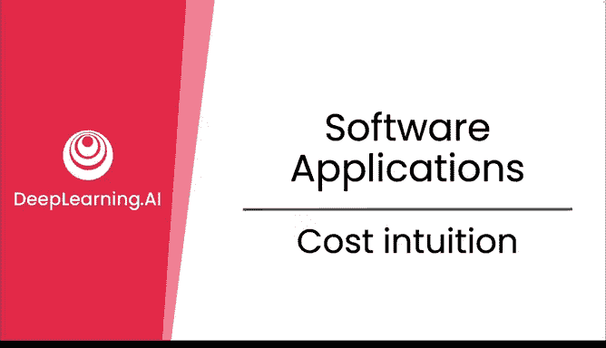
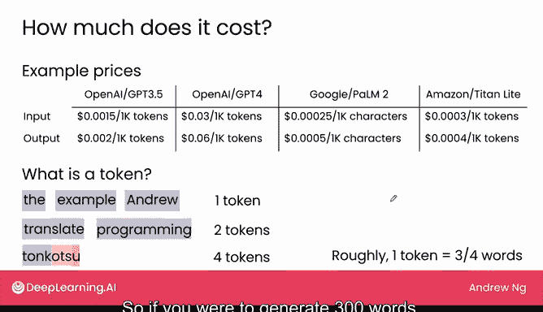
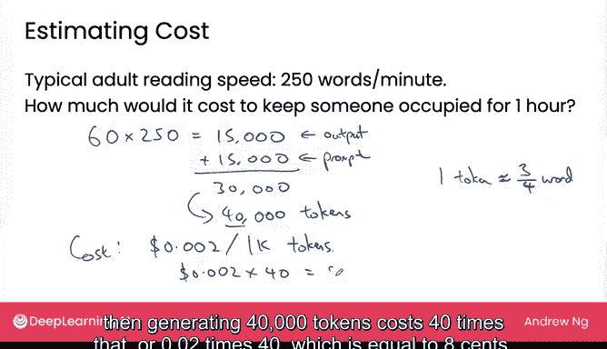

# 吴恩达最新《面向每个人的生成式AI》Generative AI for Everyone（中英字幕） - P14：14_02_04_成本直觉.zh_en - GPT中英字幕课程资源 - BV11G411X7nZ

In this video， Id like to walk through a you some quick examples that built intuition about how much using large language models in the software application actually cost。

 Let's take a look。 These are some example prices for prompting and getting responses from different large language models that' are available to developers。

 That is for if you call these large language models in your code。 So open Gp 3。5 charges0。

2 cents per 1000 tokens G4 costs quite a bit more 6 cents per000 tokens and Google's palm2 and Amazon's titan light are also pretty inexpensive。

 What I'm showing here are the costs of generating different numbers of tokens technically these large language models charge for the length of the prompt as well。

 but the length of the prompt， sometimes called the input is almost always cheaper than the cost of the output。

 So let's just focus on the cost of the output for now。 You may be wondering what is the token。

 It turns out。That a token is loosely either a word or a subpart of a word because that's how large language models process text。

 So common words like V or example would be counted as a single token when a large language model processes it or my name Andrew is a relatively common name and so that's also a single token but a less common words like translate might be split by large language model into two subparts of words Tra and Slate and so having it generate translate will cost you two output tokens unlike the more common words which would cost you only one token or programming turns out might be split by Lm into program and Ming and also cost two tokens and a less frequent word like To Kota might be split into four tokens with to and K and Ots and U。

 but average over large collections of text documents roughly each token。

ken is about three quarters of a word。 So if you were to generate。

300。Woras that would cost you about。400。Tokens， don't worry about it。

 if the math doesn't totally make sense。 but the intuition。

 I hope you take away from this is the number of tokens is loosely equal to the number of words。

 but a little bit bigger。 It turns out to be roughly 33% more than the number of words。

 And on the next slide， we'll do this calculation， assuming a cost of。2 cents per 1000 tokens。 But。

 of course， if you were to use different LM options， the cost may be higher or lower。

 So imagine that you building an OM application for your own team maybe to generate text as useful for them to read。

 Let's estimate how much it will cost to generate enough text to keep someone on your team occupied for an hour。

 So typical adult reading speed might be about 250 words per minute。

 So to keep someone occupied for an hour， you need to generate 60 times 250 words。Which is 15。

Thousand words that the Lm has output。But we need to prompt the Om as well to to generator this output。

 So we assume that the length of the prompts is comparable to the length of the output that might add another。

15，000 words。That is if we need to prompt it。In total for 15000 words worth of input。

 and then also generate 15000 words of output to keep someone occupied for an hour。 Of course。

 this is a very crude assumption， but probably good enough for the purposes of building intuition。

 So in total， we need to pay for。30000 words。 And as we saw on the previous slide。

 because each token corresponds to。Roughly。Three quarters。Of a word。30000 words corresponds to。

About 40000。Tokens， and if the cost is。2 cents per。1000 or  one k。Tokens。

 then generating 40000 tokens costs。40 times that 0。02 times 40。Which is equal to。

In sense。So if your software application uses a cloud hosted OM service by Open IO。

 Zero or Google or AWS or others， that's maybe8 cents to keep someone busy for an hour。

I know it made a lot of assumptions in this calculation， but this seems， decently inexpensive。

In the United States， minimum wage from many places is maybe around $10 to $15 an hour。

 so paying an additional 8 per hour of someone reading intensely seems like a small incremental cost。

 especially if it helps them be more productive。Of course。

 if you have a free product that a million users are using。

 then 8 cents times a million with no associated revenue can get expensive。

 but I find that for many applications using an LM turns out to be cheaper than most people think。

So I hope this gives some useful intuition for the cost of LMs let's go into the next video we'll learn about some more advanced technologies they can use to make your LMs even more powerful I'll see you in the next video。

