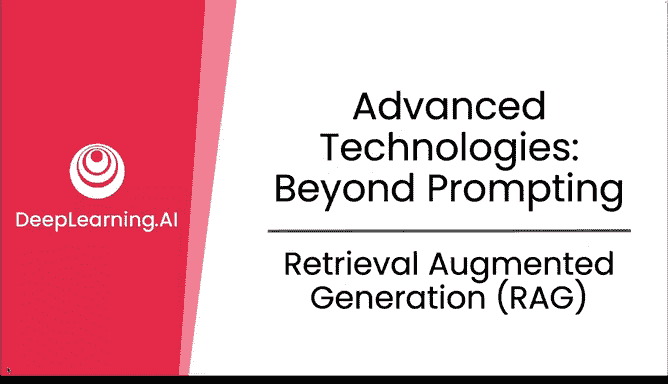
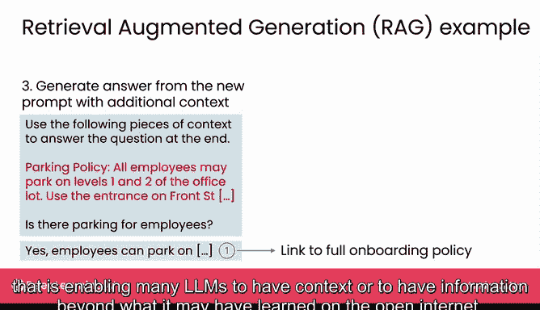
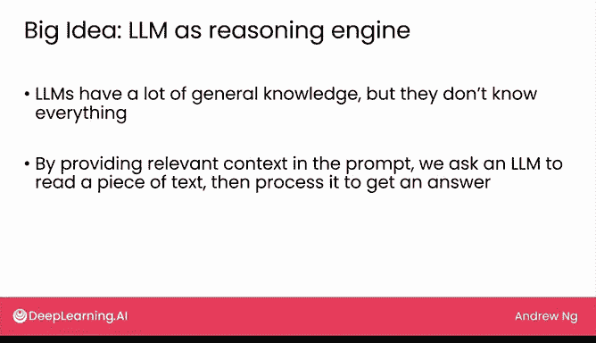

# 吴恩达最新《面向每个人的生成式AI》Generative AI for Everyone（中英字幕） - P15：15_02_01_检索增强生成.zh_en - GPT中英字幕课程资源 - BV11G411X7nZ

We've already seen that prompting a large language model can take you quite far。

 but there a technique called retrieval augmented generation or rag that can significantly expand what you can get anLM to do by giving it additional knowledge beyond what it may have learned from data on the internet or other open sources。

 Let's take a look。If you were to ask a general purpose chat system。

 such as one of the ones on the internet， a question like， is there parking for employees？

It might answer something like I need more specific information about your workplace because it doesn't know what is the parking policy for your company。

 but RaG or retrievettrival augmented generation will see is a technique that can give the LM additional information so that if you ask it if there's parking。

 it can refer to policies specific to your company， how does it work？Rag has three steps。

 step one is， given the question， is there parking for employees and first look through a collection of documents that may have the answer。

 For example， if your company has different documents on the benefits of its employees and the lead policy and some documents on the facilities and some documents on payroll processes。

 then the first step in the rag system would be to have a computer find out which if any of these documents is most relevant to this question and parking seems like a question about the facilities about the building that your team works in and so hopefully select out the facilities documents as most relevant。

 The second step is then to incorporate the retrieved documents or the retrieved text into an updated prompt So let me construct a prompt as follows I'm going to say use the following pieces of context on the question at the end and then I'm going to take the relevant text from my facilities documentation with the parking policy。

Employees may pop levels 1 and 2 and so on。 and put that into my prompt。

 So this is now pretty long prompt because it tries to give a lot of context for the LM。 Now。

 remember， last week， we had spoken about limitations to the prompt length or the input length for a large languageage model。

 That's why in practice， rather than dumping an entire very long document into the prompt。

 you might pull out just the part of the document that's most relevant to the question and put just that into the prompt。

And then finally， we add the original question is there parking for employees。

 So this is called retrieval augmented generation or RaG because we're going to generate an answer to this。

 but we're going to augment how we generate text by retrieving the relevant context or the relevant information and augmenting the prompt with that additional text。

 Having constructed this prompt the final step is to then prompt the L with this rich prompt and hopefully the L will then give us a thoughtful answer telling us about where we can park In some applications using rag in the output shown to the user。

 we would also add a link to the original source document that led to this answer being generated。

 So in this case， we might link to that facilities documentation so the user can if they wish。

 go back and read the original source document and doublecheck the answer for themselves。

 RaG retrievetrieval augmented generation is an important technique that is enabling many Lms。

To have context or to have information beyond what it may have learned on the open internet。

 Here are some examples of Rabased applications。 There are many companies today that are offering software that let you chat with a P file。

 For example， if you are reading a white paper。 but you maybe don't have time to read the entire thing carefully but have a question that you want to answered based on their white paper。

 There are many applications today like panda chatt ask your PDFf chatped and many。

 many others that let you upload your p file and then ask questions and they will use rag to try to generate answers for you。

 I find that some of these software packages work better and some work worse。

 So the results you get may vary。 but there' still been a lot of excitement and interest about building applications to let you chat with your PDF files。

 There are also more and more rag applications that will answer questions based on a websites articles。

 For example， Cora code。

Does multiple things， but one of the things it does is use RaG to try to answer questions based on content on the Coursera site itself。

 Snapchat also has a chatbot that uses text from Snap to try to answer different questions you might have about their products and Hubspot。

 which is a marketing automation company is another example of a company that has a chatbot that lets you pose questions and tries to generate answers for you based on content from the company from the website itself。

 So these types of chat are becoming an alternative way to let users get answers to questions that they may have about your company's offerings。

 Ra is also leading to new forms of web search。 Microsoft Bing has a chat capability。

 Google has a generative AI feature as well that can generate text in response to your queries and startupupyou。

 co which was actually started by。One of my former PhD students。

 Richard So is a web search engine that was built centered on a chat like interface。

 So Ra is used in many applications today and excitingly it seems to be transforming even web search to wrap up this video there's one big idea I like to share view which is to think of the Om not as a knowledge store。

 but instead as a reasoning engine Oms may have read a lot of text on the Internet。

 and so it's temping to think of them as knowing a lot of things。 and they kind of do。

 but they don't know everything with the rag approach we provide relevant context in the prompt itself and we ask the Om to read that piece of text and then to process it to get to the answer In other words。

 rather than counting on it to have memorizing a facts to get us the answer where instead using as a reasoning engine to process information and not as a source of information。

 and I find that this way of。

Thinking about LOMs as a reasoning engine rather than as a way to store and retrieve information can expand the set of applications that we might brainstorm and consider an OM to be capable of doing admittedly LM technologies early and it doesn't always do that well。

 that if an LM isn't just a database that stores a lot of information for you but it can process and reason through information。

 I think that is an exciting direction to think about where Oms might go from here even though I've talked mostly about Ra in the context of building software applications。

 this idea can also be useful if you're using a web user interface。

 sometimes I would take a piece of text and just copy it into the prompt of an online web UI of an LM and until it to use that context to generate an answer for me and that too can be an application of Ra。

Ive found that rag is useful for many different applications and I hope that you will too in the next video we'll talk about another technique called fine tuning。

 which is another way to expand what anel can do but before I wrap up let me just say I hope you enjoyed this video on rag and that you can really clean up with this rag stuff I'll see you in the next video。

