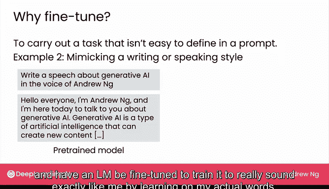
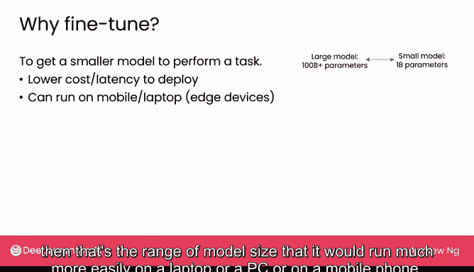

# 吴恩达最新《面向每个人的生成式AI》Generative AI for Everyone（中英字幕） - P16：16_02_02_微调.zh_en - GPT中英字幕课程资源 - BV11G411X7nZ

Whereas ragG gives you one way to give additional information to a large language model。

 there's another technique called fine tuning， which is another way to give it more information in particular。

 if you have context that is bigger to can fit into the input length or the input context window length of the Lm then fine tuning gives you another way to get an L to absorb this information and fine tuning also turns out to be useful for getting the Lm output text in a certain given style but this actual implementation is a bit harder than ragg Let's take a look Let's say you have an Lm trained the way that we had described previously with sentence found on the internet like my favorite food as a bagel or cream cheese then it may have learned from hundreds of billions of words or maybe more than a trillion words to predict the next word like this and Lm like this will have learned to generate text that sounds like what's on the internet and this process of training a large language model on a。

Lo of data is often called pretraining。 Now let's say I want to modify the LM to have a relentlessly positive and optimistic attitude about everything。

 There's a technique called fine tuning that we can use to cause theLM to do a little bit more learning to change its outputs to be in this example。

 much more positive and optimistic to fine tune the LM。

 we would come up with a set of sentences or a set of text that takes on a positive optimistic attitude such as what a wonderful chocolate click or the novel was thrilling。

 given text like this you can then create an additional data using what a wonderful chocolate cake you would have given what nextword it will try to predict a what a nextword is wonderful what a wonderful chocolate and so on。

And it turns out that if you take an LM that has been pretrained on hundreds of billions of words and fine tune it on just an additional。

 say 10，000 words or more could be 100000 words if you have more data or even a million words of even more data。

 fine tuning to this relatively modest size data can shift the output of your LM to take on this positive optimistic attitude Now maybe shifting an LM to a relentlessly positive attitude isn't that hopeful an application but fine tuning is used in many real applications。

 one class of applications that fine tuning is useful is when the task isn't easy to define in a prom。

For example。If you want to use an OM to summarize customer service calls。

 a generic OM may look at the call like this and summarize it to say the customer tells the agent about the problem with a monitor。

 but if you run a customer call center， you might want it to generate specifics about what the conversation was about。

 it was about the Mk4127 kx reported broken by customer 542 and so on。

 and if you create a data with maybe just hundreds of examples of human expert written summaries and have a large language model that's learned from hundreds of billions of words on the Internet so it' learned a lot of general knowledge on the Internet。

But if you additionally find unit on maybe just hundreds of。

Carefully handwritten summaries of the specific style。

 Then that would shift the Lm's ability to write summaries in the style that you want。

 And the specific style of summary is actually not that easy to define in a text prompt。

 Maybe you could do it， the fine tuning would just be a very precise way to tell the Lm what summaries you want。

 another example of when a task isn't easy to define an prompt is if you want to mimic a specific writing or speaking style。

 So Tommy Nelson， who's been working with me on this course。

 actually tried kind of just a fun to get an Lm to sound like me。

 But it turns out that the way most individualss sound is not that easy to describe in a prompt。

 I mean， how would you give someone clear instructions to sound like me。

 So if you were to prompt a general purpose Lm and ask it to sound like me， you get text like this。

 which I don't think。Sounds that much like me。 But if you were to take a lot of transcripts of the way I actually talk and have an Om be fine tuned to train it to really sound exactly like me by learning on my actual words。

 then asking it to write something that sounds like me results in text like this， which I don't know。

 this sounds more like how I would talk。 But because mimicking a specific writing or speaking style is very difficult to do by prompting because it just difficult to describe a specific persons style by writing text instructions。

 fine tuning turns out to be a more effective way to get an Om to speak in a certain style。

 And if you're building an artificial character， maybe a cartoon character。

 fine tuning could also be a way to get an Om to speak in a certain style other than task did not easy to define an a prompt。

 a second broad cause of application to fine tuning is to hope them gain a。

Mean of knowledge。 for example， if you want an LM to build a read and process medical nose。

 This is what a medical note written about a patient by a doctor might look like and this is really not normal English P is patient CO complaining of SoOB shouldersness of breath。

 DE dysne on exertion P this is the result that the physical examination and so on。

 treatment is to follow up with the primary care physician stat Chess ray containing treatment as needed on oxygen。

 but this is really not normal English。 and if you were to take an LM trained on normal English。

 it wouldn't be very good at processing text like this。

 So if you were to fine tune know LM on a collection of medical records。

 Den the LM could get much better at absorbing this body of knowledge about what medical notes sound like and you could then use that to build other applications on top of it。

To better understand medical records。Or legal documents。

 here's a piece of legalese kind of written by lawyers for lawyers that's really difficult for non lawyeraws to re license a grant to licensee。

 perception section 2A3 and nonexusive rights and so on and so on， within 15 days hereof。

I don't know about you， I do not use the wordheof in my ordinary day to day speech。

 but this is what legal documents sound like and if you want your LM to gain a body of knowledge about how to read and understand legal documents。

Then taking an LM and fine tuning it to legal documents would help it to gain that body of knowledge and similarly。

 financial documents too fine tuning an LOM on a large set of financial documents would help it to better gain that body of knowledge about finance。

And make it better at applications involving processing documents that look like this。Finally。

 another reason to find tune than OM is to get a smaller model to perform a task that may previously have required a larger model。

 Well'll discuss later this week， some of the pros and cons of choosing a larger versus a smaller model。

 but for some OM applications that need a lot of knowledge or need complex reasoning。

 you might use a relatively large model， say with over 100 billion parameters。

 but if we were to use a model like that， such a model may have relatively high latency。

 meaning after you prompted， you might need to wait a while to get back a response and if you were deploying this on your own computers it could be quite costly and even though we said in an earlier video that these models aren't that expensive may be wanted to be even cheaper and that's because a 00 billion parameter model may take specialized computers such as a GPU server or other really。

Fast computers to run。 You probably have a hard time running such a large model on a normal laptop or PC and certainly not on a smartphone today。

 But if you can get your application to work on a much smaller model， say 1 billion parameters。

 then that's the range of model size that they would run much more easily on a laptop or a PC or on a mobile phone。

 So， for example， if what you want is to classify restaurant reviews as positive or negative sentiment。

 This is a simple enough task that you probably don't need 100 or 200 billion parameter model to run。

 but maybe a 1 billion parameter model would be just fine， maybe even smaller frankly。

But these smaller models aren't as smart or they aren't as good as the really large models。

Which is why if you were to take a small model and then fine tune it on a data set like the one shown here。

Not just three examples， but maybe a few hundred or maybe a thousand examples if you have damaged data。

 then you can get a small model， say a billion parameters to do really well on a task like this。

So to summarize， fine tuning gives you another technique in addition to RAG to help improve the capabilities of an LM。

 you might use it for tasks that are hard to specify in a prompt such as if you wanted to output text in a certain style。

 or if you want the LM to gain a body of knowledge such as about medical notes。

 or if you want to get a smaller and cheaper to run LM to do a task that might otherwise have required a larger LOM。

It turns out that rag and fine tuning are both relatively cheap to implement RaG just is modifications of your prompt。

And fine tuning， you might really get started with tens of dollars or maybe low hundreds of dollars。

 depending on how much data you want to fine tune on。There's another technique。

 pretrain your own model that turns out to be very expensive。 and today。

 almost no one other than reasonably large companies， usually tech companies are attempting this。

 but for completeness， let's take a look at the next video at what pretrain involves。

