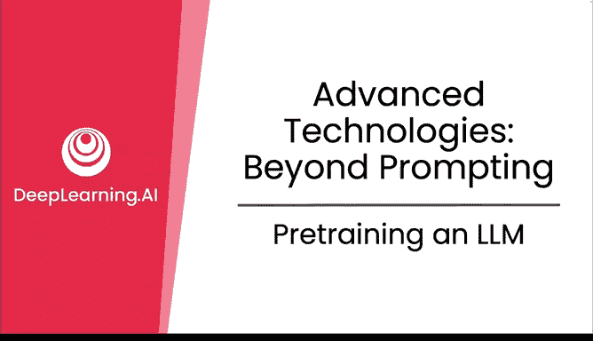
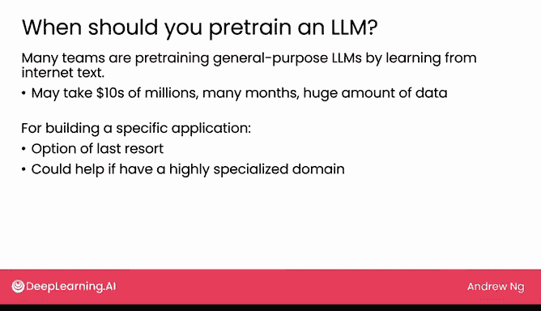

# 吴恩达最新《面向每个人的生成式AI》Generative AI for Everyone（中英字幕） - P17：17_02_03_大语言模型预训练.zh_en - GPT中英字幕课程资源 - BV11G411X7nZ

Many of the Ls we've been using have been previously trained， or we say pretrained by some company。

 often by a big tech company。When should you pretrain your own model。

 this turns out to be so expensive that when in doubt I would say probably don't do it。

 but let's take a deeper look。Many teams have been pretraining general purpose elementss by learning from text on the internet。

 These efforts to train very large language models may cost tens of millions of dollars need a large dedicated engineering team take many months and a huge amount of data。

 Many teams have been opensourcing such models and that's been a fantastic contribution to the AI community。

 if you have the resources to pretrain models and maybe even open source them。

 please by all means make that contribution into AI。 I think that could be fantastic。

 but for building a specific application， given the time and expense of pretraining a model from scratch。

 I think of this as often an option of lost resort。

 It could help if you have a highly specialized domain and a lot of data。 for example。

 Bloomberg is a company that offers software as well as media articles centered around financial services。

 because of its access to a huge amount of。

Texets on finance， it trained Bloomberg GT， which is Bloomberg's custombuilt large language model。

 purposepobut for financial applications and Bloomberg reported that compared to general purpose OMs that had learned mainly from internet data。

 this model does quite a bit better on processing financial text for many practical applications unless you have a huge amount of resources and a huge amount of data。

 it may be more practical to start with an OM that someone else had pretrained。

 say a general purpose Om that's learned from a lot of internet data and that someone has open source and then to fine-t that to your own data and that will often give pretty decent performance but in a much more economic way Now I am sincerely very grateful to the teams that have been putting a lot of resources into pre-training OMs on a lot of text data on the internet and then opensourcing them。

In fact， this gives us many different poems that we could choose from to use。

In the next video we'll actually take a look at the issue of what size of do you want to use and of all the different os out there。

 how do you think about choosing among different ones let's go take a look at that in the next video。

