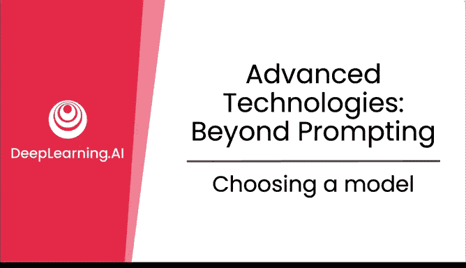
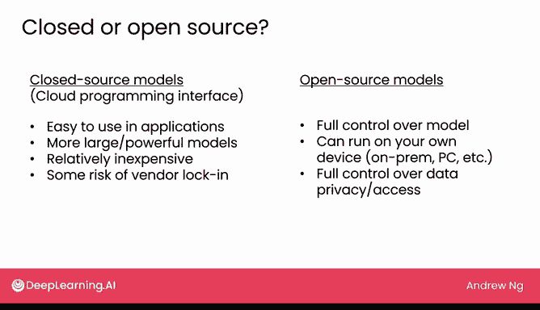

# 吴恩达最新《面向每个人的生成式AI》Generative AI for Everyone（中英字幕） - P18：18_02_04_模型选择.zh_en - GPT中英字幕课程资源 - BV11G411X7nZ

When using an LM to build a software applications， you find that there are a lot of different LMs out there。

 some big ones， some small ones， some open source， somequill So。

 how do you choose from all of these different options in this video let's take a look at some guidelines。

One way to estimate how capable an Lm is is to look at the model size。 loosely。

 if we look at models that are say in the 1 billion parameter range。

 will find that they're often good at pattern matching and would have some basic knowledge of the world。

 So if what you want is to classify restaurant reviews for sentiment I think a 1 billion parameter model would probably be able to do just fine in terms of that type of pattern matching with basic knowledge about food types of words。

 as you go to a 10 billion parameter model， you find that the models have greater world knowledge。

 They just know more esoteric facts about the world。

 and the models also get better at following basic instructions。

 So if you want to build a food order chatbot a 10 billion parameter model might be okay especially if you were to find unit to become better at the types of specific instructions you want to follow。

Then the very large models， say 100 billion plus parameters will tend to have very rich world knowledge。

 They'll know a lot of things about physics and philosophy and history and science and so on。

 and they'll be better as well at complex reasoning This is why if you're building a food order chatbot。

 maybe you don't need the chatbot to know so much about history and philosophy and all of these other things under the sun。

 some of these models might be cheap enough to deploy that it might be okay to use a huge model。

 even for a food order chatbot， but where I would definitely tend to use these larger models would be tasks that involve deep knowledge or complex reasoning。

 So for example， if I'm looking for brainstorming partner to help me think through ideas I'll often use one of the larger models one of the things you've heard me say earlier though is that development using Lms is often a highly empirical meaning experiments。

So it's hard to know in advance exactly what the performance of a given LM will be and while I'm sharing some general guidelines here in practice。

 it might be worth just trying a few different models and testing them and based on the results you see from testing a few options。

 then pick what actually seems to work best for your application。

Another decision you might have to make is whether they use a closed source or an open source model。

 Close source models are usually accessible via cloudud programming interface。

 and I find that many of them are pretty easy to build into applications。

 You just have to write a few lines of code like we saw earlier this week to incorporate them into a software applications。

 Many of the largest and most powerful models today are also available only viacloud programming interfaces and a closed source models。

 and they also relatively inexpensive to run because the large companies hosting these models will often put a lot of work into serving up these API calls inexpensively。

 a downside is that if you develop using these closed source models。

 there is some risk of vendor lockin today， the switching cost from 1 Lm to a different one is not very high。

 but there is some cost to retesting all your promises。SeeIf they work on a different element。

 if you do switch vendors in comparison， there are also many open source models that are available now。

 One advantage youre using an open source model is you have full control over the model。 You know。

 you always have access to that model and don't have to worry about one of the company providing it where to retire or deprecate the model that you have built on top of。

You can also often run these models on your own device。

 So you want to run it on premises or onprem that is on your own service or on a PC or a laptop or mobile device。

 then open source models may give you a good startinging point to do that and using open source model but also let you build an application in a way that retains full control over data privacy and data access。

 For example， I was recently working on an application using electronic health records。

 And because a patient privacy， we just could not upload the patient records to a cloud provider And so for that project。

 my team using an open source model that we ran on our own computers because we had to do that to guarantee privacy of the patient data。

 So to summarize this week， we talked about software applications built using Os we sold a lifecycle of Gen AI project as well as techniques like rag and fine tuing that can make you。

'm more capable and lastly in this video we talked about how to choose an appropriate model to build on。

There are also a couple of optional videos after this one。

 one that goes a bit deeper into the technology that enables OMs to not just predict the next word found on the internet。

 but actually follow your instructions and do so in a safe way。

And the other optional video talks about some frontier cutting edge technology that can use OMs to automatically decide what to do and also use tools along the way。

So please feel free to check out those videos if you wish。

 and then in the next and final week of this course。

 we'll take a look at how LM technology is affecting businesses and society。For example。

 how can you identify own use cases that could be useful for your company？

We'll take a look at next week as well at a systematic way to understand why jobs are more or less affected by Gen AI and how both the individuals doing the jobs。

 as well as businesses， employing people doing those jobs may navigate the changes that geneative AI is bringing to work。

 I look forward to seeing you next week。