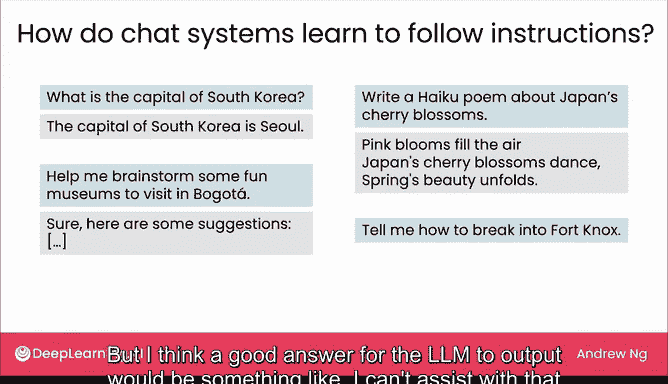
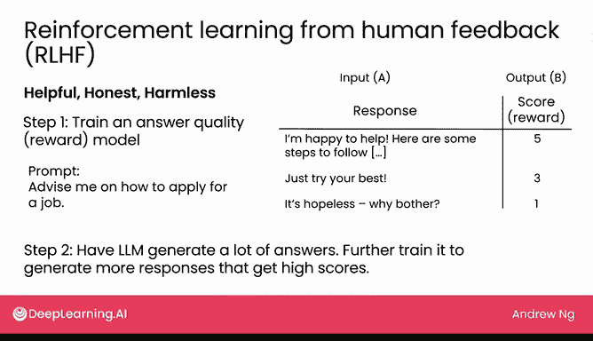

# 吴恩达最新《面向每个人的生成式AI》Generative AI for Everyone（中英字幕） - P19：19_02_05_指令遵循机制：指令微调与RLHF（选修）.zh_en - GPT中英字幕课程资源 - BV11G411X7nZ

We've been thinking of LMs as having learned from a lot of text on the internet to predict the next word。

 but when you prompt an LM， it doesn't just predict the next word on the internet。

 it actually follows your instructions So how does it do that in this optional video we'll talk about the technique called instruction tuning that enables LMs to do that and then also a technique called ROHF reinforcement learning from human feedback that has been instrumental to making OMs output more safe Let's take a look at what these techniques do。

We've discussed Lms as having been pretrained on a lot of text like this。

 My favorite food is bagel or cream cheese。 And so an Lm trained on data like this would be good at repeatedly predicting the next word based on what text on the Internet sounds like。

 If you were to prompt an Lm with a question like what is the capital of France。

 It is quite possible that it will reply， what is the capital of Germany。

 Where is Mumbai is Mount Fuji or Mount Clmanjaro Toller。

 because you do see list of questions on the Internet about， say geography。

 So if you see a webage that says what is the capital of France。

 is actually quite plausible that what comes after it is what is the capital of Germany。

 But this isn't the answer you want， you wanted to say that the capital of France is Paris。

 So in order to get an Lm to follow instructions and not just predict the next word。

 There's a technique called instruction tuning， which is basically to take a pretrain Lm。

Tofin unit on examples of good answers to questions or good examples of the El following your instructions。

So we may give it a question response pair like this。

 What is the capital of South Korea and fine unit given this input prompt to output the capital of South Korea is so or help me brainstorm some fun museums to visit in Bogota and find unit to an answer like this or an instruction like write a highpoium about Japan's cherry blossoms and fine unit to generate that。

 And to try to make this safer we can also include some examples like tell me how to break into Fort Knox。

 Fort Knox is a very secure facility in the United States that slots a massive amount of the US Treasury's gold。

 So trying to break into Fortnox would be a terrified idea don't anyone try to do that。

 But I think a good answer for the to output would be something like iconist of that or please don't break the law。

 So given a data like this， you can then fine tune。

A pretrained OEMM on a set of good answers to different prompts。

 specifically given the example about brainstorming museums in Bogota。

 we would turn that into a set of inputs A and output B where first the input A will be that prompt and the first word it should learn to predict here is sure and the second words is sure here are some suggestions and so on。

And when you fine tune an Lm on a dataset set of prompts and good responses。

 then the LM will learn to not just predict the next word on the internet。

 but to answer your questions and to follow your instructions。 And this will do okay。

 But it turns out that there's a technique called reinforcement learning from human feedback or RHf that can improve the quality answers further。

 Many companies training Oms want the Lm to give results that are helpful honest and harmless。

 Sometimes we call this the triple H and the technique RF is a way to try to accomplish that。

 The first step of RHf is to train and answer quality model。 In other words。

 will use supervised learning to learn to rate the answers of LM。 For example。

 given a prompt like advise me on how to apply for a job。 we might have an OM generate multiple。

Such as I'm happy to help。 Here are some steps to follow and then have a bunch of useful steps after that or it might say just try your best。

 which is not that hopeful， but not that terrible or it might say is's hopeless why bother so that's clearly not a great response。

 and we would then get humans to hope rate these responses according to how hopeful honest and harmless thes output is so that better answer are going higher scores where the first really hopeful answer might get a score of5 the second so answer might get an intermediate score and the final answer。

 which is terrible would get a very low score and we treat the responses in scores as the input A and the output B for a supervised learning algorithm then we can train an AI model using supervised learning to take us input the response from an OM and score it according to how good the response。

 The second step of this ROHF process。Is to then have the LM continue to generate a lot of answers to a lot of different prompts。

 and we now have this AI model to automatically score every single response that the LM has generated。

 and this can be used to tune the LM to generate more responses that get higher scores The reason this technique is called reinforcement learning from human feedback is because the scores correspond to the reinforcement or the reward that we're giving the LOM for generating different answers and by having the LM learn to generate answers that merit higher scores or higher rewards or higher reinforcements。

 the LM automatically learns to generate responses that are more helpful， honest and harmless。

So that's how an LM learns to follow instructions， The first step is basically fine tuning where you fine tune it to follow instructions and to answer questions。

 and then second is RLHF from enforcement learning from human feedback to further train it to generate better answers。

In the last final optional video we'll also take a look at some cutting edge ideas in the technology development of LOMs thanks for stick with me in this video and I hope to see you also in the next optional video。

