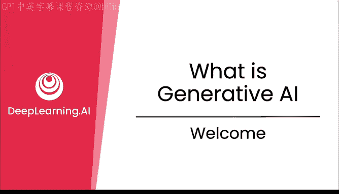
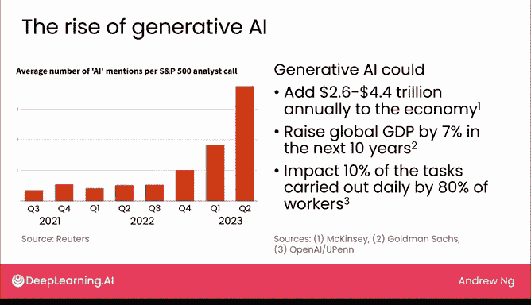
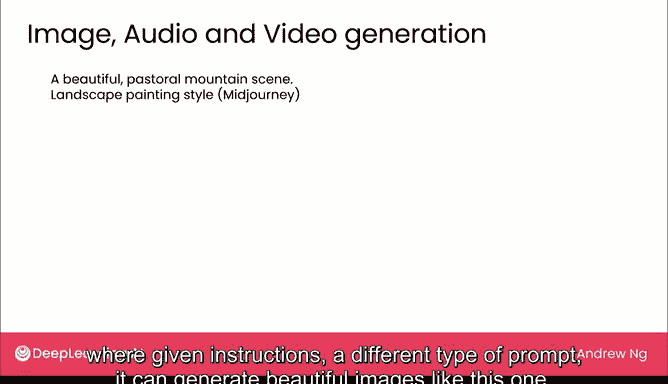
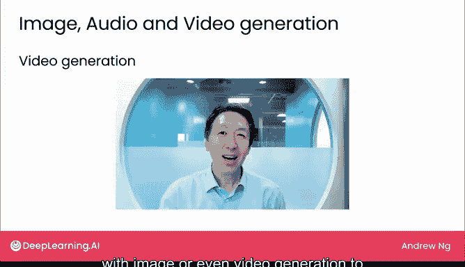
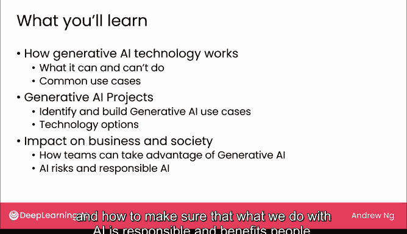

# 吴恩达最新《面向每个人的生成式AI》Generative AI for Everyone（中英字幕） - P1：01_01_01_欢迎.zh_en - GPT中英字幕课程资源 - BV11G411X7nZ

Welcome to Geneative AI for everyone Since the release of CGBT， AI， specifically Generative AI。

 has caught the attention of many individuals， corporations and governments。

It is a very deive technology that's already changing how many people learn and work。

Many developers think that Genative AI will empower many people and lead to productivity gains and also make a significant contribution to global economic growth。

 but they could be downsized as well， such as job boss or worse that some people worry about In this course you learn what generative AI is what it can and cannot do and also how to use it in your own work or business。

Because Gen AI is so new， there is still a lot of misinformation out there and so in this course I hope to convey an accurate nontechnical understanding of what it really is and also work of you to think through how you can best make use of this technology。

This course does not assume any technical or AI background and is designed to be useful to anyone in business。

 science， engineering the humanities， us or other sectors。

 so that let's dive in Gen AI had caught the mainstream attention starting around November 2022 when OpenAI release ChGT and this momentum has continued unabated according to McKiney。

 it could add 2。6 to $4。4 trillion US dollars annually to the economy Gold Sachs estimates it could raise global GDP by 7% in the next decade。

 and a study by OpenAI and UP。Esma is that it could impact 10% of the work or tasks carried out daily by over 80% of workers in the United States The same study also estimates that there is a 20% of workers whose work or tasks is more than 50% impacted by generative AI and so studies like these lead to hopes for tremendous productivity gain as well as worries about job loss through automation What is generative AI this term refers to AI or artificial intelligence systems that can produce high qualityality content specifically text images and audio one of the best known generative AI or Gen AI systems is Open eyes ChGBT which can follow instructions to carry out tasks like write three captions for social media posts about our new line of sunglasses for robots and have a gene variety of creative outputs。

Many users are familiar with websites or direct to consumer applications that can generate text like this。

Other examples include Bot， which is offered by Google， as well as Bingchat offered by Microsoft。

But there are now many companies that are offering user interfaces that let you type in some text called a prompt and would generate a response。

But beyond these consumer applications。There's one other application of generative AI that I think may turn out to be even more impactful in the long term。

 which is the use of Genative AI as a developer tool AI is already pervasive in our lives。

 and many of us use it dozens of times a day or more without even thinking about it。

 Every time you do a web search on Google or Bing， that's AI。Every time you use your credit card。

 there's probably an AI checking if it really is you using your credit card or every time you go to a website like Amazon or Netflix and it recommends products or movies to you that's AI but many AI systems have been complex and expensive to build and Gen AI is making many AI applications much easier to build and this means that the number and variety of AI product offerings is blossoming because it's becoming much cheaper to build certain AI applications compared to before so in this course one of the themes we touch on a few times as well will be how Gen AI may allow your business to much more inexpensively built very valuable AI applications and you learn best practices for identifying and exploring whether or not such applications might be useful for a given business。

After described Gen of AI as generating text images and audio and of these me types of content。

 the biggest impact so far has been on text generation。

 but it can also generate images where given instructions a different type of prompt it can generate beautiful images like this one or even a photoreistic image like this Gen AI can also generate audio。

 for example， here is a voice clone of me Hi I'm an AI generated voice clone of Andrew Andrew Neashhi said these words In't that go and you can also put audio together with image or even video generation to create a video clone of me like this Hi Im a video clone of Andrew is nice to meet you。

So there's a lot going on in Genative AI， and this is an exciting and disruptive technology that I'm confident you will find useful in your work in this course during the first week。

We'll go through how gen AI technology actually works。

And specifically what it can and cannot do and you also see a variety of common use cases that I hope will help spark your creativity to how you may use it to create value in your life on your work in the second week we'll discuss generative AI projects specifically how to identify useful generative AI applications as well as best practices for how to go about building well and will take a deeper dive into the range of technology options for building a variety of valuable projects in the final week we will zoom out beyond a single projects。

To look at how generative AI will impact businesses as well as society at large。

 well look at some best practices for how teams or a company can take advantage of geneative AI and also take a look at AI risks and how to make sure that what we do with AI is responsible and benefits people I'm excited to dive into this material with you and so of that let's go on to the next video where we'll go through a nontechnical description of how Genative AI technology actually works I'll see you in the next video。

