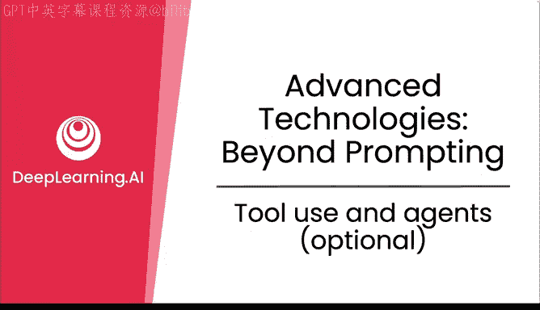
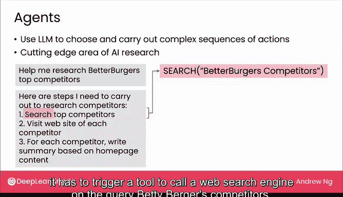

# 吴恩达最新《面向每个人的生成式AI》Generative AI for Everyone（中英字幕） - P20：20_02_06_工具使用与智能体（选修）.zh_en - GPT中英字幕课程资源 - BV11G411X7nZ

Welcome to the final video of this week。 I'd like to share with you in this video how Lms are starting to use tools and then also discuss a cutting edge topic of agents。

 which is where we let Oms try to decide for themselves what action they want to take next。

 Let's take a look In the early example of a food order taking chatbot。

 We saw that if you were to say semi your burger， the bot may reply。 O is on the way。

 in order for a chatbot to enter the order and send it to you。

 This is what actually is happening behind the scenes。

 The Lm can't just say okay is on this way because it needs to take some action to actually send the burger to you。

😊，And so an L M might output this response order burger for user 9，8。

76 to send to this address and then also say the user message is to say， okay is on its way。

 an L M that has been fine tuneuned to output text like this， will be able to generate an order。

 which in this case， we trigger a software application that passes the restaurant ordering system。

 A request to deliver a burger to this user at that address。

 And what is shown to the user is not the full output。

 The full output is all four lines of text here， but only the final line。 O is on its way。

 is whats gets sent to the user as a response。 So this is an example of to use by anm where the text L M outputs can trigger calling a software system to place a restaurant order。

 Now placing。An incorrect order can be a costly mistake。

 so perhaps a better user interface would be before finalizing the order to pop up a verification dialogue to let the user confirm yes or no if you've got the order right before charging the credit card and sending it to them。

And clearly， given that Lm's outputs are not completely reliable for any safety。

 critical or mission critical action， it would be a good idea to let a user confirm that that's the right action before letting the LM trigger some potentially costly mistake by itself。

 In addition to tools for taking actions， tools can also be used for reasoning。😊，For example。

 if you were to prompt an LOM， how much would I have after eight years of a deposit $100 in the bank account that pays 5% interest？

An LM might generate an answer like this， which sounds plausible， but the number $147。

4 is not actually the right answer。 It turns out Lms having learned to predict the next words or maybe even instruction tuned are not great at precise math。

 And just as you or I might use a calculator to calculate the right answer to a problem like this。

 you can also give the Lm a calculator2 to help it get the right answer。

 So rather than having the LM output the answer directly。

 if the Lm were to output this after compounding and so on， you would have calculator 100 times 1。

05 that's 5% interest rate compounded to the power of8。

This can be interpret as command to call an external cculator program to explicitly compute the right answer。

 which turns out to be $14774 and plug that back into the text to give the user the correct dollar figure So by giving OMs the ability to call tools in its output we can significantlyly extend the reasoning or the actiontaking capabilities of LMs2 used today is an important part of many OM applications and of course。

 designers of these applications should be careful to make sure that tools aren't triggered in a way that causes harm or causes irreversible damage going beyond tools into more experimental area。

 AI researchers have an examining agents which go beyond triggering a tool to carry a single action but is exploring whether OMs can choose and carry out complex sequences。

Of actions。There's a lot of excitement and research on agents。

 but this is that the cutting edge of AI research is not yet mature enough to count on for most important applications。

 but I want to share with you what many in the AI community are excited about。

If you would ask an agent that's built on top of an Lm， help me research Bburg's top competitors。

 then an agent might use an Lm as a reasoning engine to figure out whether are the steps it needs to carry out to do your task of researching Beburg's competitors and this reasoning engine the Lm might decide it needs to search for the list of the top competitors。

 then visit the website of each competitor and finally for each competitor write a summary based on the homepage content。

 and then perhaps by making a sequence of calls to this reasoning engine。

 it may figure out that to search the top competitors。

 it has to trigger a tool to call web search engine on the query Beburg's competitors。

 and then after that， it may visit the websites of some of the top competitors to download their homep pages and then additionally call an LM yet again to summarize the text that they found on the website on the internet that been some。

Nice demos of agents， but this technology is not really ready for prime time yet。

 but perhaps in the future， as researchers make it better and better it become more useful。

 and I think that would be an exciting future if Lms as a reasoning engine can help decide what the sequence of steps to take safely and responsibly of course to help a user carry out the task。

Thank you and congrats on making it to the very end of week two we have just one more week to go in discourse Next week we'll look at how Gen AI is affecting companies including how you might be able to come up with Gen VI use cases for your business。

As well as look at how Gen VI is affecting society and its impact on jobs。

 I look forward to seeing you next week。