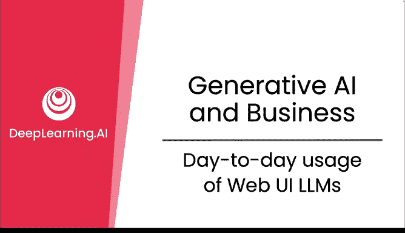
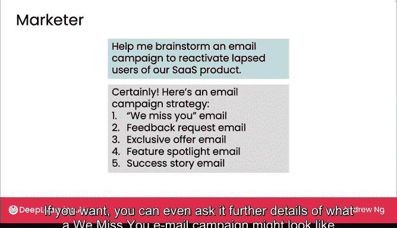
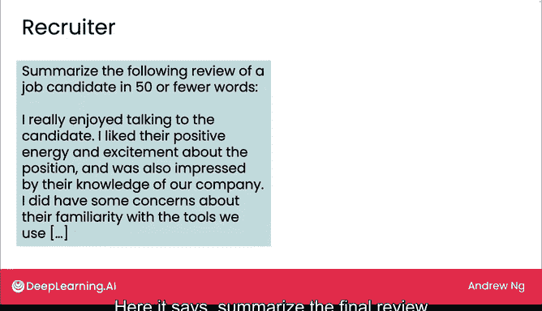
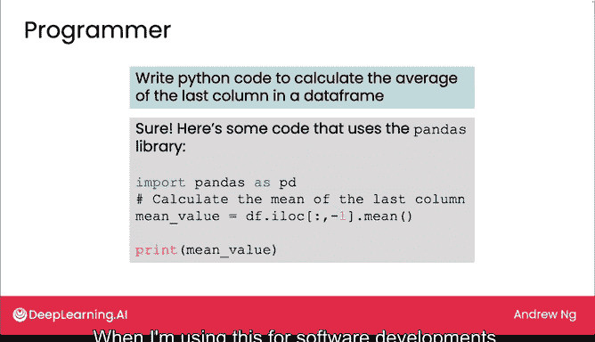

# 吴恩达最新《面向每个人的生成式AI》Generative AI for Everyone（中英字幕） - P21：21_03_01_网页界面大语言模型日常使用.zh_en - GPT中英字幕课程资源 - BV11G411X7nZ

Welcome back this week we'll start by taking a look at the role of Jarative AI in business and then after that at its impact on society。

 for example， its impact on jobs。We'll start by looking at how people in many different job roles can already use the web user interfaces to access Gen AI in their day to day work。

After that， we'll take a look at a systematic framework for analyzing a business to identify opportunities to use Gen VI to augment or to automate different tasks in the business。

 maybe in your business and to identify where building or buying an OM based software application might add value。

 Let's dive in。😊，As you've seen previously an OM can be a pretty good writing assistant or copy editor。

 So if you ask it to rewrite a piece of text to be suitable for a professional business report。

 it'll often do a pretty good job。 I use it pretty often myself for this purpose。

 although I will doublecheck its outputs before using it in my own writing and because Gen AI is a general purpose technology。

 I'm seeing also that is used by many different people in many different job roles。 For example。

 marketers are using it to help brainstorm ideas。 if you ask it help me brainstorm an email campaign to reactivate last users then it might come up with ideas for email campaigns like this。

 and if you want you can even ask it further details of what a we miss you email campaign might look like and so on。

Or if you're a recruiter， I'm seeing recruiters use LMs to summarize reviews。

 so here it says summarizemar the final review of a job candidate in 50 or fewer words and it does usually a pretty decent job。

 although again。

I would recommend double checking a summary before using and fully relying on it。

 but LMs are pretty good at summarizing text and for programmers or software engineers as well。

 Lms turn out to sometimes be hopeful at writing an initial draft of some types of code。

 So Python code to calculate something fairly technical， and in this case。

 the Lm generates a correct piece of code。 But once again， it actually often generates buggycode。

 And so when I'm using this for software developments， I will often end up having a fix it。

 but it's hopeful to get a programmer started on a task。

 So people doing many different types of job roles are already finding OMs useful in their dayto day work。

 I find myself often using an Om as a thought pond to help me think things through。

 And I hope that you too will find it useful in your dayto day work。

And when you look across an organization， what are the most valuable opportunities for using Gen VI technology or for even trying to build or buy software applications built using LMs in the next video。

 we'll start to take a look at the framework of looking at jobs and tasks done by an organization to try to identify such opportunities let's take a look at that in the next video。

