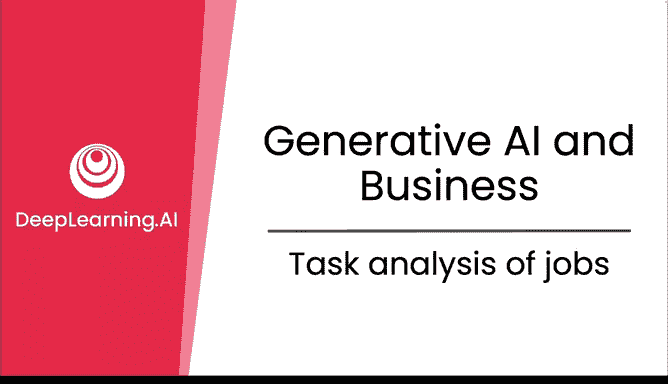
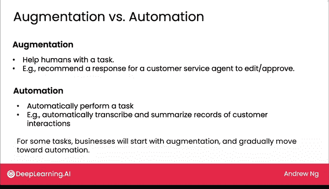
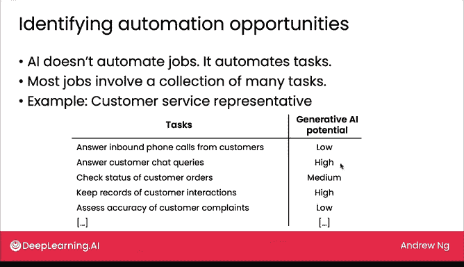
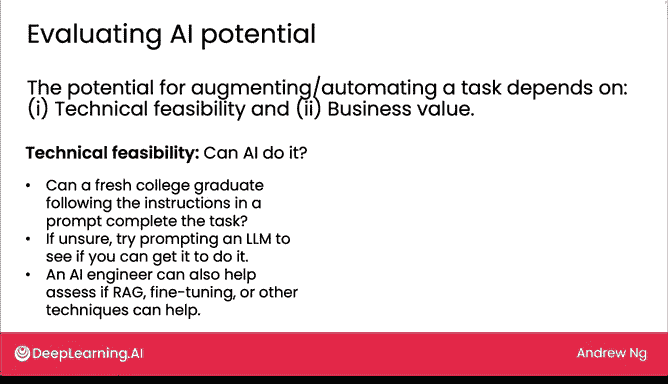
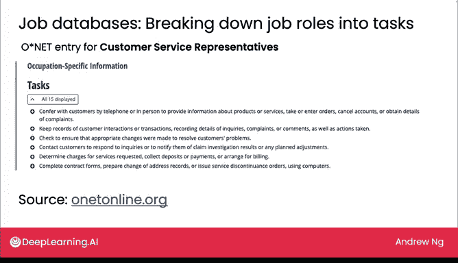

# 吴恩达最新《面向每个人的生成式AI》Generative AI for Everyone（中英字幕） - P22：22_03_02_工作任务分析.zh_en - GPT中英字幕课程资源 - BV11G411X7nZ

Many businesses think of a large or a small company， say。

 have many people doing many different tasks。There's a framework that had originated in economics due to Eric Brennosson。

 Tom Mitchell and Daniel Rock for analyzing the work task for possible automation using AI。

And the string work turns out to be useful， not just for economists to understand the financial or economic impact of AI。

 but also for businesses identify specific opportunities to use generative AI。

 Let's take a look at how to do this。Whereas there's been a lot of discussion， for example。

 in the media about will AI automate jobs， it turns out that from a technical and business perspective。

 it's more useful to think of AI， not as automating jobs， but as automating tasks。

 And it turns out most jobs involve a collection of many tasks。 Let's look an example。

 a customer service representative will do a number of different tasks。

 including maybe answer inbound phone calls from customers。

 answer customer chat queries via text rather than a voice or phone interface。

 they may check status of customer orders， key records and directions and assess the accuracy of customer complaints。

 And if you work in a company with say many customer service representatives。

 the first step to analyzing the potential for using gender AI would be to understand for your business。

 what are the tasks that the representatives in your company do After that we can then take a look at these different tasks and。

Try to assess their potential for Gen AI to either hope or augment or to automate these tasks。

 For example， for Gen AI to pick up the phone and have a long conversation。

 that's still pretty difficult。 So when you assess that to be a lower potential opportunity。

 but answering text chat with customers that might have a higher potential。

 maybe checking status of customer orders is medium。

 whereas keeping records of customer interactions could be high and assessing accuracy of customer complaints may be low。

 All of these examples in the right most column are hypothetical and the actual impact on your business will be different and would depend on the specifics of your business。

 But after an analysis like this and go in a little bit into the specifics of how the carry analysis。

 you might then decide that answering customer chat queries and keeping records of customer interactions have the highest potential and therefore focus your efforts on those two tasks now。

The opportunity for Gen AI could be either augmentation or automation by augmentation。

 I mean we can use AI to help a human withital in the customer service representative context。

 we might have Gen AI recommend a response for a customer service agent to edit or approve but not fully automate the sending of a message back to the customer so if we're not sure yet if the Gen AI would give good answers。

 then recommending a response could speed up the people doing the work but not fully automated and this would be an example of augmentation and automation would be if we have an AI system fully automatically perform a task so if we were to auto trascribe and summarize records of customer interactions that could be an example of automation what I see in many applications is that businesses will sometimes start with augmentation to maybe let the human double check or finalize the output before this use but then。

As you gain trusting gain confidence in the output of the Gen AI。

 then the user interface can be adapted to make the process more and more efficient for humans and to then gradually shift to a higher and higher degrees of augmentation and perhaps eventually to full automation Now given a list of tasks like this。

 how do you come up with this column on the right How do you evaluate the different tasks for Gen AI potential。

The potential for augmenting or automating a task depends mostly on two things。

 technical feasibility and business value。 So technical feasibility refers to can AI do it and also how costly is it to build an AI system to do it and with regard to using an LM Ive found the framework we discussed last week of asking can a fresh college graduate following the instructions in the prompt complete the task that could give you a first guess and imperfect not necessarily fully accurate guess。

 but it gives you a way to think about whether a certain task may be doable or not and sometimes if you're not sure if an LM can do a certain task。

 I would encourage you to try prompting an LM to see if you can get the OM to do that task and this would be an experiment that you might be able to do quite quickly so long as you're not revealing confidential information if you take some prompts for say answering。

Cha queries and paste them into a large language model。

 you can maybe quickly get a sense of how good ouris responses is and this could help you relatively quickly assess technical feasibility of using geneative AI for good tasks and an AI engineer can also help you assess if more advanced technique like Ra retrieve augmented generation fine tuning or other techniques can help and also give you a sense of perhaps the complexity and therefore the cost of building an AI system to tackle a certain task in this course focusing mainly on technical feasibility using Genative AI technology if you or your team is familiar with other AI tools such as supervised learning you can also assess the technical feasibility of using other tools as well for augmenting or automating different tasks other than technical feasibility the second criteria are urge you to think through is the。

So how valuable is it to use AI to either augment or automate a particular task？

And so the questions I would ask to frame up my thinking on business value would be things like how much time is spent on this task so how much time savings can we actually realize Second。

 I'd also ask does doing this task significantlyly faster。

 cheaper or more consistently using AI create substantial value？

While it may seem like orientation and automation helps lead to cost savings。

 we'll see later this week as well that when you automate a task。

 sometimes the benefits are much greater than just cost savings because it also lead to rethinking the workflow around that task。

 but if what I'm saying doesn't make sense yet， don't worry about it。

 we'll see some specific examples of this later this week。

Before wrap up this video there's one more resource I want to share that may be useful for your analysis of how to break job rows down into tasks。

 which is that there are online occupation databases that you can look up to see whether the tasks that comprise a certain row here's a screenshot from a website called ONe which is a US government funded website that for the customer service representative row this lots of different tasks including con of customers by telephone or a person key records of customer interactions and so on I found that occupation databases like this tend to be general and not necessarily specific to your company and so I wouldn't recommend just using the results from say this ONe database and assume it's accurate for your company there'll usually be some entries there that you read and feel like no this doesn't seem like it applies in my company but I found that this is a useful resource to take a look at just for ideas and to help make sure that。

you haven't missed anything when thinking through what are the tasks done by people in different job roles in your company。

 OnNe is a little bit UScentric， but it has a nice， easy to use user interface。

 So I encourage you to play of it and there are some other countries as well that have some other country or region specific databases that you may able to find online as well。

 but I found that for many job roles， OnNe is maybe a reasonable initial starting point。

So that's how you can look at different job roles and start to break them down in the tasks and analyze the individual tasks for potential for augmentation or automation。

 and I hope you play with the ONe website and get a feel for what different tasks in different job roles look like。

In this video we went through the customer service representative example。

 I'd like to go through you a few examples of other job roles as well。

 so let's go take a look at that in the next video。😊。

