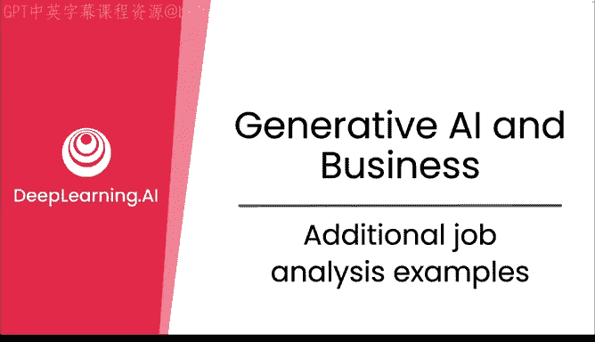
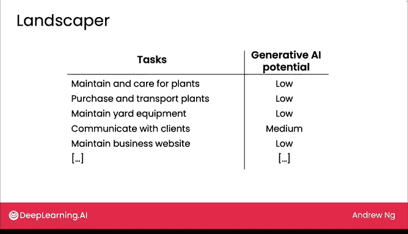

# 吴恩达最新《面向每个人的生成式AI》Generative AI for Everyone（中英字幕） - P23：23_03_03_工作任务分析补充案例.zh_en - GPT中英字幕课程资源 - BV11G411X7nZ

I found that for many job roles， people have a mental picture of that iconic task that uniquely defines that job role。

 For example， computer programme is right code doctors maybe see patients lawyers go to the court to argue court cases and I think that when people think about AI opportunities often is instinctual to say can AI do that most iconic role or that most iconic task of that job。

 but I found that when we actually systematically analyze the task that the good job is made up of the best opportunities may or may not be that first initial instinct Let's take a look at a few examples。

 If you look at the task the computer programmer does。

 they do write code and so it's tempting when think about AI for computer programming to ask can AI hope write code but it turns out computer programmers do many other things they have the right documentation they sometimes respond to use a support requests。

 they often review others code and they often gather requirements for。

The piece of software is intended to do and if you were to evaluate the Gen AI potential for this job。

 you may find that writing code can be held of AI， but it's a relatively difficult task but maybe writing documentation is actually easier to do with Gen AI and so on。

 Don't take the Gen AI potential column too seriously in these examples since these are informal evaluations and it were to do a rigorous evaluation based on technical feasibility and business value your specific conclusions may be different but I think that iss actually easier to get Gen AI to write documentation for code than to actually write the code itself and in many different job roles。

 the best potential for AI may not be the most obvious first task you might think of Let's look at another example lawyers spend a lot of time drafting and reviewing legal documents They often have to answer client' questions。

On how to interpret laws if preparing for a court case， they'll have to review evidence。

 and sometimes they're involved in negotiating settlements and sometimes they represent clients in court。

And I find that a systematic listing out of these tasks。

 as well a systematic evaluation of the potential may sometimes lead to interesting conclusions。

 so I think that there's a high potential forgen AI to help with drafting and reviewing legal documents as well maybe with interpreting laws whereas I can't see a lawyer as sending a robot to court to argue on their behalf。

 at least not for some time， and so if you work at a law firm and analysis like this might help you decide where you actually want to use Gen AI。

One more example， Landscaping， a landscapr has to maintain care plants。

 pressures and transport plants， maintain equipment， computer clients。

 maintain a business website and so on。 I' list， of course。

 just a subset of the tasks that any of these job roles do if you were to do an analysis yourself you may end up with anywhere from 5 to 15 to 30 tasks per job role。

 and in this case， I think most of these tasks actually a pretty low Gen AI potential and so the work of a landscaper may be less impacted in the next few years by Gen AI compared to computer programmers and lawyers So that's how you can analyze jobs by breaking it down into tasks and encourage you to think through whether the tasks in your work and where Gen VI may be a hope or for the business you may be involved in to think about how gender VI could help many different tasks in that business。

When people think about augmentational automation， people's minds often go initially to cost savings because if you automate something。

 seems like you can save money， but in most ways of technology innovation going back all the way to say the invention is the steam engine to electricity to the computer。

Many companies started off thinking about cost savings but ended up actually putting even more of the effort into pursuing revenue growth and that's because growth has no limit。

 but you can only save so much money。And when certain tasks are automated。

 it turns out sometimes you can rethink the workflow of how the business creates value。

 So for example， if you could do something a thousand times cheaper because of automation。

 say answering queries from customers then rather than just taking the cost savings。

 you may be able to build a new type of customer service organization that serves people a thousand times better and this type of thinking can lead to growth opportunities that go well beyond cost savings。

 let's take a look at some examples in the next video。

