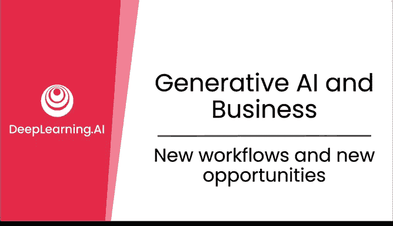
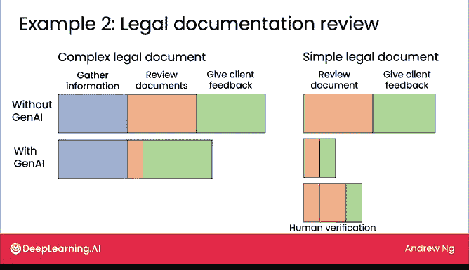
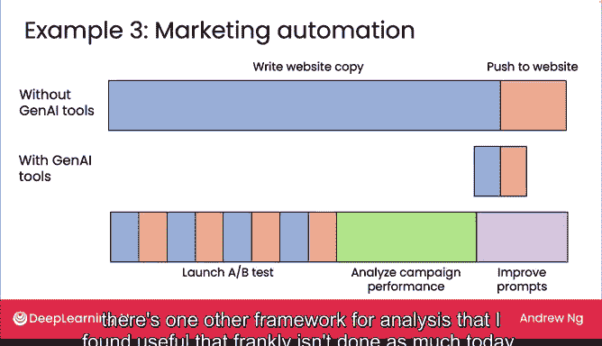
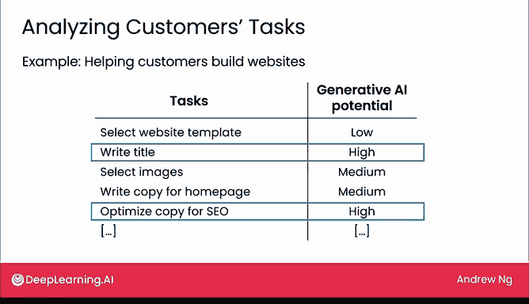

# 吴恩达最新《面向每个人的生成式AI》Generative AI for Everyone（中英字幕） - P24：24_03_04_新工作流与新机遇.zh_en - GPT中英字幕课程资源 - BV11G411X7nZ

There are many ways that Gen AI is leading not just to cost savings but to revenue growth。

 but theres so many ways for general purpose technology like Gen AI to create value。

 to talk about all of these ways， but in this video I'd like to take a look at a couple of the emerging or the more common paths I'm seeing towards this type of growth。

Let's consider the hypothetical example of a surgeon preparing to carry out the surgical operation and then actually carrying out that operation without genative AI tools。

 they may need a long time to do background research to understand the medical procedure and how to carry that out in the context of a specific patient。

 and then they will go into the operating theatre to carry out that surgery if geneative AI maybe with custom rag or retrievetrieval augment mentaledgen tools can help with the research portion of this work。

 then perhaps the time and effort needed to deeply research the medical procedure could shrink and then they still need to go in carry out the surgery after that。

 So this would be an example of how Genative AI could hypothetically help a surgeon or some of the job role where you need to do some research and then go and carry out the task with this diagram illustrating how the workflow。

The effort needed might change Let's look at the second example。

 a lawyer reviewing a complex legal document might without geneative AI first have to gather information from the client so sit down with the client to really understand what's the purpose of this contract。

 who are the people signing it， whether are the key business terms。

And then they might review the documents and then finally sit down with the client to give them feedback with Gen AI。

 maybe gathering information takes just about as much effort as before。

 but if Gen AI can help read over the document。 Perhaps this step can become shorter。

 but then maybe the lawyer still needs to sit down the client to give them detailed feedback again。

 this is a hypothetical example， based on what I'm seeing companies do。

 but the details of your workflow may be different。 In contrast。

 this is what changes the workflow might look like for reviewing simple as opposed to complex legal documents for comparatively simple legal documents say a typical nondisclosure agreement or N。

There may not be much information to gather。 And so the lawyer could just review it and then give the client feedback。

 Now， with Gen AI， maybe the review of the document can become much faster。

 and if we use Gen AI to create a document to summarize the issues that the lawyer can send to the client and discuss with them more efficiently than the process of giving client feedback could also become maybe more efficiently what I'm seeing is that companies might explore building a system like this。

 but after having built such a system may decide to further change the work though。

 where after the reviewing a document， we decide to add an extra fast human verification step in the middle。

 just to double checkck that what the Gen AI said about the document is comprehensive and correct before then having gen AI and the lawyer together try to go to that last step of giving a client feedback。

And so this type of reengineering of workflow is quite common once both Gen AI or other AI tools are inserted into a system because when one task is automated or augmented。

 it often makes sense to rethink whether the other tasks that need to be done together in order to deliver a valuable work product such as a surgical operation or a review of a legal document let's look at the third example where the redesigned of the workflow can become even more sophisticated if a marketer has to write copy for a website。

 that often is very time consuming and requires a lot of thought and then after that they might push the new website copy to the website and that's how a marketer might market a new product but with Gen AI tools。

 let's say that the marketer finds a way to significantly accelerate and make more efficient the writing of the website copy and once writing the website copy is so efficient。

It may be worth also investing in better processes of software to make pushing to the website more efficient and we could end here if we do this。

 then we just have a marketer that' is able to do their work much more efficiently than the but now they're able to write copy and push the website much more efficiently here's how we could rethink the workflow which is when a marketer wants to market a new product。

 they could write some copy， push the website， but then maybe write a different variation on the copy and push that second version to the website so they can start to launch an AB test where you can now have two different versions of a website copy and start to measure which one works better and in fact rather than just testing two versions if we are so efficient at writing copy and pushing copy of the website maybe we can now generate four different versions so it's not testing two but now full versions and after collecting data from how all four versions of the website。

we might end up sitting down and actually spending quite a long time analyzing the campaign performance to see which website copy works the best。

 And then based on that understanding， go back to further improve the website copy。

 maybe by improving the prompts that we use to generate that copy。And so in this example。

 even though it seems like Gen AI can be used just for cost savings to help the marketer be much more efficient in the process of writing and pushing copy。

 we can also take advantage of this efficiency in a totally different way and write and push and test many more versions of the website copy and this leads to other changes as well to the workflow of the marketer so that this way。

 hopefully the marketer can deliver much more compelling marketing campaigns Now， in this video。

 we've seen a few ways that Gen AI can not just save costs but lead to significant growth through new types of service offerings or products in addition to searching for growth opportunities by looking at tasks done by the employees of the company。

 there one other framework for analysis that are found useful that frankly。

 isn't done as much today but may be worth considering for your work。

Which is rather than analyzing employees tasks， consider also analyzing the tasks of your customers。

So， for example， let's say you offer a product service that helps your customers to build websites。

 Then I would urge you to consider listing out whether the tasks that your customers have to do。

 not the tasks your employees have to do， but the tasks your customers have to do In this case。

 maybe your customers have to first select a template for the website to get initial design。

 then they have to write a title for the website， then select images。

 write the copy for the homepage and optimize the copy for search engine optimization。

 to make it easy to find via search engines and maybe other tasks as well。

 and if you were to analyze the gen potential for your customers tasks。

 then you may also identify opportunities in this case。

 writing the title and Seo search engine optimization as places where Gen could help your customers and I found that this framework for analysis and brainstorming can sometimes lead companies to build。

Different product or services to deliver to the customers。

 And this can be another recipe for getting lots of happy customers and therefore pursuing growth for your business。

 So there are many ways that Gen AI is creating value and can lead to growth in terms of brainstorming frameworks。

 I found that looking at how you can auto augment task by employees or automated augmental by your customers to be useful ways to approach thinking about how to create that value。

 But if you have some other idea that isn't arrived at by some of these brainstorming frameworks。

 that's great， too。 And I hope you explore building those too。

Now， after come with an idea of how they use Gen AI in your business。

 some probably could be done via web user interface。

 but some may require building a custom software application in the next video will take a look at common team structures and some best practices for building Gen AI software applications The good news which I alluded to in the first week as well is that it may take less resources than you might think because Gen AI allows for very efficient building of AI applications compared to some earlier ways of AI technology but let's go take a look at that in the next video。

😊。