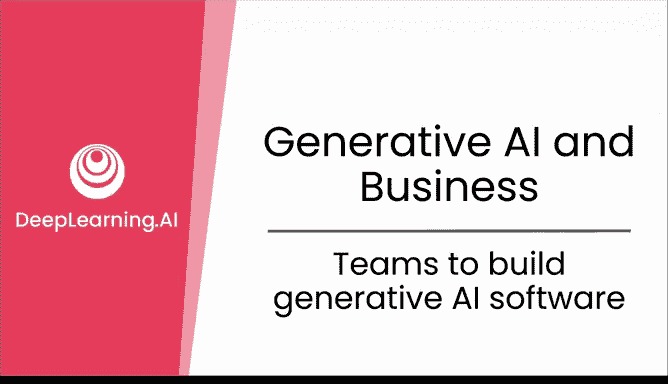
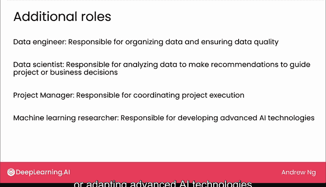

# 吴恩达最新《面向每个人的生成式AI》Generative AI for Everyone（中英字幕） - P25：25_03_05_构建生成式AI软件的团队.zh_en - GPT中英字幕课程资源 - BV11G411X7nZ

My teams have worked with or advised many companies both large and small on building a large variety of Gen VI applications。

 I'd like to share with you in this video some of the best practices I'm seeing as was what the typical team to get started on such project might look like。

😊，The most common rules for building Gen VI applications would be a software engineer who would be responsible for writing the software application and making sure that it runs robustly。

And I've seen that when a software engineer puts in just a bit of effort to learn at least the basics of large language models in prompting。

 then they can be very effective in a small team building OMbased applications。

 So if you're on a team that already has some software engineers。

 it might be worth encouraging them to consider spending just a little bit of time to learn at least the basics of OMs and prompting a second row that is quite common on teams to build applications would be the machine learning engineer and machine learning engineers are typically responsible for implementing the AI system。

 many machine learning engineers have been building AI systems even before Gen AI took off and found that a machine learning engineer that spends just a bit of effort to learn about OMs and ideally not just prompting but some of the more advanced techniques like Ra and fine tuning such a person can be very effective playing a role。

Building OEM applications。 and finally， one other role that I see in some teams。

 but less common than a software engineer and machine learning engineer would be the product manager。

 and they would be the person with primary responsibility for identifying and scoping the project and making sure that whatever is built is useful for customers Lastly。

 how about the prompt engineer role。 there's been a bit of media hype about this role。

 But what I'm seeing is that very few companies are hiring those as a dedicated role。

 what happened was a small number of companies advertise a small number of job openings for very wellpa prompt engineers and this generated a lot of media hype that someone could make a lot of money by prompting。

 But if you look at the actual job description of prompt engineers。

 prompt engineering jobs actually required doing a lot of other tasks than just writing prompts and they actually look more like machine learning engineers that have additionally learned to prompt So don't buy the hype of the prompt engineer role。

happensappens in practice is that most companies are count on machine learning engineers that have also learned LMs or learned prompting and is actually not that easy to get a job and no companies hiring that many people whose only job is the right prompts。

 if you're building an LM based application is often possible to get started with a pretty small team。

 So I definitely see companies start to experiment with even just one personson team such as a software engineer who's learned some prompting or machine learning engineer who's learned a bit about prompting LMs or maybe you could just start by yourself by experimenting and prototyping using some of the web interfaces to try to get a sense of what might be feasible。

 I do see a lot of two person teams as well。 And if you have two persons in the team probably the most common configuration is a machine learning engineer plus a software engineer but I've seen many other configurations also work well。

such as a software engineer who's learned prompting and a product manager or really two generally enthusiastic people that know a bit about how to write software and are willing to learn how to use these tools to build new and exciting applications。

Sometimes for the larger teams you also see some other roles like data engineer， data scientist。

 project manager or machine learning researcher， let me quickly talk over these roles as well in case you see them in a company。

 so data engineer is usually responsible for organizing the data and ensuring data quality and often also the security of the data and data scientist is usually responsible for analyzing data to make recommendations to guide project or business decisions。

 Project manager can be responsible for coordinating project execution and machine learning researchers are usually responsible for developing advanced AI technologies or adapting advanced AI technologies to the particulars of your business。

So Genta AI has lowered the cost， lowered the barrier entry to building AI based applications。

 if you or your team have an idea， I'd encourage you to try to find the resources。

 to prototype and try something out and see if you can build something for yourself or for your business。

Before we wrap up the section on Gen AI and businesses。

 I'd like to go through an analysis of how AI is affecting different job roles as well as different industry sectors。

 let's take a look at that in the next video。