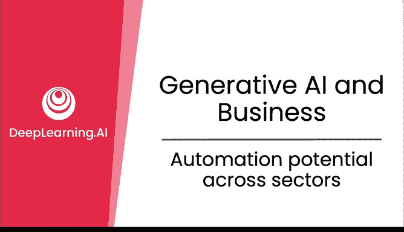
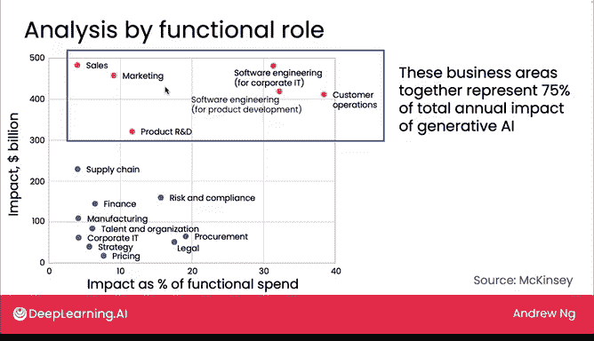
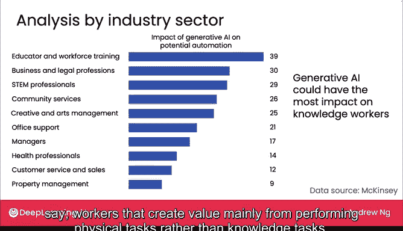

# 吴恩达最新《面向每个人的生成式AI》Generative AI for Everyone（中英字幕） - P26：26_03_06_跨行业自动化潜力.zh_en - GPT中英字幕课程资源 - BV11G411X7nZ

We've looked at how Gen AI may be useful to your work and also talked about analyzing this impact on a business。

 let's now zoom out and take a look at its impact on job roles across different companies。

 as well as this impact on different industry sectors。

The results from this video may be less directly actionable for a particular business。

 but maybe it doesn will help you to think through and try to forecast some the large macro changes that may take place over time。

 Let's dive in。A study by Alunddu and others at OpenaiI and the University of Pennsylvania examined how much different job occupations are exposed to AI augmentation or automation。

 That study resulted in this graph showing that higher wage jobs tend to be more exposed to AI augmentational automation than lower wage jobs in this graph。

 which is a slightly funny horizontal axis because it's on a large scale。

 we plot salaries ranging from about 30k up to about 163k like this and the vertical access measures the degree to which these jobs are exposed to automation earlier waves of automation tended to have lower wage jobs more exposed because AI could do more of the routine repetitive work。

 so supervised learning， for example， tended to automate more of the lower wage jobs。

 but large language models and gender AI。More broadly are exposing in this wave。

 the higher wage occupations to automation。 And we'll say more later this week as well about the impact of Gen AI on jobs。

 Let's look at the second study due to McKsey， which carries out in analysis by functional role。

 So this graph plots different functions that tries to estimate， how much will sales be impacted。

 How much remarkly be impacted， How much will customer operations。

 including customer service be impacted。The vertical axis here shows the total impact in terms of billions of dollars。

 and so the points in the upper portion of this graph correspond to the functional roles where the total value of the impact will be large in terms of total number of dollars。

 the horizontal axis measures the impact as a percentage of the functional spend。

So customer operations， according to this study， will have a very large absolute dollar value impact。

 maybe around $400 billion， I would take the exact numbers not to SerZ since these are frankly loose estimates。

 but the total dollar value seems like it will be large because Gen AI is automating or augmenting a lot of customer service。

Moreover， as a percentage of all the spending on customer operations。

 Gen AI's impact will be pretty large as well， maybe approaching 40% of the total spend on customer operations。

 In contrast， it will also have hundreds of billions of dollars impact on sales but as a percentage of the total spend on sales。

 it is much smaller and the McKinsey study also estimates that these yellow dots shown on top together might represent 75% of the total annual impact of Gen AI and it will be a significant impact Now this isn't to say that if you work in some of these other functions you shouldn't pay attention to Gen AI For example。

 if you work in the legal function and Gen AI will impact 15 to 20% of the functional spend on legal。

 that's still a significant shift for the industry。

 even if the total spend on lawyers on legal services is not nearly as big as a total spend on sales or marketing。

Software engineering and so on， but if the McKinzey study is correct。

 then these are some of the functional roles across many different companies that will have a huge impact through generative AI Lastly。

 let's take a look at its estimated impact by industry sector。

So McKinsey had carried a study on the potential of AI automation with and without Gen AI。

And we reporteded McKzey data to show the impact of Gen AI only on automation。

 leaving out other forms of AI， such as supervised learning。

 some of the sectors impacted include educator and workforce training， business and legal profession。

 same professionals and so on。 and one remarkable thing about this data is that there are sectors that werere not highly exposed to automation before Gen AI。

 but with the rise of Gen AI is now seeing a much greater potential of automation or augmentation。

 And so depending on what sector or sectors you either work in or work with。

 perhaps this type of analysis may give you a sense of what may happen in industries that you touch as well。

 If you look at the top few lines on this draft， one theme that pervays both this as well as other studies is that it looks like a lot of the impact of Gen AI will be on knowledge workers。

 meaning。Who journey value primarily through their knowledge， including their expertise。

 their critical thinking and their interpersonal skills。

 This is in contrast to say workers that create value mainly from performing physical tasks rather than knowledge tasks。

 This wraps up our section on Gen AI and business。

There are lots of opportunities for individuals， businesses， and for society。

The huge impact of Gen AI is also raising questions about how Gen AI will affect society and has also made some people anxious about what the future will be like for them in a world with these amazing AI capabilities。

Let's go on to the next video to examine how AI is impacting society。

 as was how we can mitigate risk and how we can build beneficial， responsible AI。

I'll see you at the next video。