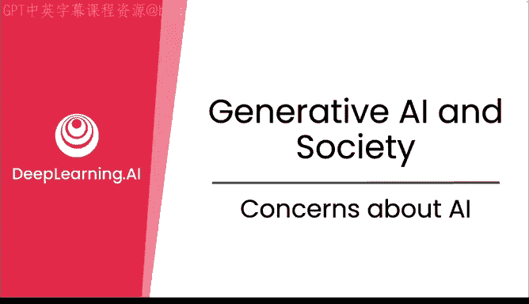
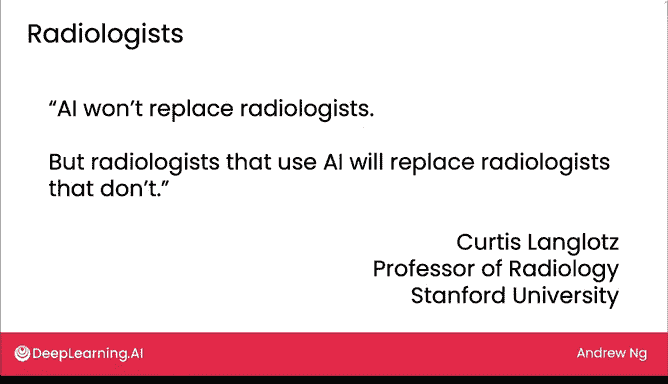
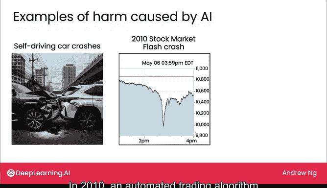
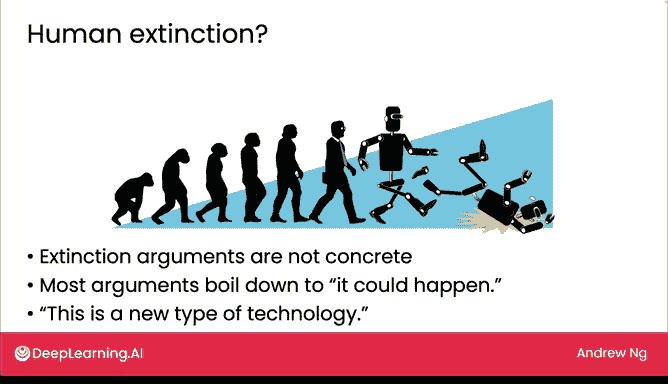
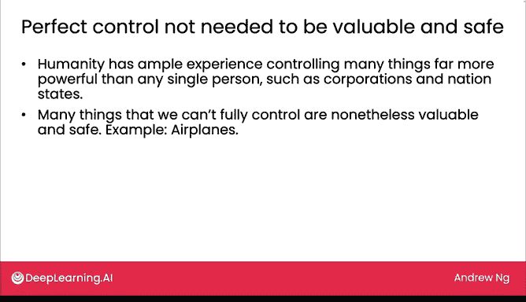

# 吴恩达最新《面向每个人的生成式AI》Generative AI for Everyone（中英字幕） - P27：27_03_01_AI相关关切.zh_en - GPT中英字幕课程资源 - BV11G411X7nZ

In a short time， access to Gen AI has spread around the world and given many people the ability to generate high quality essays。

 pictures and audio， while these amazing capabilities have also come many concerns about AI。

I think even before the rise of Gen AI， we've been living in a time of many anxieties。

 an is about the environment， about the legitimacy and competence of authority。

 about society's ability to treat people fairly， even about what sort of future awaits us all。😊，AI。

 as a very powerful technology， has inherited a lost share of this anxiety。In this video。

 let's take a look at some of these anxieties in concern that relates specifically to AI。

 One widely held concern about AI is whether it might amplify humanity's worst impulses。

 Lms are trained on text from the Internet， which reflects some of humanityities's best qualities。

 but also some of this worse， including some of our prejudices， hatreds and misconceptions。

 Lms learn some of these negative qualities， too， so word amplify our worse impulses In the first week。

 we have seen an example of an Lm exhibiting agenda bias with regard to whether a surgeon or nurse is more likely to be male or female to take another may be slightly simpler example。

 If you ask an Lm after its initial training to fund a blank and the blank was a CEO。

 many models will be prone to choose the word man。 And， of course。

 this is say social biasers that distort the fact that people of all genders can successfully。

Companies text on the internet represents our present and our past。

 and so perhaps it's no surprise that an OEMM learning from this data reflects some of these biases from our past and our present as well。

But perhaps we want LMs to represent a hopeful future that is fairer。

 less biased and more just rather than just data from our past。 Fortunatelyly。

 LMs are becoming less biased through fine tuning which we discuss in week2 as well as more advanced techniques such as reinforce learning from human feedback or ROHF In the second week there is an optional video on ROHF whether or not you watch that。

 I'd like to briefly describe how ROHF is hoping to make OMs less biased。

 ROHF is a technique that trains an OM to generate responses that are more aligned with human preferences The first step of ROHF is to train and answer quality model called a reward model that automatically scores answers So in this step of ROHF we would prompt the LM with many queries like this the blankqui of CO and collect different responses from the。

Then we would ask humans to score these answers， so on a scale of one to five。

 we give a high score to highly desirable answers like men or women。

 and a low score to nonsensical answers like airplane and any answer that contains a gender bias or a racial bias or contains a gender or racial slur will receive a very low score。

Using the prompt the responses and the scores designed by humans as data。

 we would then use supervised learning to train a reward model that can input a response and score it。

 we do this because asking humans to score responses is expensive。

 But once a supervised learning algorithm has learned to automatically score responses。

 we can score a lot of responses automatically and inexpensively。 Finally。

 now that the LM has a learned reward model to score as many responses as it wants。

 We can have the LM generate a lot of responses to many different prompts and have it further train itself to generate more responses that get high scores and that therefore reflect answers that humans perceive as more desirable RHF has been shown to make LMs much less likely to exhibit bias according to gender race。

 religion and。huan characteristics it makes LMs less prone to hand out harmful information and also makes it more respectful and hopeful to people alreadyy today。

 the output of LMs are much safer and less bias than say the average piece of text on the internet but technology like this is continuing to improve and so the degree of an Lm amplifying humanity's worst qualities is continuing to decrease as they are becoming better aligned to the future I think we all hope LM's will reflect of a fairer。

 less bias and more just world。A second major concern is who among us will be able to make a living when AI can do our jobs faster and cheaper than any human can。

Will AI put many of us out of a job to understand whether this is likely to happen。

 let's look at radiology In 2016， many years ago， Jeff Finton。

 who is a pioneer of deep learning and a friend of mine said that AI was becoming so good and analyzing X- ray images that in five years it could take radiologist jobs。

 he made this remarkable statement that if you work as radiologist。

 you like a coyote that's already over the Asia the cliff。

 but hasn't yet looked down so it doesn't realize there's no ground underneath them。

 people should stop trading radiologist now， it's just completely obvious that within five years。

 deep learning is going to do better than radiologists。

 but when now wellpa five years since the statement and AI is far from replacing radiologists。

 Now the single one of my radiologist friends has lost their job to AI。

 Why is that two reasons First， interpreting X rays turns out to be harder than a look back then that we are。

making rapid progress but second and more important。

 it turns out that radiologists do a lot more than just interpret X-ray images。

 according to OE radiologists do about 30 different tasks。

 one of which is interpreting x-rays and other medical images。

 but they do many other tasks and it has been difficult so far for AI to do all of these tasks at human level to list out some of the other tasks that radiologists do in addition to interpreting xrays。

 they also operate imaging hardware， communicate exam results with patients or other stakeholders respond to complications during procedure such as if a patient has a panic attack during the imaging procedure they document procedures and outcomes and many other tasks and I think that AI does have a high potential of augmenting or assisting the interpretation of x-rays and technically this has。

Last sheep been done with supervisor learninging rather than Gen AI。

But for AI to completely automate all of these tasks is still far away。

 So that's why I think that Curtis Langlotz， who is a professor of radiology at Stanford University and a friend and colleague says it well。

 He said that AI won't replace radiologists， but radiologists that use AI will replace radiologists that don't。

 and I think we will see this effect in many other professions。

Mind you， I don't mean to minimize the challenge of helping many people adopt AI or the suffering of the much smaller number of people whose jobs will disappear or our responsibility to make sure people affected have a safety net and an opportunity to learn new skills。

But every wave of technology， from the steam engine to electricity to the computer has created far more jobs than it destroyed。

As I mentioned earlier this week， in most ways of innovation， businesses wound up focusing on growth。

 which has unlimited potential rather than cost savings。

So AI will bring a huge amount of growth and create many， many new jobs in the process。

 and this brings us to what might be the biggest anxiety will AI cause all We know that AI can run them up。

Subdriving costs have crashed leading to tragic loss of life。In 2010。

 an automated trading algorithm caused a stock market crash and in the justice system AI has led to unfair sentencing decisions。

 so we know that poorly designed software can have a dramatic impact。

 but can it lead to the extinction of humanity。

I don't see how I know there are different views on this。

 but recently I sought out some people concerned by this question and I spoke of some of the smartest people in AI that I know。

 some were concerned about a bad actor using AI to destroy humanity。

 say by creating a bio weaponapon。Others were worried about AI inadvertently driving humanity to extinction。

 similar to how humans have driven many other species to extinction through simple lack of awareness that our actions could lead to that outcome。

 I tried to assess how realistic these arguments are。

 but I found that they were not concrete and not specific about how AI could lead to human extinction。

Most of the arguments boil down to， it could happen。

AndSome add that this is a new type of technology so things could be different this time。

 but that statement is true for every new type of technology that's been invented by humanity and proving that AI couldn't lead to human extinction is akin to proving a negative。

I can't prove that AI superintelligence won't wipe out humanity it's just that nobody seems to know exactly how it could。

But I do know this， humanity has ample experience controlling many things far more powerful than any single person。

 such as corporations and nation states， and also that the many things we can't fully control that are nonetheless valuable and safe。

For example， take airplanes， which today we still can't fully control because winds and turbulence will bufferuffet to airplanes around or the pilot flying the plane may make a mistake in the early days of aviation。

 airplanes killed many people， but we learn from those experiences and built safer airplanes and also devised better rules by which to operate them。

 and today many people con stepped into an airplane without fearing for their lives。

 similarly for AI。

We are learning better to control it and it is becoming safer every day。 Finally。

 if we look at the real risks to humanity， such as climate change leading to massive depopulation across the planets or hopefully not the next pandemic or even much lower chance。

 but another asteroid striking the planet and wiping us out like the dinosaurs。

 I think that AI will be a key part of our response to such challenges。

 So I know that there are different views on this right now。

 but my view is that if we want humanity to survive and thrive for the next thousand years。

 AI increases the odds of us successfully getting there。

Computers are already smarter in some narrow dimensions than any human。

 but AI continues to improve so fast that many people find it hard to predict exactly what it will be like in a few years。

I think the root cause of some of these concerns， including extinction risks。

 is that many people are unsure when AI will reach artificial general intelligence or AGI。

 meaning AI they could do any intellectual task that the human can Let's take a deeper look at AGI in the next video。

