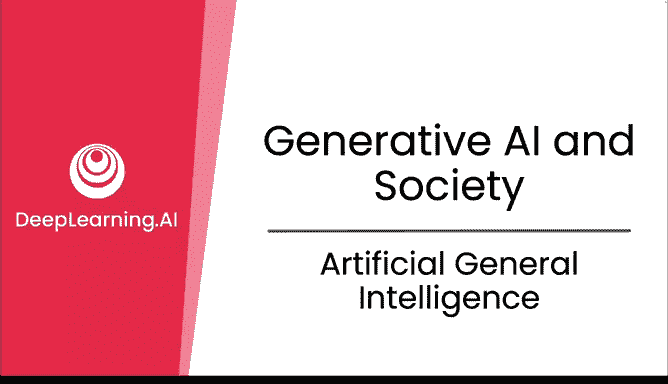
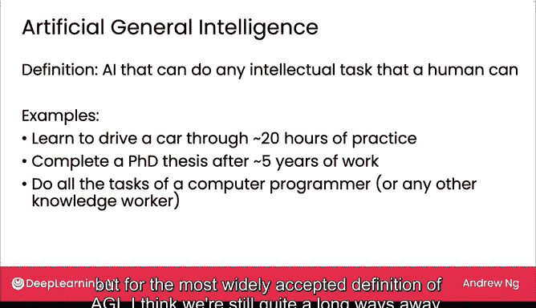

# 吴恩达最新《面向每个人的生成式AI》Generative AI for Everyone（中英字幕） - P28：28_03_02_通用人工智能.zh_en - GPT中英字幕课程资源 - BV11G411X7nZ

AGI Artificial general intelligence is an exciting concept。

I think some of the confusion around it stems from the use of the wordgene。As you know。

 AI is a general purpose technology， meaning that is' useful for many different things。

 and the rise of large language models has led to single models like ChaGT。

 that are useful for many things and feel like they could be general purpose。

But a general purpose technology is not the same thing as artificial general intelligence。

 Let's take a look at what really is the technical definition of AGI。

The most widely accepted definition of AGI is AI that could do any intellectual task that the human can。

 Some definitions actually say any task that the human or mammal can。

 but I'll stick with this one for now。 So， for example。

 if we have AGI AI would be able to learn to drive a car through about 20 hours of practice similar to what a teenager can。

 This an example raised by deep learning pioneer Yana Kun， And today。

 self-driving cause still aren't quite there yet， Certainly not after so low as 20 hours of practice。

 if we had AG AI would also be able to do the intellectual task of completing a PhD thesis level research after five years of work or maybe even faster。

 And today， AI can help with some parts of brainstorming and writing and maybe be a thought partner for some elements of research。

But we're clearly very far away from this store， if we had AGI。

 AI would also be able to do pretty much all the tasks of a computer programmer or really any other knowledge workers whose contributions to work are to carry out intellectual tasks。

And clearly， we're still very far away from this。 I know that there are different views about how long it would take to get to Agi。

 I think we're still many decades away。 maybe even longer。

 but I hope we'll get there sometime little a lifetimes。

 There are some businesses that have made much more optimistic forecast of when we'll get there。

 But I found that most of those businesses have changed the definition of Agi and said a much lower bar to get there。

 I showed the definition of Agi used by one of these businesses to an economist friend of mine。

 and he equippedpped Boy， that's the definition of Agi。 I think we got there 30 years ago。

 So it is true that by lowering the bus sufficiently， we could get there much faster。

 but for the most widely accepted definition of Agi。 I think we're still quite a long ways away。

 One of the exciting things about large language models is that we can use them as reasoning engines。

 as I mentioned last be。 and maybe we're now starting to see what a rough outline of what。😊。

I could be someday。I don't think there's any fundamental laws of physics that prevents us from ever creating AGI。

 which I think will actually be very valuable to human society。

 but we'll still need some significant technical breakthroughs to get there one of the hard things about getting to AGI is that it benchmarks artificial intelligence against human intelligence。

Artificial intelligence and biological intelligence have progressed along two very different paths。

 for example， AI learning from far more text than any human can read in a lifetime。

So AI is already far better than any human at certain tasks already， but to ask AI to do everything。

 all intellectual tasks that humans can do， that's still just a very high bar。

 but even though we're still away from AGI，AI is very powerful and it's important that we use it responsibly。

Let's take a look in the next video at Responsible AI。

