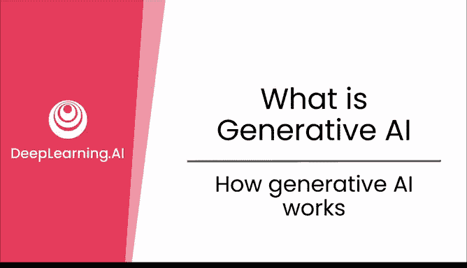
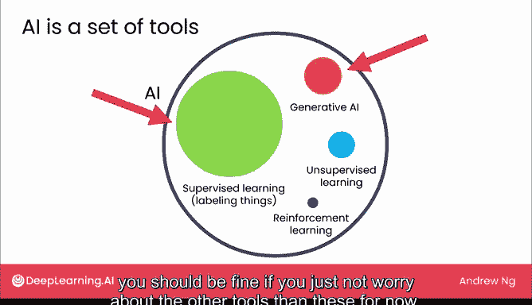
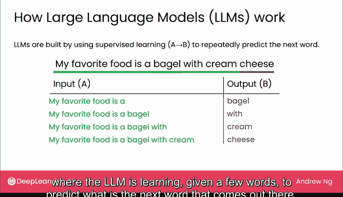

# 吴恩达最新《面向每个人的生成式AI》Generative AI for Everyone（中英字幕） - P2：02_01_02_生成式AI工作原理.zh_en - GPT中英字幕课程资源 - BV11G411X7nZ

The ability of systems like chat GT and BoD to generate text seems almost magical and they do represent a big step forward for AI technology。

But how does text generation actually work in this video。

 we'll take a look at what actually underlies degenrative AI technology and this will hopefully help you understand what you can use it for and also when you might not want to count on it。

 let's take a look。Let's start by looking at where geneative AI fits within the AI landscape there's a lot of buzz and excitement and also hype about AI and I think a useful way to think of AI is as a collection or as a set of tools one of the most important tools in AI is supervised learning which turns out to be really good at labeling things don't worry if you don't know what this means we'll talk more about it on the next slide and a second tool that started to work really well only fairly recently is geneative AI if you study AI you may recognize that there are other tools as well such as things called unsupervised learning and reinforcement learning but for the purposes of this course I'm going to touch briefly on when supervised learning and then spend most of our time talk about geneative AI and these two supervised learning and geneative AI are the two most important tools in AI today and for most business use cases you should be fine。

Just not worry about the other tools than these for now before describing how Genative AI works。

 let me briefly describe what is supervised learning because it turns out geneative AI is built using supervised learning。

Supervised learning is the technology that has made computerss very good when given an input。

 which I'm going to call a。To generate a corresponding output。

 which I'm going to call B To look at a few examples， given an email。

 supervised learning can decide if that email is STM or not so the input is an email and the output B is either zero or1 where zero is not ST and one is STM and this is how spa filters work today as a second example probably the most lucrative application not the most inspiring but lucrative for some companies。

 the everorton was online advertising where given an ad and some information about a user and AI system can join an output B corresponding to whether or not you're likely to click on that ad and by showing slightly more relevant ads this drives significant revenue for the online ad platforms in self-driving calls and in driver assistance systems supervised learning is used to take us input a picture of what's in front of your car and。

Info and label that with the position of other cars given a medical X-ray。

 it can try to label that with a medical diagnosis。

 I've also done a lot of work in manufacturing defect inspection where you can have a system。

 take a picture of a phone as it roll off the assembly line and check if the phone has any scratches all the defects or in speech recognition the input a would be a piece of audio and we would label that with the text transcript or as a final example。

 if you run a restaurant or some of the business where occasionally you have reviews written about your business of your products。

 supervised learning can read those reviews and label each one as having either a positive or a negative sentiment and this is useful for reputation monitoring of the business。

 So it turns out the decade of around 2010 to 2020 was a decade of largescale supervised learning And I want to touch on this briefly because it turns out this laid the foundation for model。

genative AI but what we found starting around 2010 was that for a lot of applications。

 we had a lot of data， but even as we fed more data。

 its performance wasn't getting that much better if we were training small AI models this means for example。

 if you were building a speech recognition system， even as your AI listened to tens of thousands or hundreds of thousands of hours of data。

 there's a lot of data， it didn't get that much more accurate compared to a system that listened to only a smaller amount of audio data but what more and more researchers started to realize through this period is if you were to train a very large AI model。

 meaning an AI model on very fast very powerful computers with a lot of memory than is performance as you fed more and more data would just keep on getting better and better In fact。

 years ago when I started and let the Google brain team the primary mission that I set by the Google brain team in the。

was I said let's just build really really large AI models and feed them a lot of data and fortunately that recipe worked and ended up driving a lot of AI progress at Google large scale supervised learning remains important today but this idea of very large models for labeling things is how we got to generative AI today Let's look at how Gen AI generates text using a technology called large language models Here's one way that large language models which are abbreviate LLM can generate text given an input like I love eating this is called a prompt。

An LOM can then complete this sentence with maybe bagels with cream cheese or if you run it a second time it might say my mother's meatloaf or if you run it the third time maybe I'll say also with friends So how does an LOM a large language model generate this output it turns out that LOMs are built by using supervised learning that's a technology to input a and output the label B it uses supervised learning to repeatedly predict what is the next word for example。

 if an AI system has read on the internet a sentence like my favorite food is a bagel with cream cheese then this one sentence will be turned into a lot of data points for it to try to learn to predict the next word especially given this sentence we now have one data point that says given the phrase my favorite food is a what。

You think is thenicks word in this case， the right answer is bagel and also given my favorite food is a bagel。

 what do you think is the nextick word with and so on？

So this one sentence is turned into multiple inputs A and outputs B for it to try to learn from。

 where the LOM is learning， given a few words to predict what is the next word that comes out there。

 when you train a very large AI system on a lot of data， a lot of data for LOMs。

Means hundreds of billions of words and in some cases。

 more than a trillion words then you get a large language model like chatGT that given a prompt is very good at generating some additional words in response to that prompt for now I'm omitting some technical details specifically next week we'll talk about a process that makes LOMs not just predict the next word。

 but actually learn to follow instructions and also be safe in what it outputs but at the heart of LLMs is this technology that's learned from a lot of data to predict what is the next word so that's how large language models work they're trained to repeatedly predict the next word and it turns out that many people perhaps including you are already finding these models useful for dayto-day activities at work to help of writing to find basic information or to be a thought partner to help think things through let'。

LookSome examples in the next video。