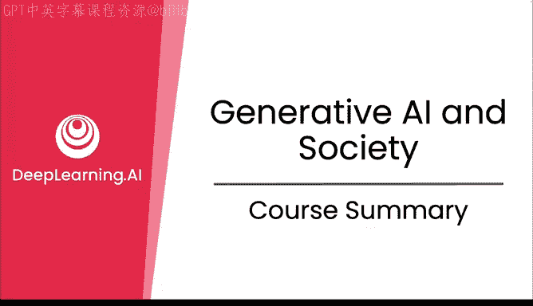
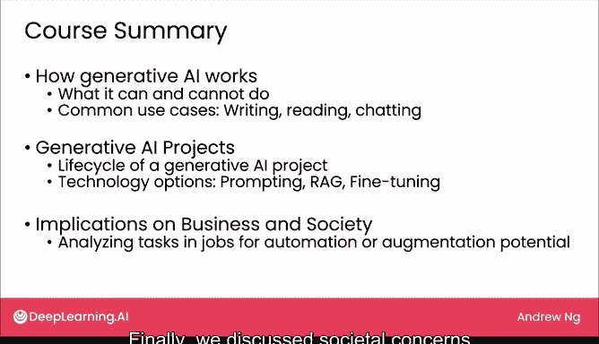

# 吴恩达最新《面向每个人的生成式AI》Generative AI for Everyone（中英字幕） - P30：30_03_04_课程总结.zh_en - GPT中英字幕课程资源 - BV11G411X7nZ

I'm glad you stuck with me all the way to this video。

We've gone through quite a lot of material together。

 and I'm actually sad that the time together in this course is coming to an end。

Let's take a look at the major topics with've COVID In the first week we had talked about how Gent AI works。

 including how you can use it as a thought partner and we touched on what it can and cannot do and made the analogy of it be to do many of the things that a college student following instructions might be able to do。

And we also talked about some common use cases， including writing， reading and chatting。

 In the second week， we went over how to build Gen AI projects。

 including the lifecycl of Gen AI project。 and we also went through a variety of technology options。

 including prompting retrieverieval augmented generation and fine tuning。

 Finally this week we discussed the implications of Gen AI on business and on society。

 we went through a framework for breaking jobs down into tasks to identify opportunities for automation or augmentation and also saw how automation or augmentation could lead to new workflows that don't just realize cost savings but lead to significant brand new value creation。

 Finally， we discussed societal concerns and also talked about responsible AI。

Congratulations on making it all the way to the end of this video。

 I hope you've learned a lot about Gen AI and that you found this course useful。I hope that many。

 many people will be empowered to use gem of AI， so please share what you've learned with others as well and perhaps also recommend that they take this course too。

Before we wrap up， there's just one last idea I want to share with you about building a more intelligent world。

 let's go on to the final video of this course。