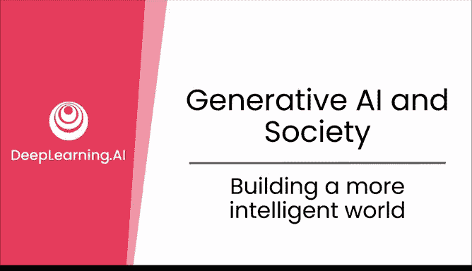

# 吴恩达最新《面向每个人的生成式AI》Generative AI for Everyone（中英字幕） - P31：31_03_05_构建更智能的世界.zh_en - GPT中英字幕课程资源 - BV11G411X7nZ

Thank you for making it to this last video and for spending all this time with me。

To conclude this course， I want to share with you how I hope AI can help us build a more intelligent world。

Intelligence is the power to apply knowledge and skills to make good decisions。

We invest years of our lives and trillions of dollars on education。

 all to develop our ability to make better decisions。 It costs a lot to feed。

 educate and train a wise human being， so human intelligence is expensive。

 that's why today only the wealthiest people can afford to hire large amounts of intelligence by hiring people like a specialist doctor to examine。

 carefully think about and advise you on a medical condition or a tutor that takes the time to really understand your child and gently coach them where they need the most help。

😊，But unlike human intelligence， artificial intelligence can be made cheap。😊。

AI has the potential to give every individual the ability to hire intelligence at low cost so that you no longer need to worry about that huge bill for visiting a doctor or getting an education。

 and you can hire an army of smart， well informed staff to think things through for you and has a potential to give society more intelligent guidance on how to approach some of the biggest problems such as climate change and pandemics。

AI is a new electricity with the potential to revolutionize all industries and all corners of human life。

The fear of AI today is similar to the fear of electricity when it was new。Back then。

 people were terrified of electrocution or of electricity sparking devastating fires today electricity still has dangers。

 but I don't think any of us would give up light， heat and refrigeration for fear of electrocution。

AI today still has flaws and there are cases where it will cause harm。

 but journey of AI is an exciting leap forward in how much intelligence we can bring to the world。

 and we're also improving the technology rapidly。As weve continued to improve the technology and also continue to build up more use cases。

 AI will contribute to longer， healthier and more fulfilling lives worldwide as the technology improves the problems of AI that La us today will rec。

And looking beyond AI， the world has many problems such as climate change， pandemics。

 war and many others， and many of these problems need urgent solutions。To solve them。

We will need all the intelligence， including all the artificial intelligence we can muster。

To conclude。Thank you very much for taking this course。😊，I hope you find Jaative AI useful。

That you use it responsibly to improve your life and the lives of people around you。

And that through your use of Gen AI， you keep on contributing to building a better。

 more intelligent world for everyone。Thank you。