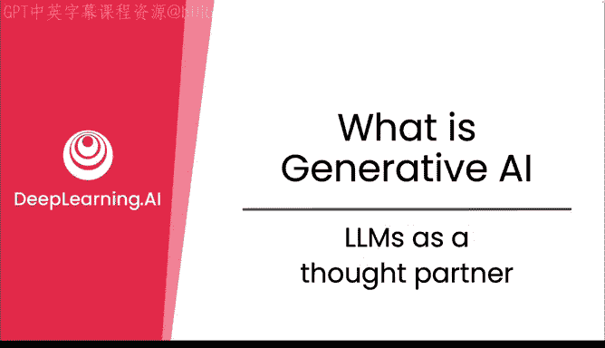
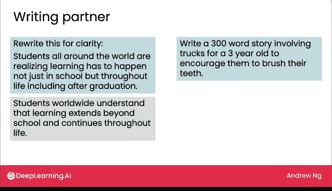
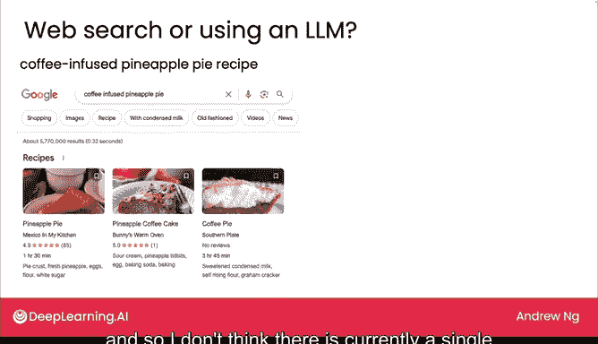

# 吴恩达最新《面向每个人的生成式AI》Generative AI for Everyone（中英字幕） - P3：03_01_03_大语言模型作为思考伙伴.zh_en - GPT中英字幕课程资源 - BV11G411X7nZ

There are quite a few web interfaces where you can access a large language model ChaGT is the best known one and Google's Bo。

 Microsoft Bing and quite a few others also work well Let's take a look at how people are using these LM applications。

 whether or not you're already using them regularly。

 I hope that this will give you some new ideas for when and how they could be useful to you。

LMs are giving a new way to find information for example。

 if you ask it what's the capital of South Africa， it may give a response like that Now as we'll see later。

 aLM can sometimes make facts up we call this hallucination and so if you are really relying on getting the right answer to the question。

 it may be useful to doublecheck the answer with an authoritative source before counting on it but in this case it does get the capital or three capitals of South Africa right and sometimes a back and forth with an LM is helpful2 for example if you ask what does LM stand for。

 it might answer LM stands for Laume magister which is a term used in law and it's actually a pretty common use of the acronym LM on the internet but if you were to then say what about in the context of AI then hopefully it'll say in the context of AI and LM refers to large language model so sometimes it's back and forth can help you give the right context theLM to give you the information you are looking for。

LM can also sometimes be a thought partner to help you think things through。 For example。

 I often use an L M to help me。Refine my writing If you were to tell it rewrite this little clarity。

 Students all around the world and realizing learning has to happens on leading elms are actually pretty good at rewriting text for you or here's a fun example if you were to tell it to write a30 word story involving trucks maybe because you have a child that likes trucks like I do my son love trucks but to encourage them to brush the teeth then leading elms can actually create pretty fun and interesting stories。

 I don't think this is nearly as good as the stories written by the great novelists。

 but for a quick fun thing I think is not bad Now there will be times when you're looking for a piece of information and you might be wondering should I use web search or use an LM So if you are playing a sport and unfortunately one out with a sprain ankle and want to know what to do about it。

 web search can lead you to pretty authoritative and I think trustworthy sources that can give advice on how to approach medical matters。

SoFor example， web pages from the Mayo Clinic or from Harvard health do seem like they would be trustworthy sources for what to do about the sprain ankle。

 You could also ask an LOM what to do about the sprained ankle and they would generate some answer but given the propensity of LOMs to make things up and sometimes sound very authoritative and confident while making things up I would probably want to double checkck anything it says about healthcare or medicine before following a suggestions Here's one more example if you want to bake a pineapple pie and they're looking for a recipe it turns out there are lots of recipes on the internet for a pineapple pie and picking one created by a trusted website or a trusted chef that might get you pretty good results or you can ask an Lm to make one up for you and in that case itll come with something that frankly might be okay but also has a high chance of being a somewhat strange recipe So if you want to bake a pineapple pie I would probably go find a web。

Because there are multiple web pages that would give a good solid answer to what's a good pineapple pie recipe。

 But if you were to look for something more esoteric。

 say French challenges you to make coffee infused pineapple pie。

 there aren't any web pages that I could find really on coffee infused pineapple pies And so I don't think there is currently a single webpage that gives a good answer to this。

 and this would be one example where an Lm can hope be a thought partner to think through how you might go about baking a coffee infused pineapple pie。

 So these are just some of the tasks for which you might find the web user interface for an LM useful。

We'll explore more examples， discuss strengths and weaknesses of LMs and go through some best practices later this week。

But as you can see from this video， Gener AI is capable of many different things in the next video we'll most systematically discuss Gen AI as a general purpose technology as well as not to come up with a way to organize all of these things that they can do。

 which includes writing， reading and chatting task let's go take a look at that in the next video。😊。

