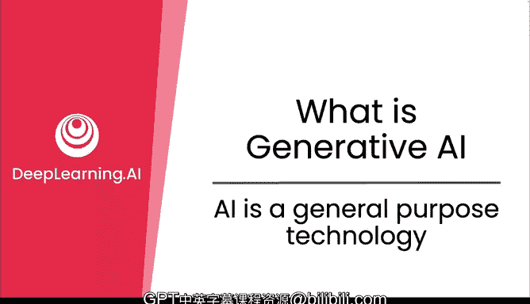
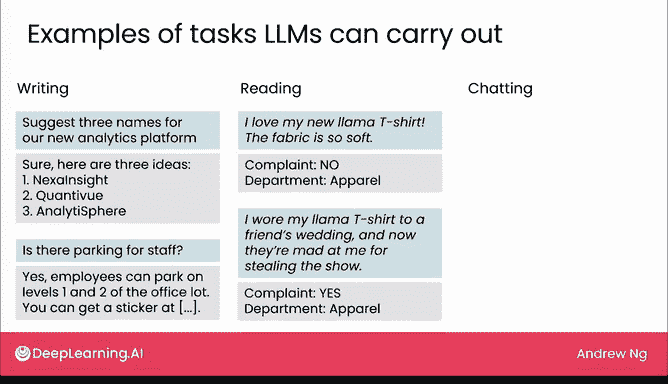
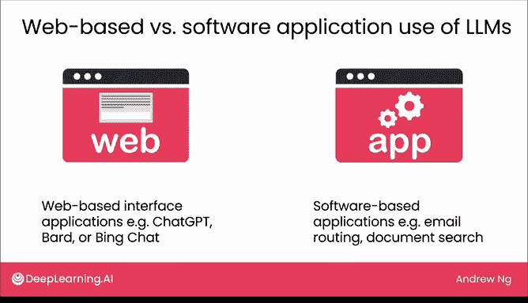

# 吴恩达最新《面向每个人的生成式AI》Generative AI for Everyone（中英字幕） - P4：04_01_04_AI是通用技术.zh_en - GPT中英字幕课程资源 - BV11G411X7nZ

What is gene AI good for One of the reasons that question is a bit hard to answer is because AI is a general purpose technology unlike a lot of technologies like a car。

 which good for transportation microgra oven good for heat food AI isn't useful just for one thing is useful for a lot of things and that almost makes it harder to talk about but let's take a look at what a general purpose technology really means similar to electricity AI is useful for many tasks If was ask you what is electricity good for or what is the internet good for these are other general purpose technologies and is' almost difficult to think what is electricity good for because it's so pervasive and is around us for so many different things In fact。

 as you saw earlier supervised learning is useful for many tasks like span filtering advertising speech recognition and many others and gene AI is like this too in the last video you saw a few of the。

Tasks that an LM can carry out answering certain questions and hoping with writing for example。

 Let's discuss more broadly a framework for what kinds of tasks OOMs can do。 First off。

 Gen AI generates text so not surprisingly perhaps is' useful for writing I routinely use Gen AI tools as a brainstorming companion。

 So if you're trying to name a product you can ask it to brainstorm some names and it comes up with some creative suggestions LOms can also be good at answering questions and if you give them access to information specific to your company。

 they can help members of your team find information that they need in this case about the availability of parking at the office in addition to writing Gen AI is also good for what I'm going to call reading tasks。

Where you're going to give it a relatively long piece of information and have it generate a short output。

 for example， if you run an online shopping ecommerce-commerce company and you get a lot of different customer emails。

 Gen AI can read the customer emails and help you very quickly figure out is this email a complaint or not which can be used for hoping to route complaints to the appropriate department to be handled quickly so given I love my new Lama Tshirt fabric is so soft。

That's not a complaint， but if someone emails I wore my longma tshirt to friends wedding now they mad at me for stealing the show。

 well， maybe that is a complaint， but Gen AI can help you route emails to the right department and they call this a reading task because is looking at a relatively long piece of text that is a customer email and then generating a relatively short output just yes or no is is a complaints or not and while supervised learning can also be used but this particular task we'll see later that gen AI is allowing these source of reading tasks and other examples that we'll see later this week to be built much more quickly and inexpensively Lastly Gen AI is also used for many chatbot types of tasks whereas chatg and and being a general purpose chatbots。

 Gen AI technology， large language models is also enabling many special purpose chatbots to be built。

In this example， here's what a chatbot might be like for taking online orders where a user can say like a cheeseburger for delivery and the chatbot acknowledges and puts the order through for the user Now in talking through these tasks I find that is sometimes useful to distinguish between two different types of OM based applications one is examples like this brainstorming one where it be quite natural for you the type of prompt like this into chatg or bad or being chat or one or the other free or paid large language models on the internet and get the result back so I'm going to call an application like this a web interface based application in contrast in the example of recognizing that an email is a customer complaint this fits more into a company's email routing workflow and it doesn't really make sense for any。

One to cut and paste customer emails one at a time into a web interface to get back answers as to which ones are actually complain emails。

 So this is an example of an Lm that would make sense when it's built into a larger software automation that in this case host of a company's automated email routing I'm going to call this a Lm based software application The second writing example of answering HR questions it turns out this also will make more sense as a software basedM application because it'll need access to information about your specific company's parking policy for employees whereas a general largel model on the internet probably doesn't have that information will talk more latent discourse about how this technology is built and most of the specialized chatbots will also be software based applications so。

rest of this course， I'm going to use these two symbols to distinguish between web interface use cases and softwarebased OM applications and for many people。

 it may be easier to get started with some of the web interface use cases because you can just go to a website like chat GBD or bars or B andty in a prompt and get the result back but I think both the web interfacebased applications and the software based Om applications are important and would be very useful for individuals and for companies I found that the framework of writing。

 reading and chatting as a useful way to think about the many different tasks than a large language model can do And the next three videos will dive more deeply into many different examples of writing。

 reading and chatting tasks and I hope that you find some of them potentially useful for your own work So I look forward to seeing you in the next video。

Well talk more about writing and until then I look forward to enjoying my burger。😊。

