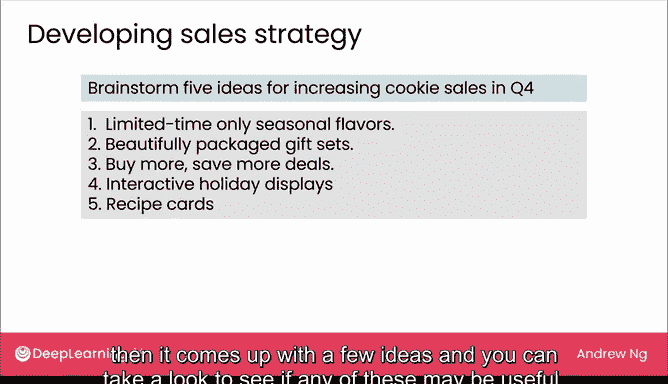
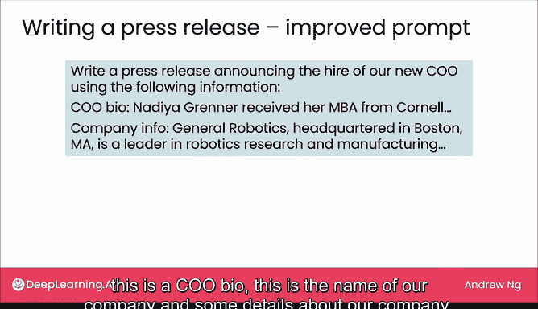
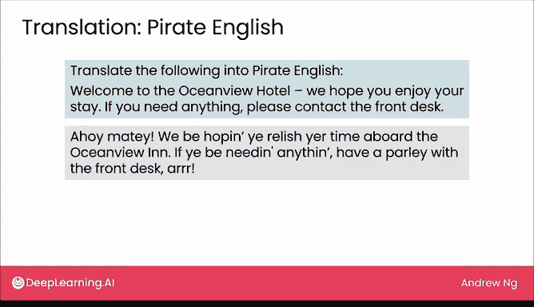

# 吴恩达最新《面向每个人的生成式AI》Generative AI for Everyone（中英字幕） - P5：05_01_01_写作.zh_en - GPT中英字幕课程资源 - BV11G411X7nZ

In the last video， we looked at writing， reading， and chatting as three major categories of tasks that you can get an along to do。

😊，Given that large languageish models were're trained to repeatedly predict the next word。

 maybe it's no surprise that they're pretty good at writing， at generating words。

 and it turns out that many writing tasks can be done via web user interface。

 so I hope you find this video where will dive more into writing tasks immediately useful。😊。

For writing tasks broadly what were will to do is start up a prompt and use a relatively short prompt to write or degenerate a much longer piece of text。

 so let's take look at some writing applications。😊。

I often use the web interface of large language models as a brainstorming partner If you ask it brainstorm vi creative names for peanut butter cookies。

 it actually comes up with some pretty creative names Na Nirvana levelss I would eat that or if you ask it to brainstorm ideas for increasing cookie sales then it comes up with a few ideas and you can take a look to see if any of these may be useful you can also use a large language model again maybe the web interface version to write some copy for you let's start with an example if you were to ask it to write a press release announcing the hire of a new COO a new chief operating officer for your company it may come up with a piece of text like this company name welcomes new CO's full name as so on and so forth and this is a pretty generic press release when writing a prompt you find that if you can give the large language model more context。

or more background information， then it will write more specific and better copy for you if all that the large language model sees is this writer a press release at this point in time it doesn't know anything about your company about the new CEOs name or their qualifications and so ends up writing something very generic like this。

If you end up prompting a large action model like this is not a problem。

 you may realize that you wound up with a very generic press release and decide to update the prompt to give it more information and serve you to prompt it and say use the following information for the press release。

 this is a CO bio， this is the name of our company and some details about our company then it will write a much more detailed and insightful press release specific to the CEOs joining this company。

I find that when prompting an LM or often not get the prompt right the first time like what we saw just now where we had the prompt Read press release announcing the new hire COO without giving any context and that's totally fine。

 if you see the result isnt what you want just revise the prompt and try again I'll say more about this in the later video this week when we talk about tips for writing effective prompts let's look at one more example another writing tasks that I sometimes use LMs for is translation In fact some of the large language models you can access via web UI are competitive and sometimes even better than the dedicated machine translation engines already especially for languages with a lot of text on the Internet and so where the large language model have a lot of data to learn how to generate text in that particular language it tends to do less well in languages also called low resource languages with less text on the internet in a language but if you're operating a hotel。

And you want to translate the welcome message into formal Heindi to welcome yes then a large language model may be able to output text like this for you unfortunately I don't speak Heindi I wish I did。

 but it turns out that this particular translation is only so so the word front desk it translates into the desk at the front rather than you know the reception which is what we mean when we say the front desk of a hotel。

So if you're working with a Hindi speaker and I was when preparing the slide。

 then they may be to give you some tips to say， oh this is some sort of not quite the best formal Hindi。

 but you were to tell it to translate this into formal spoken Hindi then it updates this text to make front desk translate into the Hindi word for reception which is much better translation Now here's one fun thing I've seen recently in the AI community。

 which is a lot of us that are working with translation often need to translate text into languages that we don't speak ourselves so how can we tell if the large language model is doing something reasonable and in fact even if you have say one Hindi speaker on your team if other members of the team don't speak Hindi。

 how can they figure out what's going on So what I'm seeing multiple teams in the AI community do is translate text into pirate English for testing purposes and so if you？

To prompt a La model to translate this into pi English， you get oho Mie。

 we be hoping you relish your timeboard the ocean view in。😊。

That sounds a pretty good power of English to me。 So that howy grand worthy models be used for writing。

 Let's move on to pein at Readinghouse R。😊。

