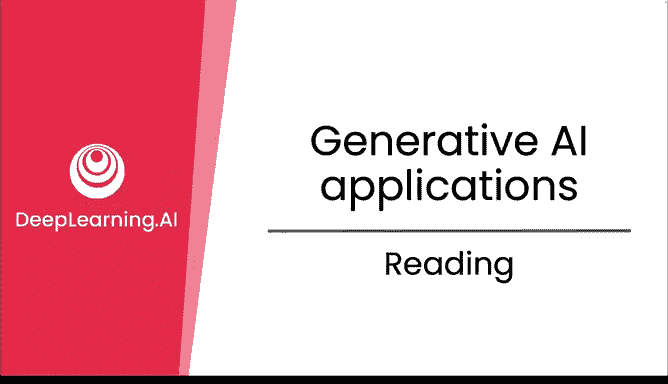
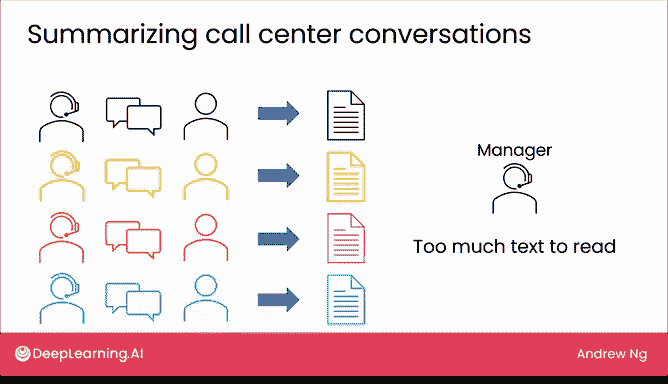
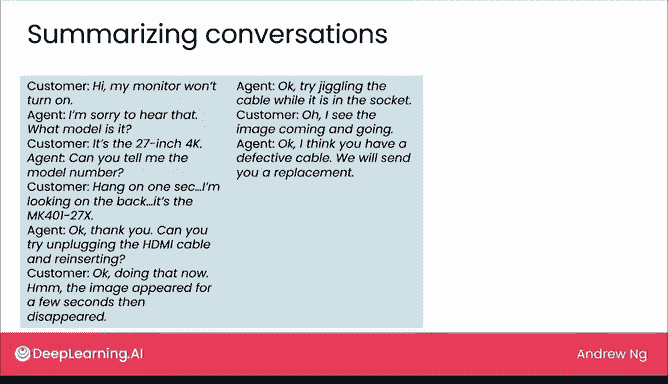
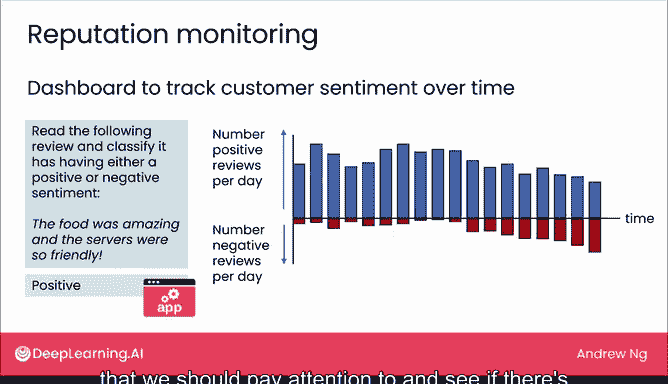

# 吴恩达最新《面向每个人的生成式AI》Generative AI for Everyone（中英字幕） - P6：06_01_02_阅读.zh_en - GPT中英字幕课程资源 - BV11G411X7nZ

In the last video we looked at writing tasks where you would specify a prompt to the last language model and have it generate a comparatively longer output than the input prompt It turns out elements is also useful for many reading tasks and by that I mean tasks where you would input a prompt and then have it generate usually a similar length or often shorter output than the input prompt let's take a look at some reading tasks starting with something that I use myself all the time which is proofread。

Many times if I'm writing a piece of text， I will read through it carefully three or four times myself for spelldling me on grammatical errors。

 and even though I thought I provedread carefully myself。

 but last night although we'll still find errors in it that somehow I had missed。😊。

Here's an example of a prompt that you could try， proofread the following text and I find that if you tell it what you wanted to text before。

 so here's text intended for a website selling children's stuff toys and sometimes ask it to check for spelling and errors as well as awkward sentences and then have it rewrite it with corrections and this is a piece of text with some errors。

And the output of the large language model fixes suger was misspelled and it fixes this little piece of grammar over here when I'm writing text myself that I want to be quite confident is free of spelling and grammatical errors and sometimes also awkwardque sentences I actually use this myself to proofread what I write a second reading tasks that large language models are often used is to summarize long articles one of my collaborators Eric Brenawusen。

 who was a professor， once sent me an email linking to an article that he had written titled the Turing trap and I knew it was a good article but it was a very long article and I didn't have time to read the whole thing before I responded to his email So I actually used the following prompt and copy pasted his entire article into an web interface of a large language model and had it quickly generated a summary for me It turns out this paper that he had written talks about how human。

AI office benefits but there's a lot to be done by having AI augment humans rather than automate but the point of Bynno's article on the Turing trap was he was advocating that instead of having AI automate or replace human work we should put more effort into having AI compliment or to augment human work and so with a large language model summarizing this long article I was able to get back on this faster than if I had to read the entire article myself and by the way this is a good article eventually I did read the entire article myself I really enjoyed it but today I do sometimes use language models to summarize for me things that I don't have time to read in this entirety and so this is a use case that you could go to one of the web interfaces of a large language model and use relatively quickly yourself。

Now it turns out there's a software application version of this too that is taking off in businesses Let me illustrate this with an example。

 say you're a manager of a customer service call center where you have many customer service agents like this person shown on the left with the microfil having phone calls with customer like this person shown on the right if you have permission to record these phone calls between the agents and the customers。

 you can then run the phone calls through a speech recognition system to get a text transfer of the conversation and if you have many customer service agents having conversations。

 you end up with a lot of text transcripts if you want to review what's going on a call center。

 you probably end up with too much text to read given a text transfer like this between the customer and an agent what really happen in this call。

 one use of large language models would be to have it summarize this entire conversation and generate a short summary。

Like M4127k was is broken and so on， and if you were to take all of these different text transcripts and have a software application to generate these summaries。

 then you as a manager of this can take a quick look at all of these summaries and just baby spot if there are any issues or any trends that you want to be aware of a system like this would be implemented as a software application that uses a large light model because it doesn't really make sense for you or anyone else to copy paste these conversations one at a time into the website of a large lightage model provider。

In terms of customer service interactions large languageage models are also used for customer email analysis in an earlier video you saw the example of taking a customer email and deciding if is a complaint in this case no as well what department to route this email and this would be another software application that uses a large language model let's take a deeper look at how one could build this application focusing on the part of deciding what department to route this email one thing you could do is write a prompt to tell the LM to read an email and decide which department to route it to so you can specify the task and provide the email but it turns out that with a prompt like this you may find that the algorithm routes it to the complaints department in this case which may or may not be a department that exists in your organization。

So this would be an example of where the LOM has been given insufficient context to know what are the names of the actual departments in your company that they should choose from In contrast。

 if you were to update the promise follows we say，Read the email choose the most appropriate department to rouse it to and choose department only from the following list in this case。

 given the set of choices you wanted to choose from， rouse it to the apparel department correctly。

The process of building an application using a launch digest model is again not all uncommon to write a problem that doesn't quite work right the first time and when you find it arouse it to non-existent complaint department then just update the prompt and that fixes a problem one last application that want to touch on is reputation monitoring where you can use an Lm to build a dashboard to track your customer sentiment positive or negative of your business or your products over time So for example。

 if you run a restaurant and occasionally your customers write online reviews or send you emails describing their experience you can then use a prompt like this read the following review and classified as having the positive negative sentiment to have it decide automatically if each review was positive or negative so in this case if the food was amazing or server friendly that would be classified as having a positive sentiment then by having software count the number of positive reviews per day as well the。

From negative reviews per day， you can build a dashboard that tracks per day or over time how the sentiments are trending。

And looks like the customer sentiment is pretty positive。

 but if ever it starts trending negative like this with more negative reviews。

 then this dashboard can alert you to that maybe something's happening that we should pay attention to and see if there's something we need to fix to the restaurant So in this video we looked at a number of reading applications。

 including proofreading summarization， email routing restaurant review sentiment analysis if you can think of tasks where you wish you had someone that could read a piece of text and just say a few things or give a few quick indications of what was in that piece of text。

 that could be a good candidate for a reading task to get an home to do for you。

Next， let's go to the next video to take a look at Chatting tasks。😊。

