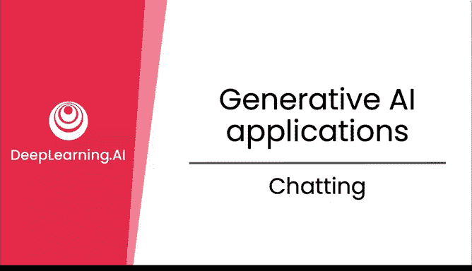
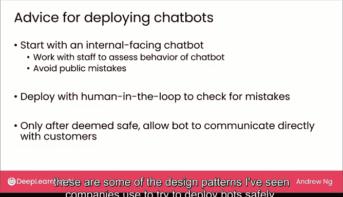

# 吴恩达最新《面向每个人的生成式AI》Generative AI for Everyone（中英字幕） - P7：07_01_03_对话.zh_en - GPT中英字幕课程资源 - BV11G411X7nZ

In the last two videos we looked at writing and reading applications in this video we'll look at chatting applications in addition to the general purpose chatbots like ChagBBd and BinChat。

 many companies are looking at whether they can build specialized chat applications if you're involved in a company where you have many people interacting with customers or having certain types of conversations of similar nature this may be a case where you can consider whether or not a specialized chatbot can help with those types of conversations let's take a look。

Earlier， we already saw the example of a customer service chatbot that might be to take orders for a cheeseburger another example of a specialized chatbot would be one that specializes in helping you to plan trips so how canification in Paris inexpensively and a bot could be built to have specialized knowledge about travel。

And today there are companies exploring a wide range of advice bots， for example。

 can a bot give you career coaching advice or give advice on cooking a meal。

 so a large variety of specialized bots that are really good at answering questions about one thing are being developed by different companies today some of these bots are capable of just having a conversation and giving advice some of these bots can also interface with the rest of a company's software system and take actions such as to put in an order for a cheeseburger to be delivered another example of a bot that might be able to take action would be a customer service chatbot where it turns out that many IT departments get tons of password reset requests and if a bot can take care of that then it may take some of the workload off your IT department and a bot like this that needs to be send a text message to verify identity and actually hold reset password。

This is a bo that would need to be empowered to actually take action in the world such as to get a text message to be sent to someone next week we'll discuss more how chatbo like these are builts that don't just generate text we can actually take action because of the number of customer service organizations exploring the use of chatbots I want to share with you a range of the spectrum of common design points being used by different businesses and for this slide I want to focus on text based chat rather than voice or phone based chat。

So at one end of the spectrum would be a customer service center with only humans。

 so you would have human service agents typing back and forth messages like Wecome to Petenburgs and Dmi only for you。

At the opposite end of the spectrum would be chatbots only where you just have software responding directly to customers。

 but between these two ends of the spectrum of humans typing the keyboard or chatbots only there are a couple common design points one common design points would be to have bots support humans in which a bot will generate a suggest a message for a human。

 but the human service agent will read the message and either approve it if it looks good or have a chance to edit the message before it is actually sent back to the customer this type of design is often also called human in the loop because as a human that's looptin and is part of the process before the message actually gets sent back to your customer and this is a way to mitigate the risk of the chatbot maybe saying the wrong thing because a human can check over it before it's actually sent back to your customer in the next video when we talk about what LMs can and cannot do well go over。

Some of the mistakes that Oms can sometimes make and so this design helps protect against those mistakes of OMs a little bit further on the automation spectrum would be if you have a bot to triage messages for humans so maybe the bot answer the easy messages but escalate to a human for the things that ist ready to handle yet sometime back actually let the team that build a bot that would automatically detect if the customer was asking for refund request。

 it turns out that was about 10% of a total trapped call volume and by just detecting that and automatically giving the customer instructions this route 10% or so the traffic away from the human agents and so to save the agents a lot of time and let the humans focus on servicing the harder request but the cyber triaging is another common design to help your human service agents save time and have to focus only on the harder cases that they're more uniquely qualified to handle。

In many customer service centers， a single human may be simultaneously having chat conversations with48 or in some extreme cases。

 maybe in 16 customers at the same time， and with bots supporting the humans。

 it becomes easier for a human to manage a larger number of parallel conversations Given that bots sometimes say the wrong thing。

 I want to share with you what building and deploying a bot often feels like in companies that want to do this in a safe way。

Often companies will start with an internal facing chatbot so many times I would build a chatbot but let only my own team use it to say answer the questions about travel or whatever the bot is supposed to do and assuming your internal team will be more sympathetic and more understand little mistakes and be more forgiving if the bot says something wrong at one time。

 this gives you some time to assess the behavior of the bot and also avoid public mistakes that could be embarrassing for the company after this looks safe enough。

 a common next step would be to deploy with human in the loop to know the human checkover many of the messages if feasible before it actually goes out to the customer and after doing this for a while if it looks like the bots messages are generally safe to send to customers then you might allow the bot to communicate directly with customers Of course the details are very business differ first and for some applications it may not be。

To have humans check over every message because of the sheer volume of traffic。

 but depending on the risk of the bot saying the wrong thing as well the volume of traffic and does whether or not human in the loop is feasible these are some of the design patterns I've seeing companies use to try to deploy bots safely to summarize we're seeing how OMs can be used for writing。

 reading and chatting these three categories are now meant to an exhaustive list of what OMs can do but to just a few broad categories of what you might really use them for and OMs can do a lot but they can't do everything in the next video let's take a look at what OMs can and cannot do and better understand the limitations let's go on to the next video。

