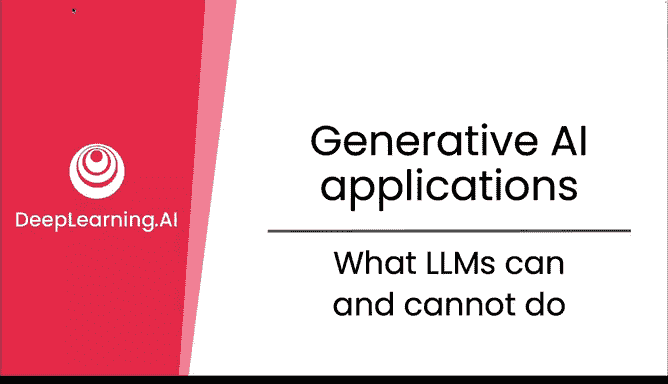
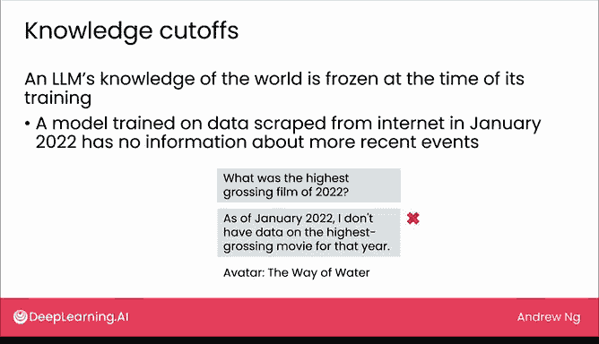
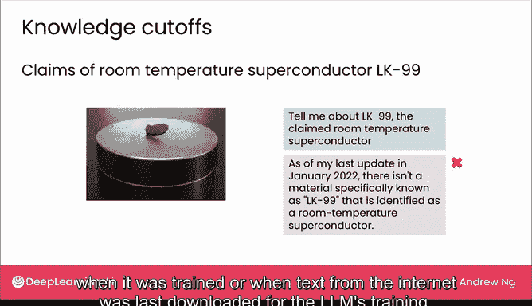
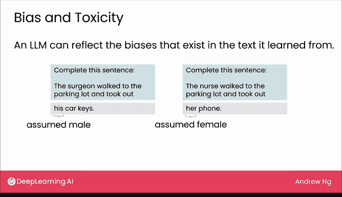

# 吴恩达最新《面向每个人的生成式AI》Generative AI for Everyone（中英字幕） - P8：08_01_04_大语言模型能力与局限.zh_en - GPT中英字幕课程资源 - BV11G411X7nZ

G AI is an amazing technology， but it can't do everything In this video we'll take a careful look at what LMs can and cannot do We'll start off with what are found to be a useful mental model for what they can do and after that let's look together at some specific limitations of LMs I found that understanding the limitations can load the chance that you may get tripped up trying to use them for something that they really not good at so that let's dive in。

😊，If you're trying to figure out what prompting an OM can do。

 here's one question that I found to provide a useful mental framework， which is I ask myself。

 can a fresh college grad following only the instructions and the prompts complete the tasks you want？

For example， can a fresh college draft follow instructions to read an email to determine if an email is a complaint well I think a fresh college draft could probably do that and an can do that pretty well too。

 or can a fresh college draft read a restaurant review？😊。

To determine if it's a positive one negative sentiment， I think they could do that quite a well too。

And so too caning an LLM here's another example can a fresh college grad write a press release without any information about the COO or your company well this fresh college gra just graduate it from college they only just met you and don't know anything about you or your business and so the best it could do is maybe write a really generic and not quite satisfying press release like this。

But on the flip side， if you were to give them more context about your business about the CEO。

 then we can ask， can this fresh college gra write a press release given the basic relevant context and I think they may be to do that decentL will and so too can the large language model when you're picturing an LLM as doing many of the things that a fresh college gra might be able to do think of this fresh college gra as having lots of background knowledge that they know lots of general knowledge off the internet。

 but they have to complete this task without access to a web engine and they don't know anything about you or your business for clarity。

 this mental model， thought experiment， fresh college gra has to complete a task with no training specific to your complete or your business and every time you prompt your LOM DM does not actually remember earlier conversations。

And so as as if you're getting a different fresh college drag for every single task so you don't get to train them up over time on the specifics of your business or the style you want them to write this rule of thumb of asking you what a fresh college drag can do is imperfect rule of thumb。

 they're things college drags can do that LMS cannot and vice versa。

 what I found this to be a useful starting point for thinking through what Os can and cannot do and while we're focused on this slide on what prompting an LM can do next week when we talk about geneative AI projects。

 we' talk about some slightly more powerful techniques that might be to expand what you can do with generative AI beyond this fresh college drag concept。

Now let's take a look at some further specific limitations of Ls First is knowledge cutpo and No's knowledge of the world is frozen at the time of his training more precisely a model trained on internet data straight by January 2022 would have no information about more recent events。

 so given such a model it would ask it what was the highest grossing film of the year 2022。

 it would say it doesn't know even though now they were well past 2022。

 we know that it was the Ruy avatar the way of water。

That was the highest grossing film。Around July 2023 there were claims of research lab having discovered a room temperature superconductor called LK99 you may have seen this picture in some of the news this claim turned out not quite to be right。

 but if you were to ask an LM about LK99 even though it's widely covered in the news if the LM learned only from text on the Internet as of January 2022 it won't know anything about this so this is called a knowledge cut off where the LM knows things about the world only up to a certain moment in time when it was trained or when text from the internet was lost downloaded for the LM's training a second limitation of LMs is that they will sometimes just make things up and recall these hallucinations。

I found that if I asked an LM to give me some quotes from wellknown people in his often make up the quotes。

 for example， if you ask it， give me three quotes that Shakespeare wrote about Beyonce since Shakespeare lived and died well before Beyonce I don't think Shakespeare said anything about Beyonce。

 but Ellan will confidently give you back some quotes like a vocal shine like the sun or or her opinions she has most worthy of love。

 so these are hallucinated Shakespeare in quotes or if you ask it to list quote cases tried in California about AI。

 it might give authoritative sounding answers like this。😊，And in this case。

 it turns out the first case Israel， there was a Waymo versus Uomber case。

 but I was not able to find an Ingaol versus Chevron case， and so the second case is a hallucination。

 sometimes Oms can hallucinate things or make things up in a very confident authoritative sounding tone and this can mislead people into thinking that this madeup thing may actually be real hallucinations can as serious consequences。

 there was a lawyer that unfortunately use Cha GT to generate text for a legal case and actually submit it to the court。

 not knowing that he was submitting to the court， illegal legal fouling with lots of made up court cases and in this New York Times headline we see in this cringeinducing court hearing。

 the lawyer who rely on AI said he did not comprehend to the Chabot could lead him astray and this lawyer was sanctioned for submitting。

Call found for made up things。So understanding of limitations。

Is important if you are using this for documents of real consequence。

OMs also have a technical limitation in that the input length that is the length of the prompt is limited as so as the output length of the text they can generate Many OMs can set the prompts of up to only a few thousand words and so the total amount of context you can give it is limited so if you are asking it to summarize a paper and the paper's length is much longer then this input length limitation the OM may refuse to process that input in this case you may have to give it one part of the paper at a time and ask it to summarize parts of the paper at the time or sometimes you can also find an OM with a longer input limit length。

 some will go up to many tens of thousands of words and technically Oms have a limitation on what's called the context length and the context length is actually a limit on the total input plus output size when I use OMms I rarely have it generate so much output。

That I run into limitation really on the output length。

 but I do hit input length limits sometimes if I have many， many thousands of words of context。

 I want to give it Lastly one major limitation of genative AI is that they do not currently work well with structured data and my structured data I mean tabular data like saw the data that you might store in an Excelel or Google sheet's spreadsheet For example。

 here is a table of home prices with data on both the size of the house in square feet as was the price of the house if you were to feed all of these numbers into an Om and then ask it I have a house there's10 square feet。

 what do you think is a good price Lms are not really good at that instead if you call the size the input a and the price。

 the output B then supervise learning would be better technique with which to estimate the price as the function of the size。

Here's another example of structured data of tabular data showing when different visitors may be visiting your website。

 how much you offered your product to them and whether or not they purchased it， then again。

 supervised learning would be a better technique than trying to copy paste all of this time and price and purchase information into the prompt of a large language model。

In contrast to structured data gene AI tends to work best with unstructured data structured data refers to tablet data of the So would store in a spreadsheet whereas unstructured data refers to text images audio video and gene AI does apply to all of these types of data although the impact is the largest and that focus mostly on text data in this course。

 Finally large language models can bias output and can sometimes output toxical other harmful speech For example。

 large language models were trained on text off the internet and unfortunately text on the internet can reflect biases that exist in society So if you were to ask anLM complete the sentence Surgeon walks the parking lot in Toout the alarmM might output his car keys or youll say the nearest walk to the parking lot and tookout it may say her phone so in this case the OM has assumed that the surgeon。

male and the nurse is female， whereas we know that clearly surgeons and nurses can be any gender。

 and so if you're using an LOM in an application where such biases could cause harm。

 I would use care in how we prompt and apply the LOM to make sure we don't contribute to such undesirable biases。

Finally， some Ls can also occasionally output toxic or other harmful speak， for example。

 some Ls will sometimes teach people how to do undesirable。

 sometimes even illegal acts Fortunatelyly all the major large language providers have been working hard on the safety of these models and so most models have gotten much safer over time and if you use the web interfaces so the major LM providers is actually been getting much harder over time to get them to output these types of harmful speech so that summarizes what prompting and LM can and cannot do and as I mentioned next week will take a look at some techniques for overcoming some of these limitations to make what LMs can do even broader and more powerful but first let's take a look at some tips on prompting LMs and I hope that the tips I share in the next video will be useful right away to how you use LMs I'll see in the next video。

