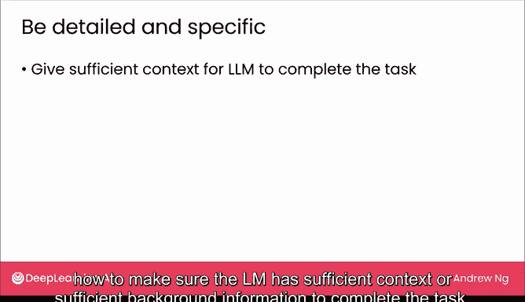
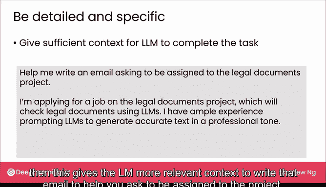
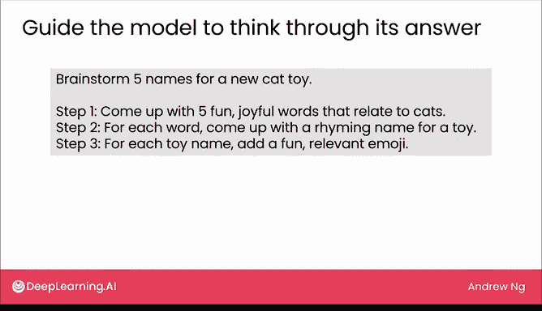
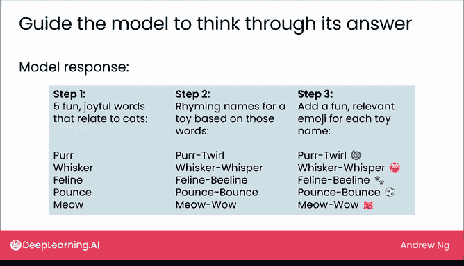
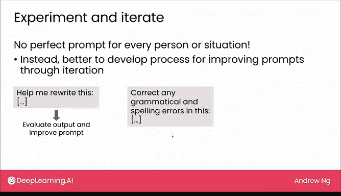
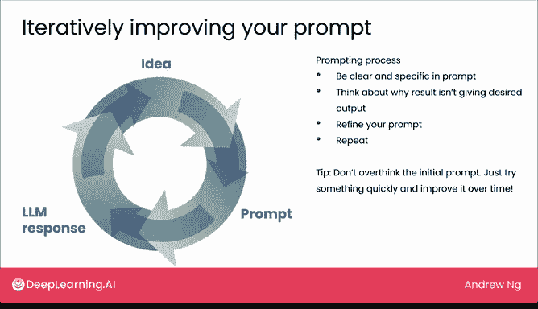

# 吴恩达最新《面向每个人的生成式AI》Generative AI for Everyone（中英字幕） - P9：09_01_05_提示技巧.zh_en - GPT中英字幕课程资源 - BV11G411X7nZ

I'd like to share you some tips for prompting large language models if you're using the web user interface of the LM provider hopefully these tips will be useful to you right away and it turns out that some tips are also useful for if you're ever involved in building a software application that uses LMs lets dive in this video will go through three main tips for prompting first is be detailed and specific second is guide the model to think through its answer and third it is experiment and iterate this starts with be detailed and specific using the fresh college grad analogy I would often think about how to make sure the OM has sufficient context or sufficient background information to complete the task。

So for example， if you were to ask it， help me write an email asking to be assigned to the legal documents project well given only a prompt like this and one doesn't really know how to write a compelling case to advocate for you to be assigned to that project but if you give additional context such as I apply for a job and the legal documents project which check the legal documents them experience on prompting Ls to get accurate text of professional tone。

 then this gives theLM more relevant context to write that email to hope you ask to be a to the project further if you can also describe the desired task in detail So you tell it instead of saying help me write an email if you ask it write a paragraph of text explaining why my background makes me a strong candidate on this project and advocate of a candidacy then just type a prompts would not only give the Lm sufficient context but also tell it quite clearly what you wanted to do and this is more likely to get you the result that you want second tip is to guide the model to think through。

This answer。So if you were to tell it brainsstorm five names for a new cat toy it actually could do pretty well。

 but if say you have in mind you want a rhyming cat toy name with a relevant emoji this is what I might try I might tell it brainsstorm five names and tell it step one come with five joyful words ready to cats then if each work come with a rhyming name and finally for each toy name at a fun relevant emoji and with a prompt like this you might get the result like this with the Elm follows your instructions to first come with per whisker and so on and then Pearl 12 whisk whisper feline B line with fun emojis at to the end So if you already have in mind a process by which you think theelm could get to the answer that you want giving it clearer step by step instructions to follow can be quite effective finally there have been a bunch of articles that seen on social media that say things like toy problems that everyone must know or 17 problems。

That will help you grow your career I don't think there's a perfect prompt for everyone instead I find it more useful to have a process by which you can write the prompt or generate the result for you so when I'mproing an on myself I will often experiment and iterate and try something I might start off say help me rewrite this and if I don't like the result I might clarify and I say correct any grammatical and spelling errors in this and if it still doesn't give me exactly the result I want。

 I might clarify even further to say correct any gra and spelling errors and re writeite the tone appropriate for a professional resume so very frequently the process of prompting is not about starting off with the right prompt is about starting off with something and then seeing that the results are satisfactory and knowing how to adjust the prompt to get it closer to the answer that you want I think of the process of prompting as like this you start of with an idea of what you want your own to do。

We just expressed that in a prompt。And then based on the prompt the LM will give a response and it may or may not be what you want if it is。

 then great you're done， but if it isn't satisfactory。

 then that initial response helps you shape your idea and modify the prompt and iterate maybe a few times before you get to the results that you want。

So I think of the prompting process as when I start off， I try to be reasonably clear and specific。

 but to save time Ill often start off with a short prompt that may be as frankly less specific than this design but I just wantna get going quickly after you get the result back if it's not what you want then think about why the result isn't the desired outputs and based on that refine your prompt to clarify your instructions and keep on repeating until hopefully you get the own response that you want One tip I want to share is I've seen some people overthink the initial prompt I think it's better to usually just try something quickly and if it doesn't give you the results you want is fine go ahead and improve it over time。

 you will not break the internet by just accidentally having a slightly incorrectly worded prompt so ahead and try what you want to important caveats first if you're in possession of highly confidential information I would make sure I understand how a large language model provider does or does not use or keep that information confidential before。

copy pastcing highly confidential information into the web users' phase of an LM and second。

 as we saw in the last video with the lawyer they gone into trouble submitting court filings with facts made up by an LM before you count the LMSs result it may be worth double checking and deciding for yourself whether or not you can trust and act on TLMs output。

But with these two caveats when prompting I will often just jump in and try something and see it not work。

 but then use the initial result to decide how to refine the prompt to get a better result and that's why we say prompting is a highly iterative process Sometimes you have to try a few things before you get the result you want So that's it for tips on prompting I hope that you go to some of the web user interfaces of the large language model providers and try some of these ideas yourself and in this course we provide some links to some of the popular providers and I hope you go play with them and have fun with them that brings us to the end of the main set of videos for this week there's one optional video to follow where I'll talk a little bit about imagegen or diffusion models so take a look at that if you want and then look forward to seeing you back next week where we'll talk more about how to build projects using large language models look forward to dive into that with you next week。

