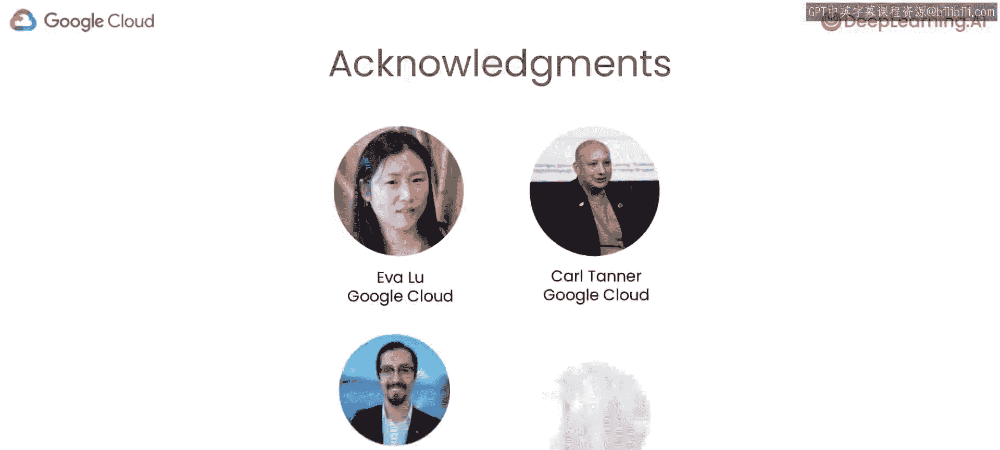
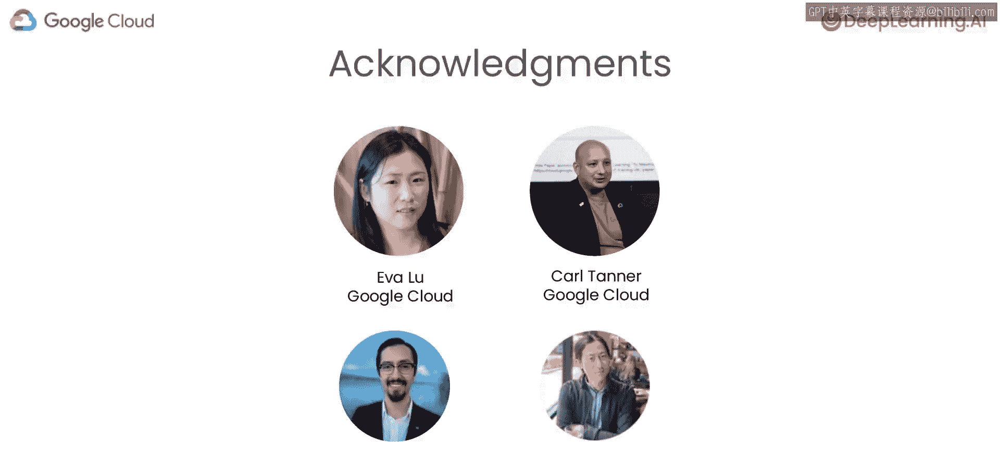

# 吴恩达｜使用VertexAI理解和应用文本嵌入｜Understanding and Applying Text Embeddings with VertexAI - P1：SC-GCP_Intro.zh - GPT中英字幕课程资源 - BV1Mw411U7yr

Hi and welcome to the short course， understandingstanding and applying T embeddings with Vertex AI built in partnership with Google Cloud In this course you learn about different properties and applications of text embeddings will dive together into how to compute embeddings that is feature vector representations of text sequences of arbitrary length and we'll see how these sentence embeddings are a powerful tool for many applications like classification。

 all detection and text clustering。If you've heard of word embedding algorithms like word to glove that just examined a single word at a time。

 this is a bit like that but much more powerful and much more general because it operates at the level of the meaning of a sentence or even a paragraph of text and also works for sentences that contain words not seen in a training set。

In this course you also learn how to combine text generation capabilities of large language models with these sentence level embeddings and build a small scale questionknowing system that answers questions about Python based on a database of stack overflow posts I'd like to introduce the other instructor for this course Nikkita Nam Thanks Andrew I'm so excited to be teaching this course with you as part of my job at Google Cloud AI I help developers build with large language models and I'm really looking forward to sharing practical tips that I've learned from working with many cloud customers and many。

 many LLM applications this course will consist of the following topics in the first half which I'll present will first use an embeddings model to create and explore some text embeddings then we'll look together to go through a conceptual understanding of how these embeddings work and how embeddings for text sequences of arbitrary language I created and also use code to visualize different properties of。

😊，ddingThe second hop is taught by Nikta Well after you've got a chance to explore some different properties of embeddings。

 you'll then see how to use them for classification。

 clustering and outlier detection because sentence level embedding start to get at the meaning of an entire sentence。

 This really helps an algorithm to reason more deeply and make better decisions about text So after this will'll see how to use a text generation model and some of the different parameters you can adjust and finally we'll put everything you've learned about embeddings semantic similarity and text generation together to build a small scale question answering system Many people have contributed to this course we're grateful for Eva Lu and Caltanana from the Google Cloud team and also on the deepbl AI side Daniel Vigilara and Eddie S The first lesson will be about how to get started with embedding text That sounds great。

 Let's get started。😊。

