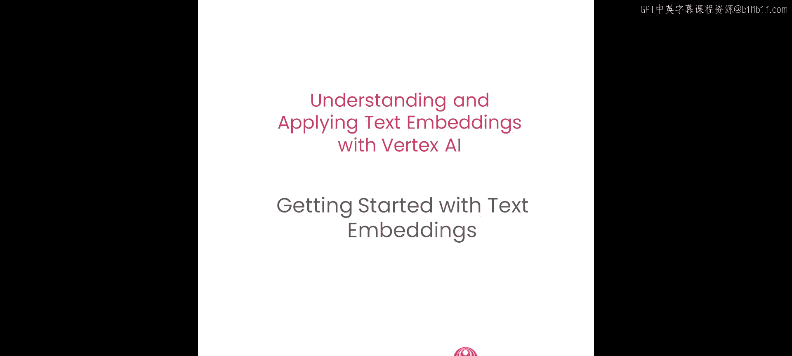
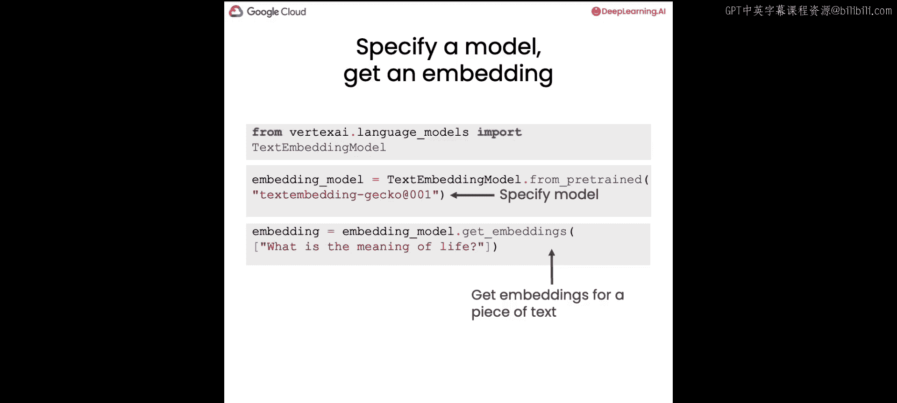
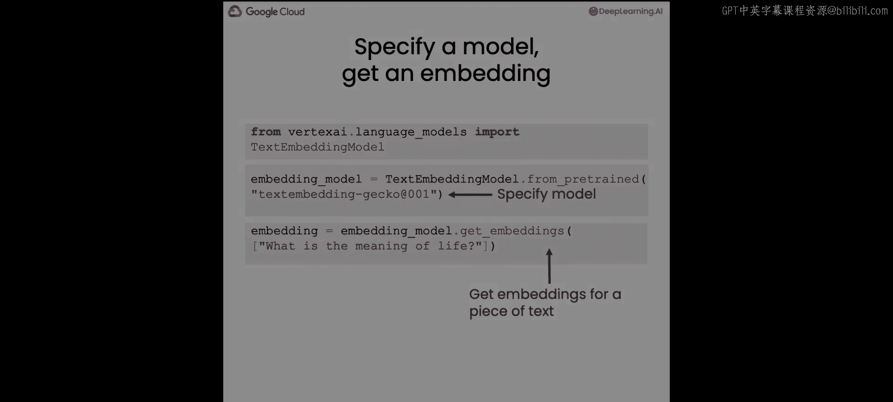

# 吴恩达｜使用VertexAI理解和应用文本嵌入｜Understanding and Applying Text Embeddings with VertexAI - P2：SC-GCP_L1.zh - GPT中英字幕课程资源 - BV1Mw411U7yr

I think text andbeddings are really fun to play with let's dive in and take a look at some examples of text embeddings so here's my empty Jupyter notebook if you're running this locally on your own computer you need to have the Google Cloud AI platform installed so you run P installst Google Cloud AI platform。

 but I really have that on this computer I don't need to do that。

Let me start by authenticating myself to the Google Cloud AI platform。

 I'm going to use this authenticate function， which is a helpfuler function that I'm using just for this Jupyter notebook environment to load my credentials in the project ID if you want you can print out these object So Project ID is just a string that specifies what project here on。

 and then I'm going to run my commands using a server in the region US Central and then lastly with this import vertex AI。

 and I'm going to initialize this by specifying my project ID。

 the region where my API calls we serve as well as passing the credentials which contains the secret authentication key to authenticate me to the vertex AI platform if you set up your own accounts on Google Cloud there are few steps needed to register an account then set up and put the project ID which。

Comes the string that you copy in here。 and then you can select the region。

 U Central1 will work fine for many people， or you can choose server closer to wherever you are。

 and we also have an optional Jupyter notebook later that steps through in detail how to get your own credentials the Google Cloud platform。

 But for now I would say don't worry about this， this is all you need to get through this short course。

 and if you want to run this locally on your own machine。

 you can follow the instructions in that later optional Jupyter notebook to figure out how to get your own credentials and P ID and so on。

 So the main topic for this short course is to use text embedding models So I'm going to import the text embedding model like so next。

 I'm going to specify this particular text embedding geckco01 model。

 which is the model we'll use today。 So what this commander it saves an embedding model here。

 And now to actually compute an embedding。 This is what you do。Said embedding equals。

 call the embedding model to get an embedding let's start up with this single word string life。 next。

 let's say vector equals embedding0 dot values。 This's just extracts the values out of the embedding and let's print the length of vector。

And let's print the first 10 elements of the vector。

So here vector is a 768 dimensional vector and these are the first 10 elements of the embedding feel free to print out more elements of this if you want to take a look at all these numbers So what we just did was we took the single word life。

 really the text string with the word life and computed and embedding of it。

Let's look at a different example， I can also pass in now a question。

 what is' the meaning of life and take this text string。And compute that embedding。Once again。

 we end up with a 768 dimensional vector that computes 768 different sort of features for this sentence and this is the first10 elements because each of these embeddings is a lot of numbers is difficult to look at these numbers to understand what they mean。

 but it turns out one of the most useful applications of these embeddings is to try to decide how similar are two different sentences or two different phrases or two different paragraphs of text So let's take a look at some more examples and how similar different embeddings are for this I'm going to use thecycl learn packages。

 cosine similarity measure of similarity what this does is basically take two vectors and normalize them to length one and then compute their dot product。

 but this gives one way to measure how similar are two different 768 dimensional or really any other dimensional vectors。

And I'm going to compute three embeddings for the first sentence。

 I'm going to embed what is the meaning of life， I it 42 or is it something else。

 And if you don't know the 42 reference is actually reference one of my favorite novels that you can search online and the another 42 if you're interested。

 but let's also embed how does one spend the time well on earth。

 which you know seems a little bit like asking what's the meaning of life and then sentence3 is would you like a salad。

 I hope the meaning of my life is much more than eating salads。

 So hopefully sentence 3 has maybe a little bit but not too much to do with sentence one and then slimmerous above。

 let's just pull out the vectors of these embeddings。

And now let me compute and print out the similarity of。All three pairs of sentences。

 So let me add this over here and we run this。And now we see that the similarity between。

Vc1 and V2 first two sentences is higher 0。655， so what is the meaning of life is judged by disembedding to be more similar to how does one spend a time well on earth？

And the similarity between sentences 2 and3 is 0。52 between 1 and 3 is 。54。

 so this accurately judges that the first two sentences are more similar meaning than one and three or two and three。

 and it accomplishes this even though there are no words in common between the first sentence and the second sentence。

What I' encourage you to do is pause this video and in the Jupyter notebook on the left go ahead and type in some other sentences。

 maybe write some sentences about your favorite programming language or your favorite algorithm and maybe your favorite animals or your favorite weekend activities and plug in a few different sentences and see that accurately judges whether different sentences are more or less similar to each other I do want to point out one thing which is that you might see that these numbers they all look like they're in a pretty similar range cosine similarity in theory can go anywhere from zero to one but it turns out that because these vectors are very high dimensionmenal vectors there are 768 dimensional vectors it turns out that the cosine similarity values you get out will tend to fall within a relatively narrow range you probably won't ever get zero distance or 1。

0 distance but it turns out that even though these numbers feel like they may be in。

Relatively narrow range， the relative values between these distances is still very helpful。

 And again， if you plug in different sentences and play with this yourself。

 hopefully you get a better sense of what these similarity measures might be like Let's take a deeper look at why sentence embeddings are more powerful I think than word embeddings。

 let's look at another two different inputs， a first input the kids play in the park。

 you know during recess， the kids play in the park and in the second input is the play was for kids in the park So someone puts on the play there is a show for a bunch of kids to watch if you were to remove what's called stop words So stop words like V in for and is those are words that are often perceived to have less semantic meaning in English sometimes but you were to remove the stop words from both of these sentences you reend up with an identical set of three words kids play part。

And play Kis Park。Now let's compute the embedding of the words in the first input。

 I'm going to do a little bit of data wrangling in the second。

 I'm going to import the nuy library and then let me use this code snippet to call the embedding model。

On the first input， Ki play part。 and then the rest of this code here using an iterator and then nu stack is just a little bit of data wrangling to reformat the outputs of the embedding model into a three by 768 dimensional array。

 So that just takes the embeddings and puts it in in an array like that。 If you want。

 feel free to pause the video and print out the intermediate values to see what this is doing。

 But now let me just do this as well。For the second input so embedding array2 is another three by 768 dimensional array and there are three rows because there are three embeddings。

 one for each of these three words So one way that many people used to build sentence level embeddings is to then take these three embeddings for the different words and to average them together so if I were to say the embedding for my first input the kids play in the park after stopware removal。

 the kids play part is I'm going to take the embedding array1 and take the mean along x is zero so that just averages across the three words we have。

And you know， do the same。For my second embedding， if I then print out the two embedding vectors。

Not surprisingly， you end up with the same value。 So because these two lists have exactly the same words when you embed the words and in average the embeddings of the individual words。

 you end up with the same values here I'm printing out just the first four elements of this array。

 you can feel free to check that all of these 768 elements of this array are identical In contrast。

 if you were to call the embedding on the original input sentence like so， then if you print out。

The values of the embeddings， you can see that they are then very different。

And that's because the embedding model， in addition to not ignoring stop words。

 a common words like is a of the。It also is much more sophisticated in understanding the word order so that it understands that the semantics or the meaning of the kids play in the park is very different than the play was for kids in the park So I do strongly encourage you to pause this video and go play with this yourself。

 plug in different sentences， see what embeddings you get， look through the liesic code。

 make sure they make sense to you and play with these embeddings。So before wrapping up this video。

 just to go over the key pieces of syntax we used in this course， you saw me use import vertex AI。

 vertex AI is the name of the Google Cloud machine learning platform。

 and then we use vertex AI do init， which required specifying the project ID。

 which references your Google Cloud project， the location where the service will run。

 so which data center will this run in and then also the secret credentials for authentication。

After setting up vertex AI， this was the syntax to get an embedding。

 We would import the text embedding model， then specify the text embedding。

Model and load the model to embedding model and then simply call get embeddings on a piece of text。

 And so with that， I hope you pause this video and go back to the Jupiter notebook and plug in other pieces of text write something fun or write something not fun of you in this but plug in different pieces of text and see what embeddings and what results you get and I hope you have fun with it And when you're done let's go into the next video where we'll dive into deeper conceptual understanding of what embeddings are and how they work look forward to seeing you in the next video。

