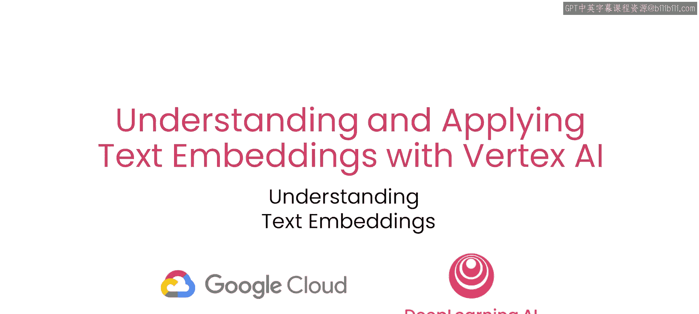
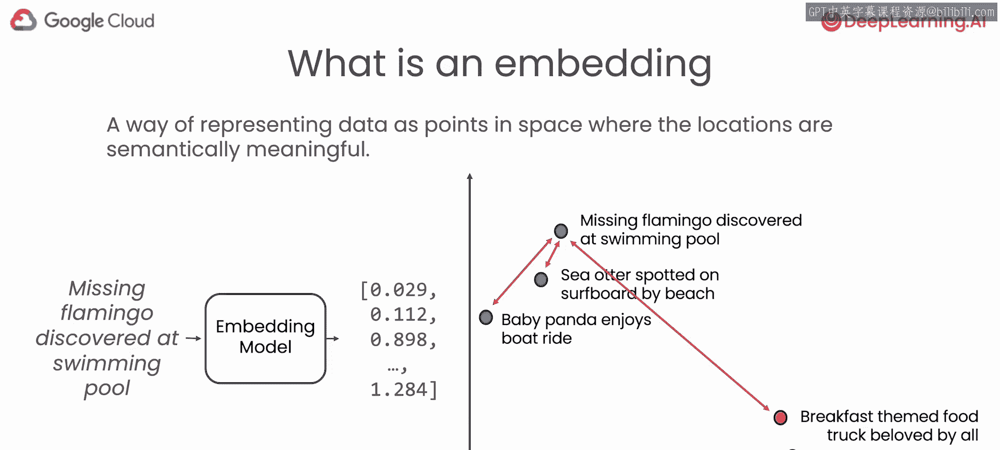
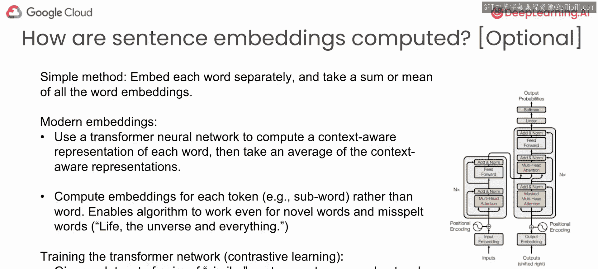
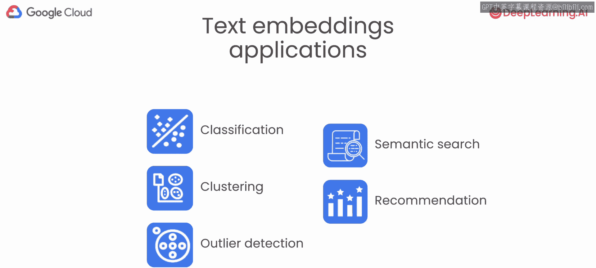
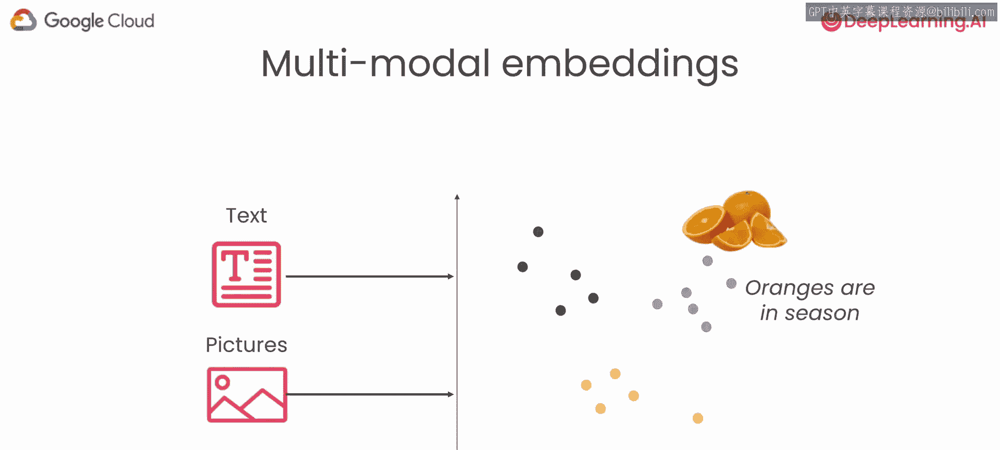

# 吴恩达｜使用VertexAI理解和应用文本嵌入｜Understanding and Applying Text Embeddings with VertexAI - P3：SC-GCP_L2.zh - GPT中英字幕课程资源 - BV1Mw411U7yr

Embbeddings is one of those technologies that I think is just really cool。 In this video。

 let's take a look together at how embeddings work。 Let's dive in。😊。

As you saw a bit from the previous video， an embedding gives a way of representing Dataz points in face where the locations are semantically meaningful。

 The word semantics just means meaning。 So it means the location captures something about the meaning of a piece of text。

 So you might inputfer the sentence like missing flamingo。

 discover that swimming pool and output an embedding like that。

 And if you were to embed multiple sentences， then hopefully missing flamingo discovered as was sea onna spotted on surfboard by beach or baby panda enjoys boat right。

😊，All of these may be more similar locations to each other。

 whereas a sentence like breakfast theme food truck beloved by all and New curry restaurant is delightful。

 those will be further away and the pair wise distances between these animal and waterrelated sentences will be much greater than the pairwise distance between say the flamingo sentence and the breakfast themed sentence。

😊，So how are these embeddings computed？

On this next slide， I'm gonna to get a little bit more technical。 So bear of me。

 But everything on this slide is optional。 So if you skip through it totally fine and nothing on this slide would be required for completing the rest of this short course。

 So actually find if you decide to skip this material。 But if you were to build your own embeddings。

 then one simple method would be to embed each word in a sentence separately and then take a sum or a mean。

 you， say of all of the individual word embeddings。 So for a long time。

 the dominant approach to computing embeddings would be to have a b lists of all the most commonly occurring English words。

 And for each word， we would separately train a set of parameters to give an embedding just for that word。

 And then if you have a sentence， you can take an average of all of them。

 and that's how you would embed。A sentence。 But as you saw already in the previous lesson。

 This means that the sentence level embedding doesn't understand word ordering。

 So modern embeddings do something more sophisticated。

 We instead can use the transform a neural network to compute a context aware representation of each word and it can take an average of the context aware embeddings。

 And if you don't know what this diagram is doing， don't worry about it。

 But what the transform a neural network does is very loosely。

 It takes each word and then compute an embedding for that word also takes into account what other words appear in the sentence。

 So that's why taking an example from our previous lesson， The word play is it kidss playing。

 or is it。A play in the sense of a show。 Those two words play will end up with different representations with different vector embeddings because they have different meanings。

 which the transformer network can figure out by looking at the context of the surrounding words。

 But by doing this， you get a much more sophisticated embedding。 But by using this approach。

 you get an embedding of a sentence that takes into much more of the meaning of each word。

 because the word play can mean different things in different context。

 And then theres one of the modification to this idea， which makes it even more powerful。

 which is instead of using a predefined list of words。

Modern embeddings will compute embeddings for each token。

 and tokens will often correspond to sub wordss。 And the nice thing about that is it enables the algorithm to work even for novel words and even for misspet words。

 So if I were to write life the unverse misspellt universe and everything。😊。

Tidled one of my favorite novels， it will still compute and embedding for this life。

 the unverse and everything that will be， you， pretty okay。 even though I miss spell universe。

 whereasas in contrast， if you're using a traditional embedding technique。

 Then the missll unverse won't get mapped to an embedding anywhere close to the word universe。

 and modern large language models， take sentences and break them down into sub words called tokens。

 and by learning embeddings for tokens， you can throw any string at it。

 and it will still you generate some hopefully meaningful embedding。

 So this is how embeddings are computed。😊，How embeddings learned？

So the technique used to train to transform neural networks parameters is a technique called contrastive learning。

 Different research groups are still experimenting with different techniques for computing embeddings。

 but loose you would first pretrain to transform a network on a lot of text data So this is how large language models are trained it on a lot of unlabeled text data of the internet off other sources and then you would find a datas or pairs of similar sentences and then tune the neural network to move the embeddings of more similar sentences together and move thesimilar sentences embeddings apart。

 So how do you know if two sentences are similar or dissimilar similar sentences can be whether you define but if you have a way of finding a database of similar sentences and there few of these online that could be one way or if your goal is to build a question answering system you can also declare that the question。

And this corresponding answer are similar， and that will tend to close the neural network to push the answer to a question closer to the embedding of that question。

 and dissimal sentences are often just randomly sample pairs of sentences because if you randomly pick two sentences。

 probably they're not that similar with each other meaning。But today。

 researchers are still playing around with different variations on this basic recipe。

 which is why embedding algorithms are still getting better every few months。

 and it's all an exciting space for research but they do work well enough for us to just use them right now。

 and in particular， later in this short course， Nikkita will go through how to use text embeddings in a range of applications。

 including text classification clustering outline detection and semantic search。

 and then we won't talk about product recommendations much in this short course。

 we can also imagine if you've bought products X， Y and Z then by using embeddings to find what are similar products based on the product description to stuff that you like This is also very useful for finding product recommendations。

 I just want to share one other fun thing with you which is multimodal embeddings we won't really cover this in depth。

Shor course again， but closer to the cutting edge of embeddings is embeddings that can embed both text as well as pictures into the same。

 say 768 dimensional space。 So we talked about how you can take a piece of text and map that to a vector 768 dimensional。

 It turns out that they are multimodal algorithms and turn multimodal refers to that it can process either text or pictures so data of multi different modalities and researchers are working on audio as well。

 But if a piece of text oranges are in season are embedded to point like that。 their algorithms。

 they can also take a picture of a bunch of oranges and hopefully embed that picture of the oranges into a location in space that is close to text about oranges。

 And so these multimodal embeddings， you can embed text and pictures into the same space are another exciting development that is slowly opening up even more applications。

That you can build that understand both text and pictures。 So that's it for embeddings。

 And with that， let's go on to the next video to play more of these embeddings and visualize some of their properties。

 Let's go on to the next video。

