# 吴恩达｜使用VertexAI理解和应用文本嵌入｜Understanding and Applying Text Embeddings with VertexAI - P4：SC-GCP_L3.zh - GPT中英字幕课程资源 - BV1Mw411U7yr

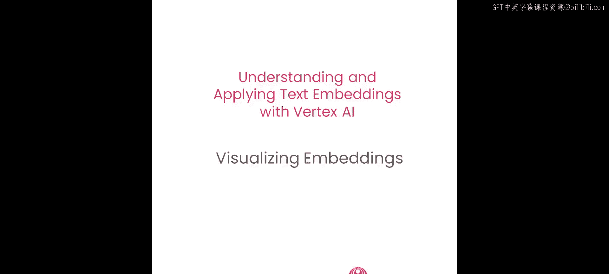

In this video， we'll take a look at some visualizations of embeddings when you're building a practical application。

 you often not be outputting the visualization as the final step unless you say taking a collection of documents and deliberately want to visualize what different text in the documents are saying。

 So what documents are similar what documents are dissimilar。

 but outside applications like that I don't end up using visualizations that much。

 but in this video we'll take a look at some of them to build intuition about what these embeddings are actually doing I think we'll get some pretty parts out of this so let's take a look let's sign up by authenticating myself to the verex platform same as before。

😊。

And for this visualization， I want to use。This collection of seven sentences Must St fllamingo discover that swimming pool。

 see all the spots who have bought baby panda， boat ride， breakfast steamed food truck。

 new curry restaurants， and in two others， Python developers are wonderful people I think that's a totally true statement and then Typescr C flips as a Java or I agree I admit admit I have my own preferences。

 but I won't state them in this video and then similar to lost time。😊。

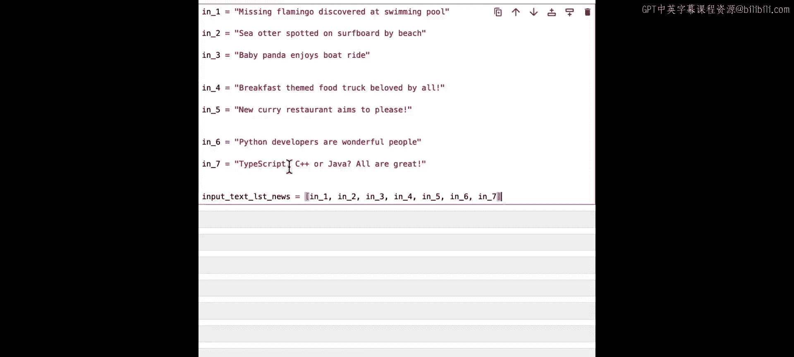

Let me import。Nampie and I'm going to sell up my embedding model as follows。

And then for my seven sentences and these input one through input7 in one through in7。

Let's run thisni of code to loop over my seven inputs to compute embeddings for all of them。

 so for input text in this list of sentences， set the embedding to call the embedding model on that extract the values and then stick in this embeddings list and then little bit the data managing to turn it into a nuy array and so let's run it。

Returns really quickly and so right now this embedding array。

 let me print out the shape of the embeddings array。

 so the shape is 7 by 768 and there are seven rows because there were seven sentences that we embedded and each row has 768 numbers。

Now， what I'd like to do is to next visualize these seven embeddings。

But I can't plot a 768 dimensional vector on this 2D computer monitor。

 so I'm going to use a technique called PCA or principal components analysis。

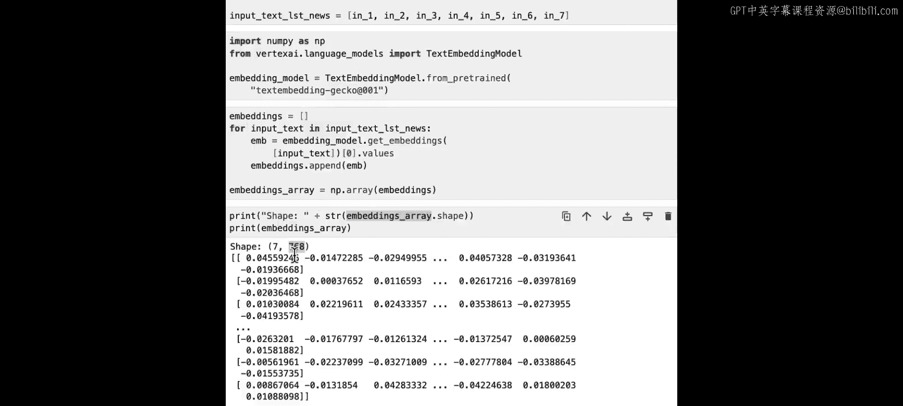

If you know what PCA is great， if you don't don't worry about it is a technique for taking very high dimensional data。

 say 768 dimensional data and compressing that down to two dimensions if you're interested to learn more about PCA you can take an online machine learning class such as the machine learning specialization but all you really need to know for the purpose of this video is this is a way to take this 768 dimensional data and squash it down to two dimensions so this code calls thesch learn PCA library fits the PC model to compress it to two dimensional data and you get a set of new values and if I now print out the new values is now7 by2 instead of7 by 768 so it' compress each of these emending vectors down to two dimensions thus losing a lot of information along the way but make it easier to plot on this computer model。

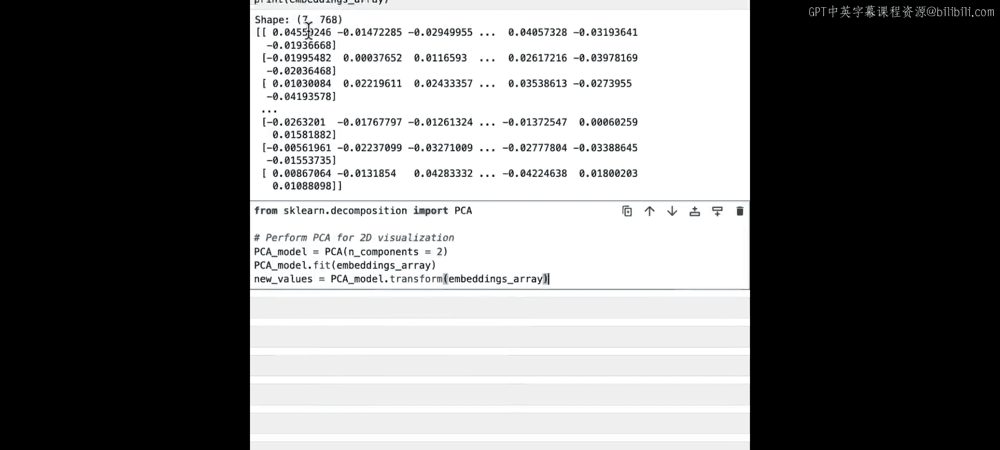

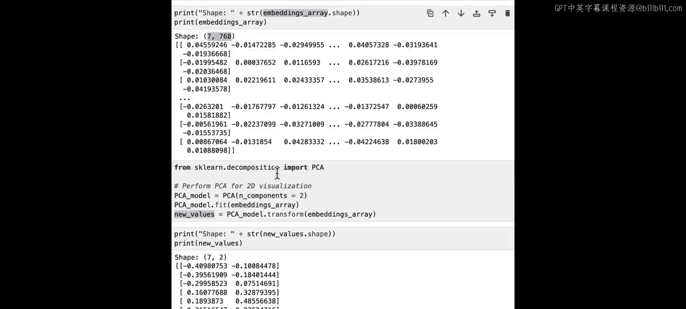

じ。Next， here's the code we can use。To plot， I'm going to use matte plot lip。

 a common plotting function， and'm just a plot， you know。

 a 2D plot of the first and second values of each of these now two dimensional embeddings on the horizontal vertical axes of a figure。

So let me do that and here's a plot。So let's see。Here is baby panther， massive fllamingo， C o。

 so our animal related sentences are pretty close to each other。

Here is my food truck and curry restaurant pretty close to each other。

 Python developers are wonderful people， I mean that's just true and you know all great program languages。

 so the coding related sentences down here。And so this illustrates how the algorithm does embed sentences that are more similar together。

Strongly encourage you to pause the video， go back and plug in your own sentences。

 maybe write some fun sentences about your friends and send the resulting visualization to them seems like there's a lot you could do to play with this and just to be clear。

If you're writing an application I would not use a two dimensional embedding。

 I would always measure distances in that original 768 dimensional feature embedding and I'm reducing this to two dimensions just for visualization purposes。

 but when measuring similarity I would not measure similarity of the 2D data I would measure similarity in that original much higher dimensional space。

 which actually gives more accurate distance metrics because PCA principle components analysis is throwing away quite a lot of information to generate the visualization。

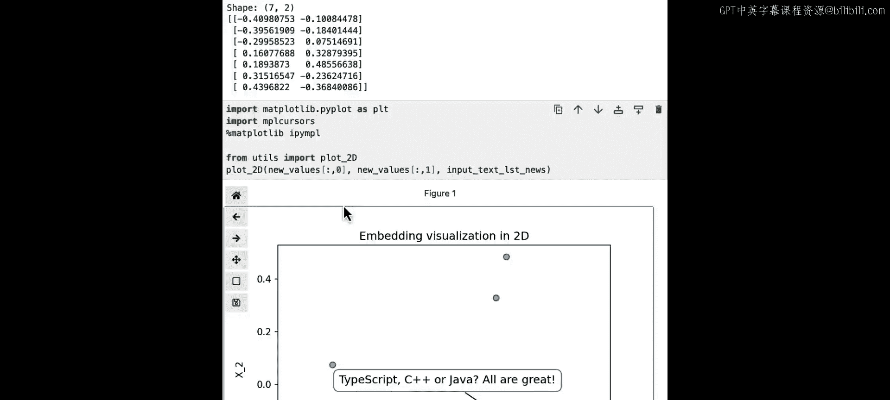

Now let's look at another example。Input one， in one， he couldn't desert his post at a power plant。

The paw plant needed him at the time。So in one and N two seem pretty similar， input 1 and input2。

Ccti are able to withstand dry environments and desert plants can survive droughts。

 so N3 and N4 seem pretty similar， even though sentence one and sentence4。

 both of the were desert and plant。Versus plants。But here's my list of four sentences and then here's my same code sni as before to generate the embeddings and lastly。

 let's plot a heat map showing the values of the embedding here's some code to plot a heat map and what does is showing is is using these different colors from shades of blue shades of red to show for each of the four embeddings does the first component have a high value or low value does the second component have high value and low value and so on through many elements of this vector I don't normally use heat maps to visualize embeddings。

 I'll say a little bit more about this in a second but from this heat map you know hopefully you can see that the desert plant embedding and the cacti embedding in this very high dimensional space the first two patterns of the heat map look a bit more similar to each other and the patterns on the。

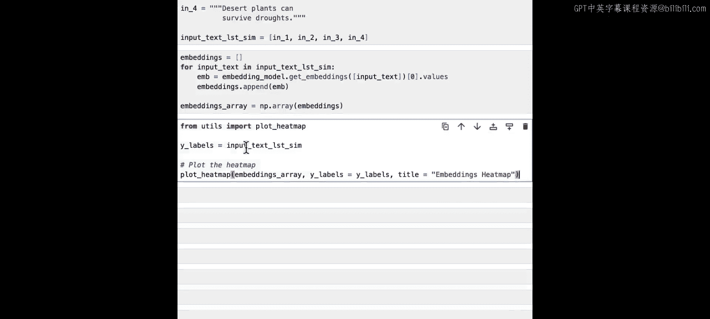

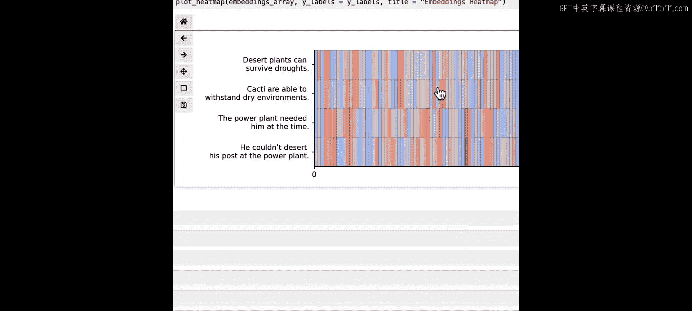

Third and fourth he maps， you know kind of look a little bit more similar to each other and so this illustrates that the embedding also maps the first two sentences close to each other。

 then sentences three and4 and just as one fun exercise I encourage you to pause this video and if you want to try get the code from the earlier notebook to actually compute the similarity between these embeddings to see if the embeddings between the first two inputs are really more similar to each other then say the first and third or the first and the four If you want to do that just as a reminder the function we used to compute similarities back in the first notebook was the cosine similarity function So if you were to do that if you want to see if we can compute these pairwise similarities before I rapid this video just one caveat which is that even though I showed this visualization this particular visualization isn't a completely mathematically legitimate thing to do and to get a little bit technical。

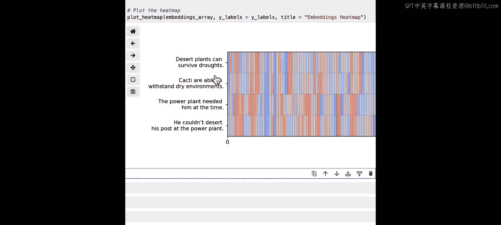

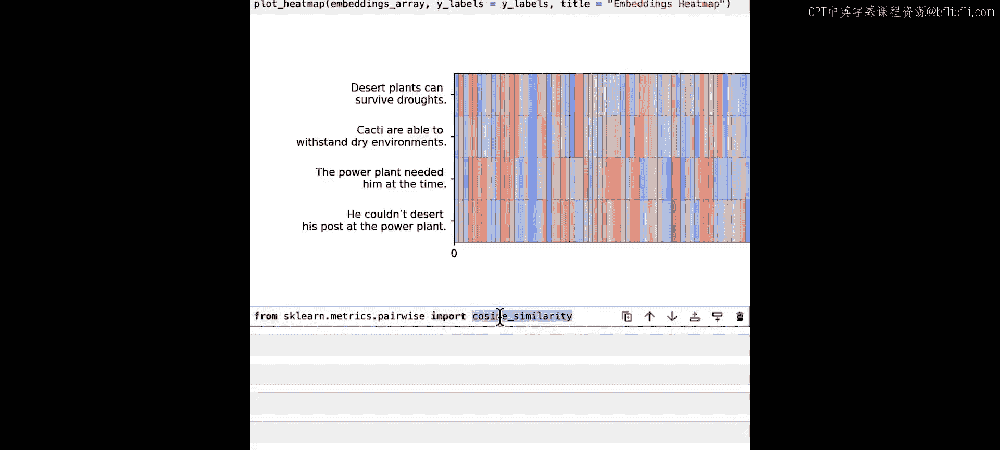

For the next 30 seconds of you。Don't follow what I say for the next 30 seconds， don't worry about it。

 but it turns out that the axes used to define an embedding is relatively arbitrary and is subject to random rotation and that's why whereas finding pairwise similarity between embeddings is a pretty robust and sound operation。

 if you were to look at， say the first component of an embedding and visualize that by look at the number of heat map。

 that first number is very difficult to drive a specific meaning to it。

 which is why we can look at this as an informal visualization to build intuition about embeddings。

 but for practical things I find it less useful to look at the outputs of the embeddings a single component at the time。

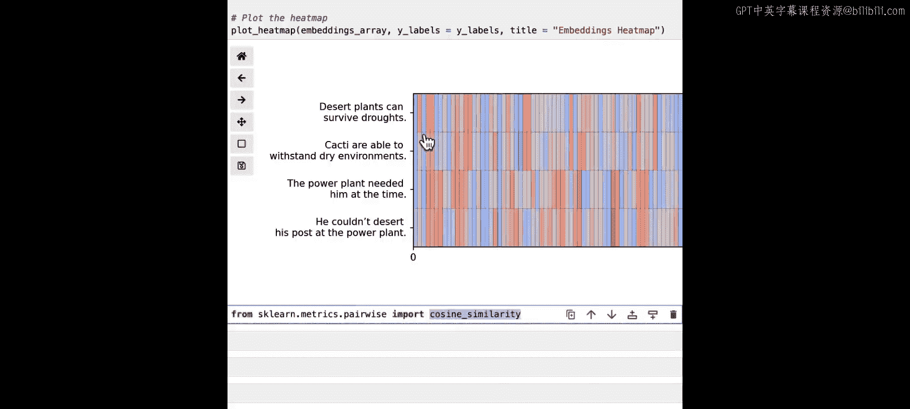

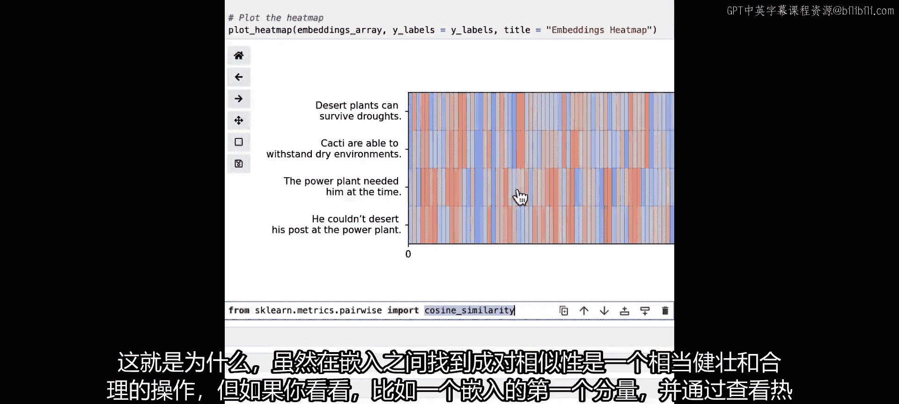

If you don't understand what I just said don't worry about it。

 the key takeaway is that this is just something of an informal visualization and these particular visualizations are not very robust and they could easily change if you were to use a different embedding model say but hopefully the intuition that certain sentences are more similar to each other in the embedding space still comes through so that's it once again please pause a video write in your own sentences maybe play the cosine similarity。

 use all this to build intuition about what the embeddings are doing in the next video Nikkita will start to dive into how you can use these embeddings to build a variety of applications when you're ready。

 please go on to the next video。

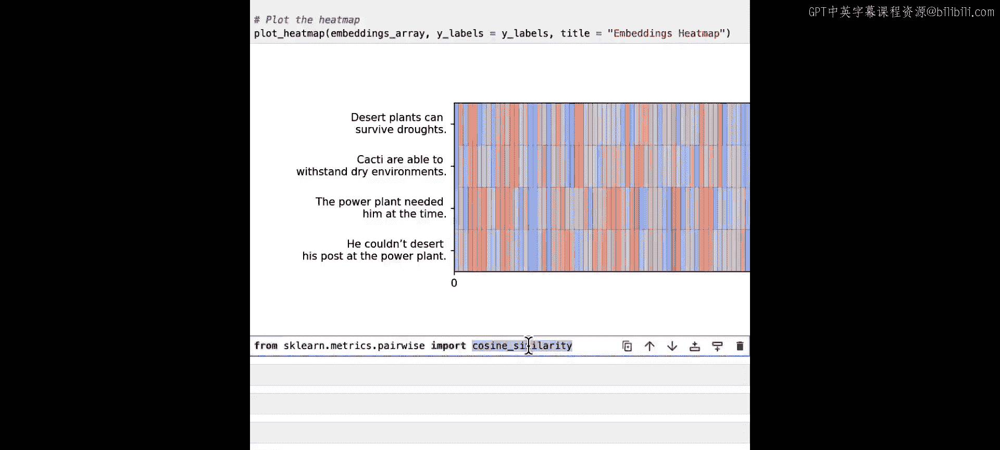