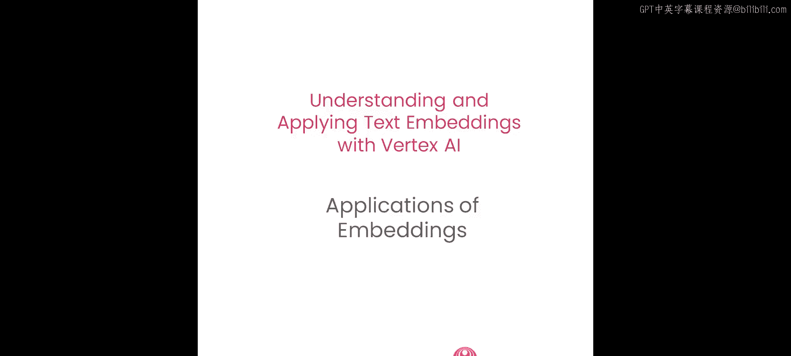
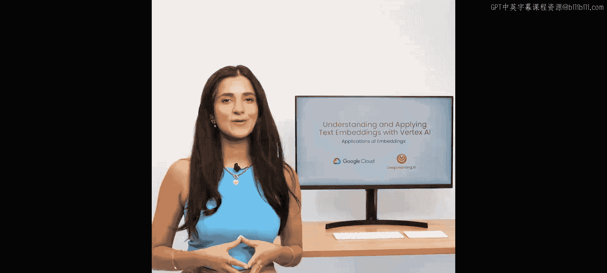
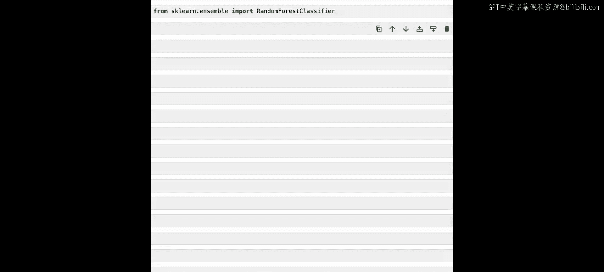
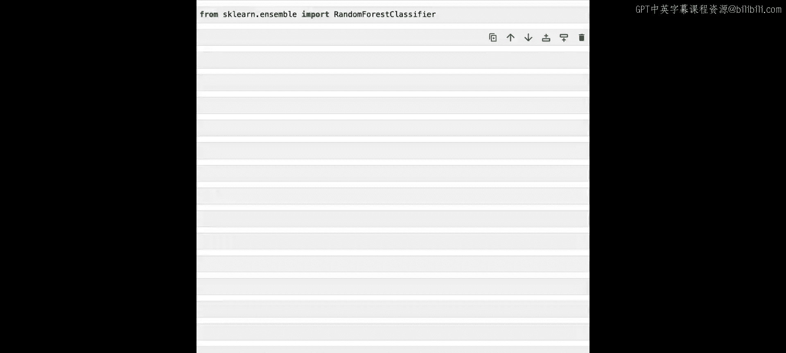
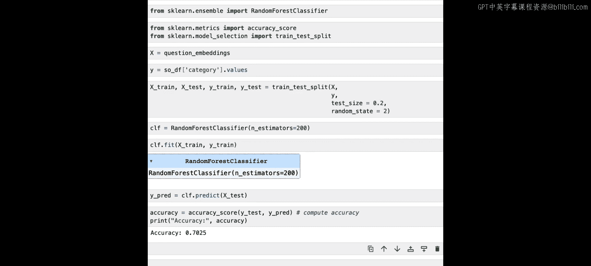

# 吴恩达｜使用VertexAI理解和应用文本嵌入｜Understanding and Applying Text Embeddings with VertexAI - P5：SC-GCP_L4.zh - GPT中英字幕课程资源 - BV1Mw411U7yr

Now that you've had a chance to get some intuition about embeddings。

 let's check out some different applications。

As we've done before， we'll start by setting up our credentials and authenticating we'll also need to specify the region we'll be running this service in and then we can import the vertex AI Python SDK and initialize it Now that we've done that setup。

 we're ready to start loading in our data for this tutorial we're going to use the stack overflow data set of question and answers which is hosted in BigQu a serverless data warehouse。

 so we'll start by importing the BigQu Python client and once we've done that we can write a function that will take in a SQL query as a string and execute this query in BigQu so let's go ahead and paste in that function。

So again， this function is going to take in some SQL and it will run that query in Big query and it will return the results as a panda's data frame。

 which we can then use in our notebook for some different applications。

 Now you don't really need to know a whole lot about how this big query function works so don't worry if you don't understand the details。

 We're just going to use this to get the data for this lesson So the next thing we'll do is we'll create a list of the language tags that we want to query and that's just because this data set is very large and it won't fit in memory so we don't want to actually pull in all the data。

 we just want to pull in a small subset of stack overflow posts for a few different programming languages。

 So to get our data we'll start by creating an empty data frame and then we're going to loop over this list of languages and we will execute a SQL query in BigQu。

 So here is the query will be running。 and if you're not familiar with SQL again。

 don't worry too much about it。 but this will basically。

Pull the first 500 posts for a particular language tag from the stack Overflow data set and then once we've done that。

 we want to concatenate all the results into one single data frame which we will use in this notebook so let's run the cell and this might take a minute or so you can see that it's pulling the data for each of the four languages that we're interested in。

Now note that if you ran into any errors while trying to execute the BigQu code or you just don't want to use BigQuery at all。

 you can just run this cell right here， which will just pull in the data for you from a CSV file so you don't have to worry about using BigQuery。

 but that's an optional step if you ran into any errors or you just didn't want to execute that code。

So now that we have all of our data， let's go ahead and examine it and see what it actually looks like。

Here's our data frame。 We can see at the bottom here that it's 2000 rows by three columns。

 so that's 2000 different stack overflow posts and it's 500 posts for each of the languages that we queed for。

 and these three columns here we have first the input text which is the title of the stack overflow post concatenated with the question of the stack overflow post and then the output text column is the accepted answer from the community for that stack overflow post and then finally we've got a column for the category which is the programming language so now that we've got our data we can now start embedding it and using it for some different applications。

 So we'll first load in our text embedding model which we've done before。

 this is going to be the text embedding gecko model。And now in the past labs。

 we went ahead and just started using the embeddings function to create embeddings。

 but because we have a lot of data in this notebook。

 we're going to need to do a little bit of extra work。

 we're going to need some helper functions to batch the data and send it to the embedding API。

So first we'll start off by defining some helper functions and the first function we're going to use here is called generate batches and this function basically takes in our data and creates batches of size 5 and the reason we need to do that is according to the documentation and at this point the API we're using can only handle up to five text instances per request so we'll need to take our data and split it into batches of five in order to get our text embeddings so we can try out this function and we'll take just the first 200 rows of our data frame and we'll call generate batches on those 200 rows and we can see what the result is of using this function。

If we call generate batches on this subset of our data frame。

 you can see that it creates these nice batches that are up sizeize5。

 and that'll be very useful when we want to embed all of the data in our data frame。

The next helper function we'll defined is called encode text to embeddings。

 which is a wrapper around the function get embeddings。

 which you've used in the previous labs to get embeddings for our text input。

 So let's try running this function on a batch of our data。 We just created a batch of five。

Sentences， so we can run this in code text to embeddings function。

 and then we can print out the length of the result。So here if we run in code text to embeddings。

 we get back five embeddings and that's because we passed in five text instances and they're each of size 768 and that number 768 should look familiar by now because that's the number of dimensions that the text embedding gecko returns for any text input you provide So in addition to making sure you batch your instances into batches of size5 there's one of the thing you need to be aware of and that's just that most Google Cloud services do have rate limits on how many requests you can send per minute So we have written a helper function for you called incode text to embedding batched and this function will manage both batching the data and manage the rate limits。

 So if you want to use this for your own projects this is the code that you would actually execute but we do want to be mindful of rate limits in this online classroom So we're not going to actually generate embeddings for all 2000 rows of our data right now instead we're just going to load the state。

But again， for your own projects， you can use this helper function here encode text to embeddings batched and you pass in the data you want embedded。

 and it will handle both batching the data for you and also making sure that the rate limits are handled appropriately。

Next， we are going to load in these embeddings that we've generated ahead of time。

 just to make sure these embeddings map properly to the stack Overflow questions。

 we'll also just reload in a new CSB file of stack overflow questions。

Just to make sure that they match and aren't different from what we've loaded in from BigQuery。

 and the next using pickle。We can load in this pickle file， which has all of our embeddings for us。

 So let's go ahead and take a look at this embedding vector。

We'll print out the shape and also the array as well。

 so we can see that our data is now of size 2000 by 768。

 so that's our 2000 stack overflow posts and each one is represented by a 768 dimensional embeddings vector。

Now that we have this data and we have it embedded。

 we can get started with some different applications。

 The first application we'll try out is clustering our data。

 and we're going to use the K means algorithm to cluster these posts。 So first。

 we'll import K means from psychit learn and then we'll also import PCA from psychit learn。

 which we used in an earlier lesson。 and this will help us to visualize our clusters。 Now。

 just to make our visualization a little bit easier。

 we're actually just going to visualize the first 1000 rows of our data set。

 So we'll take our full data set of question embeddings and we'll only be looking at the first 1000。

 These are the posts that were tagged as Python or HTML。 For our clustering。

 we'll first need to define the number of clusters and we'll set that to two。😊。

And then we will create and fit our K means model on our clustering data that we just created。

 which is the first thousand rows of our stack overflow dataset。And once we've done that。

 we can also extract the labels， and this will just tell us for each item in our data set。

 which of the two clusters does it belong to？Now as before we can't visualize all of these 768 dimensions。

 so we'll use PCA just to represent our data for 2D visualization。

 so this is code we used in a previous lesson but we'll create our PCA model with the components number set to two we'll fit this model and then we will transform the model on our clustering data set So once we've done this we can now import MatpllootLib and we can plot this data。

So let's go ahead and plot and visualize what our clusters look like。

So here we have our data and you can see that it forms two pretty distinct clusters and these are questions that were tagged as HTML over here on the left with these red circles and then on the right we have questions that were tagged as Python and it's pretty good at dividing these stack overflow posts into two distinct categories and as a reminder the clustering model didn't have these two labels all it had were the embeddings of these stack overflow posts but it was able to separate the data into two fairly distinct clusters and we've just added these labels back in to make it easier for us to visualize。

So far we've talked a lot about how embeddings can help us find similar data points。

 but that also means that we can use embeddings to identify points that are different or outside of our data distribution。

 so we'll now use embeddings to help us with anomaly detection or outlier detection。To do this。

 we're going to use this isolation forest class in psyic learnn。

 This will return an anomaly score for each sample in our data set using this isolation forest algorithm and note that you don't need to know the details of how this algorithm works just that it's an unsupervised learning algorithm that detects data anomalies。

 So all of the questions in our data are about programming。

 so we're going to add any question about a very different topic baking。 here's some input text。

 let's say someone's asking， I'm making cookies， but I don't remember the correct ingredient proportions。

 And I've been unable to find anything on the web。 This is definitely pretty different from the questions we have in our data。

 Once we've defined this input text， we can embed it and because it's just a single instance we can call the get embeddings function on our embeddings model Now we'll take this embedding and will append it to our array of other embeddings for our stack overflow data。

😊，And then we'll also need to convert this data into an array and this will just help us later for visualization and for running the isolation forest model。

 so let's take a look at this new embeddings array。The shape is now 2001 by 768。

 and that's because we've added this additional question to our data set before we had 2000 stack overflow questions and now we have 2001 because we've added this extra question about baking Now before we can fit our isolation forest model we need to do one more thing and this is just going to make things a little bit easier when we want to visualize the results we will add in a new row to our data frame that contains this baking question so we'll add in the input text there's no output text for this particular question because it wasn't a real stack overflow post and we'll say that the label is baking so let's add this to our data frame and again we're just doing this because it will help us to visualize the results in just a little bit。

 So now we're ready to create our isolation forest model right here using psyic learn and once we've created the model we can fit and predict on our embeddings array。

And this model will return negative one for outliers and one for inliers， so once it's been fit。

 we can take our stack overflow data set and filter for all of the rows that have been predicted with negative one。

 so let's see what the results look like。The last question here is our baking question and so this was in fact identified as an outlier and that is because it's pretty different from all of the other examples in this data you might notice that there also some programming questions about the programming language R that were identified as outliers so if you're interested maybe you can go in and check out the input text and see why these particular posts might have been identified as outliers maybe they were mislabeled and they weren't actually about the programming language R or maybe it was some other reason and then finally before we move on to the next application we'll just drop this baking question from our data because we won't need it for the last application in this lesson so that's what the cell does here we'll just remove it and now our SAC overflow data is been returned to only being about programming questions and it only has 2000 rows。

Now for our final application in this lesson， we'll see how we can also use these embedding vectors as features for supervised learning embeddings take as input some text and they produce some structured output that can be processed by a machine so this means that we can pass these vectors to any of our favorite supervised classification algorithms in this lesson we will be using random forest but feel free to swap this out for another classifier and psyit learn if there's another one you prefer Now there are many different ways that we could frame a classification problem around this data set maybe you could think about trying to predict if a post mentions pandas or we could try and requery the data and get the score for the different posts and try and predict how many upvos each post had。

 but in this notebook what we'll try out is just predicting the category of the post So to do that we'll need a couple of other things from psychit learn we will also import accuracy score and the train test split utility。

And then for this prediction task， we're going to define an array called X。

 which will be our embeddings， so let's go ahead and do that right here。

And this is just our embedding data that we've created previously in this lesson。And for the labels。

 we will extract the categories for each of these posts。

So we're just pulling the category column from our stack overflow data frame。

And now we have our X and our Y， but we got to do one more thing。

 we need to shuffle the data and we need to split it into training and testing sets。

 so we'll use the Psychic learn train test split utility and we will set an 8020 split so that means that our test data will be 20% of our original data set。

And now once we've done that， we have an X train， an X test， a Y train and a Y test data set。

 which means we're ready to fit our random forest classifier。

 so we'll start by creating the classifier and we'll set the number of estimators to 200。

 but you can feel free to change this if you like。And once we've created this classifier。

 we can fit the model and we'll fit the model on our training embeddings and also on their corresponding categories and once this model is finished。

 we'll be able to predict on some test data So now we'll call predict and we will pass in our X test data set and again this is just the embeddings in our test set。

And we can finally compute the accuracy score to see how well this model did。So 0。

70 not bad for very minimal preprocessing so now you've seen a few different ways that we can apply embeddings。

 we can cluster them， we can use them for classification or to detect data points outside of our data distribution and in the next tutorial we're going take a quick break from embeddings and talk a little bit about text generation so I will't see you there。

