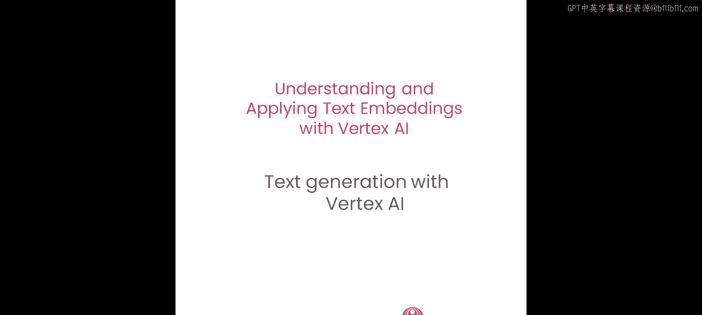
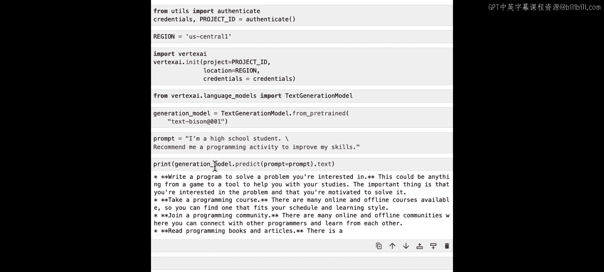
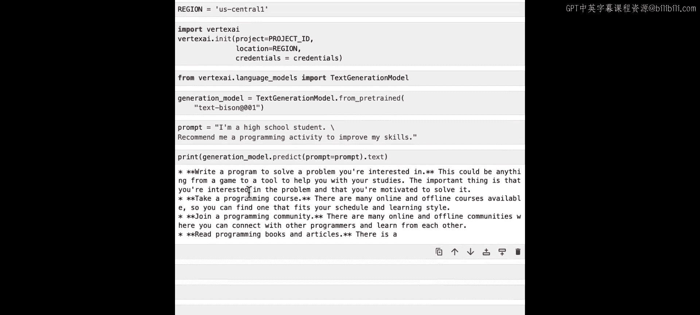
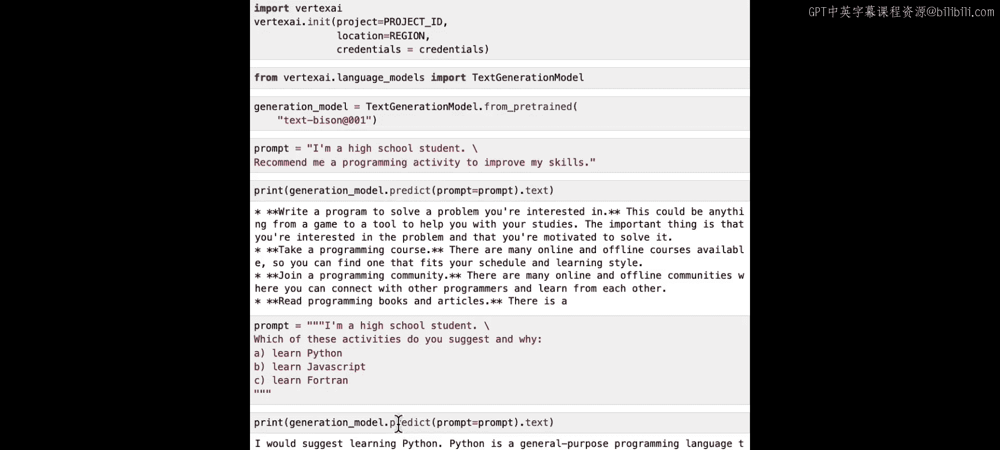
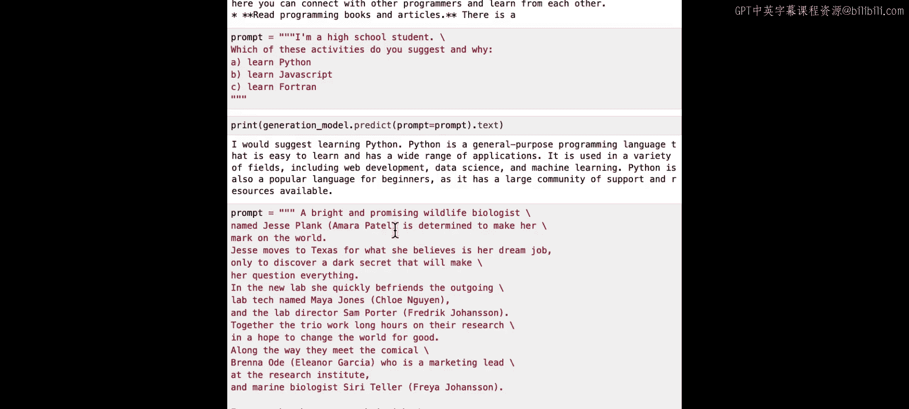
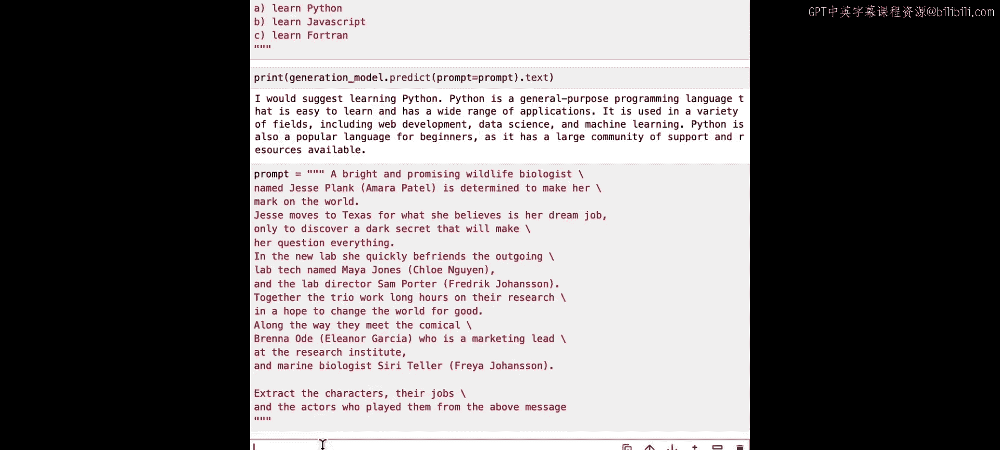
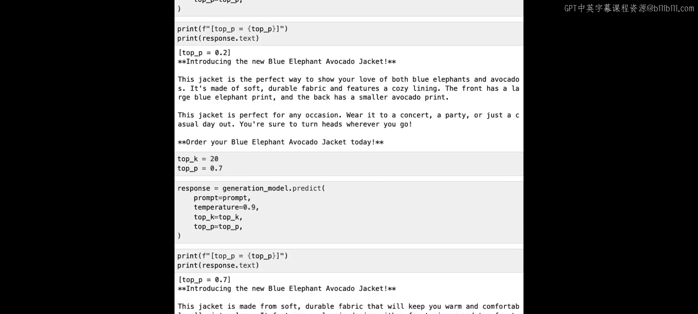
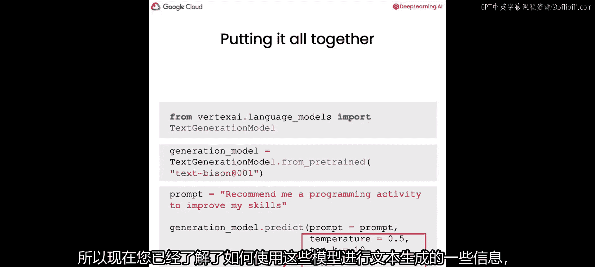

# 吴恩达｜使用VertexAI理解和应用文本嵌入｜Understanding and Applying Text Embeddings with VertexAI - P6：SC-GCP_L5.zh - GPT中英字幕课程资源 - BV1Mw411U7yr

Our goal in this course is to build a question answering system。

 and we can actually do that already with just embeddings。

 but it turns out we can build an even better question answering system if we use the text generation capabilities of large language models。

 So let's see how that works。😊。

We'll start off by importing our credentials and authenticating so that we can use the vertex AI service and we'll need to set our region and then import vertex AI and initialize the SDK。

And once we've done the required setup， we can get started。 So in this example。

 we'll start off by loading in the text generation model from vertex。

 And before we were loading an embeddings model this time。

 we're loading this text generation model When we load this model， it will be a different name。

 This model is called text bison。 instead of the embeddings geo model we were looking at earlier。

 and the text bison model is fine tuneuned for a variety of natural language tasks。

 like sentiment analysis， classification summarization and extraction。

 But note that this model is ideal for tasks that are completed with just a single API response。

 So not for continuous conversations。 If you do have a use case that requires back and forth interactions。

 there's a separate model for that called chat bison that you can check out instead。😊，Now。

 when we talk about text generation in the context of large language models。

 these models will take us input some text and produce some output text that's likely to follow。

And this input text we provide is called a prompt， so let's start off with an openended kind of generative brainstorming task we'll define our prompt as I'm a high school student。

 recommend me a programming activity to improve my skills This again is the input that we will pass to our model。

So once we've defined our prompt， we can print out the response from our model。

 so we will call predict and we will pass in the prompt。And then we can print out the results。

 So let's see what the model produces。 The model suggesting that we write a program to solve a problem you're interested in。

 Def good advice， Also taking a programming course and a couple of other ideas here。 Now。

 this is a pretty open endeded response。 And it might be useful for brainstorming。

 but it's pretty variable。 And with large language models。

 we can kind of get them to take on different behaviors by writing strategic input text。

 So if we wanted to have maybe a more restrictive answer。

 we could take this openended generative task and turn it into a classification task to basically reduce the output variability。

 So let's see what that might look like。 Here is a rephrasing of that same prompt。

 It's just a little different。 Now， we're saying I'm a high school student。

 which of these activities you suggest And why。 So instead of just keeping it completely open endeded。

 we provided a few different options。 A learn Python B learn jascript or C learn forran。

 So let's see what happens when we。😊。

This prompt the model again， we'll be printing out the results of calling the predict function on our text generation model。

 and we're passing in this prompt text。So this time the model is suggesting that we should learn a Python and again it's a pretty reasonable answer to our question。

 but it's just a little bit more restrictive based on our particular prompt and this sort of art and science of figuring out what the best prompt is for your use case is called prompt engineering and there are a lot of different tips and best practices so if you're curious you could definitely check out some of the other deep learningning do AI courses on prompt engineering but for now we're just going to try out one other task with this large language model。

So something I think is really interesting about large language models is that we can use them to extract information。

 In other words， take data that's in one format and reformat it into another format。

 So here we've got this long chunk of text， but it's a synopsis for an imaginary movie about a wildlife biologist。

 So in this imaginary movie synopsis we've got the names of the characters and their different jobs and also the actors who played them。

 So what we're going to do is instruct this model to extract all three of those fields。

 We'll instruct it to extract the characters， their jobs and the actors who played them。

 So this long piece of text is the prompt that will pass to the model。

 So let's try and see what the response is。😊。

Here you can see that the model did in fact extract all of the characters in the synopsis as well as their jobs and then the actors who played them。

 and if we wanted to get this in maybe a different format。

 we could even say something like extract this information from the above message as a table。

And we can see what happens here。 We actually get some markdown so we can test this markdown and see if it is actually。

 in fact valid markdown。Turn this into a markdown cell。And there we go。

 We got this nice table so we can actually use large language models to extract information and convert data from one format to another。

So let's review the key syntax that we just ran through。

 we first imported the text generation model and then we selected the specific model we wanted to use。

 which in this case was textex bison and this was the 001 version。

And then we defined a prompt which is the input text and we called predictt and we passed in this prompt Now。

 in addition to adjusting the words and the word order of our prompt。

 there are some additional hyperparameters that we can set in order to get the model to produce some different results。

So earlier， I said that these models take as input some text and they produce some output text that's likely to follow。

 but we can actually be a little bit more precise in this definition。 Really。

 these models take as input some text， maybe the garden was full of beautiful。

 and they produce as output an array of probabilities over tokens that could come next。

 And Andrew talked a little bit about tokens in a previous lesson。

 but tokens are essentially the basic unit of text that is processed by a large language model。

 So depending on the different tokenization method。

 this might be words or sub wordss or other fragments of text。 Now I'm saying tokens。

 but in the slides here， I'm actually just going to show individual words。

 and that's just to make it a little bit easier to understand the concepts。 but again。

 these models are returning an array of probabilities over tokens that could come next。😊。

And from this array， we need to decide which one we should choose。

 This is known as a decoding strategy。 So a simple strategy might be to select the token with the highest probability at each time step。

 and this is known as greedy decoding。 But it can result in some uninteresting and sometimes even repetitive answers。

 Now， on the flip side， if we were to just randomly sample over the distribution。

 we might end up with some unusual tokens or some unusual responses。

 And by controlling this degree of randomness， we can control how unusual or how rare the words are that get put together in our response。

 One of the parameters we can set in order to control this randomness is called temperature。

 Low temperature values are better for use cases that require more deterministic or less openended responses。

 So maybe if you're doing something like classification or an extraction task like the synopsis for an imaginary movie task we just looked at。

 you might want to start with a。😊，temperature valueOn the other hand。

 higher temperature values are better for more openended use cases。

 so maybe something like brainstorming or even summarization where you might want more unusual responses or unusual words typicallyy with neural networks。

 we have some raw output called logics and we pass these logics to the softmax function in order to get a probability distribution over classes。

 you can think of the different classes in this case as just being the different tokens that we might return to the user。

So when we apply temperature， what we're doing is we're taking our softm function and we're dividing each of the logics values by our temperature value。

 So on the slide here， you can first see our softm function。

 and then below that you can see the softm function with temperature applied where each of our logics values Z are divided by theta。

 and that's how we actually apply temperature。 Now if this didn't make a whole lot of sense to you。

 don't worry about it， the actual mechanics here aren't that important。

 What's really more important is that you get an intuitive understanding of how temperature works。

 So one way to think about temperature is that as you decrease the temperature value。

 you're increasing the likelihood of selecting the most probable token。

 And if we take that to the extreme and we make a temperature value of0， it will be deterministic。

 That means the most probable token will always be selected。 On the other hand。

 you can think of increasing the temperature as basically flattening the probability distribution and increasing the likelihood of selecting。

😊，Less probable tokens。With the vertex AI model we're looking at。

 you can set a temperature value between 0 and1 and for most these cases。

 starting with a number like 0。02 can be a good starting place。 and you can adjust it from there。

 So let's see how we actually set this value in the notebook。

 Let's start off with the temperature value of 0。 Again。

 this is deterministic and it's going to select the most likely token at each time step。

 So here's a prompt。 let's say complete the sentence as I prepared the picture frame I reached into my toolkit to fetch my。

 and we'll see what the model responds with。So we will call the predict function as we've done before on our generation model and we'll pass in the prompt。

 but this time we're also going to pass in the temperature value and then we can print out this response。

So the model says as I prepared the picture frame， I reached into my toolkit to fetch my hammer。

 and that seems like a pretty reasonable response。 probably the most likely thing someone would fetch from their toolkit for this particular example。

 And remember， temperature of0 is deterministic。 so even if we run this again。😊。

We will get the exact same answer， so let's try this time setting the temperature to one。And again。

 we can call the predict function on our model。And we will print out the result with this different temperature value。

And this time we reached into the toolkit to fetch my saw。

 I ran this earlier saw sandpaper which I thought was a pretty interesting response。

 model also actually produced some additional information here as well so you can try this out and you'll get a different response if you run this again。

 so I encourage you to try out some different temperature values and see how that changes the responses from the model。

Now， in addition to temperature， there are two other hyperparameters that you can set to impact the randomness and the output of the model。

 So let's return to our example from earlier， where we had an input sentence。

 the garden was full of beautiful and this probability array over tokens。

 One strategy for selecting the next token is called top K where you sample from a short list of the top K tokens。

 So in this case if we set k to2， that's the two most probable tokens， flowers and trees。 Now。

 top K can work fairly well for examples where you have several words that are all fairly likely。

 but it can produce some interesting or sometimes not particularly great results when you have a probability distribution that's very skewed。

 So in other words， you have one word that's very likely and a bunch of other words that are not very likely。

 And that's because the top K value is hard coded for a number of tokens So it's not dynamically adapting to the number of tokens。

So to address this limitation， another strategy is top P where we can dynamically set the number of tokens to sample from。

 and in this case we would sample from the minimum set of tokens whose cumulative probability is greater than or equal to P。

So in this case， if we set P to be 0。75， we just add the probabilities starting from the most probable token。

 so that's flowers at 0。5。 and then we add 0。23。05。 and now we've hit the threshold of 0。75。

 So we would sample from these three tokens alone。 So you don't need to set all these different values。

 But if you were to set all of them， this is how they all work together。 First。

 the tokens are filtered by top K。 And from those top K they're further filtered by top P。

 And then finally， the output token is selected using temperature sampling。

 and that's how we arrive at the final output token。

 So let's jump into the notebook and try and set some of these values。

So first we'll start off by setting a top p value of 0。2 and note that by default。

 the top p value is going to be set at 。95 and this parameter can take values between 0 and1。

 So here is a fun prompt。 Let's ask for an advertisement about jackets that involves blue elephants and avocados Two of my favorite things。

 So we can call the generation model， predict function again and this time will pass in the prompt will also pass in a temperature value。

 let's try something like 0。9 and then we'll also pass in top P。

 and note that temperature by default at 0 does result in a deterministic response。

 It's greedy decoding。 So the most likely token will be selected at each timet。

 So if you want to play around with top P and top K just set the temperature value to something other than 0。

 So we can print out the response here and see what we get。

 And here is an advertisement introducing this new。BlueEleph avocado jacket。 So lastly。

 let's just see what it looks like to set top P and top K。 So let's set a top K。to 20 and by default。

 top K is going to be set to 40 and this parameter takes values between one and 40 so we'll half that default value and then we'll also set top P so we can set all three of these parameters we just learned about and we'll use the exact same prompt as before we'll just keep it as right in advertisement for jackets that involves blue elephants and avocados。

And this time， when we call the predict function on our generation model， we'll pass in the prompt。

 the temperature value， the top K value and the top P value。And just as a reminder。

 this means that the output tokens will be first filtered by the top K tokens then further filtered by top P and lastly the response tokens will be selected with temperature sampling so here we've got a response here and we can see that it is a little different from the one we saw earlier so I encourage you to try out some different values for top P top K and temperature and also try out some different prompts and see what kinds of interesting responses or use cases or behaviors you can get these large language models to take on So just as a quick recap of the syntax we just learned again。

 we've been importing this text generation model and then we loaded this text bison model and we define a prompt which is the input text to our model and when we call predict we can in addition to passing in a prompt also passing in a value for temperature top K and top P。

So now that you know a little bit about how to use these models for text generation。

 I encourage you to jump into the notebook， try out some different temperature。

 top P and top K values， and also experiment with some different prompts， and when you're ready。

 we'll take what you've learned about text generation and combine it with embeddings in the next lesson to build a question answering system。

