# 吴恩达｜使用VertexAI理解和应用文本嵌入｜Understanding and Applying Text Embeddings with VertexAI - P7：SC-GCP_L6.zh - GPT中英字幕课程资源 - BV1Mw411U7yr

In this final lesson， we're going to take everything we've learned about embeddings。

 semantic similarity and text generation and put them all together to build a question answering system。

 specifically the system will take in a user question about Python programming and return and answer based on a database of stack overflow posts。

 so let's get to building。

Let's say we wanted to use a large language model to answer a question like how to concatenate data frames in pandas。

 We could ask this model directly， but out of the box。

 large language models aren't connected to the external world。

 So this means that they don't have access to information that's outside of their training data。

 So this question about data frames in pandas。 it's not that specific。

 but imagine if you wanted to answer questions about an organization you work for or some kind of really specialized domain。

 In these examples， you'll probably need to give the LLM access to data that wasn't in its training data。

 So for example， you might want to connect it to some external database of documents。 but in reality。

 you can't take all those documents and stuff them into a prompt。

 You're going to run out of space pretty quickly。Now another reason you might want to connect a large language model to an external database is if you want to be able to trace the lineage of a response。

 so you might have heard the term hallucinations， this is where sometimes large language models produce responses that seem plausible but aren't actually grounded in reality or factually accurate。

If we connect a large language model to an external database。

 then we can base an answer or a response in a particular document and have a way of tracing the origins of that answer。

 this is often known as grounding in LLM。Now you might think that well。

 if we have all these documents， we should probably finetune a model on all of this new text data。

 but actually we can do all of this without having to do any kind of specialized tuning instead we'll use what we've learned about embeddings and a little bit of prompting so let's check this out in a notebook。

We'll start off by doing our usual authentication step。

And then setting the region and making sure that we import and initialize the vertex AI Python SDK。

Once we've done that setup we can go ahead and start getting our data created so as we did in an earlier lab we're going to use the stack overflow data set from BigQuery。

 but this time we won't be running any BigQu code we've got a CSD file prepared for you already so we will just use pandas to import this data so we're going to call this database frame our SO database for stack overflow database and we can print out the shape and the first few rows of this data frame。

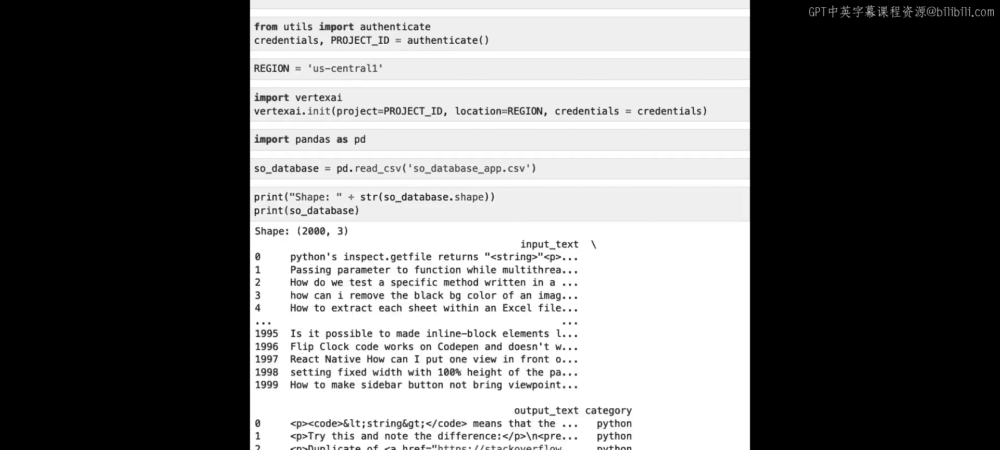

So this data should look familiar， it's very similar to a data frame we used in the previous lesson。

It's got 2000 rows of 2000 different stack overflow posts and there are three columns。

 the input text again is the question and title of the stack overflow post concatenated。

 the output text is the accepted response from the community to that question and the category is the programming language that the post was tagged with so now that we have our data we can go ahead and embed it。

 we will import our text embedding model and then we will load the text embedding gecko model。

Now earlier we talked about how if you are trying to embed a large amount of data。

 you'll need to be aware of batching the data and also managing rate limits and all of that it's taken care of for you in this encode text to embedding batched utility function so just as a reminder if you wanted to actually use this in your own projects。

 this is the code you would run you'd call this encode text to embedding batched function passing in your data frame。

 but we aren't again going to actually run this model just because we want to save on API calls so we've already embedded the data and we're just going to load in that precated embedding data。

These precomputed embeddings are saved as a pickle file， so first we'll import pickle。

 and then we can open this file and we will load it and then print out the result just to see what it looks like。

 So here we've got our array of embeddings and these are the embeddings we'll use for this particular lesson so now that we have all these embeddings we're going to add these embeddings as a column to our data frame。

😊，And this will just make a few things easier a little bit later when we go to build our question answering system。

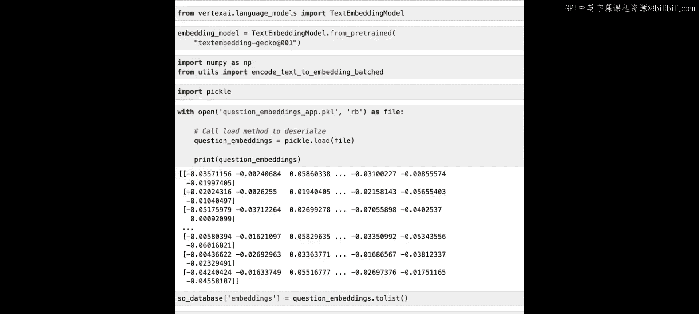

So we can take a look at our data frame and we've just added this additional column。

 which is the embeddings vector for each of these stack overflow posts。

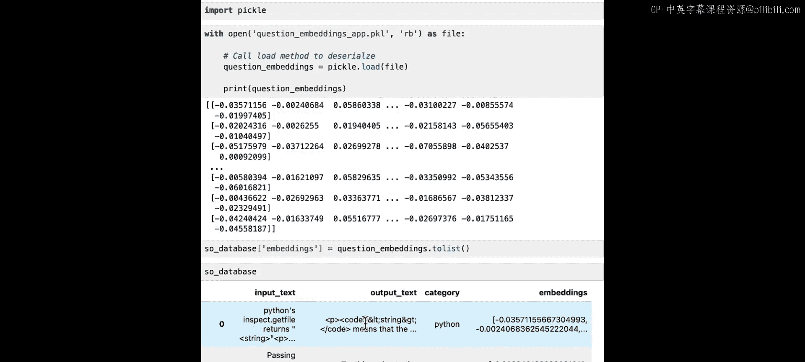

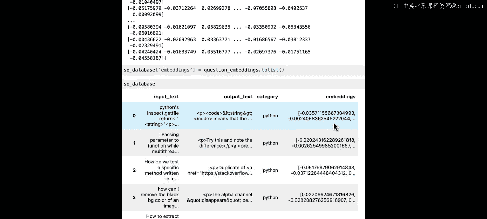

So why did we embed all of that data Well， our stack overflow data is comprised of questions and the accepted answers and what we'd like to do is we'd like to take a query from our user of this system。

 and look at all the stack overflow questions and see if there's a similar question in this database。

 And if there is a similar question then that's great news because that means we have an answer to that question。

 and therefore we have an answer for our user。 Now earlier we talked about how we can use embeddings to help us find similar data points。

 We can actually quantify how similar to embeddings are by using some sort of distance metric。

 and there are a few different common distance metrics you might use。

 The first is Euclidean distance， which is the distance between the ends of the two vectors。

 this is also L to distance。😊。

We also have cosine similarity， which is what we used in the previous lessons which calculates the cosine of the angle between the two vectors。

 and then there's the dot product， which is the cosine multiplied by the length of both vectors note that the dot product does take into account both the angle and the magnitude of the two vectors and the magnitude can be useful in certain use cases like recommendation systems it's not as important in our particular example So we'll be using cosine similarity。

 but the cosine similarity and dot product are actually both equivalent when your vectors are normalized to a magnitude of one。

 So what we're going to do next is we will take our user query and we will embed it and then we'll compute the similarity between the embedded user query and every single embedded stack overflow question in our database Once we've done that we can identify which embedded questions are the most similar and these are known as the nearest neighbors。

😊。

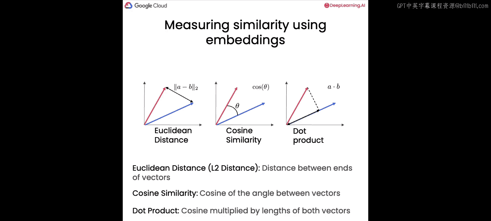

So let's go ahead and try this out in the notebook。

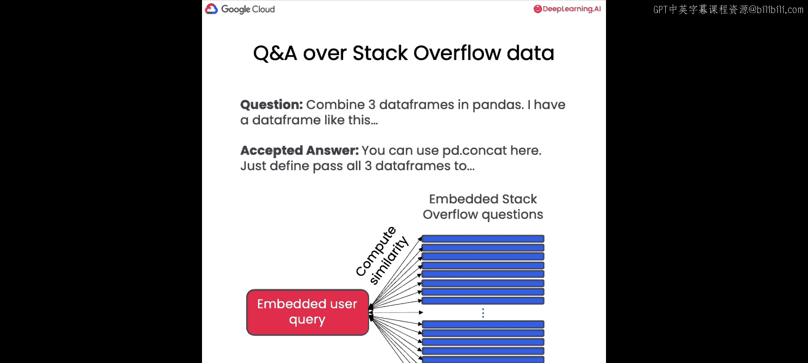

We'll start by importing a few libraries， we'll need to import NumpI and then we will also import the cosine similarity metric。

 we will also import another metric as well so that we can just see what it looks like to use Euclidean distance。

 but in this example we'll be sticking with cosine similarity。

So let's say that we have a user that asks a question like how to concatenate data frames in pandas We'll start off by embedding this query。

 we will call get embeddings again on our embeddings model and then we will extract the values The next thing we're going to do is calculate the cosine similarity between our query embedding and every embedding in our database。

So we'll start by using the cosline similarity function from Psychit learn。

 and then well pass in our query embedding。And this is the embedding for the input text how to concatenate data frames in pandas and we are wrapping this in a list and that's just because it's a list but we need to send a list of lists to this cosine similarity function。

 That's what it looks like Next we will pass in the database of stack overflow posts。

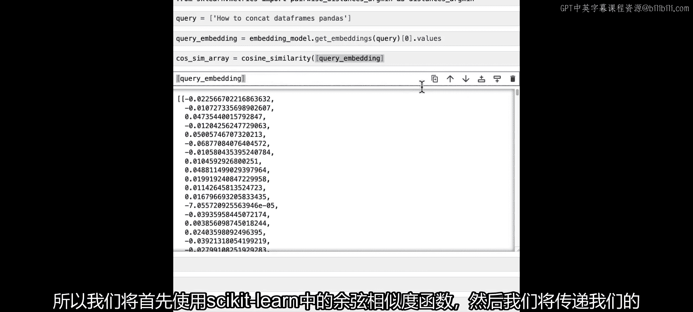

And we're converting this stack overflow database into a list and that's just because it's currently in array。

 but we need this 2D list to pass to this cosine similarity function so we print this out we should see that list of lists there you go。

Great， now that we've done that， we can compute the cosine similarity。

So let's take a look at the shape of this array。It's one by 2000。

 and that is one distance metric calculated for every single stack overflow embedding we have in our database。

 So again， just to recap， we took our input query and we calculated the cosine similarity between that query and every single one of these 2000 stack overflow embeddings So from this array。

 we want to figure out what is the most similar stack overflow embedding to our question embedding So we're going to extract the index with the highest value So just as a quick aside if you wanted to use a different distance metric and try out this whole use case with something other than cosine similarity you could use this distance a men function from psychic learn and this would compute the Euclidean distance but we're going to stick with using the cosine similarity for this use case So now that we have computed the cosine similarity and we've extracted the index with the highest similarity we can go and see which question this actually。

Respondse to。So this question is about concatenating objects in pandas， it's not exactly the same。

 but it is pretty similar to our input question and we can go and grab the corresponding answer as well。

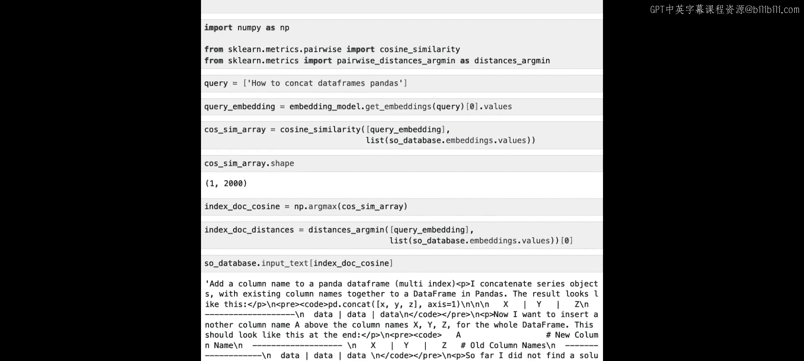

So if we were to just return this answer to a user。

 I think it would be a pretty unsatisfying user experience。 there's some strange formatting。

 it doesn't really sound like it's in context， so what we're going to do now is we're going to use a large language model and use all this information as relevant context to format a much better and more userfly response for our question answering system To do this we'll start by importing the text generation model that we used in the previous lesson and then we will load in the text bison model。

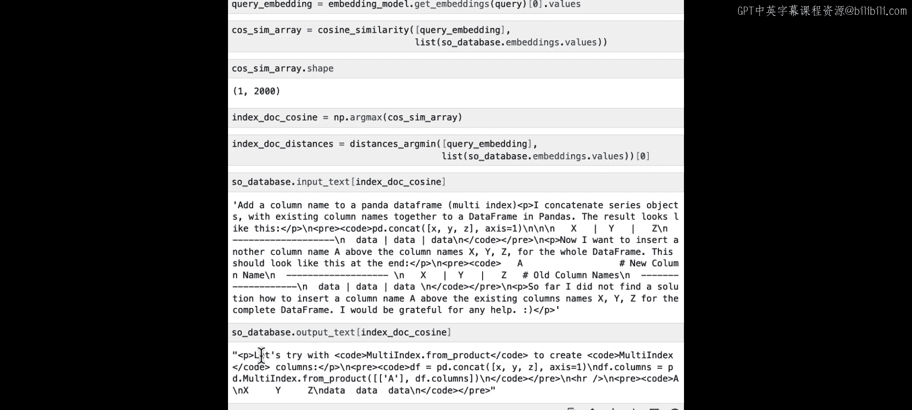

And now that we have our model loaded， we can go ahead and format a prompt。

 So we'll start by creating some context that will go into our prompt。 So here's the context。

 we've got the text question， and then we've got the actual question。😊，For the stock overflow post。

Followed by the answer， and that is the answer， the accepted answer for the stack overflow post。

 And again， we are selecting this stack overflow post based on the cosine similarity that we calculated in the previous section。

 So we're going to create a prompt and we will include this context as part of our prompt。

 So here's the prompt we're writing。 We say here's the context。

 and then we include all of this context， which is the question and answer pair from our stack overflow database。

😊，And we say using the relevant information from this context。

 provide an answer to the query here we input the user's question。

 which was about concatenating data frames in pandas。

We also instruct the model to provide a different answer if there isn't relevant information in this context。

 we say that it should respond with，I couldn't find a good match in the document database for your query and we'll see why this comes in handy in just a little bit。

So now that we've defined this prompt。We can go ahead and call the model。 we will call predict。

 and we will pass in the prompt as well as a temperature value and set some maximum output tokens and this argument here just limits how many tokens the model outputs so let's display this response and we'll display and mark down just to make it a little bit easier and nicer to read。

So here we've got an answer from our model about concatenating data frames using the conca function and as well as that an example。

 so basically we took the answer from our SAC Overflow database and we passed that into our text generation model with a little bit of additional context and had it formulate a more user friendly and conversational response。

😊，Now our current workflow returns the most similar question from our embeddings database。

 but what do we do if our user query doesn't really have anything to do with the information in our database in addition to providing a more conversational response。

 we can use a text generation model to help us handle these cases where the most similar document in our database isn't actually a reasonable answer to our user' query So let's start with a different user query this time instead of asking about pandas we' say our user is asking how to make the perfect lasagna while an interesting question。

 the answer is definitely not in this database of stack overflow posts about Python。First。

 we'll embed this query using the Get embeddings function and our embedding model。

 and once we've done that， we will compute the cosine similarity between this embedding and every single embedding in our stack overflow database。

So that's exactly what we did in the previous section。

 but just with a different query and we can take a look at this array and again this is the cosine similarity value computed between our query and all 2000 of our stack overflow embeddings from this array we will extract the index with the highest value and then we can use the same prompt we used before。

So we'll define our context， which is the document that is most similar to our input query。

 we'll have the question as well as the answer。And then we will also put this into our prompt。

 so let's take a look at this prompt again。 We've got the context。

 which is the stack overflow question and answer that was most similar to our user query。

 We also provide the model with the user query about how to make the perfect lasagna and then we instruct it to respond with I couldn't find a match in the document database for your query if the stack overflow information isn't actually relevant。

 So hopefully if we run this we should get back a response that there was no good match because we definitely don't have any information about lasagna in our database So we'll lastly call predict with our generation model we'll pass in this prompt and we will print out the response。

And here we go。 We've got this response from our model which says that there wasn't a good match in the database for this query。

 So I encourage you to try out maybe some different user queries。

 you can also try experimenting with slightly different prompts。

 see how that impacts the results from the model and maybe you can even get an even better response Before we wrap up today。

 I wanted to add a note that we computed the cosine similarity between our query embedding and every single embedding in our stackac overflow database。

 but this exhaustive search isn't really feasible when your database is hundreds of millions or even billions of vectors。

 instead， for production use cases， you'll often end up using an algorithm that performs an approximate match。

😊，Now if you're using a vector database， this will probably be taken care of for you。

 but if you want to try out one of these approximate nearest neighbor algorithms。

 one that you can use is called scan or scalable nearest neighbors。

 This is an approximate nearest neighbor algorithm and there's an open source library that you can try out which performs sufficient vector similarity search at scale。

 so let's quickly try this out in the code。So I'll first import the scan library。

And you can pi install this with。Pip install， scan， but it's already installed in this environment。

 so we'll just import it， and then we'll also need to import a utility function。

 which you can go check out later if you're curious to learn a little bit more about how this works。

 But this function is just going create an index。 and you can think of an index as being this collection of all of our vectors。

 So it will be all of our question embeddings。 This is all of our embedded stack overflow questions。

 So we can create this index and there are a few other parameters here that you can set like the number of leaves。

 the number of leaves to search。 and we're just keeping these at some simple defaults for this example。

😊。

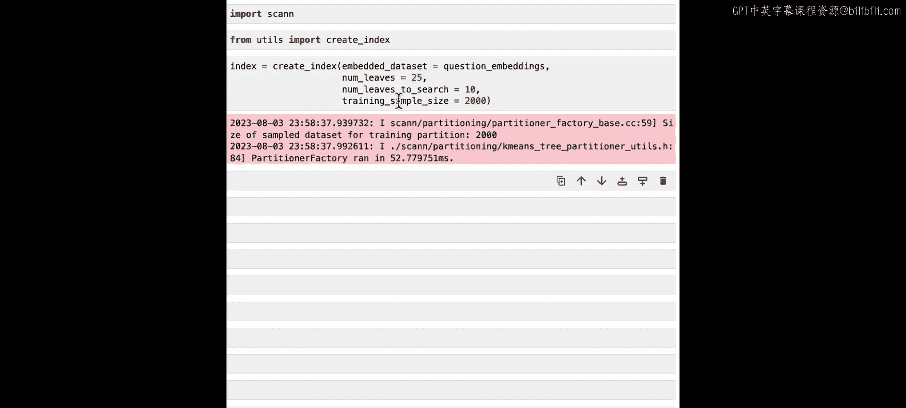

Now we'll take our input query again， are users asking how do we concatenate data frames in pandas。

 and then we can use this index to find the most similar document。

 but just to see if we get any speed benefits by doing this approximate search instead of the exhaustive search。

 we will import the time library and record how long this takes。

So first we are going to start the timer and then we will embed this query。

 we will embed how to concatenate data frames in pandas。

 and once we've done that we will pass this query embedding to our index and call the search function and then once that's done we will record the time。

So let's also go ahead and print out the responses， so this will print out the nearest neighbor。

And then we will also print out the latency， so that'll be how long this took。

So let's see that was pretty fast and here's the ID of our document on our stack overflow database as well as the similarity metric and you can see that this is the same stack overflow post that we identified earlier when we did that exhaustive search about adding a column to A pandas data frame so now we'll compare this scan algorithm to doing an exhaustive search which is what we did earlier when we computed the cosine similarity between each of our vectors in our database So here we'll set a timer again and then we will call the get embeddings function on our embeddings model passing in our query and then we will call this cosine similarity function again passing in our query and all of the embeddings in our database。

Then we will also go ahead and print out the most similar document like we did previously。

 and we will also calculate the time that I took， so let's run this cell。

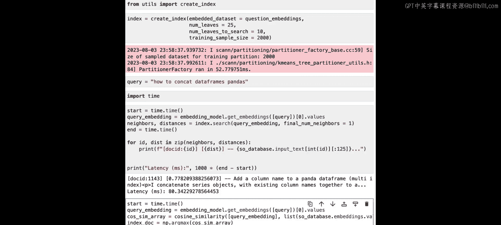

And we can see that we have the same document identified。

 This is the same stack overflow post about adding a columns name in pandas and concatenating these objects。

 but it just took a decent amount more time。 you can see here we've got 80 milliseconds when we used the approximate nearest neighbor algorithm and then 182 when we used this exhaustive search。

 Now this was all pretty quick because we had a pretty tiny database。

 but these speed gains would be a lot more noticeable if you had a large data set。

 So now you've seen how you can build a small scale question answering system using stack overflow data。

 but everything you used in this lesson you could apply to a data set of your own to build your own custom question answering system。

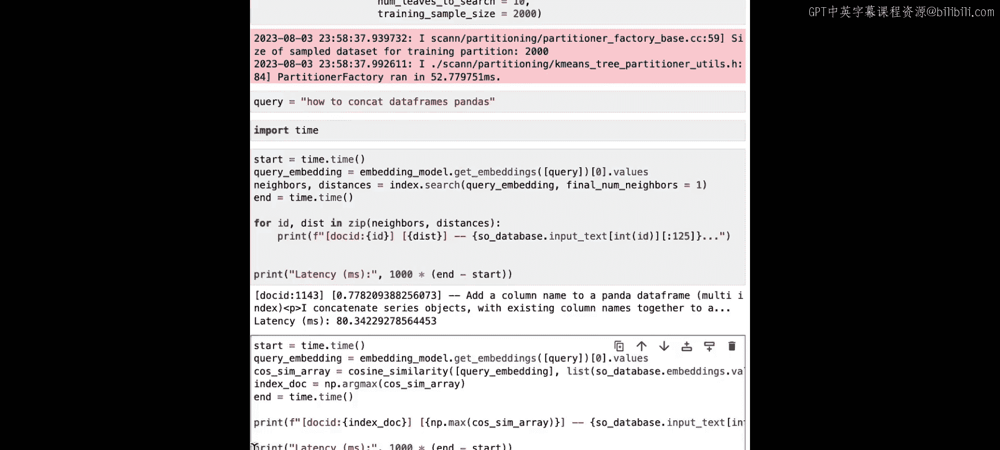

So to wrap up， let's summarize everything we did in this lesson。

 we took in all of our database of stack overflow questions and we also took in a user query and we passed all of this to our embeddings model Once we had all of our embedded questions and our embedded query。

 we could compute a nearest neighbor search where we computed the cosine similarity between the embedded query and all of the embedded questions in our database from that。

 we found the most similar question and we extracted its answer and we passed that along with the user query into our text generation model to produce a nice conversational system answer for our end user。

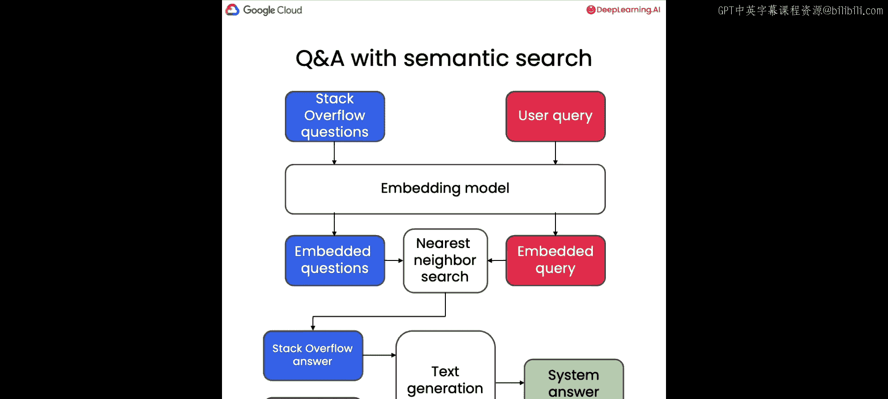