# 哈佛大学《CS50P Python编程入门》课程 - P11：列表 📋

在本节课中，我们将要学习Python中一个非常重要的数据结构——列表。列表允许我们以特定的顺序存储信息，并且可以动态地添加、删除或修改其中的元素。我们将通过一个赛车游戏排名的例子，来直观地理解列表的基本操作。

---

## 创建列表

上一节我们介绍了课程概述，本节中我们来看看如何创建一个列表。在Python中，列表使用方括号 `[]` 表示，其中的元素用逗号分隔。

例如，我们可以创建一个名为 `results` 的列表，来存储一场赛车比赛中选手的完赛名次。假设马里奥获得第一名，路易吉获得第二名。

```python
results = ["Mario", "Luigi"]
```

在这段代码中，我们创建了一个包含两个字符串元素的列表。列表中的元素顺序就是它们被添加的顺序。

---

## 向列表添加元素

创建列表后，我们常常需要在程序运行过程中动态地向列表添加新元素。Python提供了 `append()` 方法，可以将一个新元素添加到列表的末尾。

假设在比赛后期，桃花公主也完成了比赛，获得了第三名。我们可以使用 `append()` 方法将她添加到列表中。

```python
results.append("Princess")
```

现在，如果我们打印 `results` 列表，将会看到马里奥、路易吉和桃花公主。

我们可以继续使用 `append()` 方法添加更多选手，例如耀西、慢慢龟和奇诺比奥。

```python
results.append("Yoshi")
results.append("Coupa Troupa")
results.append("Toad")
```

---

## 一次性添加多个元素

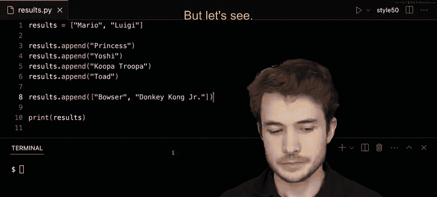

有时，我们可能需要一次性添加多个元素到列表中。例如，库巴和森喜刚 Jr. 几乎同时冲过终点线。

如果我们尝试使用 `append()` 方法并传入一个包含这两个名字的列表，会发生什么呢？

```python
results.append(["Bowser", "Donkey Kong Jr."])
```

运行代码后，我们会发现 `["Bowser", "Donkey Kong Jr."]` 这个列表本身被作为一个元素添加到了 `results` 中，形成了一个嵌套列表，这并不是我们想要的结果。

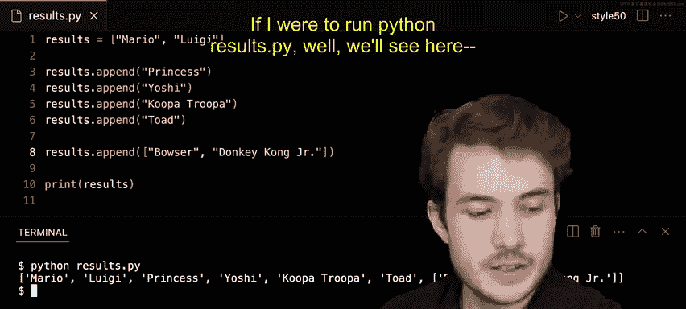

为了修正这个问题，我们需要先移除这个嵌套列表，然后使用 `extend()` 方法。`extend()` 方法会将其参数（一个列表）中的每个元素，逐个添加到原列表的末尾。

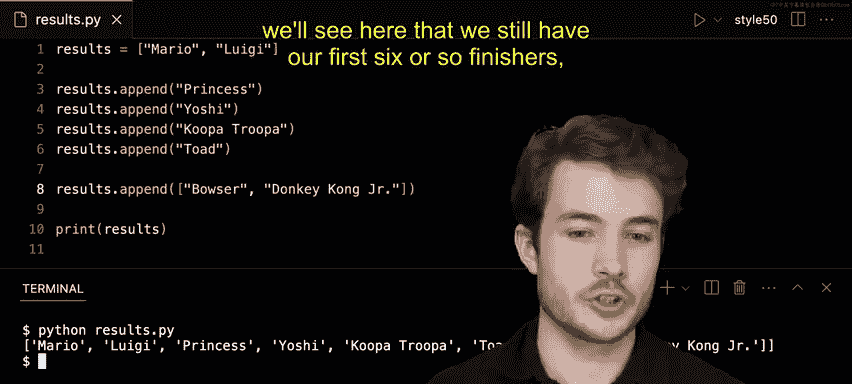

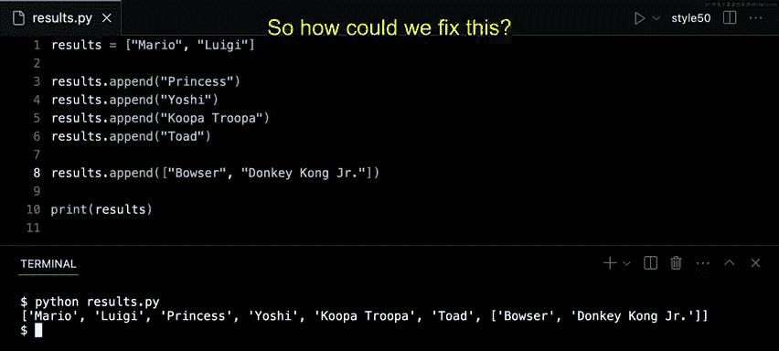

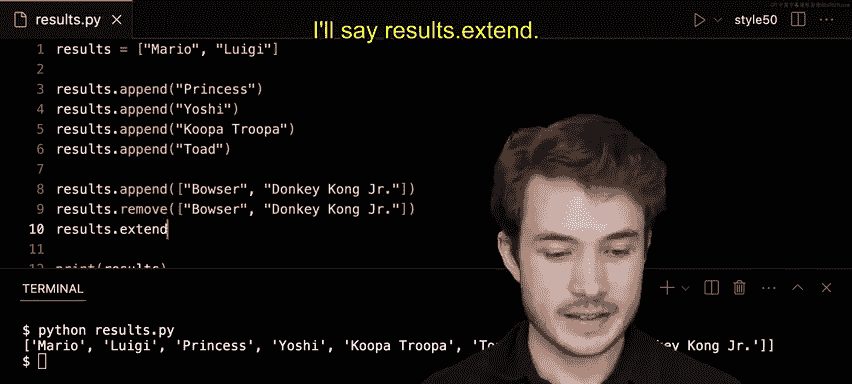

以下是修正步骤：
1.  使用 `remove()` 方法移除错误的嵌套列表。
2.  使用 `extend()` 方法添加多个元素。

```python
results.remove(["Bowser", "Donkey Kong Jr."])
results.extend(["Bowser", "Donkey Kong Jr."])
```

现在，库巴和森喜刚 Jr. 作为独立的元素被添加到了 `results` 列表的末尾。

---

## 列表的其他常用操作

除了添加元素，列表还支持其他多种操作。让我们重新初始化一个包含所有选手的列表，以便演示。

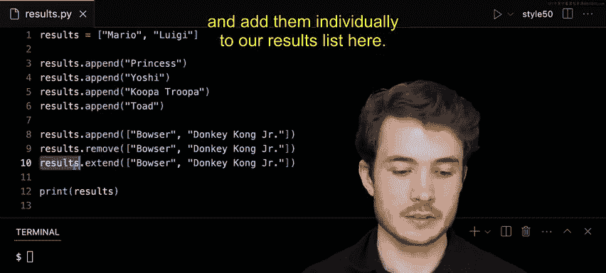

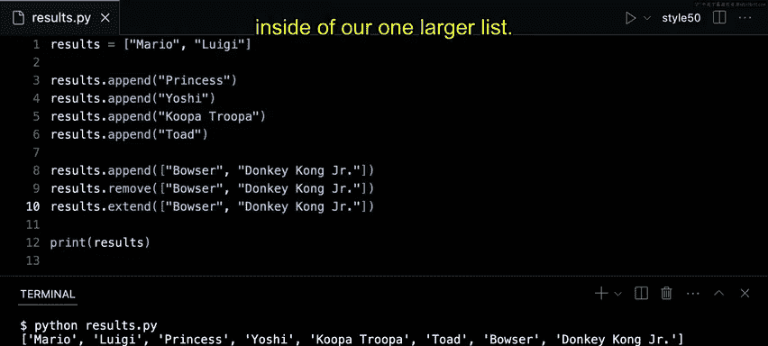

```python
results = ["Mario", "Luigi", "Princess", "Yoshi", "Coupa Troupa", "Toad", "Bowser", "Donkey Kong Jr."]
```

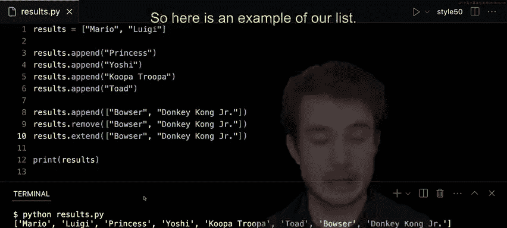

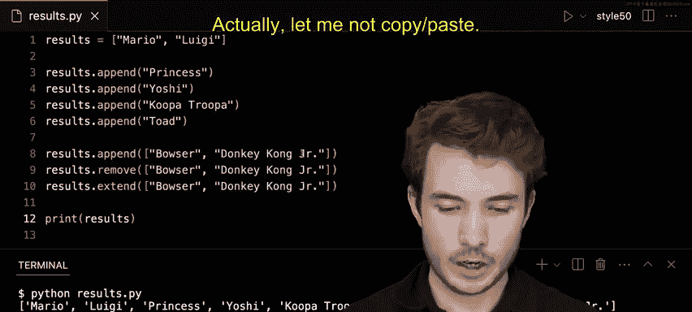

### 移除元素

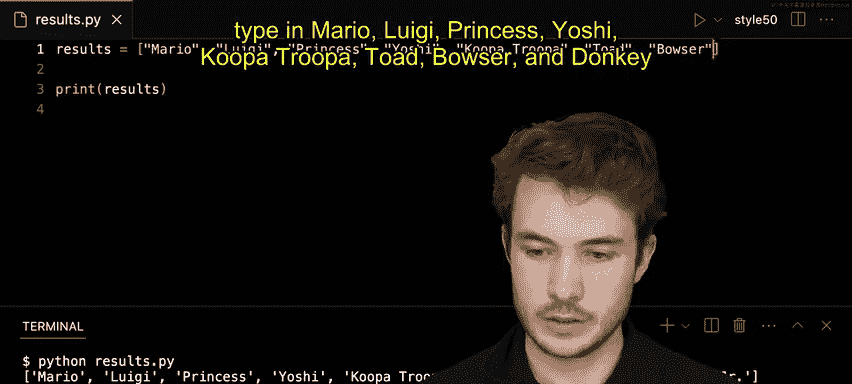

我们可以使用 `remove()` 方法从列表中移除指定的元素。例如，如果库巴作弊被取消成绩，我们可以将他从列表中移除。

```python
results.remove("Bowser")
```

`remove()` 方法会找到列表中第一个匹配的元素并将其删除。

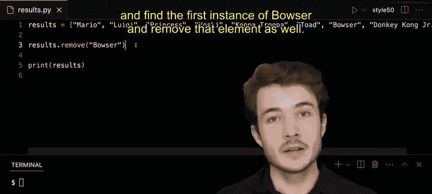

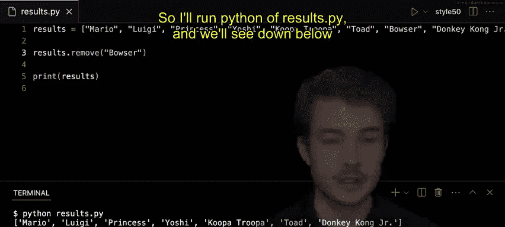

### 在指定位置插入元素

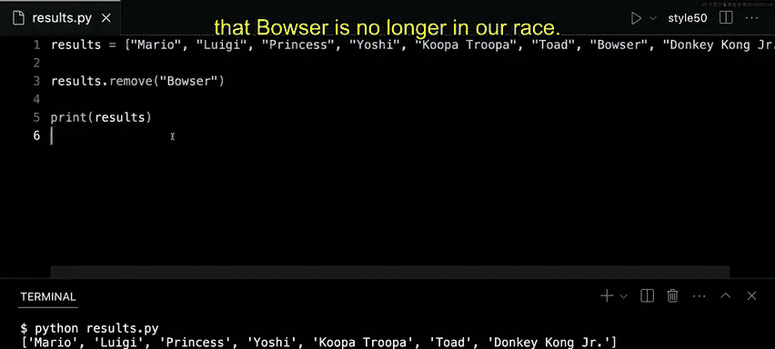

如果我们想在列表的特定位置插入一个元素，可以使用 `insert()` 方法。它接受两个参数：要插入位置的索引和要插入的元素。

列表的索引从 `0` 开始。例如，`"Mario"` 的索引是 `0`，`"Luigi"` 的索引是 `1`。

假设后来库巴的成绩被恢复，并且我们想让他“插队”到第一名（索引 `0` 的位置）。

```python
results.insert(0, "Bowser")
```

执行后，库巴将被插入到列表的最前面。

### 反转列表顺序

我们可以使用 `reverse()` 方法来反转列表中元素的顺序。这将使最后一名的选手变成第一名，第一名的选手变成最后一名。

```python
results.reverse()
```

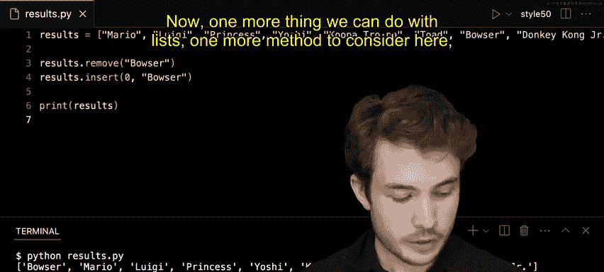

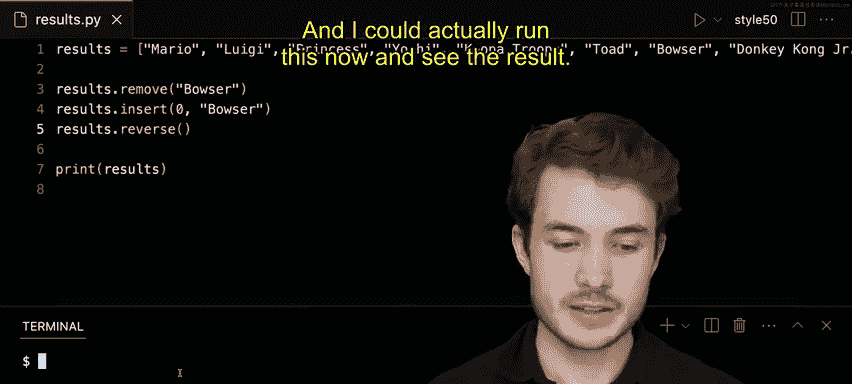

执行此操作后，列表的顺序将被完全颠倒。

---

## 总结

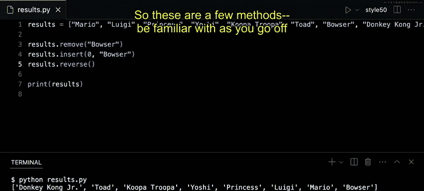

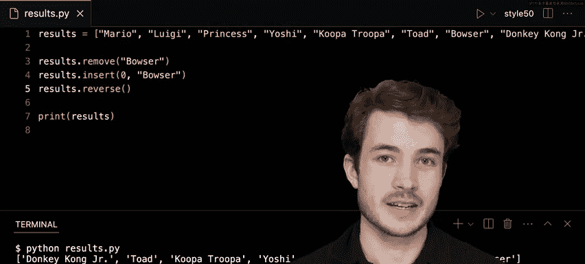


本节课中我们一起学习了Python列表的基本操作。我们了解了如何创建列表，如何使用 `append()` 和 `extend()` 方法添加元素，以及如何使用 `remove()` 和 `insert()` 方法来删除和插入元素。最后，我们还学习了如何使用 `reverse()` 方法来反转整个列表的顺序。列表是Python编程中非常强大和灵活的工具，掌握这些基本操作是进行更复杂数据处理的基础。