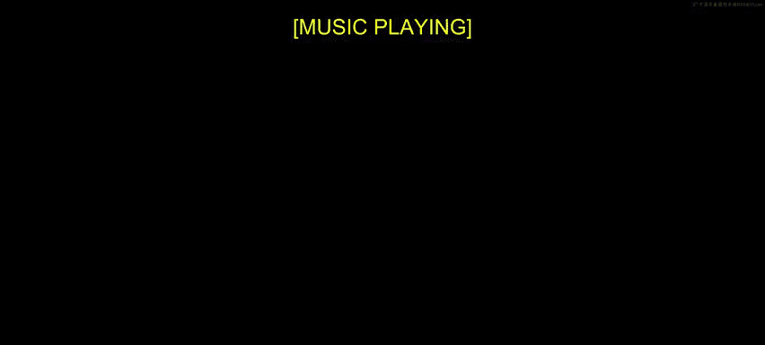
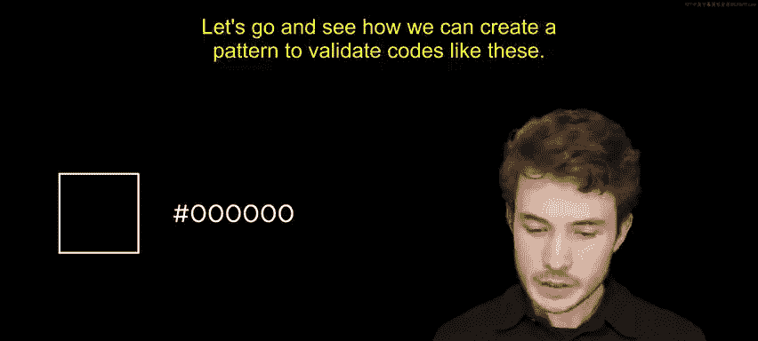
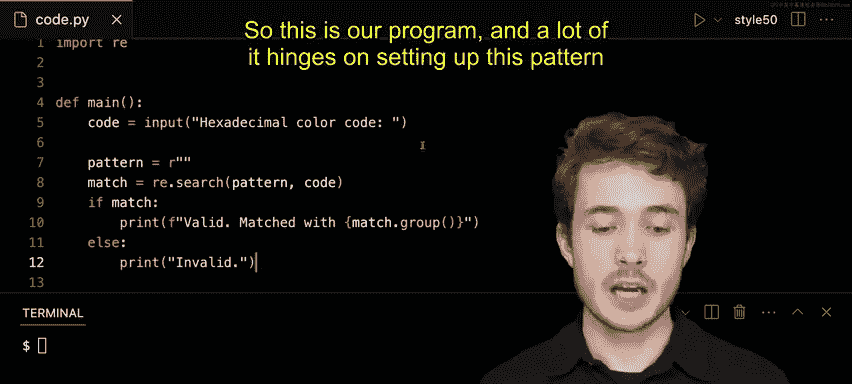
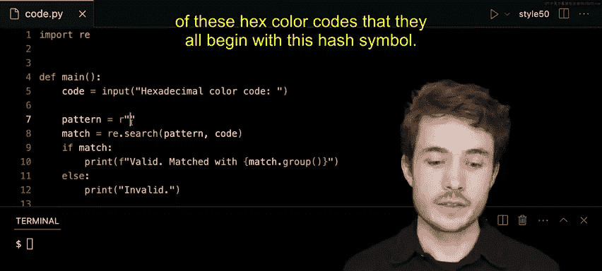
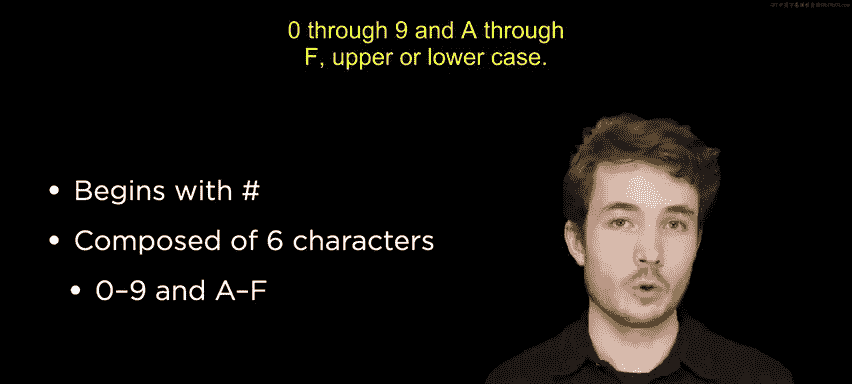
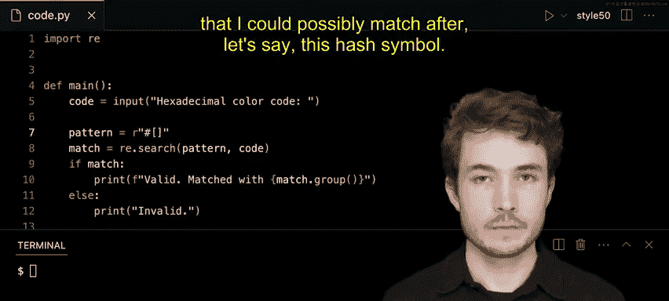
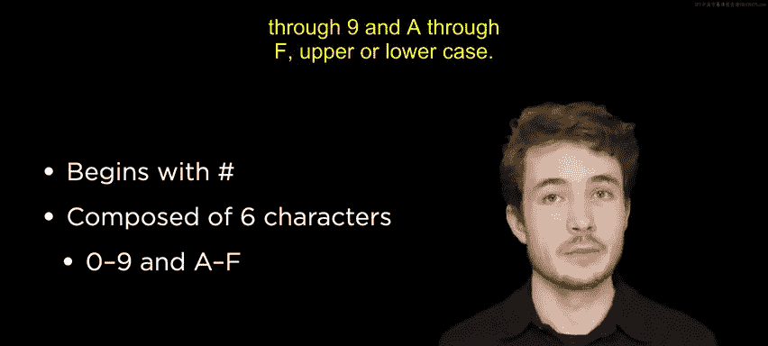
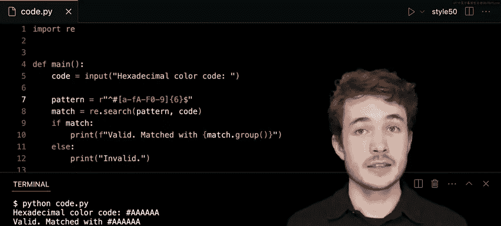

# 哈佛大学《CS50P》Python编程入门 2024 短课程 - P12：-13-模式匹配 🎨



在本节课中，我们将学习如何使用正则表达式来创建和匹配数据中的特定模式。我们将以验证十六进制颜色代码为例，讲解如何构建一个有效的正则表达式模式。

## 概述

十六进制颜色代码是一种在网页和计算机图形中表示颜色的标准方式。它以一个井号 `#` 开头，后跟六个字符，这些字符可以是数字 `0-9` 或字母 `a-f`（不区分大小写）。例如，`#0076BA` 代表一种特定的蓝色。前两个字符表示红色分量，中间两个表示绿色分量，最后两个表示蓝色分量，每个分量的范围从 `00`（无该颜色）到 `FF`（该颜色最大值）。

上一节我们介绍了模式匹配的基本概念，本节中我们来看看如何用Python代码实现一个十六进制颜色代码的验证器。

## 编写验证程序



我们将编写一个名为 `code.py` 的程序，其目标是验证用户输入的字符串是否为有效的十六进制颜色代码。

首先，我们需要导入Python的 `re` 模块，它提供了正则表达式的所有功能。

```python
import re
```

接下来，我们定义主函数 `main`。它会提示用户输入一个颜色代码，然后尝试使用正则表达式进行验证。

```python
def main():
    code = input("请输入一个十六进制颜色代码: ")
    # 验证逻辑将放在这里
```

## 构建正则表达式模式

验证的核心在于定义一个正确的正则表达式模式。根据规则，模式必须：
1.  以井号 `#` 开头。
2.  紧随其后的是恰好六个字符。
3.  这六个字符只能是 `0-9`、`a-f` 或 `A-F`。

让我们一步步构建这个模式。



首先，我们创建一个原始字符串（以 `r` 开头），这样反斜杠等字符会被直接解释，便于编写正则表达式。

```python
pattern = r"^#[a-fA-F0-9]{6}$"
```



以下是这个模式的分解：
*   `^`：这是一个锚点，表示匹配必须从字符串的**开头**开始。
*   `#`：匹配字面量的井号字符。
*   `[a-fA-F0-9]`：这是一个字符集，匹配任何一个在其中的字符。`a-f` 表示小写字母a到f，`A-F` 表示大写字母A到F，`0-9` 表示数字0到9。
*   `{6}`：这是一个量词，表示前面的字符集（`[a-fA-F0-9]`）必须**恰好出现6次**。
*   `$`：这是另一个锚点，表示匹配必须到字符串的**结尾**结束。



`^` 和 `$` 的组合确保了整个输入字符串都必须完全符合我们的模式，而不能只是其中一部分符合。

## 执行匹配与输出结果

模式定义好后，我们使用 `re.search()` 函数在用户输入的代码中搜索该模式。

```python
    match = re.search(pattern, code)
```





`re.search()` 会返回一个“匹配对象”（如果找到匹配的话），否则返回 `None`。我们可以据此判断输入是否有效。

以下是完整的判断与输出逻辑：

```python
    if match:
        print("有效")
        print(f"匹配到: {match.group()}")
    else:
        print("无效")
```

`match.group()` 方法会返回被模式匹配到的实际字符串。

## 完整程序代码

将以上所有部分组合起来，就得到了完整的验证程序。

```python
import re

def main():
    code = input("请输入一个十六进制颜色代码: ")
    pattern = r"^#[a-fA-F0-9]{6}$"
    match = re.search(pattern, code)

    if match:
        print("有效")
        print(f"匹配到: {match.group()}")
    else:
        print("无效")

if __name__ == "__main__":
    main()
```

## 测试程序

让我们运行程序并测试几种情况：

1.  输入 `#AAAAAA`（有效的灰色）：程序会打印“有效”。
2.  输入 `#00FF00`（有效的绿色）：程序会打印“有效”。
3.  输入 `#GGGGGG`（包含无效字符`G`）：程序会打印“无效”。
4.  输入 `#AAA`（字符数不足）：程序会打印“无效”。
5.  输入 `颜色是#AAAAAA`（井号不在开头）：程序会打印“无效”。

## 总结

本节课中我们一起学习了如何使用正则表达式进行模式匹配。我们以验证十六进制颜色代码为例，详细讲解了如何：
*   使用 `re` 模块进行正则表达式操作。
*   构建包含字符集 `[...]`、量词 `{n}` 和锚点 `^`、`$` 的复杂模式。
*   利用 `re.search()` 函数执行匹配，并根据结果判断输入的有效性。




正则表达式是处理文本模式的强大工具，适用于验证电子邮件、电话号码、URL等任何具有固定格式的数据。掌握它将极大提升你处理字符串数据的能力。