# 哈佛大学《CS50P Python编程入门》短片课程 - P13：Pillow图像处理库 🖼️


在本节课中，我们将学习如何使用Python的Pillow库来操作图像。我们将涵盖如何打开、保存、旋转图像以及应用滤镜。

## 概述

Pillow是一个用于在Python中操作图像的库。我们将从一个名为`in.jpeg`的图像文件开始，这是艺术家葛饰北斋的著名作品《神奈川冲浪里》。目前这个图像是倒置的，我们将使用Pillow库将其旋转至正确的方向。

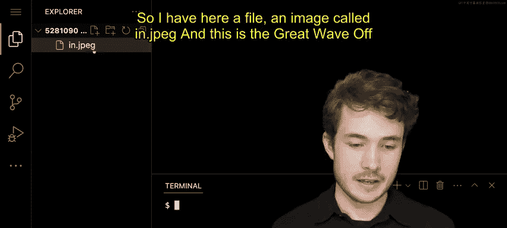

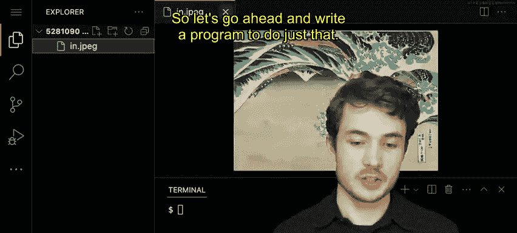

## 导入Pillow库

要使用Pillow库，我们首先需要导入它。Pillow库提供了一个名为`Image`的类，用于表示和操作图像。

```python
from PIL import Image
```

## 打开图像

使用`Image`类的`open`方法可以打开一个图像文件。这个方法返回一个图像对象，我们可以将其赋值给一个变量以便后续操作。

```python
with Image.open('in.jpeg') as img:
    # 在此代码块内操作图像
```

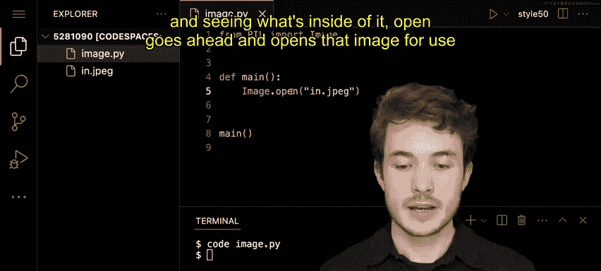

使用`with`语句可以确保在操作完成后自动关闭图像文件，这是一种良好的编程习惯。

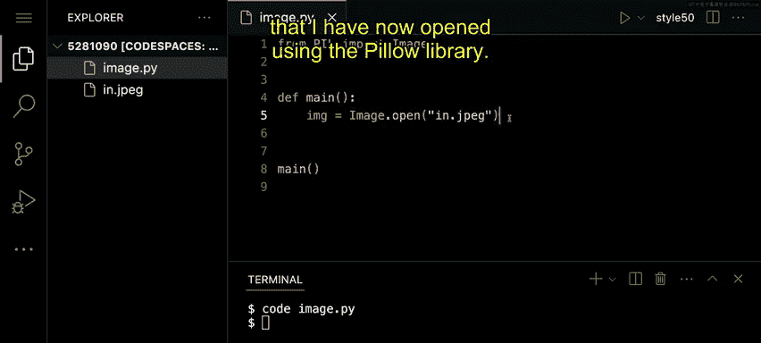

## 获取图像属性

图像对象具有一些属性，可以帮助我们了解图像的基本信息。以下是两个常用的属性：

*   **`img.size`**：返回图像的尺寸，格式为`(宽度, 高度)`，单位是像素。
*   **`img.format`**：返回图像的格式，例如JPEG、PNG等。

```python
print(img.size)   # 例如：(1052, 720)
print(img.format) # 例如：JPEG
```

## 旋转图像

现在，我们来解决图像倒置的问题。`Image`对象有一个`rotate`方法，可以按指定角度旋转图像。要将倒置的图像翻转过来，我们需要将其旋转180度。

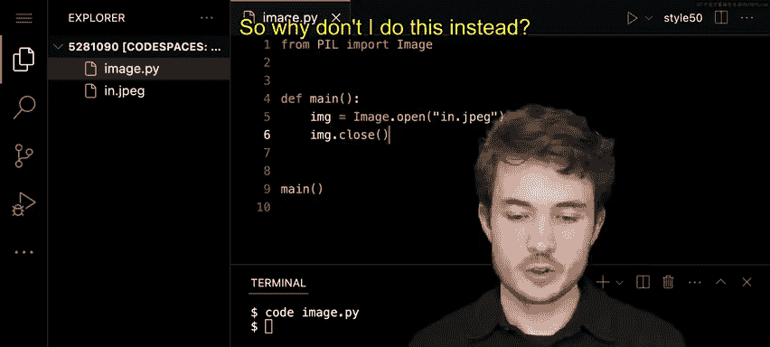

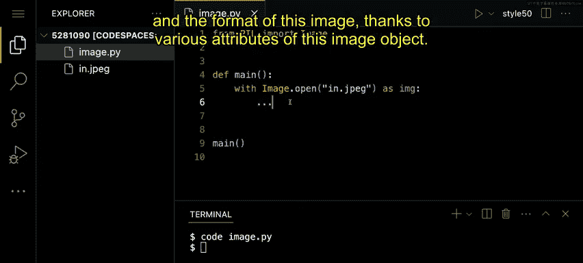

```python
img = img.rotate(180)
```

## 保存图像

对图像进行修改后，我们可以使用`save`方法将其保存到一个新文件中。

```python
img.save('out.jpeg')
```

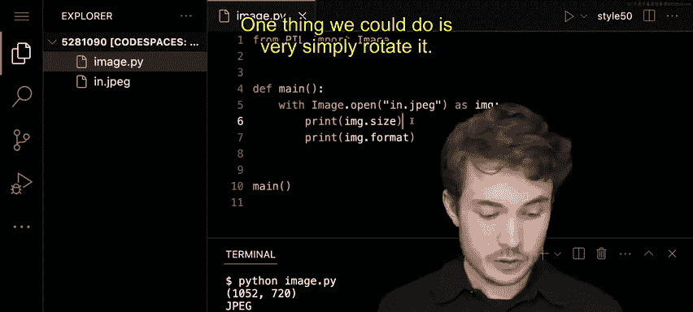

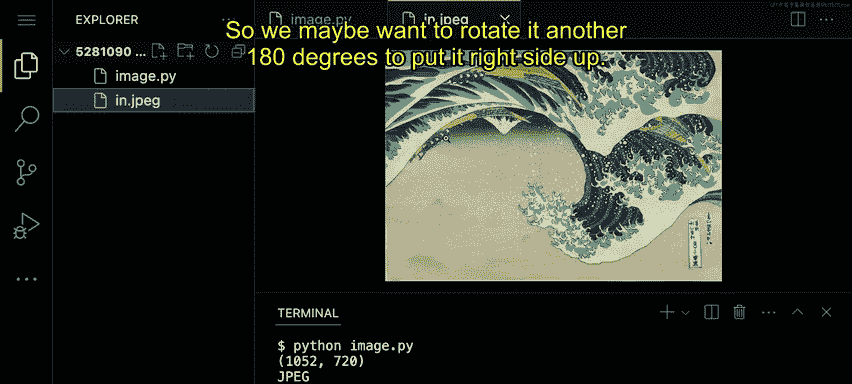

## 应用图像滤镜

除了旋转，Pillow还允许我们为图像应用各种滤镜。为此，我们需要从Pillow库中导入`ImageFilter`模块。

```python
from PIL import ImageFilter
```

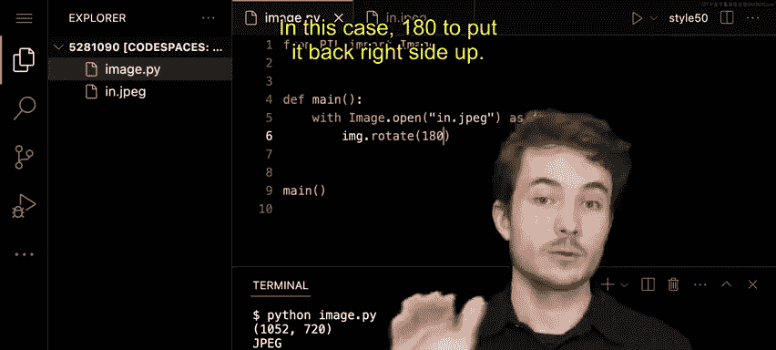

然后，我们可以使用`filter`方法并传入特定的滤镜来应用效果。以下是两个例子：

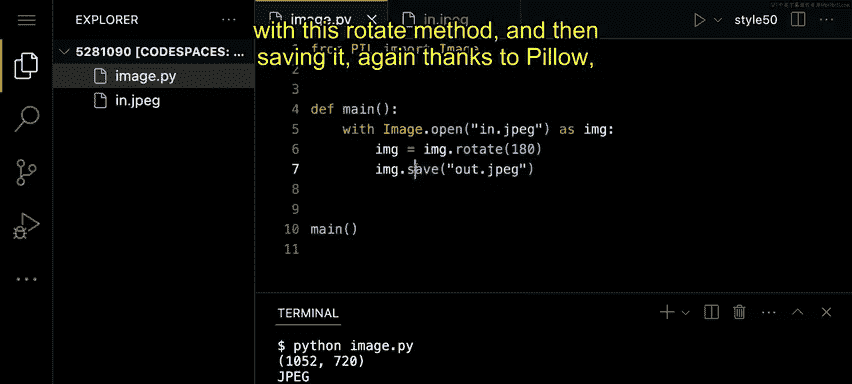

*   **模糊滤镜**：使用`ImageFilter.BLUR`。
*   **边缘查找滤镜**：使用`ImageFilter.FIND_EDGES`。

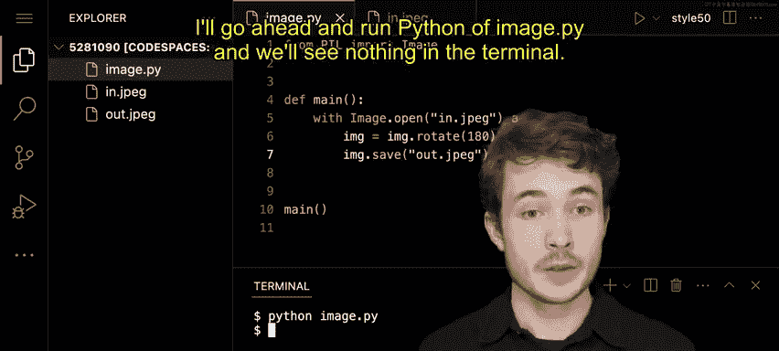

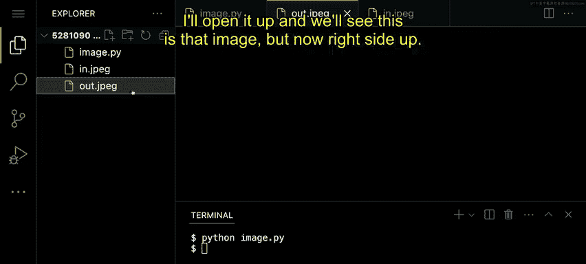

```python
# 应用模糊滤镜
img = img.filter(ImageFilter.BLUR)

# 应用边缘查找滤镜
img = img.filter(ImageFilter.FIND_EDGES)
```

应用滤镜后，同样可以使用`save`方法保存处理后的图像。

## 完整代码示例

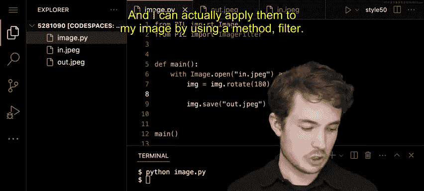

结合以上步骤，一个完整的图像处理程序可能如下所示：

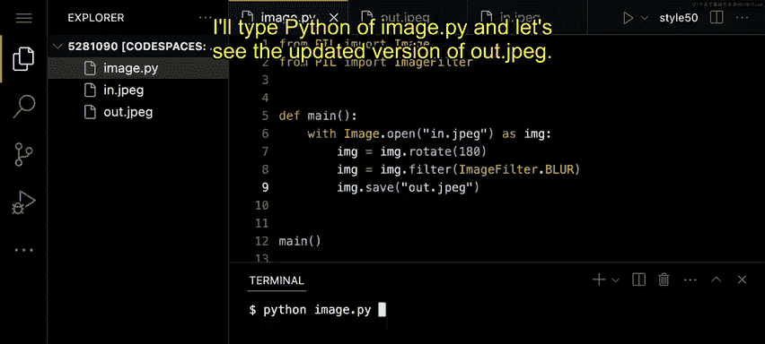

```python
from PIL import Image, ImageFilter

def main():
    # 打开图像
    with Image.open('in.jpeg') as img:
        # 获取并打印图像信息
        print(f"图像尺寸: {img.size}")
        print(f"图像格式: {img.format}")

        # 旋转图像180度
        img = img.rotate(180)

        # 应用模糊滤镜 (可选)
        # img = img.filter(ImageFilter.BLUR)

        # 保存处理后的图像
        img.save('out.jpeg')
        print("图像已处理并保存为 'out.jpeg'")

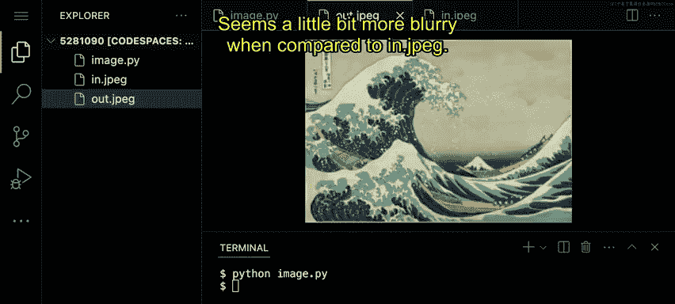

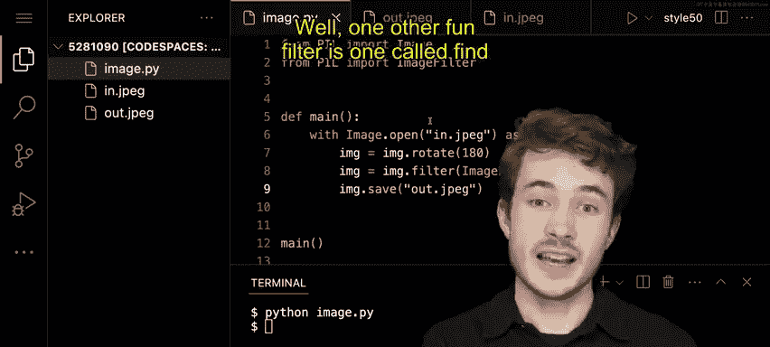

if __name__ == "__main__":
    main()
```

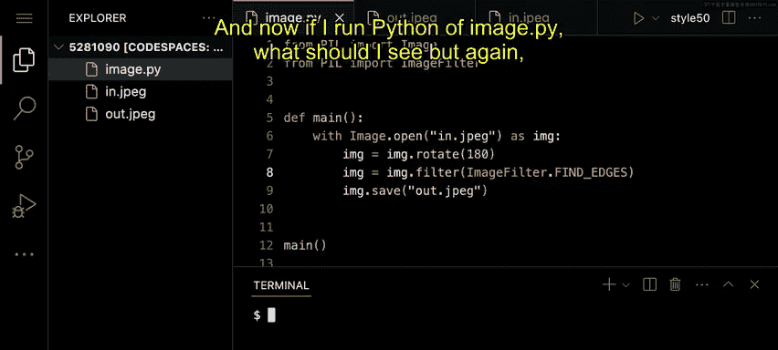

## 总结

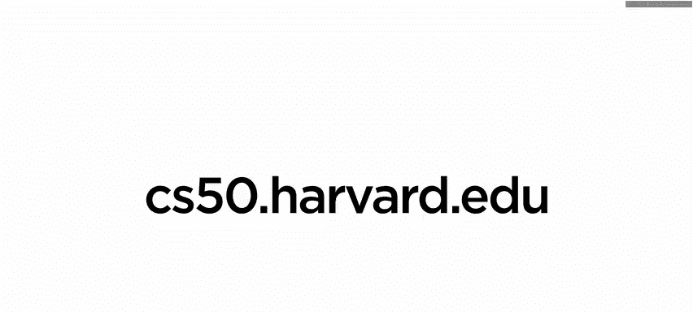

本节课中，我们一起学习了Pillow库的基础操作。我们了解了如何导入库、打开和关闭图像文件、获取图像的基本属性、旋转图像以及应用滤镜效果。通过Pillow，你可以轻松地对图像进行各种编程处理。期待看到你使用Pillow创造出的作品！