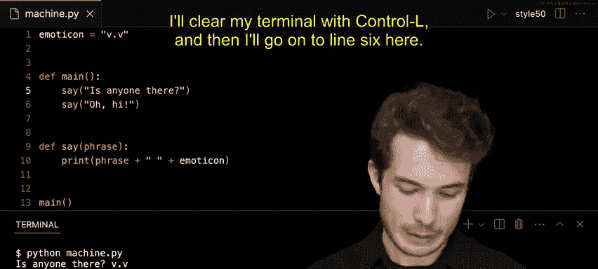
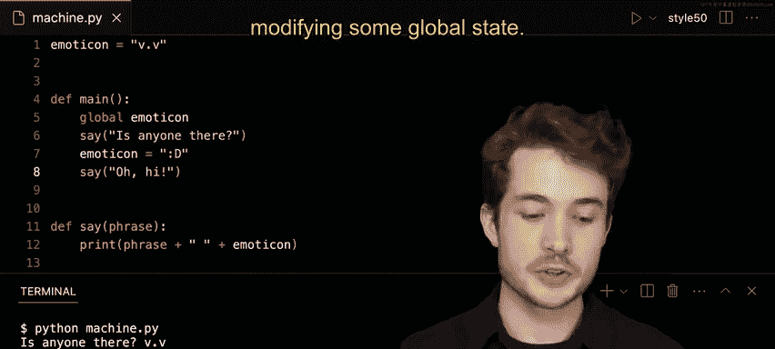

# 哈佛大学《CS50P Python编程入门》课程短片 - P18：副作用 (Side Effects) 🧪


在本节课中，我们将要学习编程中的一个重要概念：**副作用**。我们将了解什么是副作用，它与函数的返回值有何不同，并通过具体的Python代码示例来探索副作用的两种常见形式。

---

## 概述

函数是编程语言中接收输入并产生输出的工具。我们已经知道，函数可以通过**返回值**将结果传递出来。然而，函数在运行过程中还可能产生另一种输出，即**副作用**。副作用指的是函数运行时，除了返回值之外，对程序状态造成的任何其他改变。本节课我们将通过一个“情感机器”的例子，来具体理解副作用。

---

## 理解副作用

上一节我们介绍了函数的基本概念。本节中我们来看看什么是副作用。

副作用不是函数的返回值，而是函数在执行过程中对程序环境造成的任何其他影响。例如，向屏幕打印信息或修改一个全局变量的值，都属于副作用。

让我们来看一个具体的程序示例。这里有一个名为 `machine.py` 的程序，它模拟了一个带有内部情感状态的机器。

```python
emoticon = ":("
```

在程序顶部，我们定义了一个全局变量 `emoticon`，它代表了机器当前的情感状态，这里是一个表示悲伤的表情符号。

---

## 示例：一个会说话的机器

我们的目标是让这个机器能够“说话”。为了实现这个功能，我们将在 `main` 函数下方定义一个名为 `say` 的函数。

以下是 `say` 函数的定义：

```python
def say(phrase):
    print(phrase + " " + emoticon)
```

这个 `say` 函数接收一个参数 `phrase`（要说的短语）。在函数体内，我们使用 `print` 函数将短语和全局变量 `emoticon` 一起输出到终端。这里，`print` 语句的执行就是一个**副作用**——它改变了终端显示的内容，但函数本身并没有返回任何值。

现在，我们在 `main` 函数中调用 `say` 函数。

```python
def main():
    say("Is anyone there?")
    say("Oh, hi!")

if __name__ == "__main__":
    main()
```

运行这个程序，我们会在终端看到两行输出，但表情符号始终是悲伤的。这是因为我们还没有改变机器的情感状态。

---

## 修改全局变量作为副作用

上一节我们看到了打印输出这种副作用。本节中我们来看看另一种副作用：修改全局变量。

我们希望机器在说“Oh, hi!”之前能变得开心一些。因此，我们尝试在 `main` 函数中直接修改 `emoticon` 的值。

```python
def main():
    say("Is anyone there?")
    emoticon = ":D"  # 尝试改为笑脸
    say("Oh, hi!")
```

然而，直接运行上述代码会发现，第二个表情符号并没有改变。这是因为在函数内部，Python 默认将 `emoticon` 视为一个局部变量，我们的赋值操作创建了一个新的局部变量，而不是修改外部的全局变量。



为了在函数内部修改全局变量，我们需要使用 `global` 关键字来明确声明。

以下是修改后的 `main` 函数：

```python
def main():
    global emoticon  # 声明我们将要修改全局变量 emoticon
    say("Is anyone there?")
    emoticon = ":D"  # 修改全局变量的值
    say("Oh, hi!")
```

通过使用 `global emoticon`，我们告诉 Python 在 `main` 函数中，`emoticon` 指向的是全局作用域中的那个变量。因此，对其赋值就修改了全局状态，这构成了另一个**副作用**。

运行修改后的程序，现在我们可以看到机器先悲伤地问候，然后开心地打招呼了。

---

## 关于副作用的注意事项

在编程中，使用副作用（尤其是修改全局变量）需要谨慎。虽然它功能强大，但过度使用可能导致代码难以调试和理解，因为变量的状态可能在程序的多个地方被改变。

以下是使用副作用时需要考虑的几点：

*   **明确性**：使用 `global` 关键字让代码意图更清晰。
*   **可维护性**：全局变量的修改可能产生难以追踪的影响。
*   **设计决策**：在决定使用副作用前，应评估是否有更清晰、更模块化的替代方案（例如，通过函数参数和返回值传递状态）。

---

## 总结

本节课中我们一起学习了**副作用**这一核心概念。

我们了解到：
1.  副作用是函数运行时对程序环境产生的、除返回值之外的任何改变。
2.  我们通过 `print` 函数演示了**向终端输出信息**这种副作用。
3.  我们通过使用 `global` 关键字修改全局变量 `emoticon`，演示了**改变程序全局状态**这种副作用。
4.  我们认识到，虽然副作用很有用，但在设计中需要慎重使用，以保持代码的清晰和可维护性。




副作用是编程中一个强大但需要谨慎使用的工具，理解它有助于你写出更灵活、但也更可控的代码。