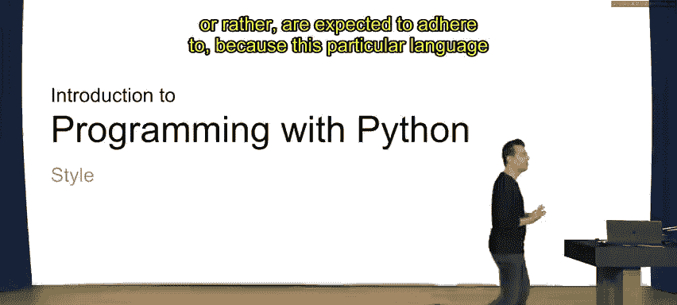
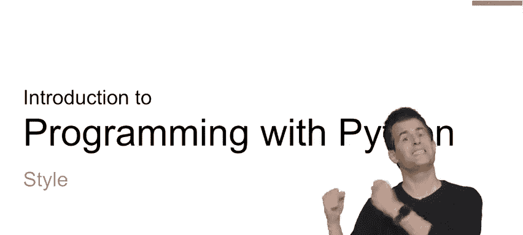

# 哈佛大学《CS50P Python编程入门》课程 - P19：代码风格 🎨


在本节课中，我们将要学习代码风格的重要性以及如何遵循Python社区的通用标准来编写整洁、易读的代码。我们将介绍PEP 8风格指南，并了解如何使用自动化工具来检查和格式化代码。

---



## 什么是代码风格？

到目前为止，我们编写的代码主要关注正确性和设计。代码风格是代码质量的另一个维度。风格的选择具有一定主观性，它取决于程序员、公司、课程或所使用的编程语言。

然而，在Python社区中，存在一些相当规范的标准，大多数Python程序员都遵循或期望遵循。这是因为Python语言及其社区试图将他们的偏好编纂成文。

---

## PEP 8：Python的风格指南

Python社区通过一种名为**PEP 8**的文档来标准化代码的外观。PEP，即Python增强提案，是Python社区提出新想法并最终确定某些标准的一系列提案。PEP 8就是这样一个提案，它试图标准化我们的代码应该是什么样子。

编写代码时，即使代码正确且设计良好，但如果看起来混乱，可读性就会变差。可读性差的代码更难维护，从而增加了引入错误的可能性。因此，像在写作中注意大小写、标点和段落一样，在编程中遵循良好的风格实践同样重要。

PEP 8的核心原则是：**可读性至关重要**。它试图标准化代码中的许多细节，其总体前提是保持一致性。与PEP 8风格指南保持一致很重要，在项目内部保持一致更重要，而在一个模块或函数内部保持一致则最为重要。这些并非硬性规定，而是指导你设计代码的准则。

---

## 风格指南的关键要素

以下是PEP 8规定的一些关键要素：

*   **缩进**：在Python中，规定使用**四个空格**进行缩进，而不是制表符。这有助于代码在不同环境下保持一致的视觉结构。
*   **最大行长度**：过长的代码行会降低可读性。PEP 8规定了代码行的最大字符数，以防止代码在屏幕上横向滚动。
*   **空行**：在代码块之间、函数之间或注释周围适当使用空行，可以使代码结构更清晰，避免形成“代码墙”。
*   **导入语句**：PEP 8对如何以及在何处放置 `import` 或 `from ... import ...` 语句也有具体规定。

这些细节在我们课堂的示例代码中都有所体现。随着你阅读更多代码，你会逐渐习惯这些规则。

---

## 如何检查代码风格？

你可以通过阅读PEP 8指南并手动对比来检查代码。但作为程序员，我们也可以利用工具来帮助解决这个问题。

一种流行的工具是 **`pylint`**，它是一个**静态代码分析器**。它会读取你的代码，检查其中是否存在潜在的错误或与风格指南不一致的地方。你可以通过 `pip` 安装它。

然而，`pylint` 的检查可能非常详尽，对于初学者编写的代码可能会报告大量风格问题，容易让人不知所措。

---

## 自动化代码格式化工具

一个相对“安静”且更直接的工具是 **`pycodestyle`**（原名 `pep8`）。这个程序可以检查你的代码是否符合PEP 8。

另一个目前更流行、功能更强大的工具是 **`black`**。`black` 是一个**代码格式化程序**，它不仅能检查，还能自动将你的代码重新格式化为符合其规则的样子。

`black` 的设计理念是“**独断专行**”。这个名字的灵感来源于亨利·福特的名言：“任何顾客都可以将这辆车漆成任何他想要的颜色，只要它是黑色。” 这意味着 `black` 对代码格式有自己的一套强硬规则，并自动执行，减少了开发者之间在风格细节上的争论，让你能更专注于编写正确的代码和解决问题。

---

## 实践：使用 `black` 格式化代码

让我们来看一个具体的例子。假设我们有一个名为 `students.py` 的程序，它创建了一个字典来存储学生姓名和他们的学院，然后打印学生姓名。

原始的代码可能存在风格问题，例如行过长、缩进不一致等。

我们可以通过在终端中运行以下命令来使用 `black` 自动格式化它：
```bash
black students.py
```
运行后，`black` 会重新格式化文件。长行会被合理拆分，缩进会被修正为四个空格，并且它可能会在字典的最后一个元素后添加一个逗号。这个尾随逗号虽然不是必需的，但有助于未来添加新元素时避免忘记添加逗号的常见错误。

---

## 总结

本节课中，我们一起学习了代码风格的重要性。我们了解了Python社区的官方风格指南**PEP 8**，它强调了可读性和一致性。我们还介绍了几种工具来帮助维护代码风格：用于静态分析的 `pylint`，用于检查PEP 8合规性的 `pycodestyle`，以及能够自动格式化代码的“独断专行”的工具 **`black`**。



养成遵循良好代码风格的习惯，并利用这些自动化工具，可以帮助你编写出更整洁、更易维护的代码，从而让你能将更多精力集中在算法的正确性和程序的设计上。