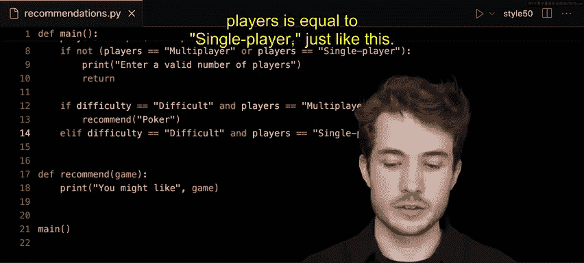
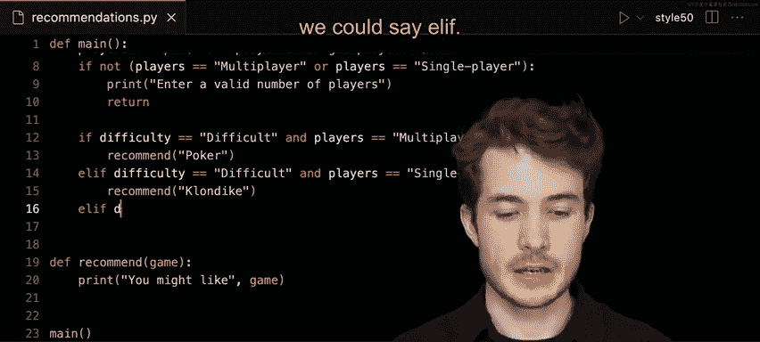
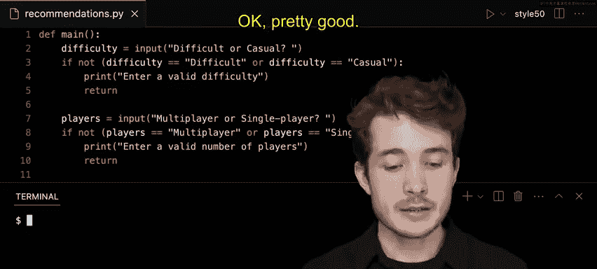

# 课程 P1-01：布尔表达式 🧠


在本节课中，我们将学习布尔表达式和布尔运算符。我们将通过改进一个游戏推荐程序的设计，来理解如何利用这些概念编写更简洁、更高效的代码。

---

在之前关于条件语句的短片中，我们编写了一个根据用户偏好的难度级别和玩家数量来推荐纸牌游戏的程序。现在，让我们思考如何改进这个程序的设计。

我们注意到代码中存在大量重复。具体来说，第6至11行和第13至18行的条件判断逻辑几乎完全相同。我们可以做得更好。

## 如何改进设计

我们可以从程序一开始就检查用户输入是否正确。我们需要确保用户输入的是“difficult”或“casual”，以及“multiplayer”或“single player”，而不是其他选项。

以下是实现方法：

首先，在获取用户输入后，我们可以使用条件语句来检查输入的有效性。例如，检查难度值是否为“difficult”或“casual”。

```python
if difficulty == "difficult":
    # 处理逻辑
```

然而，如果只了解基本的布尔表达式，我们可能需要写多个`if`语句。但幸运的是，我们可以使用布尔运算符来组合多个问题。

## 布尔表达式与运算符

布尔表达式是结果为“是”或“否”（即`True`或`False`）的表达式。例如，`difficulty == "difficult"`就是一个布尔表达式。

我们可以使用布尔运算符将多个布尔表达式组合成一个更复杂的表达式。Python提供了三种主要的布尔运算符：`and`、`or`和`not`。

在本例中，我们关心难度是否是“difficult”或“casual”。我们可以使用`or`运算符在一个表达式中询问这个问题：

```python
if difficulty == "difficult" or difficulty == "casual":
    # 用户输入了有效难度
```

但我们的需求实际上是检查用户是否**没有**输入有效选项。这时可以使用`not`运算符来取反一个逻辑表达式的结果。

```python
if not (difficulty == "difficult" or difficulty == "casual"):
    print("Enter a valid difficulty.")
    return
```

`not`运算符会将其后的表达式结果取反。如果表达式为`True`，则变为`False`；如果为`False`，则变为`True`。

通过这种方式，如果用户输入了无效的难度，程序会立即提示用户并结束运行。

## 应用相同逻辑检查玩家数量

我们可以将相同的逻辑应用于检查玩家数量的输入：

```python
if not (players == "multiplayer" or players == "single player"):
    print("Enter a valid number of players.")
    return
```

通过提前进行输入验证，我们可以简化后续的条件判断逻辑，并立即向用户提供反馈。

## 优化后续条件判断

上一节我们通过提前验证简化了程序结构。本节中，我们来看看如何优化后续的游戏推荐逻辑。

原来的代码在多个分支中重复了相似的条件结构。我们可以使用`and`运算符将多个条件合并到一个更复杂的布尔表达式中。



例如，要推荐“poker”游戏，需要同时满足难度为“difficult”且玩家模式为“multiplayer”。我们可以这样写：

```python
if difficulty == "difficult" and players == "multiplayer":
    print("poker")
```



我们可以用这种方式重写所有的条件判断：

以下是重写后的条件判断逻辑：

```python
if difficulty == "difficult" and players == "multiplayer":
    print("poker")
elif difficulty == "difficult" and players == "single player":
    print("Klondike")
elif difficulty == "casual" and players == "multiplayer":
    print("hearts")
else:
    # 只剩下一种组合：casual 和 single player
    print("clock")
```

由于我们只有两个输入（难度和玩家模式），每个输入有两种可能，总共只有四种可能的组合。因此，在检查了前三种组合后，最后一种情况可以直接使用`else`分支处理。

## 测试程序

让我们测试一下改进后的程序。我们将运行程序并尝试各种输入组合，以验证其行为是否符合预期。



1.  **输入无效难度**：例如输入“medium”，程序应提示“Enter a valid difficulty.”。
2.  **输入有效难度但无效玩家模式**：例如输入“difficult”和“two player”，程序应提示“Enter a valid number of players.”。
3.  **输入有效组合**：
    *   “difficult”和“multiplayer”应推荐“poker”。
    *   “difficult”和“single player”应推荐“Klondike”。
    *   “casual”和“multiplayer”应推荐“hearts”。
    *   “casual”和“single player”应推荐“clock”。

经过测试，程序在所有情况下的行为都正确无误。

---

本节课中我们一起学习了布尔表达式和布尔运算符（`and`、`or`、`not`）。我们通过重构一个游戏推荐程序，实践了如何利用它们来组合复杂的逻辑问题、提前验证用户输入，并最终编写出更简洁、更易读的代码。掌握这些工具对于编写高效的Python程序至关重要。