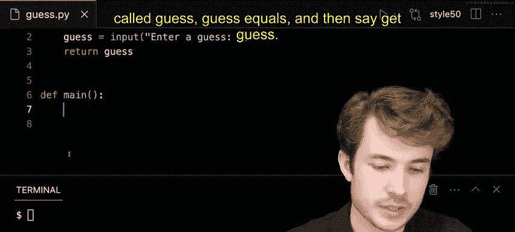
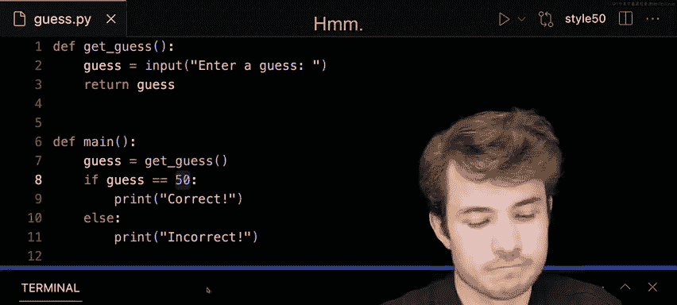
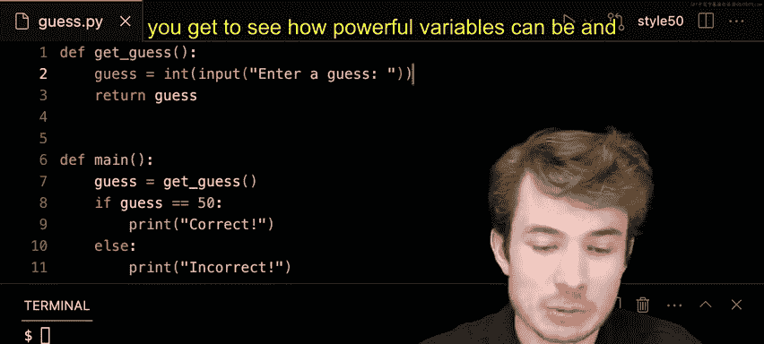

# 哈佛大学《CS50P Python编程入门》课程 - P20：变量 🧩


在本节课中，我们将学习编程中的一个基础构建块——变量。变量是程序中用于存储可变值的容器。我们将通过创建一个简单的猜数字游戏来理解变量的声明、赋值、作用域以及不同类型变量的使用。

---

## 概述


变量是编程中用于存储数据的容器，其值可以在程序运行过程中改变。本节将通过构建一个猜数字游戏，演示如何在Python中创建和使用变量，如何通过函数获取用户输入，以及如何处理不同类型的数据。

---

## 变量的基本概念

变量可以被视为一个命名的容器，用于存储程序运行期间可能发生变化的值。在Python中，创建一个变量非常简单。

以下是创建一个名为 `guess` 的变量，并为其赋值 `10` 的示例：

```python
guess = 10
```

这里的等号 `=` 是赋值运算符，其作用是将右侧的值（`10`）存储到左侧命名的容器（`guess`）中。赋值后，我们可以通过 `print` 函数查看变量的值：

```python
print(guess)  # 输出：10
```

---

## 变量与函数结合使用

变量的真正威力在于与函数结合。我们可以创建一个函数来获取用户的猜测值。

首先，我们定义一个名为 `get_guess` 的函数。该函数内部创建一个变量 `guess`，并将其值设为 `10`，最后返回这个变量。

```python
def get_guess():
    guess = 10
    return guess
```

然后，我们可以调用这个函数并打印其返回值：

```python
print(get_guess())  # 输出：10
```

---

## 获取用户输入

一个固定的猜测值并不实用。理想情况下，程序应允许用户在终端中输入他们的猜测。Python提供了 `input` 函数来实现这一功能。

我们可以修改 `get_guess` 函数，使用 `input` 提示用户输入，并将输入的值存储在变量中：

```python
def get_guess():
    guess = input("Enter a guess: ")
    return guess
```

现在，运行程序时，`input` 函数会显示提示信息“Enter a guess:”，并将用户输入的内容作为字符串存储在 `guess` 变量中。



---

## 变量的作用域

你可能会注意到，我们在不同的函数中使用了相同的变量名 `guess`。这之所以可行，是因为变量具有作用域。

作用域定义了变量在程序中的可见范围。在上述代码中：
*   函数 `get_guess` 内部的 `guess` 变量只在该函数内部有效。
*   函数 `main` 内部的 `guess` 变量也只在该函数内部有效。

它们是两个独立的变量，互不干扰。这种设计允许我们在不同的上下文中复用变量名。

---

## 比较变量与处理类型

上一节我们介绍了如何获取用户输入并将其存储在变量中。本节中我们来看看如何将这个输入与一个预设的数字进行比较。

我们可以在 `main` 函数中调用 `get_guess` 来获取用户的猜测，然后将其与目标数字（例如 `50`）进行比较：

```python
def main():
    guess = get_guess()
    if guess == 50:
        print("Correct")
    else:
        print("Incorrect")
```

然而，直接运行上述代码可能会出现问题。如果用户输入 `50`，程序可能仍然会输出“Incorrect”。这是因为 `input` 函数返回的是一个**字符串**（例如 `"50"`），而我们比较的目标 `50` 是一个**整数**。在Python中，字符串 `"50"` 与整数 `50` 是不相等的。



以下是两种主要的变量类型：
*   **整数（int）**：表示没有小数部分的数字，如 `50`。
*   **字符串（str）**：表示文本，由字符序列组成，如 `"50"` 或 `"cat"`。

为了使比较有效，我们需要确保比较的是相同类型的值。有两种方法可以解决这个问题：

**方法一：将用户输入转换为整数**
我们可以使用 `int()` 函数将输入的字符串转换为整数。

```python
def get_guess():
    guess = input("Enter a guess: ")
    guess = int(guess)  # 将字符串转换为整数
    return guess
```

**方法二：将目标值改为字符串进行比较**
我们也可以将目标数字 `50` 写为字符串 `"50"` 来进行比较。

```python
def main():
    guess = get_guess()  # 假设 get_guess 返回字符串
    if guess == "50":    # 使用字符串进行比较
        print("Correct")
    else:
        print("Incorrect")
```

选择哪种类型取决于程序的具体需求。在处理数值计算时，通常使用整数；在处理文本信息时，则使用字符串。

---

## 完整程序示例

以下是整合了所有概念的完整猜数字游戏程序：

```python
def get_guess():
    # 获取用户输入并转换为整数
    guess = input("Enter a guess: ")
    guess = int(guess)
    return guess

def main():
    # 获取猜测值
    guess = get_guess()
    # 定义目标数字
    target = 50
    # 进行比较并输出结果
    if guess == target:
        print("Correct")
    else:
        print("Incorrect")

# 运行主程序
if __name__ == "__main__":
    main()
```

---

## 总结




本节课中我们一起学习了Python中变量的核心概念。我们了解到变量是存储数据的容器，可以通过赋值来改变其值。我们探索了如何将变量与函数结合，使用 `input` 函数获取用户输入，并理解了变量作用域的重要性。最后，我们深入探讨了不同的数据类型（如整数和字符串），并学习了通过类型转换确保数据在比较和运算时的一致性。掌握变量是构建更复杂程序的基础。