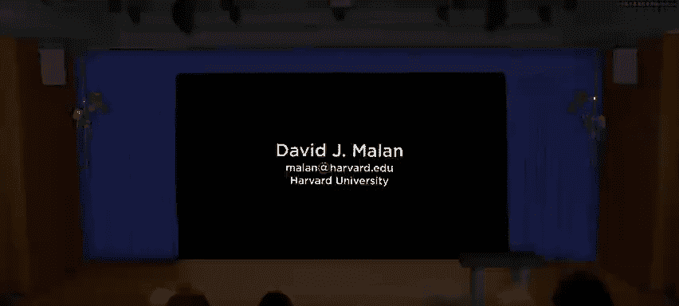
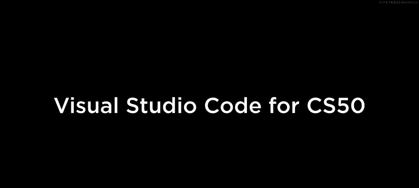
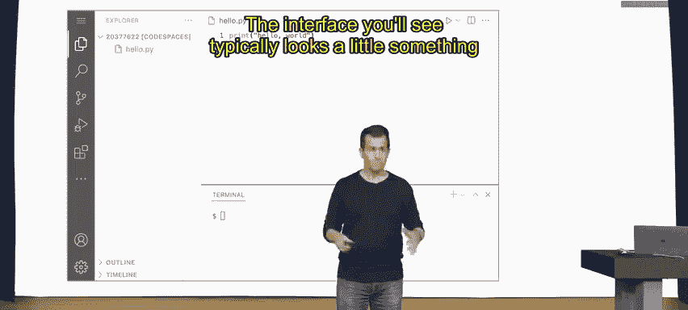
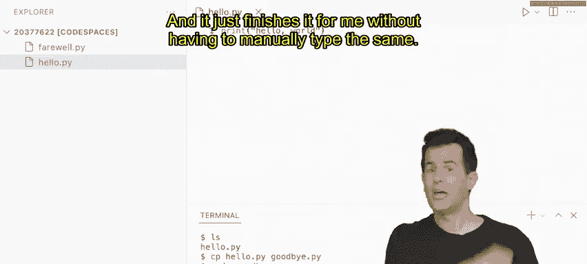
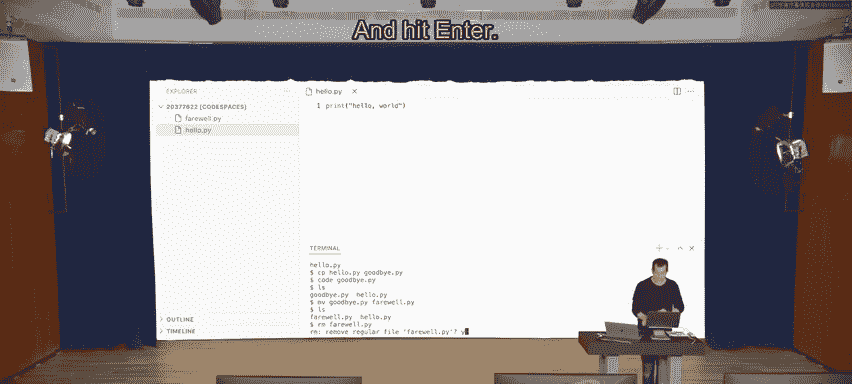
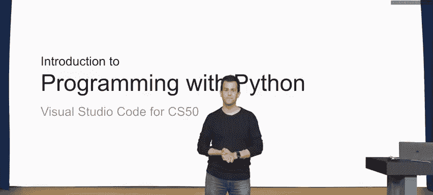

# 哈佛大学《CS50P Python编程入门》课程 - P21：📚 为CS50准备的Visual Studio Code






## 概述

在本节课中，我们将学习如何为CS50课程使用Visual Studio Code。我们将了解什么是VS Code，为什么推荐在云端使用它，以及如何通过命令行界面来高效地管理文件和运行程序。

---

## 什么是Visual Studio Code？💻

Visual Studio Code，简称VS Code，是当今非常流行的代码编写程序。从技术上讲，它是一个文本编辑器，或者更准确地说，是一个集成开发环境。这意味着它是一个专门设计用于让你在计算机上高效、有效地编写代码的程序。

通常，你会在自己的Mac或PC上安装VS Code。它是免费的开源软件，任何人都可以在自己的电脑上下载。然而，为了使用像Python这样的语言进行编程，通常还需要进行一些额外的配置步骤，例如安装Python支持，以及配置计算机的一些底层实现细节。

因此，对于本课程，我们推荐你使用VS Code，但建议通过CS50在GitHub Codespaces上实现的云端版本来使用。



---

## 如何使用CS50的云端VS Code？☁️

要使用CS50的Visual Studio Code，请访问 `code.cs50.io`。系统会提示你使用免费的GitHub账户登录。经过几秒或几分钟后，你将被重定向到你的代码空间。这是你在GitHub服务器上的一个虚拟空间。

在这个空间里，你将拥有自己的存储空间，实际上就是云端的一个硬盘。你可以在这里创建文件、运行程序，甚至用文件夹来组织一切。你还可以通过这个界面编写代码，以及进行更多操作。

你看到的界面通常类似这样：屏幕左上角会有一个文件资源管理器，可以查看你在账户中创建的所有文件。顶部可以创建多个标签页来编写程序。屏幕底部则是一个你可能不太熟悉的终端窗口。

---

## 理解终端窗口🖥️

终端窗口是一个命令行界面。这与我们如今熟悉的图形用户界面形成鲜明对比。我们在这里看到的一切本质上都是图形化的，有按钮、图标和窗口等。但在底层，你不仅可以访问云端的虚拟硬盘，实际上还可以访问你自己的服务器。

在GitHub服务器上，某种意义上运行着你自己的虚拟服务器。技术上这被称为一个容器，你所有的文件都将存放在这里。你可以在这个服务器或容器内创建文件、运行程序，甚至安装额外的软件，因为这个服务器容器本身运行着自己的操作系统。

它运行的操作系统不是你熟悉的Mac或Windows，而是另一个流行的操作系统——Linux。如今，许多程序员不仅用它来编写代码，还在自己的服务器上运行代码。

---

## 掌握命令行界面⌨️

那么，如何利用这个新的命令行界面呢？通过学习一些你可能从未输入过的命令。这些命令不仅在Linux上有效，在Mac OS上同样有效，经过一些修改后，在Windows上也可能有效。

如果你在 `code.cs50.io` 使用CS50的云端Visual Studio Code，你将能够运行所有这些命令。以下是一些你可以输入的命令示例。

我将输入 `code` 命令，这是VS Code自带的一个命令，用于创建新文件和打开新标签页。

假设我想创建我的第一个Python程序，名为 `hello.py`。我可以在终端窗口中输入 `code hello.py` 并回车。请注意，在输入之前，左上角的文件资源管理器里什么都没有。但当我回车创建名为 `hello.py` 的新文件后，不仅会在标签页中打开它进行编辑，还会在文件资源管理器中看到它的图形化表示。

现在，让我来写一个非常简单的程序：
```python
print("hello, world")
```
这可能是你在学习大多数编程语言时最先编写的、最具代表性的程序。

接下来，我将在终端窗口中运行另一个命令。我将运行Python本身，它不仅仅是一种语言，也是一个能理解该语言的程序。如果我输入 `python` 加上一个空格，再输入我创建的包含该语言代码的文件名，然后回车，我就运行了自己的程序。

在Mac和PC上，我们习惯于双击图标来启动文件或程序。在命令行界面中，一切都通过键盘完成。你可以用鼠标移动光标，但通常所有操作都通过键盘进行，而不是鼠标。

屏幕上其他部分可以点击，但在终端窗口中，你通常会看到这个提示符——一个美元符号 `$`。这并不意味着货币，它只是一个标准符号，意思是“在这里输入你的命令”，它是一个视觉指示器，提示你可以输入下一个命令。

我输入的两个命令是：`code` 用于在VS Code内创建新文件，以及 `python`，它已经预装在代码空间中，让你从第一天起就能获得内置支持来编写自己的代码。

---

## 图形界面与命令行界面🔄

在这个环境中，我还可以做其他事情。例如，我可以在这里按住Control键点击或右键点击，看到一个完整的菜单选项，用于编辑或修改文件，就像在Mac OS或Windows上一样。我可以点击左上角的一些图标，比如加号图标来创建新文件或新文件夹。

所有这些图形用户界面的惯例仍然存在，但随着时间的推移，你应该会越来越习惯仅使用命令行界面，它能为你完成所有这些事情，甚至更多。

事实上，以下是一些你可以在Linux和这个命令行界面中使用的命令。稍后我们会看到 `ls`，它允许你列出当前文件夹中的所有文件。`cp` 允许你将文件从一个地方复制到另一个地方。`mv` 允许你移动文件，或者实际上是从一个名字重命名为另一个名字。`rm` 用于删除文件。`mkdir` 允许你创建一个目录，也就是文件夹。`cd` 允许你从一个文件夹切换到另一个文件夹。`rmdir` 允许你删除一个目录。`clear` 则只是从美观上清除你的终端窗口。

这些只是你可以在Linux命令行中输入的一些命令。但它们实际上等同于我们经常在自己的Mac或PC上所做的所有事情。

让我回到VS Code，让我们在这里尝试其中一些命令。首先，我将清除屏幕，就像从头开始一样，但这不会更改或删除我的任何文件，它只是清除了我的终端窗口。我也可以按 `Ctrl+L` 来做同样的事情。

现在，我将输入 `ls`。请注意，`ls` 听起来像“list”，确实，这个命令和几乎所有其他命令都非常简洁，`ls` 意思是“列出”，但你只输入 `l` 和 `s`，而不是 `L-I-S-T`。许多命令行界面命令都是如此，只是为了让你我能更快地输入。很多命令都有这种非常简洁的语法和名称。

我输入了 `ls`，然后回车。你会看到只有一样东西：`hello.py`。这意味着当我尝试列出当前默认文件夹中的所有文件时，我只看到一个文件存在，我也可以在这里的图形界面中看到它。

现在，让我做点别的事情。让我们复制这个文件，并命名为 `goodbye.py`，以便编写第二个程序，让它说“goodbye world”而不是“hello”。我将输入 `cp` 表示复制，然后是第一个文件名 `hello.py`，接着一个空格，然后是新的文件名 `goodbye.py`，回车。现在注意，似乎什么都没发生，这通常是件好事。如果你在这里没有看到错误信息，那就说明你做对了。但你确实可以在图形界面中看到现在有两个文件存在。

我可以用几种方式打开 `goodbye.py`。我可以直接在这里双击 `goodbye.py` 来打开它，或者我可以输入和之前相同的命令 `code goodbye.py`。现在我将在这里打开第二个标签页，为了对称，我可以把这个词从“hello”改成“goodbye”，这样我就有了第二个程序，它也保存在第二个文件中。





现在，如果我决定不想要这个文件了，我将在这里关闭它。我想重命名它，从 `goodbye.py` 改成 `farewell.py`。它在这里仍然显示为 `goodbye.py`。如果我在这里输入 `ls`，我会看到同一个文件夹中现在有两个文件。

让我输入 `mv` 表示移动，然后是 `goodbye.py`，接着是像 `farewell.py` 这样的名字，回车。你会看到它在左边发生了变化，如果我再次输入 `ls`，你会看到它在下面也发生了变化。

算了，我们不要 `farewell` 了，让我们直接删除这个文件。我可以在这里单击文件资源管理器中的 `farewell.py`，按住Control键点击或右键点击，然后选择删除。或者，我可以在下面的命令行界面中这样做。我可以输入 `rm farewell.py`。注意，如果我有点厌倦输入这些长文件名，Linux和命令行界面通常支持自动补全。所以，与其输入 `farewell`，我可以输入 `f` 和 `r`，这听起来已经足够完成我的想法了。然后我按键盘上的 `Tab` 键，它会自动为我补全，而无需手动输入相同的内容。我回车，会看到一个有点隐晦的信息。这不是错误，只是一个提示：“remove regular file ‘farewell.py’?” 这只是一个安全检查，以确保我同意删除这个文件。通常当被问到这样的问题时，输入 `y` 表示是，或 `n` 表示否，然后回车。现在，似乎没有发生什么不好的事情，但确实，`farewell.py` 现在已经消失了。

---

## 管理文件夹📁

现在，我们还能做什么？让我为了美观起见清理一下屏幕，让我们创建一个或多个文件夹，而不仅仅是文件。让我在这里用 `mkdir` 创建一个目录，我就叫它 `folder`，当然我可以叫它任何名字。或者，我可以到文件资源管理器这里，点击文件夹图标，手动创建一个新文件夹。但这里再次强调，目标是专注于命令行界面。好了，`mkdir folder` 并回车。似乎没有错误信息发生，但现在注意，不仅有 `hello.py`，还有一个名为 `folder` 的文件夹或目录。

现在我能用它做什么呢？让我看看里面有什么。在我的图形用户界面中，我可以点击这里的文件夹，看这个小三角形里面。当然，里面什么都没有，因为我刚刚创建了它。但让我现在在终端窗口中做这个。让我在点击这里后输入 `ls`，我们会看到我的文件夹，按照惯例，它的末尾有一个斜杠 `/`，以便在视觉上清楚地表明它是一个文件夹，而不是一个文件。还有 `hello.py`。

现在让我改变目录。在Mac OS或Windows上，我们只需点击或双击文件夹就能看到里面有什么。在命令行界面中，你需要更明确地操作。输入 `cd folder`，带不带斜杠都可以，然后回车。现在你会看到你的提示符改变了。仍然有一个美元符号，但按照惯例，我们会在你的提示符前加上一个前缀，这只是快速提醒你当前在哪个文件夹里，这样你就不会忘记你是在主文件夹里还是在其他文件夹里。

我现在输入 `ls` 来列出这个文件夹的内容。当然，里面什么都没有，因为我还没有创建任何文件。但如果我这样做，我可以再次输入 `code farewell.py` 把它带回来，但这次是在这个文件夹里。回车后，你会看到这里打开了一个新标签页，我可以写更多代码。但你也会看到，`farewell.py` 现在层级上位于这个文件夹内部。

假设这是个错误，我并不是有意这样做的。我能做什么？让我在这里关闭标签页，甚至不写任何代码。在我的终端窗口中，让我这样做。我输入 `ls` 来确认，是的，`farewell.py` 在那里。但假设我想把它移回我的主文件夹。就像在Mac或Windows上一样，我可以点击这里的文件 `farewell.py`，然后拖拽它到我想放的地方。但这次让我们移动它，而不是重命名它，使用相同的 `mv` 命令。

我想把 `farewell.py` 移动到父文件夹。在文件和文件夹的世界里，你可以把它们想象成一个家谱。如果你想在层级上向上走，你想进入父文件夹，而 `folder` 则是我们开始时所在的默认文件夹的子文件夹。

所以我想把 `farewell.py` 向上移动。我如何表达这一点？命令行界面中的另一个语法通常是 `..`。`..` 是父目录的符号表示，无论它的名字是什么。在这个例子中，它是我自己的默认文件夹，它的技术名称是什么甚至不重要，屏幕上没有显示。我回车，观察左上角图形版本中发生的变化。我们应该看到 `farewell.py` 现在从文件夹中弹出来了，缩进发生了变化，意味着它不在文件夹内部了，现在它与 `hello.py` 并列。确实，如果我在这里关闭文件夹，我看不出区别，因为里面也什么都没有。

让我在终端窗口中输入 `ls` 来确认，`folder` 里面什么都没有。现在让我回到我的父目录，我可以用不同的方式做到这一点。就像编程本身一样，有时会有多种方式可以在命令行界面中导航。这是一种方法：我可以输入 `cd ..` 回到父目录。但另一种技巧，尤其是如果你对这个新世界还不太熟悉，就是当你怀疑时，如果你想回到登录时的默认目录，只需输入 `cd` 后面不加任何东西，然后回车，你就会被迅速带回到起点。确实，如果我输入 `ls`，我会看到 `farewell.py`、我的空文件夹和 `hello.py`。

现在，我真的不需要这个文件夹了，因为里面已经什么都没有了。所以让我们删除它。我可以在文件资源管理器中按住Control键点击或右键点击它，然后像在Mac OS或Windows上一样手动删除它。或者，我可以使用我新学的命令 `rmdir folder`，带不带斜杠都可以，然后回车。因为它是空的，我甚至没有被提示，它就直接干净地消失了。

---

## 命令行技巧与历史记录📜

在命令行界面的上下文中，你会发现一个非常有用的最终技巧是：它倾向于存储你的整个命令历史记录。事实上，不仅仅是自动补全，如果我按上箭头、上箭头、上箭头，你会看到我所有先前命令的历史记录在屏幕上滚动，这很有帮助，如果我只想再次执行其中一个命令，我不需要手动输入，我可以上下滚动找到我想要的那个。

---

## 总结

那么，这只是云端Visual Studio Code中命令行界面功能的冰山一角。无论在你的Mac还是PC上，大多数这些命令都是相同的，至少如果你使用的是连接到运行Linux的计算机的终端窗口，无论是在容器、虚拟机还是云端的实际服务器上。

在接下来的几周课程中，你将可以访问 `code.cs50.io`，进而访问你自己的代码空间，这样你就可以通过浏览器全天候访问，只要你拥有互联网连接，而无需在自己的Mac或PC上安装任何东西。在学期末，如果你感觉更舒适，并且希望使用相同的软件VS Code，甚至Linux，你也可以在自己的Mac或PC上免费安装它们，并在课程结束后继续编程。



本节课我们学习了为CS50准备的Visual Studio Code以及与之配套的命令行界面。