# 哈佛大学《CS50P》Python编程入门 2024 - P22：🌱 While 循环


在本节课中，我们将要学习 **`while` 循环**。这是一种在特定条件为真时，重复执行一段代码的控制流结构。我们将通过一个为植物浇水的实际例子，来理解它的工作原理和应用场景。

## 概述

生活充满意外。最近，照料一株特定植物成为了我的一个任务。这株植物对浇水的时机和水质相当挑剔。我需要在土壤干燥但又不至于太干的时候给它浇水。因此，我每天都需要检查土壤湿度，以决定是否需要浇水。我决定编写一个程序，根据土壤的干燥程度来提醒自己何时浇水。

我了解到，土壤湿度是以百分比来衡量的。当湿度达到 **20% 或更低** 时，土壤就被认为是干燥的，需要浇水。理想情况下，我可以编写一个程序，每天检查一次土壤湿度。如果湿度等于或低于20%，就提醒我为这株植物浇水。

## 初始程序：单次检查

首先，我编写了一个名为 `water.py` 的程序。它使用了一个我预先写好的名为 `sample` 的函数。这个函数的作用是模拟检测土壤，并返回当天检测到的土壤湿度百分比。

初始程序的核心代码如下：

```python
# 导入sample函数来检测土壤湿度
from sample import sample

def main():
    # 检测土壤湿度
    moisture = sample()
    # 打印当前湿度
    print(f"Moisture: {moisture}%")

if __name__ == "__main__":
    main()
```

运行这个程序 `python water.py`，我们可能会看到类似 `Moisture: 28%` 的输出。这表明土壤还不够干，不需要浇水。

但是，这个程序只检查了一次。我希望它能持续检查，直到土壤变干为止。

## 引入 While 循环

请注意我的描述：我希望 **当** 某个条件为真时，重复做某事。具体来说，我希望 **当** 土壤还湿（湿度大于20%）时，持续检查。

这正是 **`while` 循环** 的用武之地。当我们不确定需要循环多少次，但希望在某个条件为真时持续循环，`while` 循环是绝佳选择。

以下是 `while` 循环的基本语法：
```python
while condition:
    # 条件为真时，重复执行的代码块
```

现在，让我们更新程序，使其动态地循环检查。

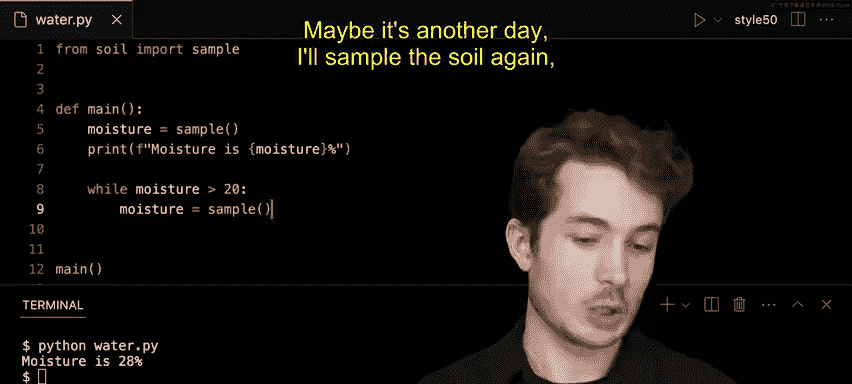

## 动态检查程序

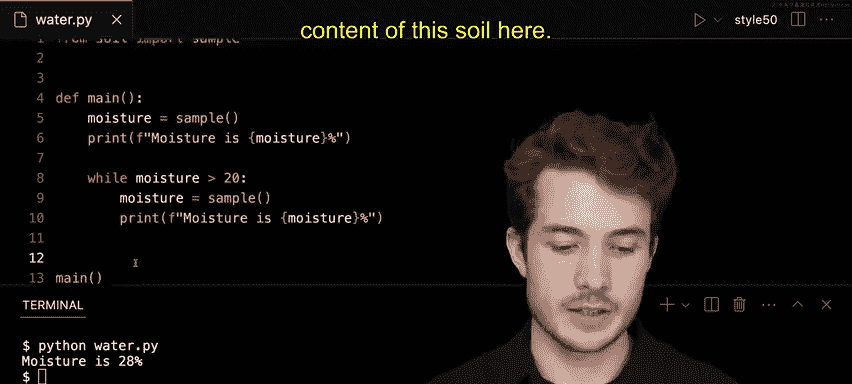

上一节我们介绍了 `while` 循环的基本概念，本节中我们来看看如何用它改进我们的浇水提醒程序。

更新后的程序逻辑如下：
1.  首次检测土壤湿度。
2.  只要湿度 **大于 20%**，就继续循环。
3.  在循环内，再次检测湿度并报告。
4.  当湿度不再大于20%（即小于等于20%）时，退出循环，并提示需要浇水。

以下是更新后的代码：

```python
from sample import sample

def main():
    # 首次检测土壤湿度（假设刚浇完水）
    moisture = sample()
    print(f"Moisture: {moisture}%")

    # 当土壤还湿时，持续检查
    while moisture > 20:
        # 模拟隔天再次检测
        moisture = sample()
        print(f"Moisture: {moisture}%")

    # 循环结束，说明湿度 <= 20%
    print("Time to water! Your soil is getting too dry.")

if __name__ == "__main__":
    main()
```

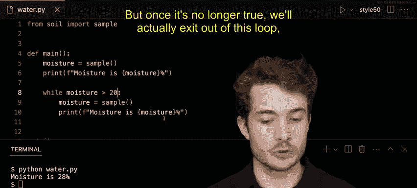

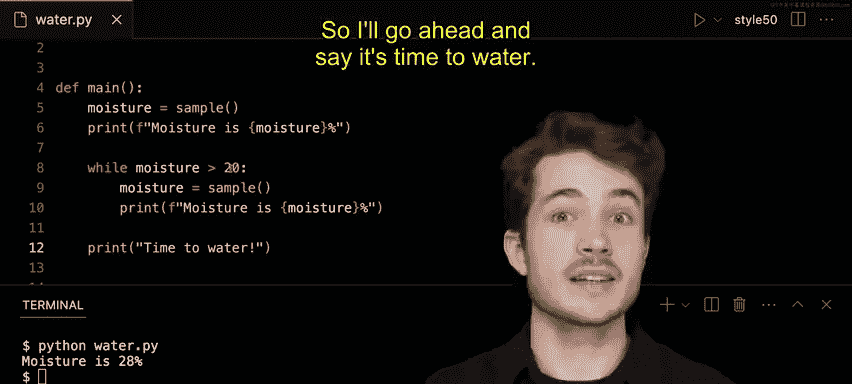

缩进在 `while` 语句下方的代码块会一直执行，只要条件 `moisture > 20` 为真。一旦条件变为假，程序就会退出循环，并执行后面的提示语句。

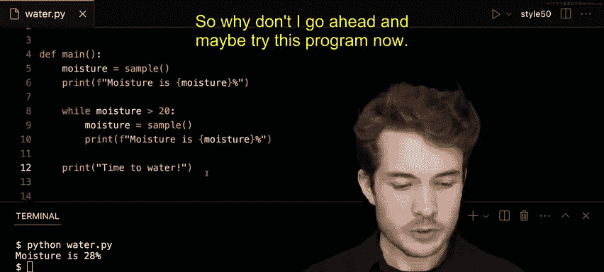

运行这个程序，我们可能会看到类似以下的输出，模拟了连续几天的检测：
```
Moisture: 34%
Moisture: 31%
Moisture: 27%
Moisture: 23%
Moisture: 22%
Moisture: 18%
Time to water! Your soil is getting too dry.
```

只要湿度大于20%，循环就会继续。当检测到湿度为18%（不大于20%）时，条件为假，循环终止，并打印浇水提醒。

## 追踪循环天数

为了更清晰地展示循环过程，我们可以添加一个变量 `days` 来追踪检测了多少天。

以下是改进后的程序，它记录了从第0天开始，每次循环（即每天）的情况：

```python
from sample import sample

def main():
    days = 0
    moisture = sample()
    print(f"Day {days}: Moisture: {moisture}%")

    while moisture > 20:
        days += 1  # 天数增加
        moisture = sample()
        print(f"Day {days}: Moisture: {moisture}%")

    print("Time to water! Your soil is getting too dry.")

if __name__ == "__main__":
    main()
```

运行这个程序，每次的结果可能不同，因为土壤湿度受天气、阳光等因素影响，具有随机性：
```
Day 0: Moisture: 30%
Day 1: Moisture: 28%
Day 2: Moisture: 25%
Day 3: Moisture: 19%
Time to water! Your soil is getting too dry.
```

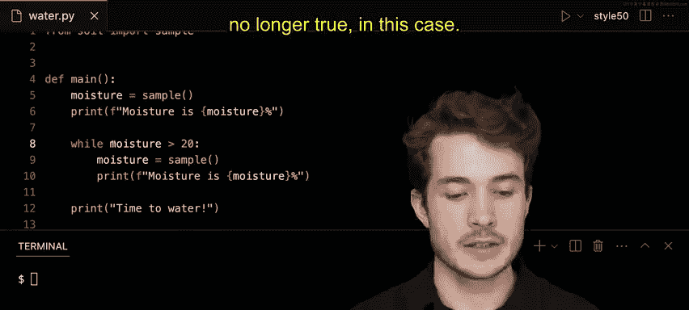

有时可能需要5天，有时只需要3天。**`while` 循环** 的魅力在于，无论这个过程持续多久，它都会在条件 `moisture > 20` 不再为真时准确结束。这使它非常适合处理这类我们无法预知确切循环次数的场景，例如根据随机变化的土壤湿度来决定浇水时机。

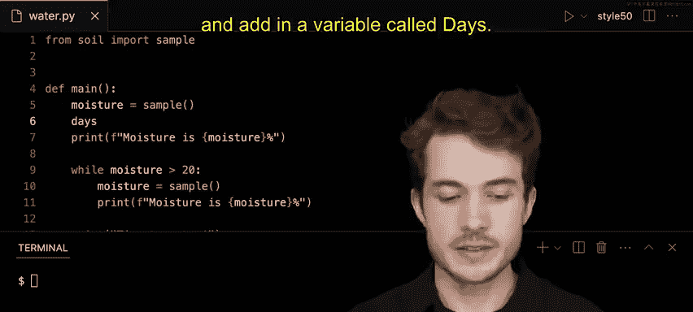

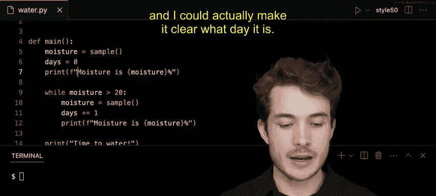

## 总结

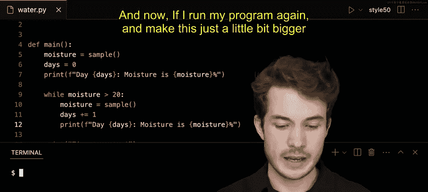

本节课中我们一起学习了 **`while` 循环**。

*   **`while` 循环** 用于在指定条件保持为真时，重复执行一段代码块。
*   它的语法是 `while condition:`，后面跟着一个缩进的代码块。
*   它特别适用于你不知道需要循环多少次，但明确知道循环条件的情况（例如“当土壤还湿时”、“当用户未输入正确密码时”、“当游戏未结束时”）。
*   我们通过一个为植物浇水的实例，演示了如何用 `while` 循环构建一个动态的、条件驱动的程序。

**`while` 循环** 是控制程序流程的强大工具，能让你编写出更灵活、更智能的代码。

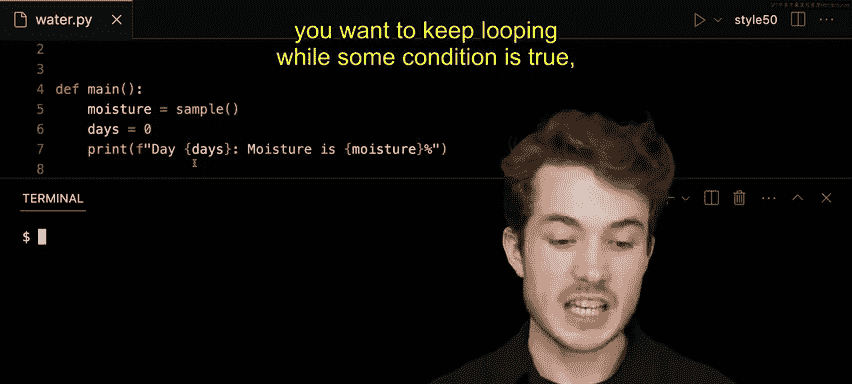

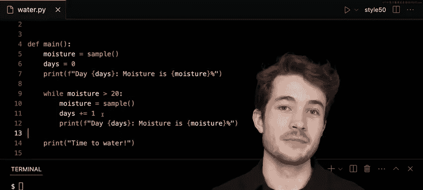


