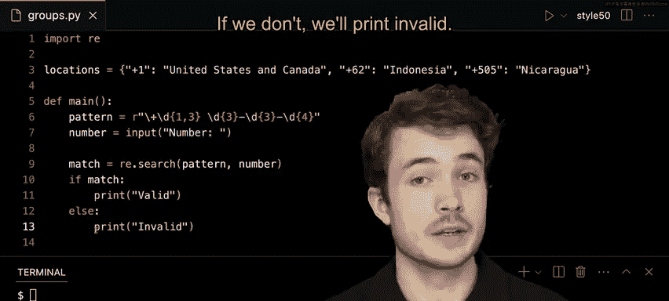
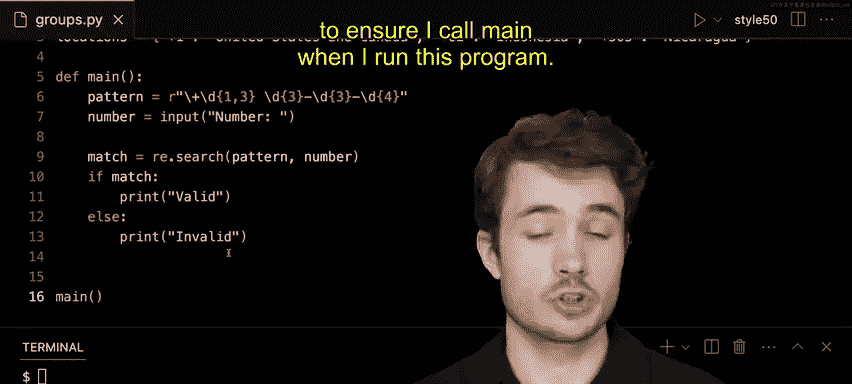
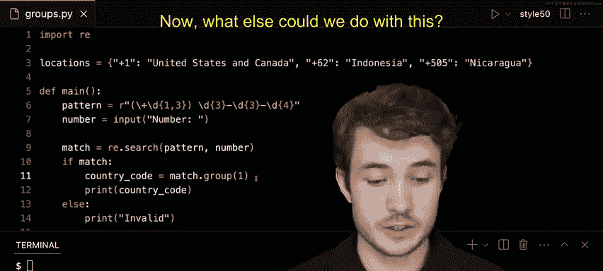
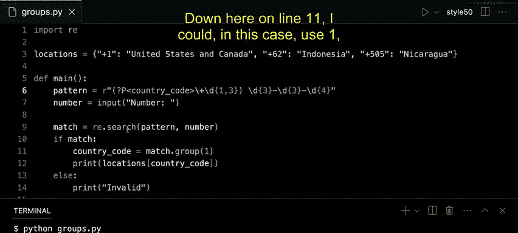

# 哈佛大学《CS50P Python编程入门》课程 - P2：捕获组 🎯


在本节课中，我们将要学习正则表达式中的一个强大功能：捕获组。我们将通过一个验证国际电话号码并识别其所属国家的程序，来理解捕获组如何帮助我们提取字符串中的特定部分。

## 概述

正则表达式不仅用于验证字符串是否符合特定模式，还能提取模式中的特定部分。捕获组通过圆括号 `()` 实现，它允许我们“捕获”匹配到的子字符串，以便后续使用。本节课我们将构建一个程序，它不仅能验证国际电话号码的格式，还能根据国家代码识别来电国家。

## 验证电话号码格式



首先，我们来看一个基础程序，它使用正则表达式验证国际电话号码的格式是否有效。

以下是我们需要匹配的模式：
*   一个加号 `+`。
*   紧随其后的是1到3位数字（国家代码）。
*   然后是一个空格。
*   接着是3位数字，一个短横线 `-`，再3位数字，另一个短横线 `-`，最后是4位数字。



这个模式可以用以下正则表达式表示：
```python
pattern = r"\+[0-9]{1,3} [0-9]{3}-[0-9]{3}-[0-9]{4}"
```
在代码中，我们使用 `re.search()` 函数来检查用户输入的电话号码是否符合这个模式。

## 提取国家代码

上一节我们介绍了如何验证格式，本节中我们来看看如何从有效的电话号码中提取出国家代码部分。

仅仅验证格式有时不够。例如，当接到一个国际来电时，我们可能还想知道它来自哪个国家。这就需要从完整的号码中提取出开头的“国家代码”（如 `+1`、`+62`）。

如果我们尝试用简单的字符串切片（如 `number[0:2]`）来提取，会遇到问题：不同国家的代码长度不同（`+1` 是2个字符，`+62` 是3个字符）。这时，捕获组就派上了用场。

我们通过将正则表达式中代表国家代码的部分用圆括号括起来，创建一个捕获组：
```python
pattern = r"(\+[0-9]{1,3}) [0-9]{3}-[0-9]{3}-[0-9]{4}"
```
当匹配成功时，我们可以通过匹配对象的 `.group(1)` 方法来获取第一个（也是唯一一个）捕获组的内容，即国家代码字符串。

## 根据代码查询国家

在成功提取出国家代码字符串后，我们可以利用一个预设的字典来查询其对应的国家名称。

以下是实现这一功能的步骤：
1.  定义一个字典，将国家代码映射到国家名称。
2.  使用捕获组提取用户输入号码中的国家代码。
3.  使用这个代码作为键，从字典中查找对应的国家。

核心代码如下：
```python
locations = {"+1": "United States and Canada", "+62": "Indonesia", "+505": "Nicaragua"}

match = re.search(pattern, number)
if match:
    country_code = match.group(1)
    location = locations.get(country_code, "Unknown location")
    print(location)
```



## 为捕获组命名

当正则表达式中包含多个捕获组时，使用数字索引（如 `.group(1)`、`.group(2)`）可能会使代码难以阅读和维护。为此，我们可以为捕获组命名。

命名捕获组的语法是在圆括号内使用 `?P<name>`。例如，将我们的国家代码捕获组命名为 `country_code`：
```python
pattern = r"(?P<country_code>\+[0-9]{1,3}) [0-9]{3}-[0-9]{3}-[0-9]{4}"
```
之后，我们可以通过名称来获取该组的内容，使代码意图更清晰：
```python
country_code = match.group("country_code")
```

## 总结

本节课中我们一起学习了正则表达式中捕获组的使用。
*   **捕获组** 由圆括号 `()` 定义，用于提取匹配字符串中的特定子串。
*   通过 `match.group(n)` 可以按索引获取第n个捕获组。
*   通过 `(?P<name>...)` 语法可以为捕获组命名，并通过 `match.group('name')` 获取，这提升了代码的可读性。
*   我们结合字典映射，实现了一个既能验证国际电话号码格式，又能识别其来源国家的实用程序。




捕获组是处理复杂文本匹配和提取任务的利器，熟练掌握它将极大增强你的字符串处理能力。