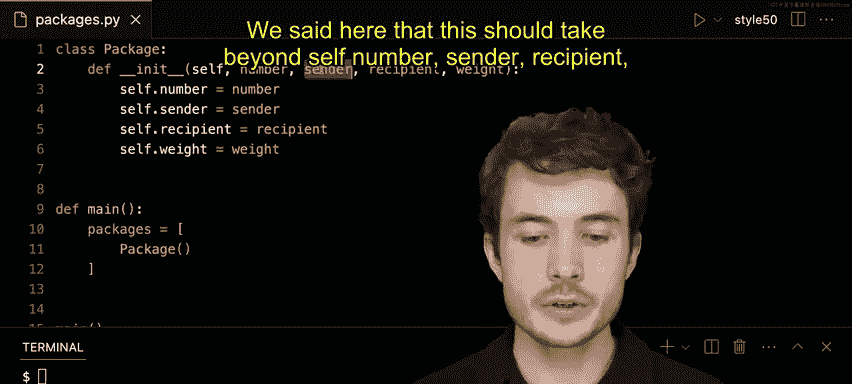
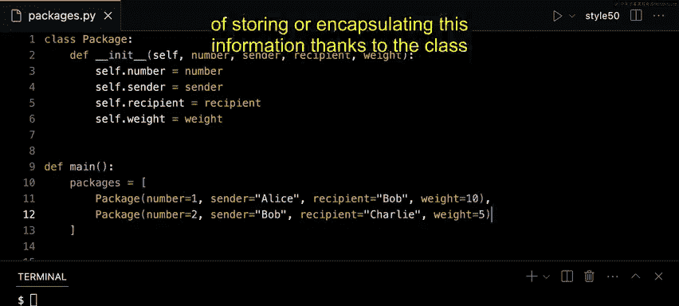
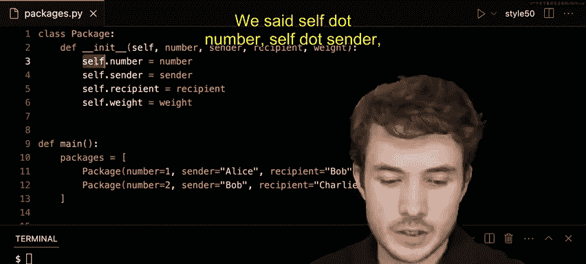
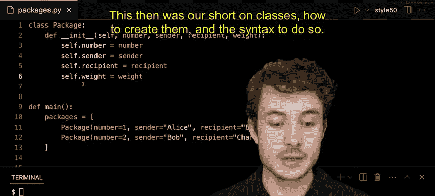

# 🐍 Python 课程 P3：类（Classes）入门


在本节课中，我们将要学习 Python 中一个非常重要的概念：**类（Classes）**。我们将了解为什么需要创建类，以及如何使用它们来更有效地组织和表示数据。

---

## 概述：为什么需要类？

假设我们有一个程序，目标是追踪在不同用户之间发送的包裹。最初，我们可能用一个字符串列表来表示这些包裹：

```python
packages = [
    "Package 1: Alice to Bob, 10 kg",
    "Package 2: Bob to Charlie, 5 kg"
]
```

虽然字符串很灵活，但可能**过于灵活**。我们很容易在添加更多包裹时偏离预定的格式（例如，先写发件人还是先写重量）。我们需要一种更**结构化**、更**严谨**的方式来存储信息，这就是类的作用。

类就像一个**模板**，我们可以用它来创建代码中的各种**对象**。在现实世界中，每个包裹都是一个对象。类允许我们将包裹的相关信息（如ID、发件人、收件人、重量）**封装**在一个地方，而不必担心在代码中维护复杂的字符串格式。

---

## 创建类的模板

要创建一个表示包裹的类模板，我们使用 `class` 关键字，后跟类名。按照惯例，类名通常以大写字母开头。

```python
class Package:
```

现在，我们有了一个 `Package` 类的框架。接下来，我们需要定义这个模板具体应该存储什么信息。

---

## 初始化方法：`__init__`

为了使用这个模板来创建具体的对象，我们需要定义一个特殊的方法：`__init__`（读作“dunder init”）。这个方法允许我们在创建新对象时进行初始化。

`__init__` 方法必须至少有一个参数，即 `self`。`self` 指的是我们正在创建的**新对象实例**本身。此外，我们还需要传入创建包裹所需的所有信息。

```python
class Package:
    def __init__(self, number, sender, recipient, weight):
        self.number = number
        self.sender = sender
        self.recipient = recipient
        self.weight = weight
```

让我们分解一下这段代码：
*   `def __init__(self, number, sender, recipient, weight):`：这定义了初始化方法。它接收 `number`、`sender`、`recipient` 和 `weight` 作为参数，用于描述一个包裹。
*   `self.number = number`：这行代码将传入的 `number` 参数值，赋值给这个新创建对象的 `number` 属性。`self.number` 是一个**实例变量**，它属于这个特定的包裹对象。`self.sender`、`self.recipient` 和 `self.weight` 的作用相同。

---

## 使用类创建对象

现在我们已经有了 `Package` 类的模板，可以重写之前的包裹列表，用对象代替字符串。

以下是创建具体包裹对象的方法：

```python
packages = [
    Package(number=1, sender="Alice", recipient="Bob", weight=10),
    Package(number=2, sender="Bob", recipient="Charlie", weight=5)
]
```



我们来分析一下 `Package(number=1, sender="Alice", recipient="Bob", weight=10)` 这行代码：
*   当我们写 `Package(...)` 时，Python 会自动调用我们定义的 `__init__` 方法来创建一个新的 `Package` 对象。
*   我们传入的参数（`number=1`, `sender="Alice"` 等）会传递给 `__init__` 方法。
*   在 `__init__` 方法内部，`self` 指的就是这个新创建的对象。通过 `self.number = number` 等语句，我们将这些值存储为对象的属性。

现在，`packages` 列表包含了两个 `Package` 对象，每个对象都清晰地封装了其所有信息。这种方式比使用字符串列表更加系统化和可靠。

---

## 总结



本节课我们一起学习了 Python 中类的基础知识：
1.  **为什么使用类**：类提供了结构化的模板，用于创建对象，能更好地封装和组织数据，避免使用灵活但易出错的格式（如字符串）。
2.  **如何定义类**：使用 `class` 关键字，并按照惯例以大写字母开头命名。
3.  **初始化方法 `__init__`**：这是类的“蓝图”，定义了创建新对象时需要哪些信息。`self` 参数代表对象实例本身。
4.  **创建对象**：通过调用类名并传入 `__init__` 方法所需的参数，可以实例化出具体的对象。

通过创建 `Package` 类，我们能够以更清晰、更易维护的方式表示包裹数据。在后续课程中，我们将学习如何访问和操作这些对象的属性（实例变量）。






我们下次课再见！