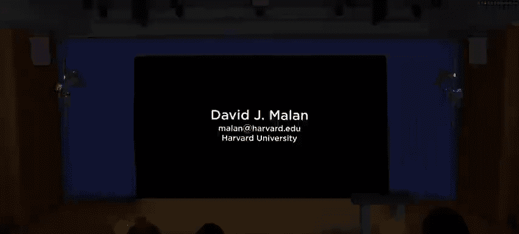
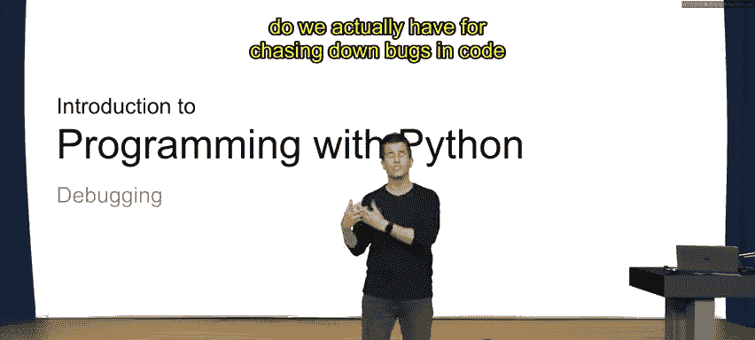
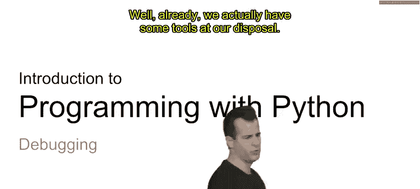
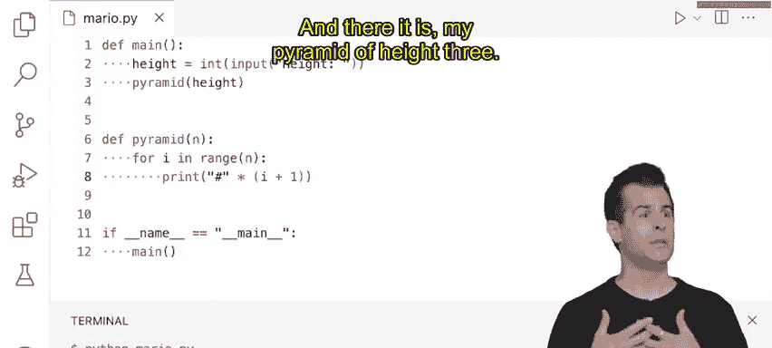
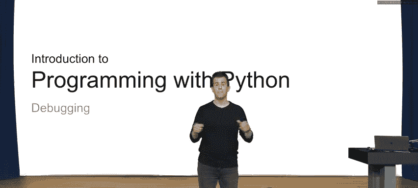

# 哈佛大学《CS50P Python编程入门》课程 - P4：-05-调试 🐛





在本节课中，我们将学习如何发现和修复代码中的错误，即“调试”。我们将介绍两种核心的调试工具：`print`函数和集成开发环境（IDE）中的调试器。





## 概述


编写代码时，难免会引入错误。这些错误可能是导致程序无法运行的语法错误，也可能是程序能运行但输出结果不符合预期的逻辑错误。本节课将探讨如何系统地找出并解决这些错误。

## 使用 `print` 函数进行调试

当仅凭肉眼阅读代码无法找出问题时，`print`函数是一个简单有效的调试工具。它允许你临时查看程序运行过程中变量的值。

让我们通过一个打印金字塔图案的程序示例来演示。程序的目标是根据用户输入的高度，打印出由`#`符号组成的金字塔。

```python
def main():
    height = int(input("Height: "))
    pyramid(height)

def pyramid(n):
    for i in range(n):
        print("#" * i)

if __name__ == "__main__":
    main()
```

运行此程序并输入高度`3`，我们期望的输出是：
```
#
##
###
```
但实际输出却是：
```
##
###
```
第一行缺失了。

为了找出原因，我们可以在循环中临时添加`print`语句来查看变量`i`的值：

```python
def pyramid(n):
    for i in range(n):
        print(i, end=" ")  # 打印i的值，不换行
        print("#" * i)
```

再次运行程序，输出变为：
```
0
1 #
2 ##
```
现在问题变得清晰：`range(n)`生成的序列是从`0`开始，到`n-1`结束。因此，当`i`为`0`时，`"#" * 0`打印了一个空行。

找到问题后，我们修复代码并移除临时的`print`语句：

```python
def pyramid(n):
    for i in range(n):
        print("#" * (i + 1))  # 将 i 加 1
```

现在程序可以正确打印金字塔了。

虽然`print`在简单情况下很有用，但在复杂的程序中，到处添加`print`语句会显得繁琐且难以清理。这时，我们需要更强大的工具。

## 使用调试器进行调试

集成开发环境（如VS Code）通常内置了调试器。调试器允许你逐行执行代码，并在执行过程中检查变量的状态。

以下是使用VS Code调试器的基本步骤：

1.  **设置断点**：在你希望程序暂停执行的代码行左侧单击，会出现一个红点。例如，在调用`main()`函数的行设置断点。
2.  **启动调试**：点击VS Code侧边栏的“运行和调试”图标（形似播放按钮和虫子），然后点击“运行和调试”。
3.  **控制执行**：程序会在断点处暂停。你可以使用顶部工具栏的按钮控制执行：
    *   **继续 (F5)**：继续运行直到下一个断点或程序结束。
    *   **单步跳过 (F10)**：执行当前行，但不进入该行调用的函数内部。
    *   **单步进入 (F11)**：执行当前行，如果该行调用了函数，则进入该函数内部。
    *   **单步跳出 (Shift+F11)**：跳出当前函数。
4.  **检查变量**：在调试过程中，你可以在“变量”面板中查看所有当前作用域内变量的值。

通过使用调试器单步执行上述有问题的`pyramid`函数，你可以清晰地观察到变量`i`从`0`开始变化，并亲眼看到`print("#" * 0)`打印了一个空行，从而直观地理解错误根源。

调试器让你能够像慢动作一样观察程序的执行过程，这对于理解复杂逻辑或他人编写的代码尤其有帮助。

## 总结

本节课我们一起学习了两种调试代码的核心方法。

首先，我们介绍了使用`print`函数进行简单快速的调试，通过输出中间变量值来理解程序状态。

接着，我们探讨了更强大的集成调试器的使用，包括如何设置断点、逐行执行代码以及检查运行时变量。这为分析和解决更复杂的错误提供了系统化的工具。





掌握这些调试技能，将帮助你更自信、更高效地构建和修复程序。