# 哈佛大学《CS50P Python编程入门》课程笔记 - P5：字典（Dictionaries）📚


在本节课中，我们将要学习Python中一个非常重要的数据结构——字典。字典非常适合存储和管理成对的、相关联的信息。我们将通过创建航天器报告和距离转换等实际例子，来学习如何创建、访问、修改和遍历字典。

## 什么是字典？🔑


上一节我们介绍了列表，本节中我们来看看字典。字典与列表不同，它使用花括号 `{}` 定义，并通过“键-值对”来组织数据。键（Key）是用于访问对应值（Value）的唯一标识符。

例如，一个表示航天器的字典可能包含“名称”和“距离”等信息。

## 创建与访问字典 🛰️

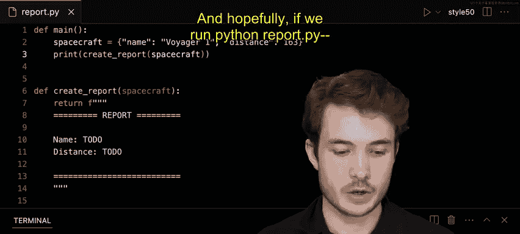

让我们从一个名为 `report.py` 的程序开始。我们的目标是创建一个函数，为给定的航天器生成报告。

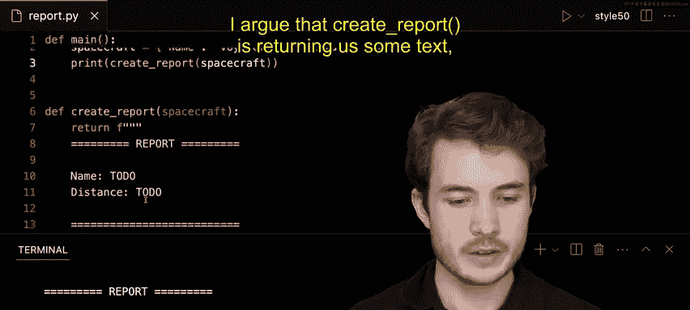

首先，我们在 `main` 函数中创建一个字典来表示一个航天器。字典以花括号开始，内部包含键值对。

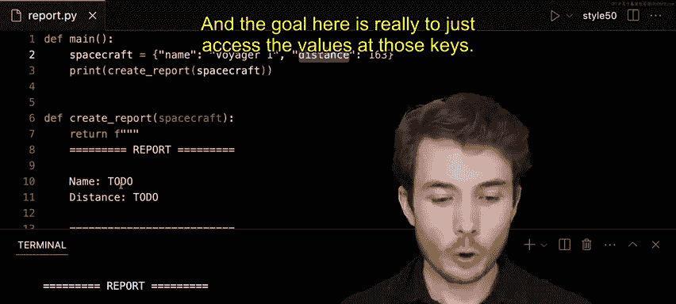

```python
spacecraft = {
    "name": "Voyager 1",
    "distance": 163
}
```


这里，`"name"` 和 `"distance"` 是键，`"Voyager 1"` 和 `163` 是对应的值。要访问字典中的值，我们使用方括号 `[]` 并传入键名。

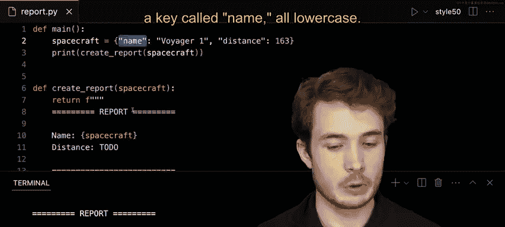

在 `create_report` 函数中，我们可以这样生成报告：

```python
def create_report(spacecraft):
    report = f"{spacecraft['name']} is {spacecraft['distance']} AU from Earth."
    return report
```


运行程序，我们将得到报告：“Voyager 1 is 163 AU from Earth.”

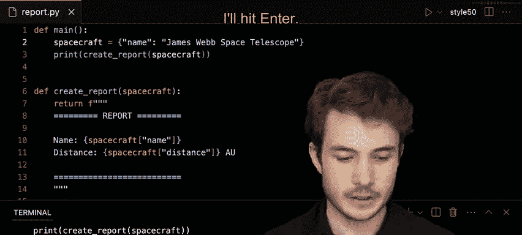

## 处理缺失的键与更新字典 ⚠️

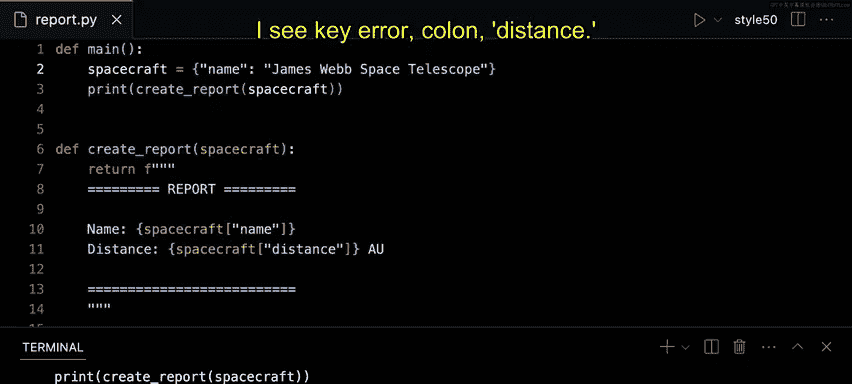

如果字典中缺少我们尝试访问的键，程序会抛出 `KeyError`。例如，我们创建一个新的航天器字典，但只提供了名称，没有距离：

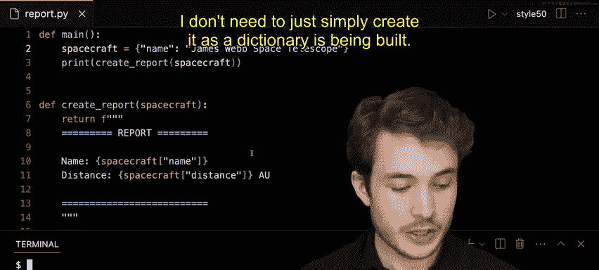

```python
spacecraft = {
    "name": "James Webb Space Telescope"
}
```

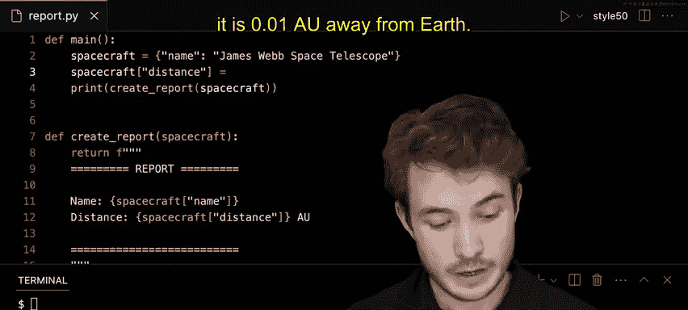


调用 `create_report` 函数会出错，因为字典中没有 `"distance"` 键。

有两种方法可以解决这个问题：


**1. 添加缺失的键**
我们可以直接为字典添加新的键值对：

```python
spacecraft["distance"] = 0.01
```

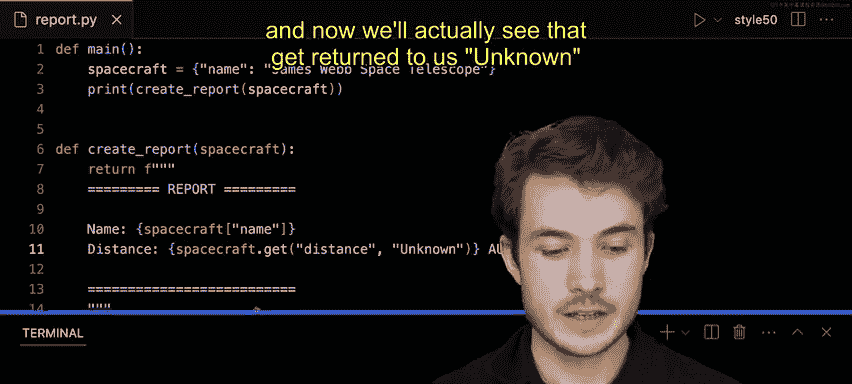

**2. 使用 `.get()` 方法安全访问**
`.get()` 方法允许我们尝试获取一个键的值，如果该键不存在，则返回一个我们指定的默认值（例如 `"unknown"`），而不会导致程序崩溃。

```python
distance = spacecraft.get("distance", "unknown")
```

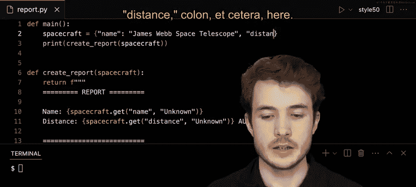

这样，报告就会显示：“James Webb Space Telescope is unknown AU from Earth.”

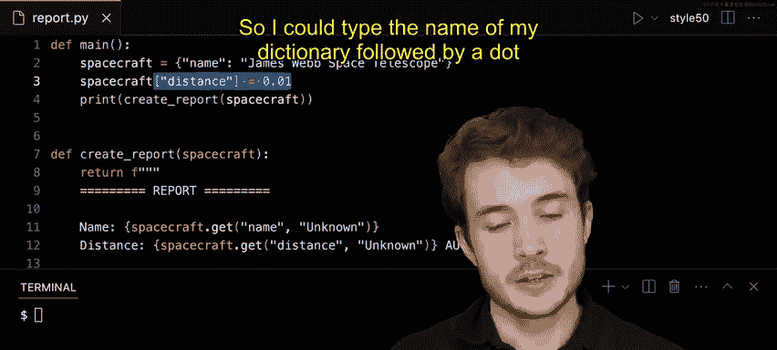

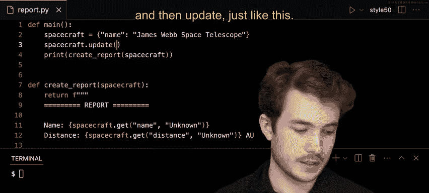

## 使用 `.update()` 方法批量添加键

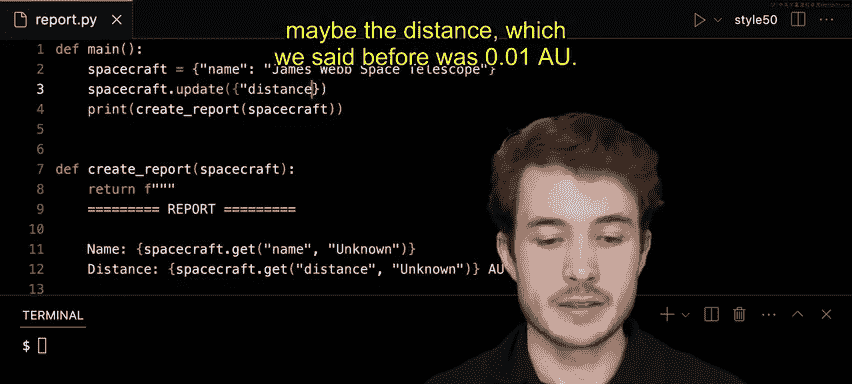

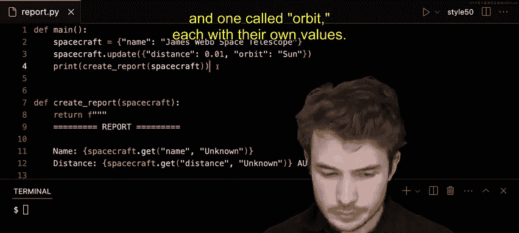

如果我们想一次性添加多个键值对，可以使用 `.update()` 方法。它接受另一个字典作为参数，并将其所有键值对合并到原字典中。

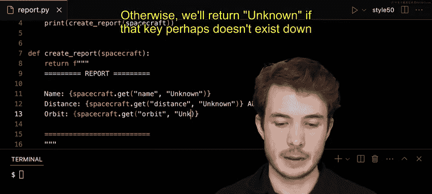

```python
spacecraft.update({"distance": 0.01, "orbit": "Sun"})
```

现在，`spacecraft` 字典就包含了 `name`、`distance` 和 `orbit` 三个键。

## 遍历字典 🔄

接下来，我们看看另一个程序 `distances.py`。这里，我们创建一个字典，将多个航天器的名称与其到地球的距离关联起来。


```python
distances = {
    "Voyager 1": 163,
    "Voyager 2": 136,
    "Pioneer 10": 80,
    "New Horizons": 58,
    "Pioneer 11": 44
}
```

如果我们想打印每个航天器的信息，就需要遍历字典。

以下是遍历字典键的两种主要方法：

**遍历所有键**
使用 `.keys()` 方法可以获取字典中所有键的列表，然后通过 `for` 循环进行遍历。


```python
for name in distances.keys():
    print(f"{name} is {distances[name]} AU from Earth.")
```

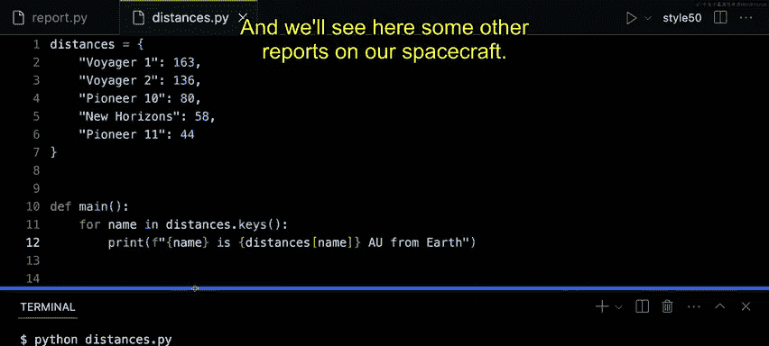

**遍历所有值**
类似地，使用 `.values()` 方法可以遍历字典中所有的值。

```python
for distance_au in distances.values():
    distance_m = distance_au * 149597870700  # 1 AU 转换为米
    print(f"{distance_au} AU is {distance_m} meters from Earth.")
```

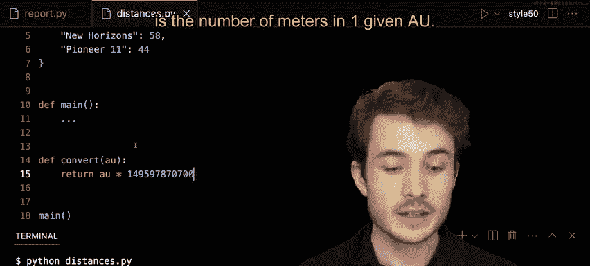

## 总结 📝

本节课中我们一起学习了Python字典的核心操作：


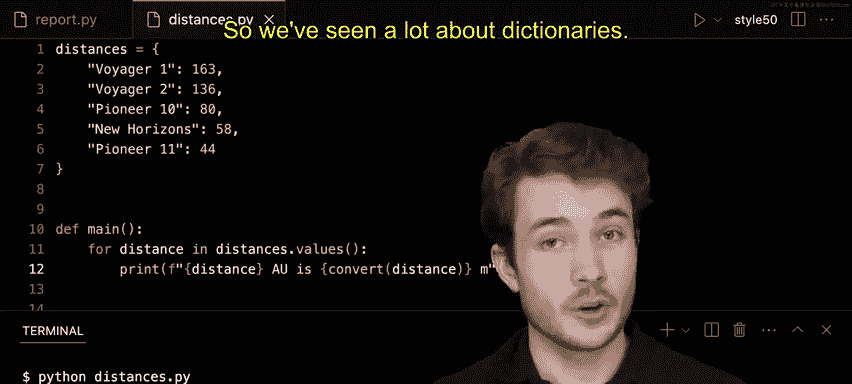

1.  **创建字典**：使用花括号 `{}` 和 `键: 值` 的语法。
2.  **访问值**：通过 `字典名[键]` 或更安全的 `字典名.get(键, 默认值)` 方法。
3.  **添加或修改键值对**：可以直接赋值（`字典名[新键] = 值`）或使用 `.update()` 方法批量添加。
4.  **遍历字典**：使用 `.keys()` 遍历所有键，使用 `.values()` 遍历所有值，使用 `.items()` 可以同时遍历键和值（本课未展开）。

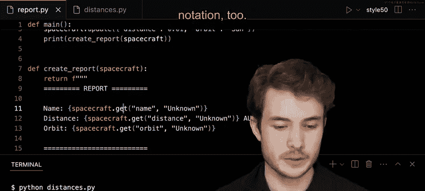

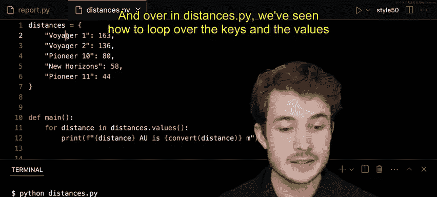

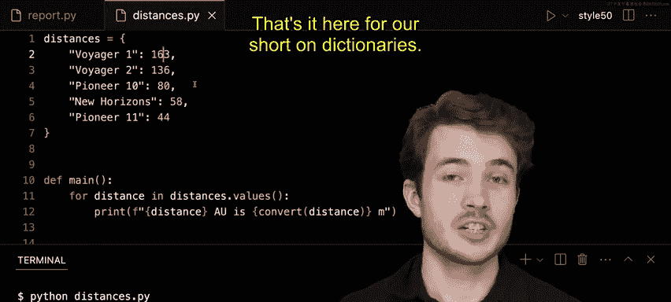


字典是组织相关数据的强大工具，它通过清晰的键名让数据的存取变得直观且高效。