# 哈佛大学《CS50P》Python编程入门 2024 - P6：07-For循环 🔄


在本节课中，我们将学习Python中的`for`循环。`for`循环是一种强大的控制结构，它允许我们重复执行一段代码，特别适用于处理列表中的每个元素或已知需要重复的次数。我们将通过一个为派对客人写邀请函的示例，来理解`for`循环的基本概念和实际应用。

---

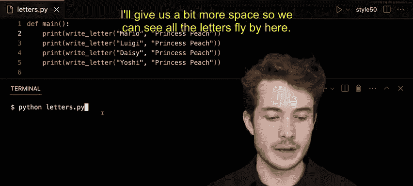

## 概述与问题引入

假设碧琪公主正在筹备一场今晚7点在城堡举行的舞会，她需要为每位客人写一封邀请函。我们有一个名为`write_letter`的函数，它接收`receiver`（收件人）和`sender`（发件人）两个参数，并返回一封格式完整的信件。

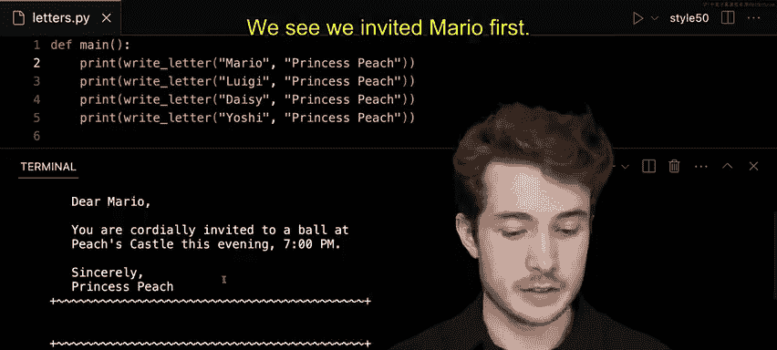

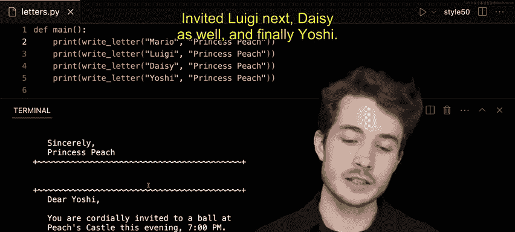

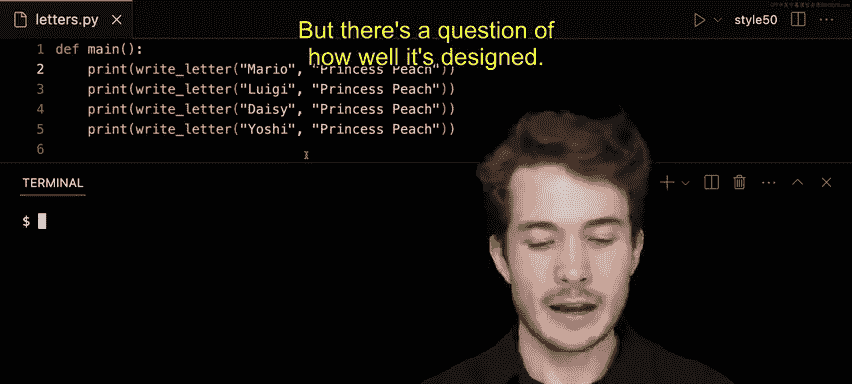

以下是`write_letter`函数的示例代码：
```python
def write_letter(receiver, sender):
    return f"Dear {receiver},\n\nYou are cordially invited to the ball at Peach's Castle tonight at 7 PM.\n\nSincerely,\n{sender}"
```

最初，我们可能通过多次调用这个函数来为每个客人（如马里奥、路易吉等）生成信件。然而，随着客人名单变长，这种方法会变得冗长且难以维护。

上一节我们介绍了重复代码的问题，本节中我们来看看如何使用`for`循环来优化这个过程。

---

## 使用索引的`for`循环

首先，我们可以创建一个客人名单列表。然后，使用`for`循环配合`range()`函数和列表长度，来遍历列表的每个索引。

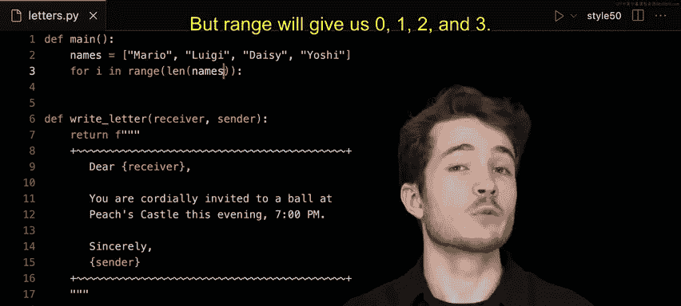

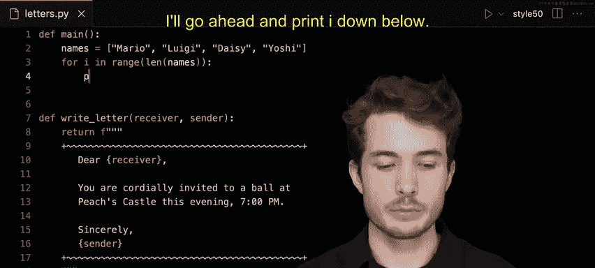

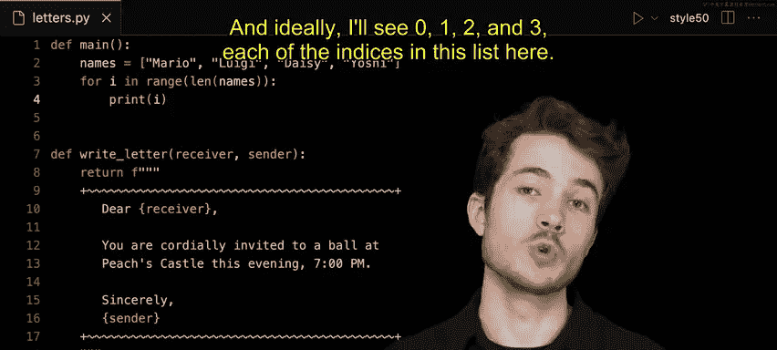

以下是实现步骤：
1.  创建一个名为`names`的列表，包含所有客人的名字。
2.  使用`for i in range(len(names)):`来循环，`i`会依次取值为0, 1, 2...。
3.  在循环体内，使用`names[i]`来获取当前索引对应的客人名字，并作为参数调用`write_letter`函数。

核心公式与代码如下：
```python
names = ["Mario", "Luigi", "Daisy", "Yoshi"]
for i in range(len(names)):
    letter = write_letter(names[i], "Princess Peach")
    print(letter)
```
这种方法有效，但我们可以让它更简洁、更易读。

---

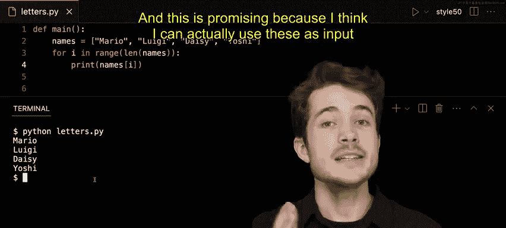

## 直接遍历列表元素的`for`循环

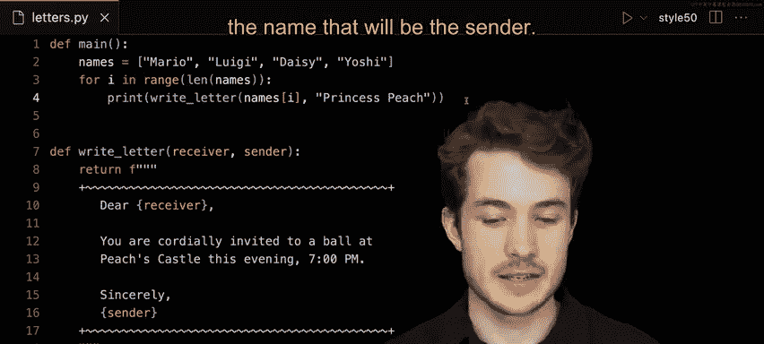

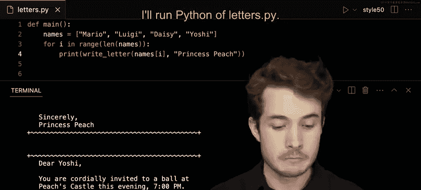

Python的`for`循环可以直接遍历任何可迭代对象（如列表）中的元素，无需使用索引。这使代码更加清晰。

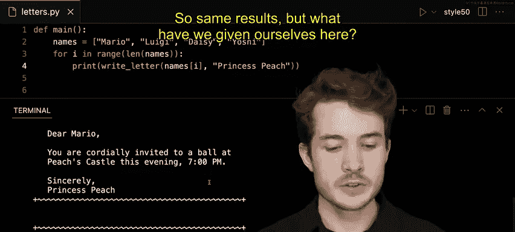

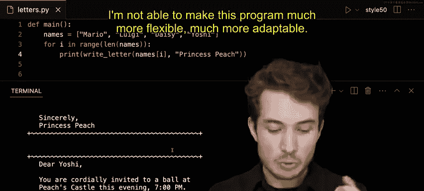

以下是优化后的方法：
1.  使用`for name in names:`的语法。
2.  在每次循环中，变量`name`会自动被赋值为列表`names`中的下一个元素（如“Mario”, “Luigi”）。
3.  直接使用`name`变量作为收件人参数。

优化后的核心代码如下：
```python
names = ["Mario", "Luigi", "Daisy", "Yoshi"]
for name in names:
    letter = write_letter(name, "Princess Peach")
    print(letter)
```
现在，如果想增加新客人（比如“Bowser”），只需将其名字添加到`names`列表中即可，循环会自动处理所有信件，无需复制粘贴任何代码。

---

## 总结

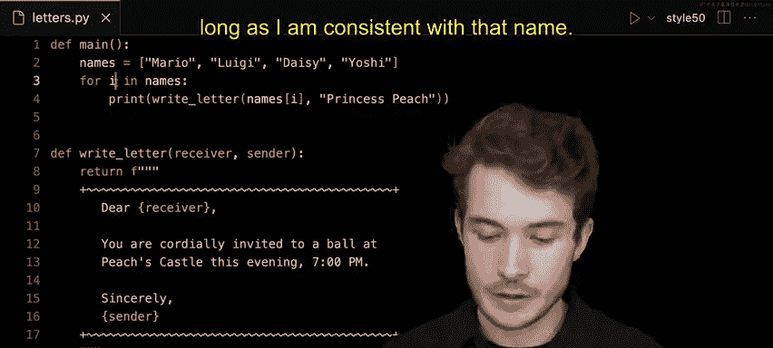

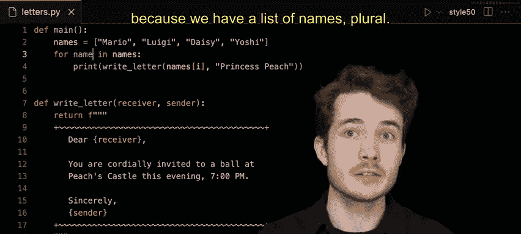

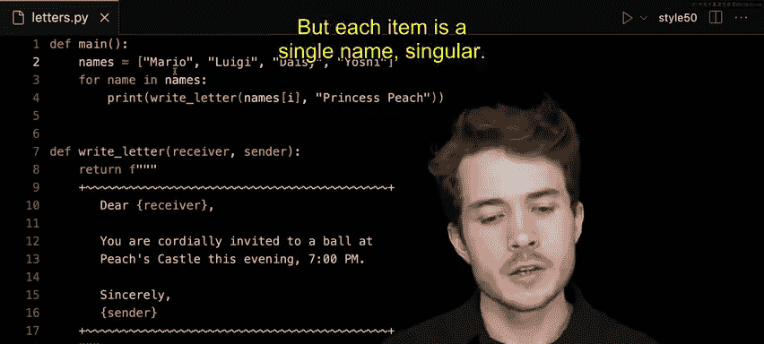

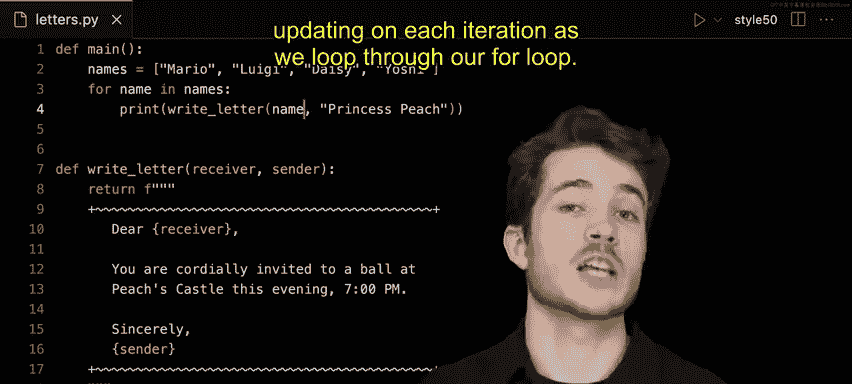

本节课中我们一起学习了`for`循环。`for`循环在你知道需要循环的次数，或者需要对某个列表（或更广义的可迭代对象）中的每个元素执行相同操作时，非常有用。

我们通过优化邀请函生成程序的例子，掌握了两种使用`for`循环的方式：一种是使用索引（`for i in range(len(list)):`），另一种是直接遍历元素（`for item in list:`）。后者通常更符合Python风格，代码也更简洁易读。

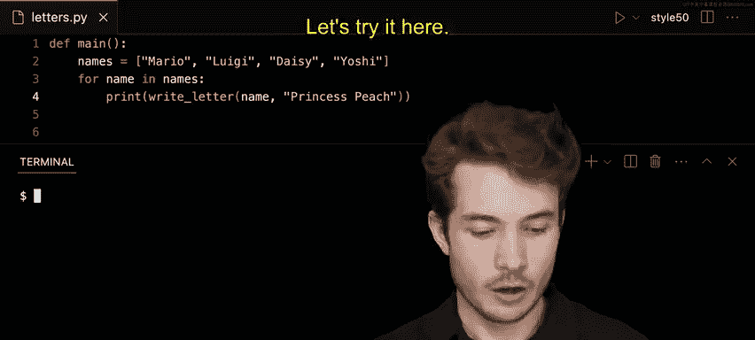

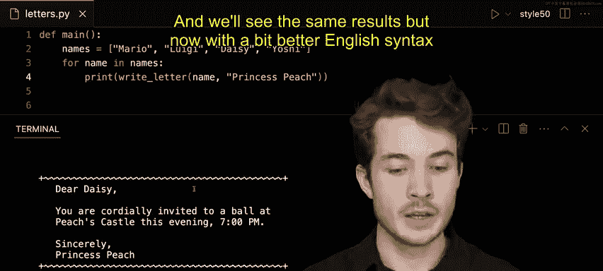

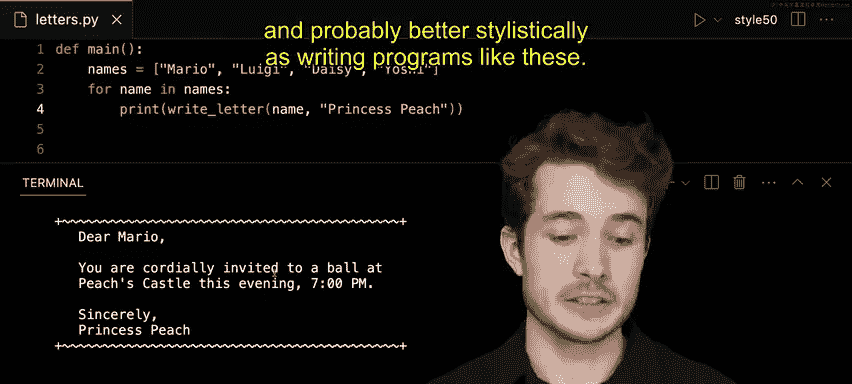

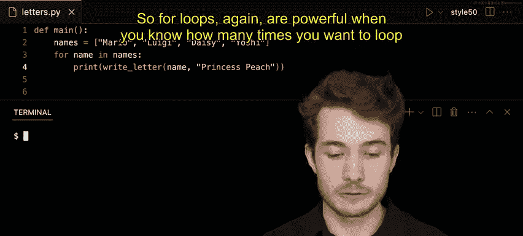

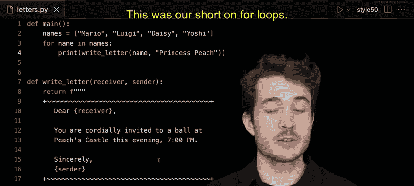


记住，`for`循环是自动化重复任务、让代码更高效灵活的关键工具。