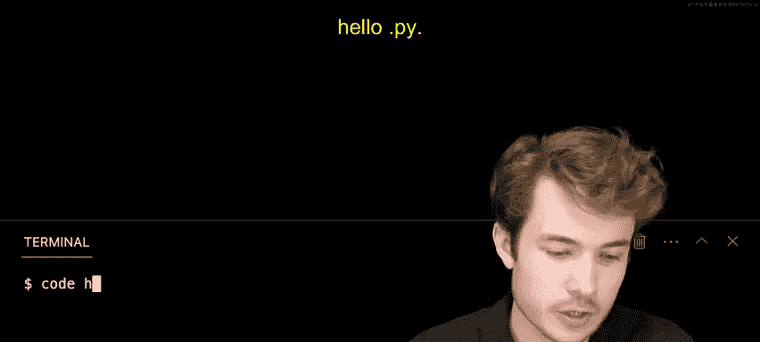
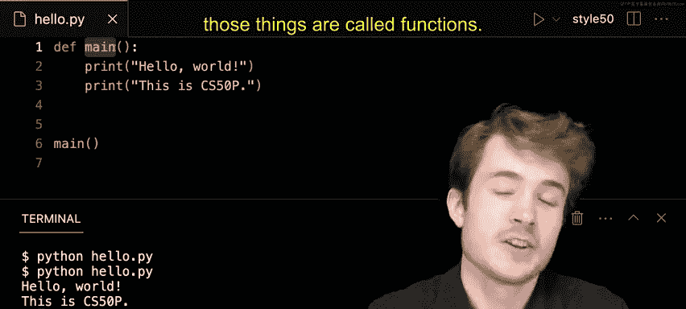

# 哈佛大学《CS50P Python编程入门》课程笔记 - P7：函数 🧩


在本节课中，我们将学习编程中的一个核心概念——函数。我们将了解什么是函数，如何调用Python内置的函数，以及如何定义我们自己的函数。

---

## 什么是函数？ 🤔




上一节我们介绍了编程的基本元素。本节中我们来看看函数。函数是一段可以接收输入、执行特定任务并产生输出的代码。你可以把它想象成一个动词，可以在你的程序中执行。

在Python中，函数通常通过其名称和紧随其后的括号来识别。例如，`print()` 就是一个函数。

## 调用内置函数 📞

以下是Python中一个内置函数的例子。

`print()` 函数接收一些文本作为输入，并在终端中输出这些文本。

```python
print("hello world")
print("this is CS50P")
```

运行这段程序，你会看到两行输出。我们调用了两次 `print` 函数。

## 定义自己的函数 ✍️

上一节我们调用了别人写好的函数。本节中，我们来学习如何定义自己的函数。

要定义一个函数，你需要使用 `def` 关键字，后面跟上函数名和括号。函数体需要缩进。

```python
def main():
    print("hello world")
    print("this is CS50P")
```

这段代码定义了一个名为 `main` 的函数，它内部包含两个 `print` 语句。但仅仅定义函数并不会执行它。

## 调用自定义函数 ▶️

定义函数和调用函数是两件不同的事。要运行我们定义的函数，必须在代码中显式地调用它。

```python
def main():
    print("hello world")
    print("this is CS50P")

main()
```

现在，当我们运行程序时，Python会从上到下执行：首先定义 `main` 函数，然后在最后一行调用它，从而执行函数体内的代码。

## 总结 📝



本节课中我们一起学习了函数。我们了解到函数是接收输入并产生输出的代码块。我们学会了如何调用Python内置的 `print` 函数，以及如何使用 `def` 关键字定义自己的函数。最后，我们明白了定义函数后必须调用它，其中的代码才会被执行。随着学习的深入，你会发现编写程序很大程度上就是在创建和使用各种函数。