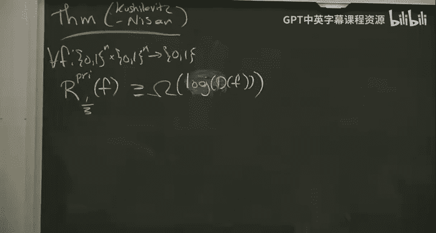
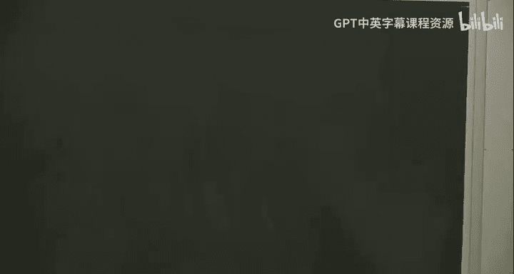
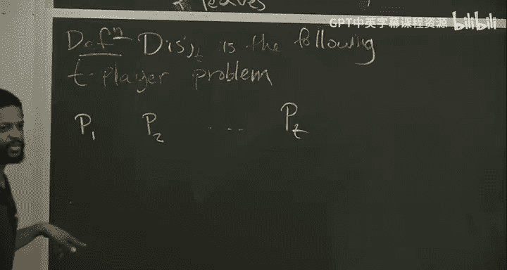
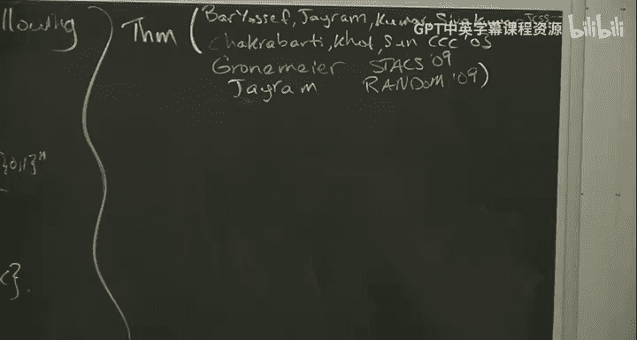
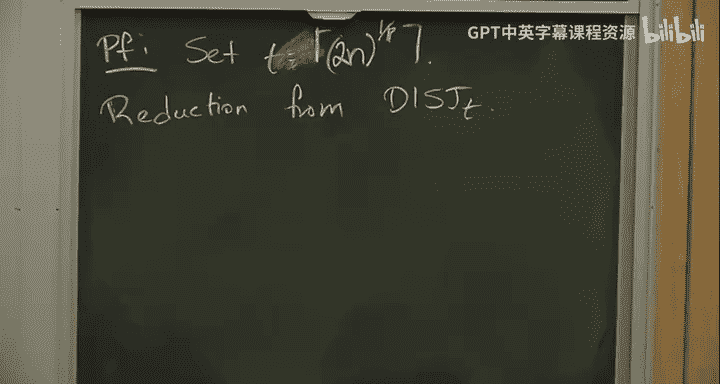
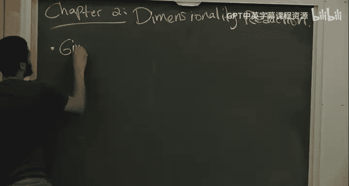
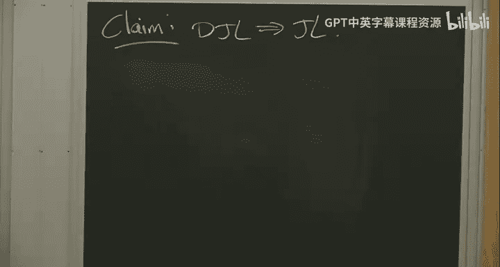

# 哈佛大学《大数据算法｜Harvard Algorithms for Big Data (COMPSCI 229r) 2016》deepseek - P10：-10-Algorithms for Big Data (COMPSCI 229r), Lecture 10.zh_en - GPT中英字幕课程资源 - BV1yGdNYvEMo

So just a recap of last time， we proved some space lower bounds for streaming algorithms for one past streaming algorithms via communication complexity。

And we did it via establishing that some communication problems were hard and then reducing those hard problems to our streaming problems。

So for example， one way to get a lower bound for a distinct elements。

 a linear lower bound is via reduction from equality。You know， you can even do it for。Determininate。

 you can reduce deterministic。The deterministic equality to deterministic approximate of zero。

Indexing was another one。 I didn't show the reduction to gap hamming。

 but I claimed that it can be done。And then gapamming can be reduced to randomized。

 actually randomized approximate of0。And that's how you get a one ripson squared lower button for randomized approximately 0。

 You can also reduce it to randomized median， so。This。

 the stuff in blue is some stuff that I want to show you today。

 And then we're gonna be done with this and move into dimensionality reduction。 So a new topic。

You know， closing the chapter on streaming， okay， after I finish showing these things in blue。嗯。So。

This thing is probably something you all are familiar with now because you had to show it on the P set。

Right， so I PSAT one。I forgot out which problem。3B， okay， so piece of one problem 3 B。

 you had to show that randomized exact distinct elements requires omega n space。

And then now you'll see it's basically。You know， if you had known about indexing。

 which intentionally， I didn't let you know about it because I wanted you to see。

More hands on some other approaches to proving it。 But once you have indexing。

 it's almost like a one line proof that randomized exact of0。 it requires linear space。 Okay。

 so you know now that you've struggled with it yourself。

You'll see you'll appreciate the power of indexing right you。嗯。I'll also show you。

 So we showed that there's a one ofrups on square lower bound for randomized approximate F 0。

 I'll also show you that there's a log n lower bound。So in other words。

 the max of the two or the sum of the two is a lower bound。They're both floor beds。嗯。

And I'll also show you that there's a problem called disjointness。

That can reduce to FP when P is bigger than 2。And show that for P bigger than two。

 you need poial space。I'm not going to actually prove the lower bound for destroyitness because that would take。

Certainly， at least one lecture to prove that， if not a little more。

 And I don't want to devote that much time to it。 but I， I'll give you the reference and。

You can look at that if you wish it's you know similar to the way that we use information theory arguments to get the lower bound for indexing。

 disjointness， you know， the nice some of the proofs for disjointness use a similar approach。

 they're just even more involved。O。So。And。没白。Will be dimensionality reduction。

We're done with streaming after this。So let me first show this one that the thing that you showed on piece。

 the P P at 1 problem 3D。Okay， so claim。Randomized。Exact。Zero。Requires。Omega n space。

And when I say randomized， I mean the failure probability is a third。

 it's some constant less than a half。Proof。We're going to reduce from indexing。Okay。

 what does Alice have？Alice has some x， which is in 01 to the n。Bob has some J。

Which is an index into x。对。And， you know， you're， you're used to it by now。

 Alex is going to do the usual thing。If X I is one， she puts I in the stream。 otherwise she doesn't。

Alice runs。 So suppose we， so what we're gonna do is， say。

 suppose we had a randomized exact of zero algorithm。

 We're gonna show that we can solve the index thing using it。Soett Alice runs。Alg。

 the streaming algorithm。On x。And sends。Where she said the space contents。The memory contents。

 maybe I'll say memory。And then she also sends the support size of x。To Bobb。Bob， then just。Appends。

J。To Ag to the stream， sorry。Then queries。F0 from Al。嘿。To what happens？Well。

 if J was already in the stream， because X J was1。Then F 0 doesn't change。

 He knows the support size because Alice sent him the support size。Right。

 so he just checks whether or not F0 increased from the support size。 If it increased。

 that means x J was 0。 If it did't increase， that means x J was1。 Q E D。 That's the whole proof。Okay。

And well， just to wrap it up， you know， whats what's the how many bits are communicated in this communication protocol。

 Well， it's a space S algorithm。Right。Plus， she sends the weight of x， the support size of x。

The support size of X is a number that's at most n。 So to communicate， it takes log n bits。

So the total communication is S plus log n。喂。And you cannot solve this problem with communication less than the lower bound。

 The lower bound is some constant times n。 indexing requires omega and bits of communication， right。

So just move the log n over。 log n is almost nothing compared to C N。 This implies that。S is mega n。

So there's your PSAT 3B。In basically one light。Yeah。欢等。Why doesn't randomness？

Influence the communication。W you mean about that。Yeah， so。You know。Let me okay， so let's。

Let me be a little more precise。So let's say random exact F0。With failure。Probability 1 third。

Let's say requires a mega n space， right？And we're going to reduce from index。Sub a third。

 which to me means the index problem where you you you have to solve it with failure probability a third。

And we know that index a third requires C bits of communication。So Alice runs Alg， what is Alg？

Alg is a randomized exact zero algorithm with failure probability a third。

When does this communication protocol fail， It fails， if and only if Ag fails。On that single query。

But Ag fails with probably a third。So we're solving index with failure probability third。

Does that answer your question？系。So anyway， yeah， that's that's it。 So questions about this。

Yeah indexing is a very， you know， powerful primitive for lower bounds。 you know。

 and sometimes the way you use it ends up actually being somewhat tricky。

 I didn't show you this index to gap pounding thing。

 but it's a little more involved in some of the things I showed you。 Not too much more。

 It's still simple， but I'm not gonna spend time on it。Okay， good。Now。Let show you that arrow。

 Let me show you this one。Let me show you that。Randomized approximate F0 requires omega log n bits。

So before I do that， theorem。You can find a proof of this theorem， example。

 in Kushhi Levit's Nissan in that book I mentioned on communication complexity。Which says that。

For any function F。呃。For any communication problem。And so。For any communication problem。

 F is your communication problem， let's say two players。The randomized private。

Communication complexity。So， this is。The communication costs of the best randomized protocol for F with private coins with one third failure probability。

Is at least omega the determinant log。terministic complexity。Okay， that's a theor。嗯。

I'll， I don't want to spend much time on this proof， but I'll give you a proof sketch。

It's a very simple idea。Basically。What I want to show here is that， you know， if there's an S bit。嗯。

有。If there's an S bit randomized protocol。Then I'll show you that there is a two to the S bit。

 roughly deterministic protocol。Okay。嗯。Right。How do I want to。Do this， so。嗯。O， so。Basically。

Let me write it like this。The essential idea is Alice has her private input X。

 Bob has his private input Y。Okay now Alice， let's say Alice is the one to speak first。

So she has some private coins that Bob doesn't know about， right。Based on what her X is。😡。

She's either going to go to this node。 There's kind of like a decision tree of what how how the communication between them is going to look。

You know，So she's going to flip a coin and she's going to flip some coins。 And based on that。

 she's either going to like speak this or speak that。O。Let's， let's assume that。

This is without loss of generality， like every time they speak， they each speak just like a bit。Okay。

This blows up the total communication by most a constant factor。So。Alice is going to flip some coins。

 And based on the outcome of those coins， he's either going to go this way or this way in terms of what she's going to communicate。

Now， Bobs sees what Alice communicated。 So he knows which edge you went down。

 And then based on his input， he's gonna to flip some coins privately。 And based on that。

 based on those private coins， he's either going to。Oh， actually， so not S leaves， sorry。

 two to the S leaves。So the height of this， says the communication is S， the height of this tree。

The height is the total amount of communication， like the maximum leaped depth。

So Bob is going to know what Alice said， He's going to know kind of where in the tree we are。

 And based on that， he's going to flip some coins and either communicate a 0 or1， etc。Great。

How are they going to。You know， if they have， if they have a randomized Sbit protocol。

 I claim they have a two to the Sbit。Deterministic protocol。Roughly。

 and how does that go basically for every leaf。Alice looks at。

The root to leaf path going to that leaf or from some other leaf。

 she looks at the root to leaf path going to that leaf。And she just asked herself like， okay。

 pretend I'm here， what's the probability that I would go to this node？

And now suppose Bob decided to go here， given that what's the probability that I go to this node。

 et cetera。 So what she calculates is assuming Bob keeps us on this path。

 what's the probability that all always keep us on this path。😡，And that's some number。

And Alice is just going to send all those probabilities to Bob for every single leaf。

And then Bob is going to do a similar calculation。 And based on that。

 he's going to know the probability distribution of the protocol。 He's going to know like。

 what's the problem that we， if we actually had done the randomized protocol for every leaf。

 what's the probability would have ended up at that leaf。Okay。

 and then he can figure out kind of which leaves。 based on that， he can figure out like。

 basically when the answer is yes or no。So there's some issue here。

 We have to like round the probabilities because， yeah， you know， you're communicating bits here。

 but you can show that。You， you don't have to specify the probabilities of the too much precision。

 At the end of the day， the total communication is2 to the S times polys or something。

 So you you kind of get the reduction。So I'm not gonna， if you really want to see this， you know。

 it's， it's not a long proof， but if you want to see the details more carefully than what I just said。

 Look in the book。 but let's just take this as a theorem。Good， so now that we have that。

Remember that。We said， well。You know， let just like before， let see。Be a set subset。Of 0，1 to the n。

 such that。For all C and C。The support size。It's exactly you know， andover。And over 100 or something。

And， you know， for all C。C prime。And see。The hammer distance， like the number of agreements。

back when we did the exact。2。The deterministic approximate F 0 lower bound。

 we showed the existence of a collection of subsets with this property。So when I。Here。

 what I'm saying is kind of every subset I'm just identifying as a bit string。

 which is the indicator vector of that subset。 so this is a subset of size exactly n over 100。

 meaning they're exactly n over 100 ones corresponding to what's in that subset。

 and for every pair of distinct subsets in the collection。

 those subsets don't really overlap that much。Right。And also。

 we want that the size of C is at least2 to the omega n。By the pigeonhole principle。

Deterministic equality。On sea。Requires。Omega and。Communication。Right。

 in particular requires log size of C communication by the pigeonhole principle。给。

But then by that theorem。😡，This implies that the randomized。One third private communication on E。

On sea， let's say。Is at least omega log n。But now there's a reduction。There's a reduction。

 a natural reduction。From。X C from randomized private X C。To。To randomized approximate。Of zero。Right。

So。Alice and Bob each have a set in this collection。 And they want to know， are these two sets equal。

Or I'm viewing the sets also as binary strings， right。So we do the same thing as always。

Alice takes her input vector for everyone one in that vector。 she puts it in the stream。

 She runs the algorithm and sends it over to Bob。Bob then inserts all of the elements from his set into the stream。

And then， checks have 0。If the two elements had been equal， then F 0 would be n over 100。

If the two elements were different。Well， the answer would be kind of n over 50 minus their intersection。

 but their intersection is tiny compared to， compared to N over 50。

 Their intersection is N over 2000。So。Basically， based on whether or not those two sets were equal。

 the F0 answer the actual F0 changes by almost a factor of  two。So if you have like a 1。

1 approximation， and let's say you can distinguish those two cases。So you've reduced X。

 E to randomized approximate of 0。 Therefore， randomized approximate of 0 must take log n bits of communicate。

 Let's take login bits of space。So what we've shown is that the the finally。

 the lower bound for randomized approximate of 0 is one of uppson squared plus login。

 which turns out to be the truth。 There is an algorithm that achieves that。Okay。

 and now let me show you the very last question。Oh， okay， yeah， I mean， one。

 one thing many people do is just like handwriting and then。O， O。Yeah， instead of line teching。嗯。

Any other questions？Oh yeah， I think I I think I did。Yeah， so， I mean。

 I didn't bother proving it here。 So， I guess we've seen Yeah， I guess we have seen it right。

 So and now just using that combined with this。I'm getting the randomized lower bound of login。Yeah。

So good， the only thing left is this thing。I want to show you that a randomized approximate FP for P bigger than 2 requires n to the 1 minus2 over p bits of space。

Which is optimal up to log factors。 There's a result due to inic and Woodruff。From 05。

 I believe that achieves that up to the log factors and you can get a one plus Epsilon approximation even。

 and people have been improving the dependence on one over Epsilon and the dependence on log n in subsequent works。

嗯。Right I guess I showed you the algorithm based on Anddoni's note。

 the one using exponential distribution and P set 2 problem 1 is about that algorithm as well。

 So you， you're familiar with this end of the 1 -2 over repeat。Where。This thing。This is omega。Right。

 so。Deterministic equality requires omega n communication。

And the randomized private communication complexity of any problem is at least log of the deterministic one。

Yeah， so。2 to the omega n is the size of C。By pigeonhole， the deterministic complexity。So。你啲要。

Right so what I'm saying here is。What I'm saying here is that。The deterministic complexity。Of X E。

Is omega n。喂。The deterministic complexity of X E is lo the size of C by pigeonhole。

But then the randomized complexity is always at least log of the deterministic complexity with the private coin model。

So， in fact， the randomized complexity of Xc is at least log log of the size of C。Yeah。That's right。

 I make a log in。A make log。So there is an omega n somewhere， so randomized exact is omega n。Right。

 and that's what we showed by indexing。Randomize exact is omega。

 n deterministic approximate is also omega N。 But if you want both randomization and approximation。

 then the lower bound is log in。Right， and in class， we had this algorithm for F0。

Maybe in the first or second week of lectures where we showed that you can get kind of a。

 I think in class， we showed a log squared n algorithm。But。

 you really can get a login space algorithm。Any other questions？Okay， so let me show you。

不了解。Oh， sorry， S is the space of the algorithm L。So let me show you this last lower bound。

This F P lower bound。 So first of all， let me define this jointness。And I should really say。

Thisjotness tea。走。The following。Tea player。And I should really say this is also going to be like the one way we're going to look at lower bounds from the one way。

 although that's not really necessary。嗯。So there's Alice。notWell， I can't say Alice now。

 let me say there's。There's player P1。There's player P2。There's player PT。

 So before we just had two players， we called them Allison Bob。 now we have T players。

In this problem， each player gets。Their own bit string。 So there's x1。In 0，1 to the n。There's x2。

In 0，1 to the end。And there's X， T。And 01 to the end。Okay。And。Promised。That。Either。

For all I not equal to J， X I intersect X J。Is the empty set。 So when I， Im。

 I'm using a notation here。 When I say intersect to binary vectors， I mean， treat them as sets。

Treat X as a subset of one to n。本人。So case1 is that no two pairs intersect at all。Okay。

 and then case， in case 2 is that。For all I not equal to J。嗯。Let's say， X I。Let's say there exists。

There exists a。Such that for all I not equal to J X inters。Exactly equal to K。Second。Oh， I just。

 yeah。 So I mean，'s okay。 So in this case， no two sets intersect at all。 In this case。

 every pair of sets intersects at exactly one point。 and it's always the same point， K。

So there is an element from one to end that's in every single set。

And the disjointous tea problem is to decide which。

And how does communication work in this tee player problem？Basically。

 P1 is the one who starts talking。 P1 can send a message to P2。Who can then send a message to P3。

 et cea， all the way up to PT T。And if you looking at if you were looking at。You know。

Let's say multipas streaming algorithms or， you know， not just one way communication。

 We would also allow it to go around。 We would allow PT T to then talk to P1。

 who can then keep talking。 and we could keep going around like this。But for streaming。

 for one past streaming algorithms。We're just going to look at the one way communication complexity where once it gets to PT T。

 PT T then just has to answer。对。And the way we're gonna measure communication is。

The total amount of communication over the course of the entire protocol。

 So the sum of how much should P1 send to P2 plus， how much should P2 send to P 3， etc cetera。

 We're gonna look at that sum。Okay， so before I tell you the lower bound for this problem。What's。

What's a trivial upper bound？😡，N， okay， how would you do O N。Right， so yeah。

 P1 could just simply send to P2， right if you're in one of these two cases。

People can just send everything he has to P2 and then figure it out。

 We don't even need the other players to talk at all。哎。What's something now， use use randomization。

 What's something that beats O of N。I'll give you a hint。So in your comment just now。

 basically P1 and P2 could figure it out on their own。 right， We don't need the other players。嗯。

What's something they could do to take advantage of the fact that there are multiple players。

Basically。P1 will talk to P2。😡，And then if there actually is an intersection。

 they'll figure that out with a pretty good probability。If they don't figure it out。

 that's okay because P2 will then talk to P3。And they'll catch it in good probability， right so。

Basically for if there's actually something in the intersection。

For a randomized protocol to not find it basically。

The communication between every pair of adjacent players has to fail， which is unlikely， right。

 So any ideas and how you could use this kind of idea to beat。So there exists a K such that for all。

 I not equal to J， X I inter secx J is K。 So if you look at any two players。Okay。

Their intersection has exactly one element， and it's the number K。Right。

 so P1 can just send his entire set to P2。And they either intersect or they don't。Oh。

 but your promise， your promise that one of these two cases holds。

 so you just have to check which of these two promises is the truth。Yeah， this is a promise problem。

Well， I'll just tell you basically。The point is。Roughly the point is。You know。

Look at the support size of all these vectors。😡，The average support size had better be less than n over T。

Right，If the average support size is bigger than an over t。

 that means the total number of elements across them is N is more than n。

 which means you definitely know that there's an interception。

So kind of the only interesting case is when the average support sizes N overT。Or less。Yeah。

Say that word time。Yeah。Well， not necessarily。 So you're saying。嗯。

They can just figure it out by sending their support sizes over。 But for example。

 maybe everyone gets a set of size exactly n over 2 T。Right。

And the total number of elements is at most N over2。Yeah， not every bit has to be present。

So even though everyone has a set of size， exactly N over 2 T。

There could still be an intersection in all of them， right， And you want to find out who that is。

So kind of the interesting case to keep in mind is that everyone set has size roughly n over T。

If the average set size is bigger than N over T， then you definitely know there's an intersection。

So everyone set sizes less than n over T。 And then。

What P1 can do is just take a random subset of like a one over T fraction。

Of his input subset and send it over to P2。Just like for each thing in his set。

Send it over with probability1 over T。 So you're sending only a one over T fraction of your set。

And if there's something in the intersection， that intersected element will be sent over with probability1 over T。

喂。So P2 will catch it with probability 1 over。And then P2 will do the same thing。

 send a one over tea fraction of her subset to P3。And。

For no player to ever catch something in the intersection。

 the probability of failing is like 1 minus1 over T to the T。Which is like one over E。

 which is less than one over E。 So it's less than a constant。

So if you want a constant success probability， it's enough to do that。And each person。

 the average set size is less than n over T。 Each person is sending in a whatever T fraction。

So each person is sending like NT squared bits。They need to send the indexes。

 That's an extra log n that I'm sort of not paying attention to right now。That's a good point。

 They need to send the indexes， as I'm saying it， but kind of really。

Everybody's saying n over t squared。 there are T of them that's like n over T。 So the lower bound。嗯。

Theorem。So the original prove- well so there was a paper by Bar Joseph。Ja Ramm。Kumar。And sheva Kumar。

I believe it wasnt。402 well， it's in JCSS 04。They lost the log somewhere， and they also。

They couldn't。 They only got， you know， they lost even more if it's not just one way protocols。

 but there were improvements later。 So there was cha of Bary。Coat and sun。

And then there was a grronnamire。Who was the first person to nail it exactly， this was in Sta 09。

And then J Ram gave an alternate proof to Gronnamiyer's results。 That was in random。I believe in '09。

And， and there's even older history。 If you look at just the two player version of the problem。

 So I forgot who proved that。In two players， it was known that mega and communication is required。

And that's trivial， basically， Alice can just send her entire vector to Bob。

And then there was another proof of that later given by Rosborov， Rosborov。

 who's going to actually be here。In a couple weeks to give a talk in our theory seminar。

About something else。And then these are these tea player versions。

 and they use this information theory。Well， information complexity， yeah。Yeah。Oh， I see。 Oh， yeah。

 yeah。 Actually， that's a good point。 Yeah， that's perfect。 So that's。

 that's a deterministic protocol。 right， So as you said。

 one of these guys has to have a set of size at most interval T by averaging。

 So he'll just send his entire set to the person after him。😊。

And that's now going also have the extra login in that I don't see at the moment how to get rid of that。

 but。你这个可。So yeah， there's even an deterministic protocol。 But this lower bound。

 this lower bound says that basically our pub。Even even there's our pub of， let's say。

 final probability， a third of。Join this key。Is Omega and over。开。In fact， there's even you know。

It's even true， I think， in the distributional sense。

 there's a hard distribution that says that any deterministic protocol for that hard distribution requires N over 2。

So， by the way， notice the total communication is N over T， which implies that。Some player。Ss。

Omega at T squared bits。So since the total communication is in over T。

 there is a plan that sends in over T squared。And now。Claim。For P greater than2， a 1。1 approximation。

To FP。Let's say， randomized。randomomized 1。1 approximation to FP。Requires。

Omega n to the 1 minus2 over P。对是。And that was。That was one of the motivations for the Barossa Fi all paper why they were looking at this problem to get a good lower bound for this。

And the proof of that。Said。N or T。To the and to the。Take2 n。To the1 of P。嗯嗯。I should mention。

In the hard。In the proof of hardness for disjointness， it's also the case that kind of every set has。

Every set in the hard example has size n over 40 or something like that。O。Or some。

 you know what the set sizes are。 They're all exactly at over T times some constant。

So what's the reduction now？There's a reduction。From。From this jointness tea， as you might imagine。

And it's the usual thing。喂。The usual thing is。嗯。Actually。

 I don't even need to use the fact that all the sets on the same size。The usual thing is。

P1 will treat everyone in X1 as an element of the stream and put it in。

And just like when he finishes processing his set， he he'll send the space of the streaming algorithm。

 the memory contents to P2， who then runs it on X2， sends the memory to P3。

 and everybody just keeps running the streaming algorithm。

Okay。Now。Let's say there's case1。In case one。No one intersects。So everyone in the stream has weight。

 has frequency 1 or 0 at most one。So， this means that FP。Is at most end？Right，1 to the P is1。

In case 2。There is some index K that's in everybody's stream。Right。

 so the weight of the frequency of x of K is going to be T。

Which implies that F P is at least t to the P。Right， by definition of T。

 So if you have better than a two approximation， you can distinguish these cases， Q D。

RightSome players send since the disuous lowerdown is in over t。Some players sends N T squared bits。

But how much， how many bits is each player sending， each player sending exactly S bits。Right。

They're setting the space of the streaming algorithm。

So this implies that s is at least n over over t squared， which is omega n to the 1 minus2。

So once you have the dis drainous lower bound， it's straightforward to use it。

 The hard part really is proving to this drain lower bound。By the way， just。I mean。

 there's a more straightforward way to say this。 but just so you know， a trick to keep in mind。

What if I wanted to prove。So what about L infinity norms。 So here's L P norms。 L infinity。

 So P is infinity。What's one way to get that。Out of this。

One way to get it out of this is basically look at two player disjointness。

2 player disjointness requires linear amount of communication。And if。

 if Aliison Bob's two sets intersect。Then the L infinity is 2。If they don't intersect。

 then the L infinity is one。So if you have a 1。1 approximation， you can tell the difference。Okay。

 notice that L infinity， that's basically what this says as well。

 because L infinity is basically the same thing as the the L。

 the infinity norm is basically the same thing as the log n norm。

That follows by holders's inequality。So that's something to keep in mind， right。

Infiny norm and log n norm， where the dimension is N are basically the same thing by hold's inequality。

 So I'll let you think about that offline。 But then n to the one over log n is 2。

And two times 2 is 4。 So again， this， what this proof is saying is for El infinity norms。

 you should do disjointness with a constant number of players。Which， you know。

 you can do it with two players anyway。Any any other questions？

So that's all I want to say about lower bounds， and I want to start doing some。

Non streaming stuff now。 So if you have some streaming questions。Speak up。

Even though I even though I'm saying that we're done with streaming， as you're gonna to see。

Everything's the same。 I mean， we're gonna， we're gonna go to another topic and the techniques that we're gonna to start using over there are gonna start looking a lot like things that we analyzed when we're doing streaming。

 so。You know， these different topics that we're going to see in this class are all quite connected。

And。So。You know，Chapt 2。Is dimensionality？just to make sure everybody realizes that we're done with streaming。

 you know， maybe all， we should have like。Not a moment of silence， but something to commemorate this。

 So maybe。let's have a moment of silence，Very good。 That's enough。 That's enough of a moment。 Okay。

 so now let's move on to another topic， which is dimensionality reduction。And。Okay， so。

 the point of dimensionality reduction， So is。We're given。

An algorithmic problem。With high dimensional。Vs。As the input。So you。

re given an array or list of high dimensional vectors， and you have to solve some problem。

Nearest name search。Or maybe。嗯。You knowLge scale linear algebra problems。

 large scale regression problems。嗯。Or some other。No， I mean， there are lots of I could keep going。

 minimum closing ball， etc ce。So think computational geometry， but high dimensional。So for example。

 nearest neighbor search。嗯。You know， people do this kind of thing。 They take they take an input。

 They take input like images or documents， webp pages， and they vectorize them， right。

 So an image is naturally， let's say you have 10 pixels by 100 pixels。

 that's just a million dimensional vector， which every inch of the vector tells you the intensity of that pixel。

 or maybe you featureize it in some other way。But the point is you turn。

 you turn your input into high dimensional vectors。

 and then you want to solve problems like find me given a query image。

 find me an image in your database that says close to the query image。Okay。

 so that's the nearest neighbor problem。We'll see'll see， you know。

 there's clustering problems where you're given lots of data and you want to cluster you want to cluster the data。

Based on some kind of similarity metric。So we'll see various problems， but。

The goal of dimensionality reduction is quite simple or the motivation。 So as you might imagine。

If you're given an instance of， of one of these problems。

Kind of the higher the dimension is the harder it is to solve the problem。 Okay。

 like we're gonna develop there are algorithms that solve these problems。

 The run times depend on the dimension， as well as the number of points。

And the more the dimension goes up， the more the runtime goes up。

 the more the space consumption of the algorithm goes up。Okay，Or if you want to communicate。

 you know， if I have some data and you have some data and we're in a distributed setting for me to send you parts of my data。

The communication goes up if my data is more is higher dimensional。

 because I have to send a longer vector to you， Okay， so。The goal here。You know。

 there are a few goals， you know， fast。Oneun time。Let's say。Low storage。Low communication。

And to get these things， you know， one thing to do is to make is to have low dimensional input。

And dimensionality reduction。They basically are pre processing stuff。Where。

You're given before you even run whatever algorithm you're going to run。

 you're given this high dimensional data。😡，You run it through a pre processingces step。

 which we'll talk about for the next few lectures that makes the data lower dimensional。Okay。

While preserving some structure。And then now you run whatever algorithm you're gonna run on this lower dimensional data。

 and it's faster。 and it uses less memory， etctera， etc cetera。Okay， so。Gemetric structure。

 what does that mean？😡，You know， distances。Between different points。 So you have to fix your metric。

 But you wantanna， you want to map down to lower dimensional while preserving distances。

 or maybe you want to preserve angles。Or maybe you want to preserve。You know， take any。

So what's the distance， you know， take any two pairs of points and look at the length of the line between them。

And maybe you want to do a higher dimensional version of that。 Take any， take any subset of K points。

 You want to preserve the volume of the。Of， of their， of their convehu。 So， you know， volumes。

Of subsets of points。Or， you know， more generically。

 something you might want to preserve is just there's some problem you want to solve like clustering。

 K means clustering or something， you know， you want to preserve。You know， optimal。Solution。To some。

You know， geometric optimization problem。And sometimes sometimes to do this。

 it's enough to preserve distances。 Sometimes there's something else you want to preserve。

 Sometimes you can do better if you just want to preserve this as opposed to all distances or something like that。

And today。In the remainder of today。嗯。Go on to preserve distances。Okay。

 so let me give you a definition。So what do I mean by preserving distances。

 I'm going to talk about distortion。And it's it's like a worst case form of preserving distances。

 I give you a set of vectors。They're high dimensional。 I want you to map them to low dimension。

 such that all the distances in this set are are almost the same as the distances in the original set。

So。Given to。Metric spaces。XDX。And why， don't worry there's not much。

So analysis is not a pre for this class， but you know。I'll just say what'ssymmetric space。

 It's a point set together with a distance function。

 Dis function should satisfy what you think about distance functions， triangle inequality。

 their symmetric。 The distance between x and Y is the same as y and X。

The distance from a point to itself is 0， okay。And if in distance between a point and another point is never 0。

 Okay， so that's what metric space is。 So given two metric spaces。And。A function， mapping。

Let's say one metric space to the other。One set of points， the other set of points。We say。嗯。Has。

Distortion。At most。D。If。For all。Xx prime and capital X。We have the following inequality。 Okay。

 we have。If you look at the distance in x。Between。And they say， if you look at the distance in y。

Between f of x and f of x prime。It's at most C2 times the distance in x between x and x prime。

And it's at least C1 distance in X x and x prime。Where。C2 over C1 is at most the distortion。

So maybe think about C1 is1。What I'm saying by having distortion D F is。

Look at where x got for any two point pair of point X and x prime in the original metric original metric space。

 look at where F mapped it in y。 So F of x is an element of y。 So I'm mapping x to y。

 So F of x is in y， F of x prime is some other point in y。

The distances should be at least as what they were before， and they shouldn't blow up by too much。

 They shouldn't blow it by more than DF。Okay， so we say that a map has distortion D F。

 if that's true， all the distances are kept roughly the same to a factor of DF。

So today we're going really the rest of this class when we talk about dimensionality reduction。

We're going focus mostly on， like， normed metric spaces。So the distance between two pair of so。Right。

 normed vector spaces。The distance between two vectors x and y is the norm of x minus y for some norm。

LP norm or whatever other norm。嗯。He good。Okay we will。Fcus。Un normed。Lect your spacing。

And mean what I mean by that is the distance between x and x prime is just for some norm。

 it's the norm of x minus x prime。嗯。And we want to have like really good dimensionality deduction。

 So we're gonna， I'll show you。Well， let me just claim it now， so there's a theorem。

This is due to Johnson and Len Strauss。In 84， it's often called the J Al Lama。Yeah。Which says that。

For any set of points。X1。X capital n。In。In L2 N。 So these are little n dimensional vectors。

 and we measure distance in， in L 2 norm。Okay， so let's say that。X is。X1 up2 xn。

There exists a matrix。And also I should say for all epsilon。For all epsilon， for all sets of points。

 there exists a matrix。With the number of dimensions being one over uppsilon squared times log n。

 the number of points。Notice it doesn't depend on the original dimension at all。

 just the number of points。Such that。The map。X goes to such that。Y。Hi。Mapping capital X to L2M。Has。

Retorship。At most one pluspsilon。What does that mean？There's a linear map。

 so X I gets mapped to pi X I。 You're multiplying by this matrix pi。Right。

 so the pi is an M by n matrix。 So the original vector has little M dimension。

 It now has little M dimension。 Little M is1 of ups on squared log number of points。

So for any set of capital end points。You can map them to log capital N dimensions。

Such that all the distances are preserved up to a constant factor。 In fact， up to one plus epsilon。

 if you make it one or ups on squared times log capital。Okay， so that's， this is one。 this is。

One form of dimensionality reduction。 It's for preserving L2 distances， Euclidean distances。嗯。

While mapping to very low image。And。We're going to mostly focus on L2。

So we'll spend quite a lot of time focusing on L 2。 And you might ask， why。

 why don't we look at L1 or L infinity or some other LP。So。First， let me say， know， after。

After jail had this thing in the 80s， people started asking those kinds of questions。

 why don dot we do this for a1， et cetera。Brickman and Charlieri Car。I'm now forgetting the year。

They showed the following。嗯。You know， basically。For。1。嗯。Iion add any reduction。With distortion。C。嗯。

There exists a set of endpoints， so for any end there exists a set of endpoints。Requiring。

Dimenssion M， which is at least n to the omega 1 over c squared。

So whereas we were getting like log dimension over there。They show that if you want to do it for L1。

 you really need polynomial dimension。Okay， so you can't， you know。

 you can't do as good a job at dimensionality reduction in L1。And， actually。

There's a paper by Anddoni。嗯。Charri Car。Naam and。And when。This is I guess， box 11。That says。See。

 if you want distortion， not just a constant， but you want one pluspsilon distortion。

 just like what you're getting in JL， that implies that M has to be at least there is there is a set of points such that you can't map to low dimension unless M is at least something like n to the1 minus O of1 over log when a uppsilon。

So if Epsilon's tiny， this is like almost linear， so you can't really like do anything is basically what they're saying。

嗯。And， you know， there'st even。There another theorem， which is even kind of more a hint。

 So this is all L 1。 maybe what about， you know， L 1。5， maybe you can do something there。 So。

 you know， people there are theorems that say that give lower bounds that basically hinted that L 2 was really a special case。

 And it's the only thing we can do good dimensionality reduction。And that was made more formal。By。

By Johnson and Naor。Okay， so let me make sure I say this。 So by the way。

 these lower bounds are not just for。Linear embeddings， right， This says。

 no matter how you do your embedding， no matter what F you use， right， no matter what F you use。

 Where F there that F。You can't beat these target dimensions。

So Johnson andor said they basically said that if you want to use a linear embedding。

And map to log n dimensions or at most log n dimensions。

Then you can really only do it if your original space is like almost the same as L 2。

So they say the following。嗯。Suppose。I don't want to get too May so。This amazing。Suppose X。呃D。

Is a or let me call it。It has a norm。Norm。Reector space。OkayThis has a name。

 it's called a Bnock space。あた。Okay so。Nor about the formality。 if you have some norm vector space。

Such that。For。Any。Endpoint。Subset。Of X。Can map。To an O N。Log n dimensional subspace。Of X。

With constant distortion。Right so that's what the jail Elma says。

 right It says that for any endpoint subset of L2 N。

 you can map it to a log n dimensional subspace with constant distortion。So suppose you have。

 suppose you had a vector space such that for any endpoint subset。

 you can map to log in dimensional subspace of x with constant distortion。

Then what the theorem says is that then this， this norm space X is almost the same thing as L2。Then。

Every。Endpoint。Or not end point。 N dimensional。And dimensional。Linear subspace。Of X。Embbeds。Into L2。

With distortion。Atmost。Two to the2 to the O of log star N。Okay， so。

Do people know what log star and as log star is the number of times you have to take log to get down to one。

So。If you look at， you know，2 to the two to the two to the two。That's a really big number， right。

2 to 2 to the 2 to 2。 So that's like 2 to 2 to the 4， which is like。2 to the 16。嗯。And2 to the 16 is。

 I guess， around 65000 in change。Just add another two。 Then you have 2 to 65000。 Okay。

 so that's a ginormous number。But log star of that number is just5， I guess， because or five or6。

 How many times you have to take log of this tower of twos you get down to one。

Every time you take a log， you reduce the height of the tower by one。

So log star N for all practical purposes is like five or six。Okay， so。

What the theorem is saying is that if you have this jail kind of property where every finite point subset maps to log dimensions。

Then the space， every， every linear subspace of your vector space， of your normal vector space。

Basically， is almost the same as L2。 It embeds into L 2 with like， tiny distortion。

So this really says like L2 or things like L2 are very special。Okay， and in fact。

 you have a lower bound。 They， you know， you could say， well， maybe I could get a constant here。

 They show that there is， They show that there is a Bock space， why。Such that for any end。

There is an n dimensional linear subspace of y that does not embed into L 2 with distortion better than two of the alpha N。

 where Al is inverse sacrament。Okay， so。Anyway， random fact。 So the point of this。And。Oh。

 why did I leave that there， The point of dad in this is just that。L 2 is special。 Okay。

 so we're gonna focus our attention on L2。So we're going prove this jail， ama。

And before we prove the jail alema。嗯。I'm we're gonna prove it using something called the distributional jail alema。

It says that。For all dimensions， N。And for all。For all， let's say， Epsilon Delta。

In between0 and a half。It's two。There exists a distribution。D epsilon Dlta， which is a distribution。

On matrices， which are M by N。With M being at most up to constant1rupson squared times log1 over a delta。

Such that。嗯。For all X。The probability。Over pi being drawn from this distribution。

The probability that pi does not preserve the norm of x。Is that most Delta？

Notice that since pi is a linear map。If you preserve all the unit norm vectors。

 it implies that you preserve all the vectors。Right， so we could even say that。For all X and R N。

Such that the norm of x is1。And then this thing here is just one。So let me rewrite that。

The probability that。Pi x。Al to Nor square。Ps1 is bigger than epsilon is at most delta。Hey。

 so this is the distributional jail ma。By the way， just， you know。

 given your streaming experience now。We want a random matrix that preserves L2 norms of vectors。

Does that sound familiar？That's like the AMMS S sketch。Right， or the thing you did in your Pet。 So。

 in fact。What's pi going to be， It's going to be a random side matrix。

That's how we're going to prove this。So you've already seen this。嗯。对。

You've basically already seen it， I mean， the A Dutch。The A M S sketch， we analyzed using。

We analyzed using。Well， we analyzed in the case that Delta was a constant。

 You want to succeed with the probability two thirds。

And we showed that M could be one of Rpson squared。Okay。

And we did it using like an expectation variance argument and these chubby shelvess inequality。

If you want to use chby chef's inequality and get failure probability Dlta。

It's going force you to set M to be something like1 of Epsson squared times whatever delta。

This is going back to even like lecture 1， lecture 2， when we're doing more plus， more plus plus。

 et cetera， right？And the way that you can get log1 over deelta is back in the streaming world。

 get failure probability a third， do lots of these in parallel and take the median。

Once you take the median， though， it's no longer an embedding into L2。Right。

 because what is it embedding into L2， It's a function mapping vectors in L 2 to vectors in L 2。

 meaning。The the embedded vector， like the image， the way that you measure its cell2 norm should be you take its cell2 norm。

There are no medians here。So really， what we want is。That even， after you apply pi to this dimension。

 the L2 norm is still what it should be with high probability， probability1 minus delta。Right。

 and we don't want to have a dependence on one over deta。 We have a dependence on log one over delta。

And the way that we're going to do that。Is by using， well。

 the variance argument was like the chubby chef argument was like a bound on the second moment。

Does that sound familiar？You， you bound the second moment of your， of your estimator random variable。

 and they use chumby show。The way that we're gonna to get this kind of bound is by using by using the same exact pi。

 the random sign matrix。 But instead of bounding the second moment。

 we're going bound the log one adult moment。And we're going to see that that's going to let us。

That's going let us get away with a smaller M。 And embasss be lo over over。Anyway。Pussians。老板。So。

 before we prove。Distributal JL claim。I claim that DJL， distributional JL implies。If you。

 if we proved the theorem， it would imply the jail limit。

P。Set Delta。To be less than one over and choose two。Okay。And look at the set of vectors。

Look at the set of vectors。T， which is。Xi minus Xj over the norm of Xi minus Xj。对。I lesss than J。

Notice that the size of T is exactly N choose 2。Okay。Now， for some matrix pi。

What does it mean that Pi doesn't have distortion One plus epsilon？

For pi not to have a distortion ones epsilon， it means that。

pi fails to preserve the norm of one of the vectors in T。😡，So。The probability。Over pi that。

Hi doesn't have。Distortion。One plus epsilon。On this on that set of vectors X。

Is the same thing as the probability of a pie that。There exists as Z and T。Such that。P Z。

L2 norm squared minus1。Is bigger than absolutely。That there is something in Z that it didn't preserve。

But by a union bound。Is that most the size of tea？😡，Times。The probability for a single one of them。

 which is delta。Right。And that's strictly less than one because Delta is less than one to。So。

The probability that pi doesn't have distortionable bipsson an X is strictly less than one。

 which means that with positive probability， it actually preserved everything。

And then the final dimension you need is1 of Epsson squared log1 delta。

 which is the same as1 of on squared log capital n。Questions。So we have just maybe four minutes。

 so I won't write anything。 I'll just tell you where we're going next。 So next lecture。

What we're going to do is we're going to prove the distributional jaillemma。Okay。

 the way we're going to do that is we're going。嗯。Prove some。

Til bound inequalities and introduce methods for proving tail down inequalities。

 So we've already seen some， right， We've seen Bernstein inequality。 We've seen turn off bound。

Chubby chef's inequality。🤧啊。Now， kind of the difference。

 one kind of fundamental difference between this kind of tail bound versus the ones we've seen before。

 Or like this tail bound。 the one we've seen before is this is。You know， let's say pi I J。

Let's write it as Sigma IJ over root M。So it's it's a scaled random sign matrix。

 Sigma is a random sign。Before。Before we were used to proving tail bounds on sums of independent random variables。

 like a turn off bound。A sum of independent random variables is like kind of a linear form。In those。

Independent random variables。Here， this is like something L two norm squared。

 It ends up being a quadratic form。 This is like a degree2 polynomial in independent random variables。

So we need to develop a way to handle you know higher， you know， hired reforms for for taildowns。

 So we're going to see that next lecture， there's something called the Hanson right inequality。

And then once we prove the Han and right in equalityality。Distributional jail is like a corrollary。

 essentially。And then we're going to use the handsome of around inality to prove other things to like other forms of JL that are more efficient。

 etca。So I think I'll leave it here for today， any questions？And the PSAT was extended。

 it's due tomorrow。Before midnight。