# 哈佛大学《大数据算法｜Harvard Algorithms for Big Data (COMPSCI 229r) 2016》deepseek - P11：-11-Algorithms for Big Data (COMPSCI 229r), Lecture 11.zh_en - GPT中英字幕课程资源 - BV1yGdNYvEMo

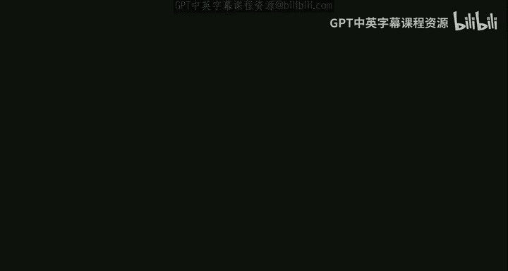

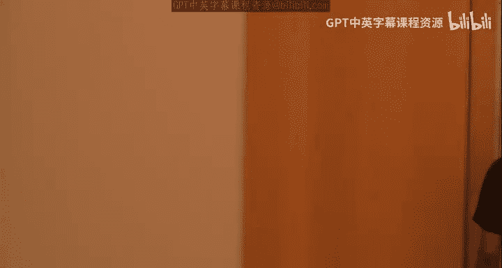

subsetsid of our end。Let's say x is the size of。The size of x is capital N。

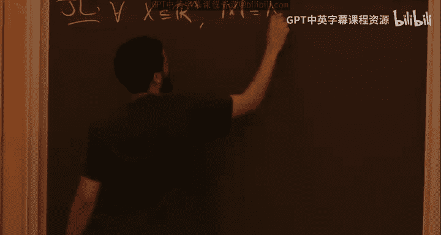

all epsilon。and a half。There exists a linear map。Hi。M by N。Amy is one of Rpson squared log n。

Such that。X，Y and capital X。If you look at pi x minus pi y。So。X gets sent to pi X。

 So here you should think， right， So this think about M as being much less than a little N。're。

 we're trying to do dimensionality reduction。If you map by pi。That's that most wonderful sub salon。

X minus y。And it's at least one minus sub。嗯。And then we had something called distributional jail。

Which said that for all Epsilon Delta。And zero half。There exists a distribution over matrices。

So this is a probability distribution over matrices。Such that。For all x of unit norm。嗯。

The probability。Over pi drawn from this distribution。Of this pi xlton norm squared。-1 bigger than。

Epsilon is at most Delta last time we saw that distributional J implies JL if you set Delta to be1 over capital N2。

 union bound over all the normalized different vectors。Just so we're clear， you know， why is that。

 you know， why is this similar， This basically means that pi preserve the norm of x， right。

 Because what we want。What we want is that。Pi x。Has roughly the same norm as x does。

That's what we want。And then I squared both sides。And then I subtracted x squared from both sides。

 but x squared is1。So。This is the same thing as saying and basically one plus epsilon squared。

Is one plus two epsilon plus epsilon squared， which is basically the same thing as  one plus two epsilon。

 right？It helps not small。So this thing is really the same thing as saying。Pi X。

L2 norm squared minus1 is less than two uppsilsonons。Right。Roughly two Epsilon，2 Epsilon。

 plus Epsilon screen。Plus epsilon squared， but that doesn't matter。So right。

 this is just saying that pi is preserving the norm of x。And if you preserve the unit norm vectors。

 you preserve all the vectors， know， if this is true for unit norm vectors。

 it's true for any vector because piesal linear map。对。Good。

 so really it boils down to proving distributional jail。So。

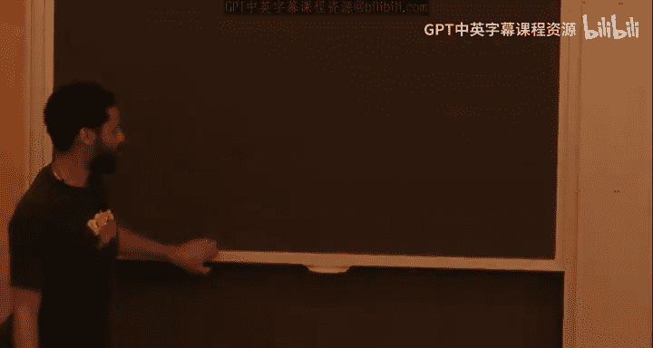

I'll say a little bit about the history and then I'll say what I'll actually prove。So。

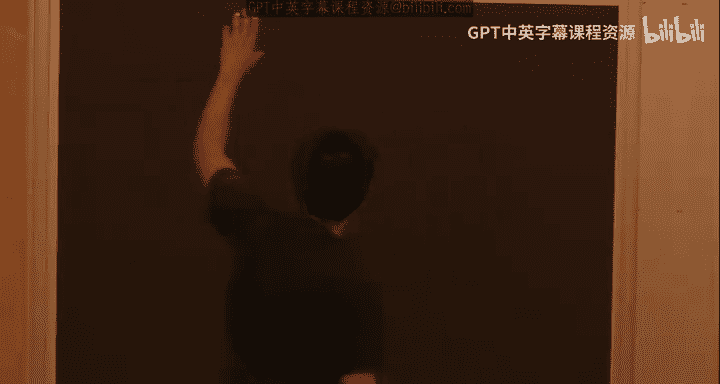

In the original Johnson and London Str paper from 84， this is how they did it。

 They proved distributional jail， and then they got jail。And。You know。

 what was the pie that they used？So the pie that they used was。Oh， and I should say。

 I didn't say what he was。Here。M is。Of one over epsilon squared。Log one over Delta。

So what's the pi they use or the distribution B Epsilon and delta they use？

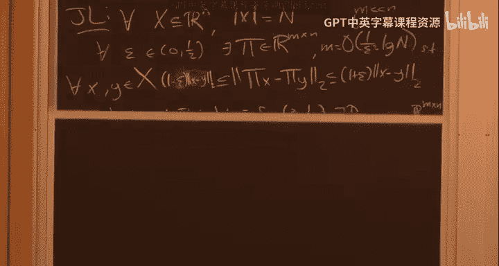

What they did was they said。The linear map think of it as like the product of two matrices。Okay。

 so we're gonna。The way pi X is going to be， you know， M times P times x。Okay。

 so I'm in PR2 matrices， what's P？P is a random rotation matrix。

So you're going to take your your vector and just randomly rotate itly random your uniformly random rotation。

And then， P。P is a silly matrix it just projects to the first M coordinates。Okay。So。

That was was their their distributional JL。 and they proved that it works if you picked M to be something like that。

Good。😊，嗯。the basic idea is。If you if you take a fixed vector X and you perform a random rotation。

What do you have you have a random point on the sphere。

Right and basically it basically came down to proving that a random point on the sphere。呃。

The squared mass in its first M coordinates is tightly concentrated。So I'm not going to approve。

The jail way， the way that the original jail paper did。

 but I just wanted to let you know how they did it。After that。

 there have been several works that have come up with other distributions。

Or even reanalyze the same jail distribution。 So there's a paper by Dus Gan Gupta that gave another analysis of the original jail distribution。

 random rotation。Otherwise there were papers， Indic Muwani， Aliopus， Aiaga Iala。

 there are several other papers that。So11， one slightly annoying thing about implementing this random rotation idea。

Is。The entries of a random rotation matrix are not independent。what's a rotation matrix。

 Basically the columns are ortho normal。So there's some dependency there。 So I mean。

 one way to get a random rotation matrix is pick a random Gaussian matrix and run Grm Schchmidt on it。

Okay， but。But there's some overhead to doing that， but what some of these other papers did that I just mentioned is they just took a matrix with IID entries。

Okay， so just pick a matrix that has independent Gaussians as its entries or independent plus minus ones as its entries。

Okay。So that's what I'm going to show you。 So we're going to analyze today。We'll show。呃。

Distributional J L， distributional J L。For pi IJ being a random sign。

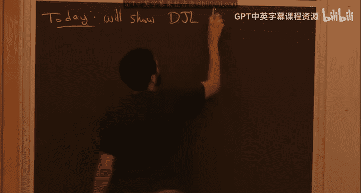

IJ over Ro M。And the way we're gonna prove it is， it turns out that it's just a corollary of a certain concentration inequality。

 So we've been using concentration inequalities， Bernstein， turn off， et ceter。

 There's one that handles exactly the situation。

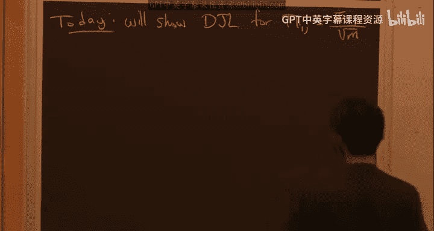

And it's a theorem。Due to Hanen and Wright。Which will approve。1971， which says the following。

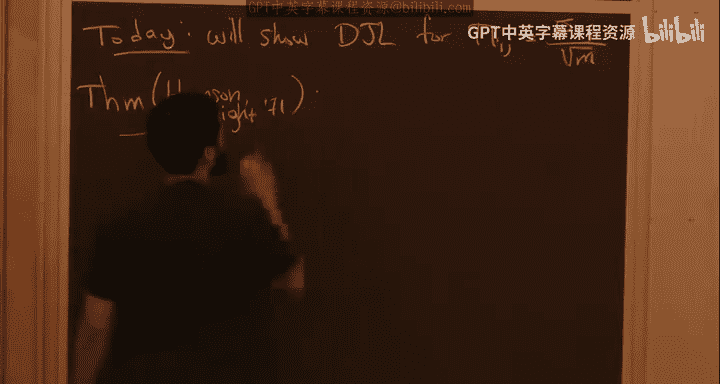

来。A。Be a matrix， which is real and symmetric。Okay。And。Sigma 1 up to Sigma n。Our。Independent。

Roommaers， Raammaer just means plus minus-1。Then。For all lambda bigger than zero。

The probability over sigma。That。嗯。Sigma transpose a sigma minus the expectation of sigma transpose a sigma。

Is bigger than lambmbda。Is that most？E to the minus some constant lambda squared over the Frbeius norm a squared。

Plus， e to the minus some constant over the operator number of a。Right so remember。

Forenience the norm of a matrix。Is the sum of overall entries？

Basically treat the matrix as a vector and take its L2 norm， that's for norm。And the operator norm。

Well， for a real symmetric matrix。It's the soup overall x of unit norm。Now x transpose AX。

So also the matrices A we're going to look at。Are， oh。Right， so actually the law， So this。

 this this means for semestersymmetric matrix resistance means。

The absolute value of the largest eigenvalue。 What's the。

 what's the largest magnitude of an eigenvalue。That that's what the operator arm means。

So questions about the theorem statement。Okay， so just。Just so we're on the same page。

 now that you're tail bound experts。If Hanson Wright is assuming that Hanen Wright is true。

call this random variable here Z。What's the P norm， Give me a bound on the P norm of Z。If I ask you。

 give me a anymore more of Z， what is it？This is， I guess， PSet one problem one。

Do you all remember this， something that looks like this， at least？

RightSo you have e to the minus lambda squared over variance plus e to the minus lambda is the lambda here。

Over some other parameter， right， So this is a mixed Gaussian and exponential tail。

 which means every P norm is bounded by。For beous norm times root P。Plus。

 operating norm times P up to a constant。Okay， so this is this statement is also a bound on all the pen organs。

Okay， so we're going to prove Hansson right today。But before we prove Hanson write。

I want to show you that DJL basically follows immediately from Hanson Wright。So proof of DJL。

So what do we want We want。We want that thing， right， We want to show that。Well。

 let's look at this thing。 So pi X。Elson norm squared。That's the thing that we want to understand。嗯。

嗯。This is equal to。Some。Say R goes from， So there's a1 over M。Right。

 because k J is a random sign of a rooteb。1 over Ms sum a goes from 1 to M。And then。Some。

I goes from one to。N of Sigma， R I， X， I。Squared。Right， is this is the RFF entry of px。

So the alt two norm squared well over root M。 So the alt norm。啊。Yeah。

 this is the IF entry over of pi， the r entry of pi X。Over Ro Adam。When we square it。

 we get a1 over M， and then we sum over all injuries。So。If you expand this。This is equal to。1 over M。

 some over R from1 to M。Some over IJ。嗯。X I， well let me bring the one over M here and just make it a little clear。

X， I， X J。Over M。Sigma R， Sigma RJ。Okay。So。One way to view this。

I is is as a quadratic form where x is the vector， namely this is x transpose。Pi transpose pi X。

Right。But another way to view this is as a quadratic form where sigma is the vector。Right。

 so this is， this is equal to sigma transpose some matrix sigma。Where by sigma。I just mean。

An MN dimensional vector。That has。Sigma 1，1 up to Sigma 1 n， Sigma 21 up to Sigma 2 n。Et cetera。

So what's that matrix that goes in there， In fact， you can verify this yourself。

Pi X L 2 norm squared is nothing other than。What I'll callX， a sub x sigma Lton norm squared。

Which is a sigma transpose Ax transpose Ax。Sigma。Where AX。

Something looks something like one over root M。Times。なんです。Huge vector。

 that looks huge matrix looks like this。 This has。And then columns。And it has M rows。

And here we write down x transpose。And then this is the first row。And then the next row。

 we write down X。And here。A you right down next。Right， so。Plus minus-1， random time。

Rmaer means random size。So if you look at AX Sigma as a vector。

What does Ax Sigma have as as its entry， The first entry is x dotted with the rent with with the first row of pi。

The next entry is x dotted with the second row of pi。X， et cetera， right， So this is exactly。

This squared and this squared are exactly the same thing。In fact， I guess。For about the squ。

 For about the norms。 I think these are just the same vector。Okay。

 pi x is the same vector as a X sigma。Right。Does that make sense。So。Hanson Wright just tells us。

Right。And notice Husonry just tells us the probability。Over pi that。Pi X。Squared。

Minus the expectation of pi x squared。Which in this case is just one， right。

 The probability this is bigger than epsilon。Well， that's just equal to the probability over sigma。

Of。Sigma transpose AX transpose AX sigma。Min is the expectation of that thing。Right， so。

This is our matrix。This is Hanen Wright。With a being。Yeah。Right，Does that make sense？You know这。

Like you're curious about something。Here。So all I'm saying。

 I guess what I'm really saying is notice that。Pi x is actually the same thing as a x sigma。Yeah， so。

We're looking at what's the problem that Piek squared deviationiates tremendous its expectation。

But that's exactly。 But Pi squared is the same thing as this as A X Sigma squared。

So these are this are actually exactly the same quantity。 So we're just asking。

 what's the problem that this debates from its expectation。But。We're here。This， this yeah， exactly。

 this is A X trans A X。So I guess all I was saying here was if you expand this out。

 this is a quadratic form。This is viewing it as a quadratic form where x is the vector， but really。

 you can view it as a quadratic form where sigma is the vector。 And then the question is。

 what's the matrix of that quadratic form and the matrix is exactly x transpose a X。

So now we just do Hanson right。Right。Ax transpose Ax。It's a block diagonal matrix。

 It looks something like this， Y over M times。Xx transpose。X X transpose。Xx transfer。

That's what x trans was x。So let's bound these frombeous and operator norms。The Frenius norm。

 let's just call this matrix， know， a， the Frminous norm of a squared。Right， so remember。

The IJ entry of Xx transpose is just X Xj。

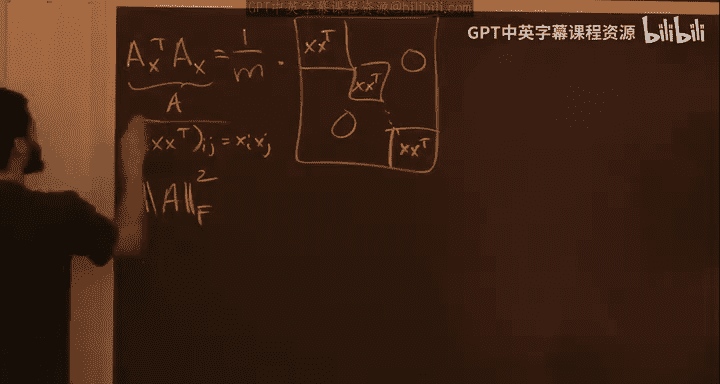

So the Frminior squared。Well， it's the sum of the squares。

 the previous room squared is the sum of the squares of all the entries。

 So we have a1 over M that gets squared。And then we can just sum up the squares of all the entries of these separately。

 But each one， they're all the same。 So they're M of them。 So times M。

Times the Frvei norm squared of Xx transpose。That's equal to 1 over M。Times a sum over IJ of X。

ESquad x J squared。Which is equal to1 over m times a sum of X squared。Squared， but that's just one。

 so this is equal to 1 over n。 so the Perme room squared is exactly one of。So now the operator norm。

Whenever you have a block diagonal matrix， this is some linear algebra。

All the eigenvalues are just the eigenvalues of each block。Right， so。The largest。

The largest eigenvalue。Is just the largest second value on any block。

 but all the blocks are the same。So， this is equal to。

1 over m times the largest eigenvalue of Xx transport。X X transpose is， you know。

 I can tell you what eigenvalues are。 It's a rank 1 matrix。Right。X X transpose has。

One eigenvector with a nonze eigenvalue， which is the vector x。

And then then all the rest of the eigenvectors have eigenvalue 0。Right， so。嗯。This is， so。是吧。

You know Xx transpose。Times it's eigenvector X is equal to。X squared times x。

So the the nonze eigenvalue is one。RightSo this here is one， this is equal to1 over around。对。

We're okay， so I mean， this is， you， nothing too crazy going on here。

 So this implies all now by Hanson right。

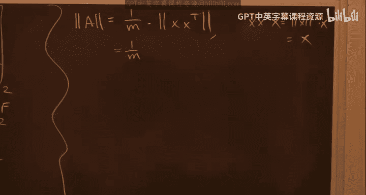

That the probability。That。Pi X。L2 norm squared -1 is bigger than epsilon is at most e to the minus some constant lambda squared over M plus e to the minus some constant lambda over。

So set。to be bigger than something like。嗯。Xi。Times the max。Oh， no， there's no lambda。

 there's epsilon。要。So。M has to be at least one of Epsilon squared log1 over delta。

 and also has to be at least one of Epsilon log1 over deelta。

And then both of these things will just give you E to the minus log whenever delta。

 E to the minus log number delta is delta。Sorry。Im on the numerator， oh yeah， yeah， sorry sorry。

 good point。Now it makes more sense。So that's it。Prety simple。Of course， the。All the work really。

 is improving。Hansonright， right， I just assumed Hansonright。So any questions about anything？

Otherwise， we're going to improvements hands， right？Okay， so。Before I approve Hanson right。

 I want to make sure we have some。Things。Subtled。Okay， so。Remember， definition。This was on your PSet。

 but so this would look very familiar to you。If you have a random variable， x。The LP norm of x。

The expectation of ex。自动握那个屁。But I know you've seen this before。嗯。TheTheorem。This is Mowski。

This thing actually is a norm。Okay， so in other words。You know。Basically。

 what I want to be able to use are things like triangle inequality and and。 So I would say so。

X plus y。LP norm is at most XLP norm。Was wild you。Let me put actually constants here。

 so if you have scalrs。AX plus B，Y。It's atmost Ax plus byY。嗯。I also want to use。

I'm not going to prove it， but I'll just assert it， there's something called Ysen's inequality。

Which says that。嗯。Is a convex function。Implies。That。F。Of the expectation of x。

Is at most the expectation？I guess。So we're going to use this a bit。Okay， and。Claim。

And I should say is a norm for P。At least one。Claim。1 less than equal to P less than Q。

 less than infinity。Implies that the por。Is that most acute arm？

I'll leave this to you as an exercise。 This follows from Ys's inequality。

You basically you define F of x to be the absolute value of x raised to the Q over P。

And then apply en。And。Also。A definitionition。So this this is standard normal distribution。ThePDF。

The PDF of this thing is。Its one over a square root of2 pi。E to the minus。Expert over two。嗯。嗯。嗯。

And the last thing I'm going to write down on this fact board before I actually start doing real stuff。

Is。So you can find this calculation pretty much anywhere on the internet。

If you have G is a standard normal random variable。That implies that。The expectation of G to the P。

Is equal to。0， if P is odd。Otherwise， it's equal to p minus1 times p minus3 times all the way down to1。

 which is at most square root P to the P。F p is院。This is that most squared P of the P because。

Each of these， each of these numbers is B P， and there are。Facts strictly less than。

 And there are less than at most fewer two of them， right。So there are P over。So in other words。

 the p norm of a Gaussian is at most root P。Which makes sense because， I mean。

 this is related to P at 1， problem 1。RightSo as I said， if you look at this。

 this is just Gaussian decay with a particular variance。 So the P norm is root P。

 just like a Gaussian， root P times the standard deviation。Okay， good。Now let's prove Hanson right。嗯。

So。Hansonright。嗯。Ingredients。I'll list them here and then I'll tell you what they mean one by one and then improve them。

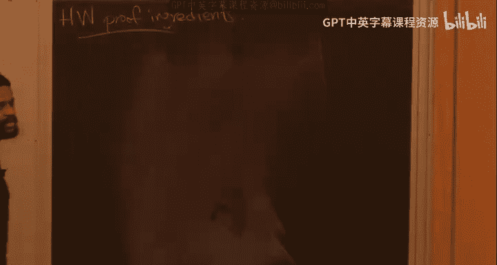

So， one。Is called kinch's inequality。Two is something called decoupling。

And three is something like Ruddleson Square root trip。So if you remember lecture one。I mean。

 maybe it was long time ago， and it looked scary then。

 but it's gonna look less scary because you're gonna see it again and again。 Okay。

 so this is gonna enter your。Toolkit， excuse me at your fingertips。

So remember when we proved Bernstein's inequality？In lecture1。

 we bounded a penor in terms of its own square root。So we're going to do something like that here。

 okay， but before we get there we need to prove some other things。He， so。So lamma kinchs。

 let's put kinchin first。Wheres he from， like where did you grow up？Kinch， oh， it's his name。

I don't know if he's Russian or if I'm making that up。 Yeah， I'm actually。

 I don't know much about his life。I don't know anything。Actually， gonna。

 I'm only going to write down one side of Kinchin。 Kinchin is actually a two sided inequality， but。

What Kinchen says is。For all X and Rn。And for all P bigger than equal to1。If you look at the por。呃呃。

Some。Sigma I Xi。This thing is at most up to a constant rootee。Times the number of x。This L。

The other side of Kinchin is that not only is it at most P times0 X。

 it's also at least some other thing， so there's also a lower bound。

 which we're not going to care about that。So， right， what does this tell you？Going remember。

 because of P at1， now， you know， if you， if you prove bounds on porms， you also get tail bounds。

So it says that for all lambda， the probability that this sum is bigger than lambda in absolute value。

Is at most e to the minus lambda squared over the squared number of x？

RightBecause this kind of tail bound and this kind of moment bound and that kind of tail bound are equivalent。

IP at one problem one。So let's just prove Kin。First of all。

 I claim that it suffices to only prove this inequality。For even integer P。

So we're going just prove it for even integer P。But why does that suffice。And。Use that claim， right？

If P is less than  Q， then the LP norm is the L Q norm。Okay。So， let me just spoil it， so。

Suppose there was suppose you wanted to bound some LP norm of this thingingy where P is bigger than1。

 P is at least one， but P maybe is not an even integer。Just round it up to the closest queue。

 which is an even inr。That'll at most double P。😡，There's always an even injury nearby。

So then what you'll get is oh this is P norm， by the way。So then what you'll get is。

The P norm is at most the Q norm， where Q is this even integer。

 which is at most root Q times the L2 norm。But Q and P are are different most a factor of two。

So basically that's the same thing as root P times down to。 So okay。

 so we can just prove this thing for even integers and it implies it for all P at the loss of a constant factor。

So。Let's look at this thing。So the LP norm。Is。To the P， anyway。

Is equal to the expectation of sum of sigma I Xi to the P。Okay。

So you can expand this thing out to the P。And you'll get like a sum。a bunch of a bunch of。Indices。

 you know， I 1 up to I P。嗯。The product of the Xi Js where J goes from1 to P。

Times the expectation of the product of the Sigma I Js where J goes from one to。

I just expanded out this power to the peak。The reason I wanted P to be an even integer。

Is technically， technically the definition of p norm。Would make me put an absolute value here， right？

That's the definition of P norm。 The P norm is expectation of the absolute value of x to the P one of P。

But if P is an even integer。Then raising something to the raising the absolute value of the piece of power is the same as raising itself to the piece of power。

So that's why I wanted P to be and even an injured。So without loss of generality。

P is an even integer。But now look at this thing。Some of these sigma I Js are the same。

 Sigma I1 might happen to equal Sigma I 7。Some of these sigmas are the same。 So really。

 if you look at the distinct indices that appear here。

 you'll have sigma of some index to some power times a sigma of another index to some power。

 sigma of another index some power。谁。You see what I mean， this thing really。

 you can really view this thing as the expectation of， you know， Sigma R1 to the D1。

Sigma R2 to the D2。Where I just grouped together sigmas that had the same index。

What is the expectation of this thing？What is the expectation of this product of powers of S？

Sigma is a random sign， right， Sigma I is a random sign。It's either one or0， right？

Whenever whenever D is even。A random sign to an even power is just one。First of all。

 these are independent。 So I should have said these are independent rotmaers。

 So this thing is equal to the product。Of the expectation by independence。

 is equal to the product of the expectation of sigma R J to the DJ。Right。Now。

If DJ is even negative  one to an even powers 1， that gives you a1。If DJ is odd。You get a zero。Right。

So if any of the DJs is odd， you get a zero。Otherwise， if they're all even， you get a one。

So this expectation is a sum of product and XIJs。Either times either1 or0。Meanwhile。

Let's look at a Gaussian， Some of G I。Xi。P制皮。Right。Again， you can take this and raise it to the P。

 and you get a similar thing。You get that this thing is equal to a sum of product and X I Js。

Times a product。Of expectation， G， RJ to the DJ。You basically the syns become Gs， right？

What happens if any of these DJs is odd？You get zero again， a gous into an odd power。In Washington。

 odd power has expectation zero。What happens if you raise it to an even power？You get something。

But that something is always at least as big as one。Right。So。Notice， basically。For。

 for a monoommial to survive。In both cases， all the powers have to be even。

If all the powers are even。That all the distinct xenddices are getting raised to even powers。

 which means all of these guys are non， which means that all of these guys are non negative。

So you're summing a bunch of things that look like a non negative number times 1。

Here you' are sum a bunch of things which look like a non negative number times something which is at least one。

Because in the Gaussian case， if you raise it to larger powers， you get even larger numbers than one。

Maybe get this thing。So what that tells you is that。

This case is actually strictly less than or equal to the Gaussian case。喂。

But Gaussians have this magic property that if you sum up。Independent Gaussians。

You get back a Gaussian。Whose variance is the sum of the squares of the coefficients。

So this sum here is just a Gausian。Whose variance is the L2 norm squared of x。

But we know what the pome of a Gaussian is。The pen of a Gaussian is root P to the P。

So because you're scaling it by the L2 norm of x， repeat of the p times the L2 norm to the P。Okay。

 so that's it。 That's the end。Questions。So。Basically。

 you can prove attention just by saying this thing is dominated by the Gausian case。O。确定的。

So now we need to prove the next thing， which is decoupling。

So the problem with kinchin is kinchin bounds p norms of linear forms， right， Sigma dot a vector。

Hanson W right is a quadratic form。 Sigma transpose a sigma。

So we want to be able to reduce the quadratic form case to the linear form case。

And that's what decoupling is going to do for us。Yeah， question。Equality。You mean this？

It's an inequality because。Just look at this， do a comparison term monoomial by monoomial。

The monomials that survive here， you have some non negative number times 1。No， no。

 this is just I don't need anything here。 This is， this is less than equal to that。Right。

 I'm just comparing， I'm just expanding this out monoomial by monoomial。

 And I'm expanding this out monoomial by monoial。 And I'm saying。

The monoials that have odd powers are zero for both of them。The mononoials that have even powers。😡。

Here you get some number times 1。Here you get that same number。😡。

That same non negative number times something which is at least one。You have even powers。

 So some of these powers might be four。The expectation of a Gausian to the fourth power is three。

 which is even bigger than one。RightSo the Gausian even powers。

 the Gaussian even moments are always at least one。 They can even be bigger。So term by term。

 this thing dominates this thing。And then， we just say。Here。

 this is just a sum of independent Gausians。😡，sum of independent Gaussians is a Gaussian。Right。

 it's a Gaussian whose variance is the sum of the squared coefficients or the sum of the variances of the individual Gaussians。

But we， so， so then this thing is just a Gaussian， but we know what the p norm of a Gausian is or the pe moment of a Gausian is。

 The beat lo of the Gaussian is that。It's I most repeat the P。So therefore。

 the pumome of this thing is at most， the peak moment of this thing is at most repeated the p。

Does that make sense。So。So good， we took care of Kin， let's do decoupling。And I think。Well。

 there's a book on decoupling。Della Bega。I'll fix it in the lecture notes。

If I spell these names wrong。So what this says is。Let's say that。A being。AIJ。

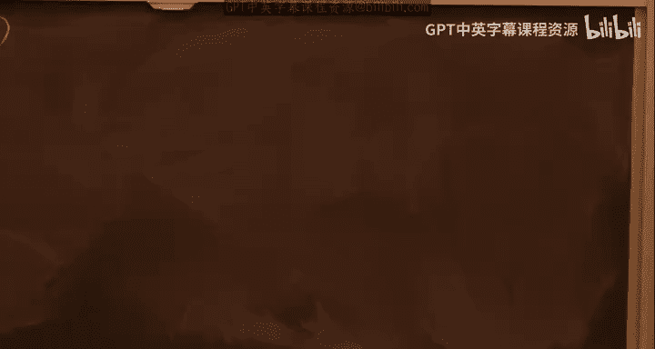

Is an n by N matrix。Real matrix。And then。Sigma 1 up to Sigma n and Sigma 1 prime up to Sigma n prime。

Are independent Raammaers。Plus， minus-1s。Then it says for all p bigger not equal to 1。If you look at。

The sum of I not equal to J。AI J Sigma i Sigma J。So this is just sigma transpose a sigma， right。

Because I have I not equal to J。 I deleted the diagonals。

 but the diagonals are exactly the expectation。 So it says that if you look at the p norm of this random variable。

RightThis is exactly the pen norm like this is exactly what we care about enhance and write。

 the pen norm of this， right。The penor of this random variable is at most four times the penor of this random variable。

So this thing right here。IsSigma transpose a sigma prime。诶。That's decoupling。Right， so you can。

 you can view this as。嗯。Some of。To put it in that notation， some of her I have sigma I。

A sigma prime I， right， That's exactly what we handled with kinchin。Right kinchin。

 kinchin says if you give me a linear form， I can bound its p norms。If you condition on Sigma prime。

RightSigma prime is some random sign vector independent of Sigma。 Once you condition on Sigma prime。

 as sigma prime is just some vector。So this is exactly a linear form in the kinchin style。

 So you can apply kinin to this thing。 So that when we， that's how we're gonna prove Hanson right。

 That's why we're doing decoupling。Right，Because this lets us reduce the attentionin。Of course。

 in Kinchen。This is Kin right here。This is Kch。We're going to end up with。

The norm of ascigma prime on the right hand side。But ayn the prime is a random vector。

 So that norm is a random variable itself。 So then we're gonna to have to bound it。

And then we're gonna end up using the square root trick to do that。

 So we're gonna to see soon how to complete the proof， but。For now， let's prove decoupling。

So any questions about the statement of decoupling。Does it make sense？喝水。So let's prove this。

In the proof。We're going to do the following。Eta 1 up to Eta n。Be independent。Bulli。

One half random variable。By that， I mean， it's a qua flip。

 A to I is one with probability a half and0 with probability a half。This implies that。

Sum I not equal to J， AI J sigma i sigma J。Is equal to four times。The expectation over Eda。

Some of are I not equal to J。AI J。Sigma I， Sigma J。Data I。Eta 1 minus。1 minus a J。可。Right， because。

Expectation， since I is not equal to J。These two randoms are independent。

 So the expectation of their product is just the product of their expectations。

 But what's the expectation of a to I， It's a half。What's the expectation of 1 minus ata J。

 it's also a half。So the expectation of their product is a quarter。But I multiplied by four。

 So all I did was I multiplied by one。And then now what I do is I apply En's inequality。

Which says that if I have F of a convex function， remember。

 the P norm is the expectation of the P of the absolute value to the P。 if I expect if I have。

F if I have a convex function of an expectation， that's at most expectation of a convex function。

Which lets me take this expectation and pull it outside。Okay， so。

Just so that things don't get confusing。 Let me write this as by P norm， I really mean LP of sigma。

What do I mean by that in the definition of P norm。It's an expectation， but expectation over what。

So I'm just being explicit about that。 I'm saying I'm taking， I'm taking that expectation over Sigma。

So I'm taking penor with respect to sigma。Okay， so LP Sigma just means I'm taking p norm with respect to sigma。

So this thing is p norm with respect to sigma。And what I'm saying is this expectation over 8 I can be brought outside。

 so。By Yanen。That thing is at most。4。Times sum over I not equal to J。AI J， Sigma I， sigma J。

 ata I 1 minus ata J。LP。Sigma and Eda。Now， the randomness is overbo。Okay。So now， what do I say。

So we're going to use an averaging argument。What's an LP norm， An LP norm is just some average。

 right， It's some expectation。So。There has to be an Eta。 There has to be a fixed vector。 Eta。

 Eta is a 0，1 vector， right， It's a random 0，1 vector。

Where each entry is one with probably and a half and0 with probably a half。

And what this number is is。The expectation over Eda。😡，I can write this as。Expectation over Ada。

On the expectation over sigma of something to the P。To the want to repeat。So this number。

 there's a four here。This number is the expectation over eda of something。😡。

RightIt the average over  Eta of something so。There must be a fixed vector eta prime。

 a fixed 01 vector eta prime， which is at least as much as the expectation。😡，Right。

So this thing is at most four times。The P norm。Of sum， I not equal to J。AI J， Sigma I sigma J。

 Eta prime I， Eta prime or 1 minus Eta prime J。LP Sigma。Now the random is only over sigma。

For some fixed。Eta prime in 01 to the end。哎。So this thing is equal to now。Four times。S of I and S。

Some of J not in S。AI J。Sigma I， Sigma J。LP。A的。Where。S is the set of indices I。

Such that aW prime I is equal to1。

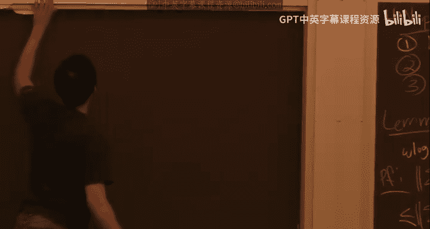

But now notice in this random variable。😡，If I just replace。So for the J is not an S。

If I just replace Sigma J with Sigma J prime。Then I get exactly the same distribution。Right。

 so this thing is equal to。Four times。Some IN。S J not an S。Of AIJ。Sigma I， Sigma prime。J。

So this is LP。Over。Sigma S and Sigma prime S bar。Okay。So， these。These two random。

 these two random variables， this random variable and that random variable。

Have exactly the same distribution。So their p are the same。And now we're basically done。

So there's one more step。Questions。Yeah， so， so that was the first thing I said， which was。

Just proving it for P an even integer is without loss of generality。

 because if our number is not even， if it's not an even integer。

Then take P and round it up to Q such that Q is the closest even integer。

Then the P norm is bounded by the Q norm by this claim。Now apply tension to the Qn norm。

Now the Qs't even inju， right， so now apply this to the Q norm。Ma a factor of two。第二么。Oh， sorry。

 So this twiddle twiddle， for me， means it it ignores constant factors。Less than Twitter。

 than Twitterwi for me means bigger。Okay， so now we're basically done because what I can say is。

 look。This is equal to four times。 Let me write the expectation over。

Sigma S bar as well as Sigma prime S。Of some over all I J。AI J， Sigma I， Sigma J prime。LP。Sigma S。

 Sigma prime S bar。Right， I just added in a bunch of。

 I basically just added in the terms that we're missing。Which terms are missing。

 The terms that are missing are where。Ba there are four cases。I could either be in S or not an S。

 J could either be in S or not in S。 This sum only contains one of those four cases where I's and S and J is not in S。

 I added back all the cases。Okay。But， the other cases that I added back。I added their expectations。

 but their expectations are zero。 This is a prime here， right。

Because if I added in something that wasn't there before。😡。

Let's say I added it in a case where I was in S， but J was also in S。

Then I have AI J Sigma I Sigma J prime。But J is an S。So， J。

So the expectation over J and S of sigma prime J is 0。 So all I did really， is I added 0。

This is a fancy way of adding 0。On the inside of the norm。But then what am I going to do next？

There's one more line left and then we're really done。

What I really want is to have this P norm over sigma and Sigma prime。For one word answer。

 it's a trick we just did。It's Yenssen， right， It's the trick。

 It's this trick pulling the expectation outside via Ysen。 So we're just going take this out。

Pull it out there via Yenssen。And this thing is at most four times。Some over IJ。AI J， Sigma I。

 Sigma J prime。LP。Sigma Sigma product。那是。这的的行了。Oh， how did I go from here to here？Because， I mean。

 the reason is they're exactly the same distribution， right， so。So what's going on。

 there's this vector sigma， right？Here is， this is S。And this is the complement of us。Right。

And what I'm doing is I'm writing， I have this quadratic form where I keep multiplying entries from here with entries of here。

😡，SomeSome of her I here and J here of AIJ， this number times that number， right？So this is Sigma S。

And this is sigma。Sbar。And now what I'm saying is， what if I just replace。Let's take Sigma prime now。

 this is Sigma prime。This sigma prime S， sigma prime S bar。喂。And I look at some of her I J。

 where I is and S and J is not an S of AI J， Sigma I Sigma J。If I just took these guys。

And just like swap them。Then I mean， this is a random sign vector。

 This chunk here is a random signine vector， a bunch of random signs。

 independent of these random signs。So if I just replace these by another set of random signs。😡。

It's exactly the same distribution。I can just replace all of these with another set of random signs。

 and it's the same thing。So these two random variables are equal in distribution。Yeah。Yeah。对。Yeah。Oh。

 I pulled it， I mean。I guess I was， maybe I'll， maybe it's better to just。

Go through it with the definition offline。 So basically， pen norm is that， right。

So if you look at the function， F of x。Where F of x is equal to absolute value of x to the P and P is at least one。

 that is a con x function。So I was actually applying Ysen to that convex function。So what I had was。

The absolute value to the P。 And on the inside， I had the expectation over Eda。

And then what I was doing was I was pulling out the expectation of Eda outside。

And when I pull the expectation over Eda outside。I ended up with this。Right。

 the second line over there， which is， which is the p norm over Eda。So， yeah， I mean。Yeah。

 I guess it's。一。Maybe work through it with that definition。

 and you'll see exactly why this was just Yssen。Ada is。A bunch of independent Bernoulli one have。

Yeah， so a to I is 1 with probably a half， 0 with probably a half。Okay。

 so that's the end of decoupling。So now we can prove Hanson Wright。And of course。

 when I initially stated Hanson right。I stated in terms of a tail bound， but as you know from P at1。

 it's the same as a bound on all the p norms。So， Hanson Wright restated。We want。

That for all p' integral to 1。The p norm of sigma transpose as sigma minus the expectation of sigma transpose a sigma。

Is that most。Root P times the formminous norm。Plus p times the operator。That's what we want to show。

That's the same thing as that。So let's prove it。So we know that。

Sigma transpose a sigma minus the expectation of sigma transpose a sigma。

P norm is at most- this twiddle hides constants， in particular right now I'm going to hide the constant  four。

This is that most。Sigma transpose a sigma prime。Where this is now。

V LP norm over both Sigma and Sigma pride。Okay。And then what I'm going to do is。

I'm going to apply kin。By kin， this is decoupling。By k， this thing is at most。

The alt2 norm of asigma prime。Por。谁。And。This is kin。And in general。嗯。Right。

 and this thing is at most。You're read like this。A Sigma prime。L2 norm squared。Well， actually。

 it's equal to。This thing is equal to。So， let's。呃。So。We'll show。Or P bigger than equal to2。Again。

 is why does it suffice to show it from p bemin equal to two？Because any norm。

 which is between one and2， we can just bound it by the two norm。喂。

Which changes P by most a constant factor for those small P。So this is。

 if you just look at the definition of p norm， this is actually equal to。

Look at as sigma prime L2 norm squared， look at the P over 2 norm to the1 half power。

This is just by definition of p norm。 So if you， if you just like expand this out to its definition and expand this out to its definition。

 you'll see that they're exactly the same thing。Now。I can replace P over2 norm by P norm。

 because if you increase A P norm is less than a Q norm if， A P is less than Q。So this is at most。

A sigma prime L new norm squared。P norm to the one half。Question。This。This。

So that was what we just proved， right， that's decoupling。This。

 this right here is sigma transpose a sigma minus the expectation。

 That sigma transpose a sigma prime。So that I just， I just。Did deco。That's the definition of p norm。

 right， The P norm。Well， what， what do you mean by that， right， so。That that is decoupling。

So the P norm， the definition of P norm has the expectation in it。And then now I use now I basically。

 I'll subtract the expectation and add it back。And use's trinal inequality。This is at most。

The expectation。Of a Sigma prime。L2 arm squared。Plus。A sig prime L2 norm squared。

Minus the expectation。えすよ。Right， so I just， I just added in the expectation and subtracted it out and did triangle inequality。

And now， this thing is at most。And。Oh， I've been losing rootees everywhere。 When you apply Kinin。

 there's a rootee， right， So there's a rootee here。 There's a rootee here。Kinchin says that。

That linear form is that most root P times the L2 norm， so there's root P。

So this thing now is at most。Root P times。Expectation of that thing need。Plus， P times。呃。

And this is just because in general， the square root of x plus y is at most。Rode x plus root y。对。Now。

 what is this？😡，Well， I'll just tell you， you can calculate it out。But I'll tell you。

This thing just happens to be the Frbenius norm square rootta a。

So that's a calculation you can do if you want。It's not too hard to show though。

So this is equal to root P times the Permeous norm。That looks like progress to me， right？

That's the first term that we wanted。 That's this。 right， So this is recruiting answer right here。

We wanted this root P timess read norm， but we also want P1's operator norm。Plus。Root P times。

Sigma transpose。A transpose a sigma。Minus the expectation of sigma transpose。A trans was a sigma。

Right，I just replace Sigma prime with Sigma， but it doesn't matter because Sigmas a random signine vector。

 Sigma primes randomom sign vector。 They give you the same norm。So。

What do you think we want to do to that？The couple。Okay， so we'll decouple that。

We'll decouple this thingingy。Okay。And then we'll apply Kinching again。

 so this thing is at most root P times the Frenous norm。Plus。

This will give us root P times the al norm of some vector。But that root p is to the1 half。

 so it actually is P to the quarter。😡，So P of the quarter plus root is P to the three quarters。

 So P to the three quarters。Times。Here we have a transpose a。Sigma， L2 norm。P to the one half。Well。

 actually， yeah， Peter。But notice that。A transpose in general， right， in general。

Now let me just write it down。This thing's at most。Rup P times。你吗？

Plus p to the three quarters times the operator norm of a to the 12。Times。A sigma L2 norm。

 P to the12。系。This is just because。You know， Mx。Is at most the operator of M？Times the number of x。

This is basically the definition of operating on。So， if I'm。Yeah， so I think we are done。

Why are we done？We're done because of the following reason。Call this number。Thiss visible。

This number here。Call it B。Okay。What have we shown？Well， that's E。What is this number？

That is e squared。So what have we shown？We've shown that。Rpe。Times e squared。

Is less than twiddle that loses constant factors。Root P plot times for media norm。

Plus p to the three quarters times operator norm to the 1/2 times E。

So less than twiddle just means less than times a constant factor。Right， so。

Putting that constant factor back， where did my nice track go？Yes， I've。Useed it up a lot。

 So this implies。That。嗯。I can I can divide root P everywhere， right， so I can divide root P。

Dvied thisrupee。Here I get Peter the quarter。And what I get is that e squared。Minus some constant。

Times p to the quarter， times up no to the one half。Times E。

Minus some constant times the Frbeous norm。Its less than equal to 0。Right，That's what I get。

This is a quadratic in E。😡，Who'se leading coefficient is non negative， right？ So this quadratic。

Goes from infinity down back to infinity。And we're saying that it's less than equal to0。So。

 it means that。We're at a point in this quadratic。That's smaller than the larger root。

So you just solve the quadratic equation， and then you're basically done， right。

We'll do that and then we'll finish。So this is the square root trick in action。So。This implies that。

E is that most。The larger route。Of the C equation。And then we know that。

Sigma transpose a sigma minus expectation of sigma transpose a sigma。Was at most E squared？

Was was that most root P times？呃。Yeah， was that most？Repe。Times e squared。

 and that will conclude everything。That's what we showed here。 We showed that sigma trans say Sigma。

 blah，h is at most root P times Z squared。So now just solve， I mean， now that's it， right。

 so just solve it。I can do it。 I guess we have two minutes。 I might as well。

 but it's nothing complicated at this point。 You just solve this quadratic equation。

 which implies that E is at most。呃。CP to the quarter。Times the operator under the half。Plus。

The square root。Of。C squared P operator norm。Plus，4 C。For beis in room。Over to。Right。

 and this thing is at most。Well here we have something， so like this thing here。

 the square root of a squared plus b squared。😡，Is that most？Well。

 a squared plus B squared is at most twice the max of a squared， the max of a squared and B squared。

 right。So basically， this thing here up to Constance is dominated by the max of the skirt of that and the skirt of that。

So this thing is up to a constant， it's at most。P a quarter times Romanenous norm。

Or times operating house。Plus the square root。Of the forgetian storm。

Which implies that root p times e squared。Is that most？哦。Rup P times the Frminous norm。Plus。

 p to the quarter squared is root p times another root p is p times the upward。对。

So that's the proof of answer right。So we're done。Questions。

